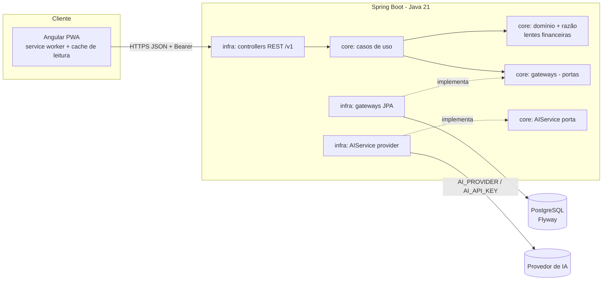
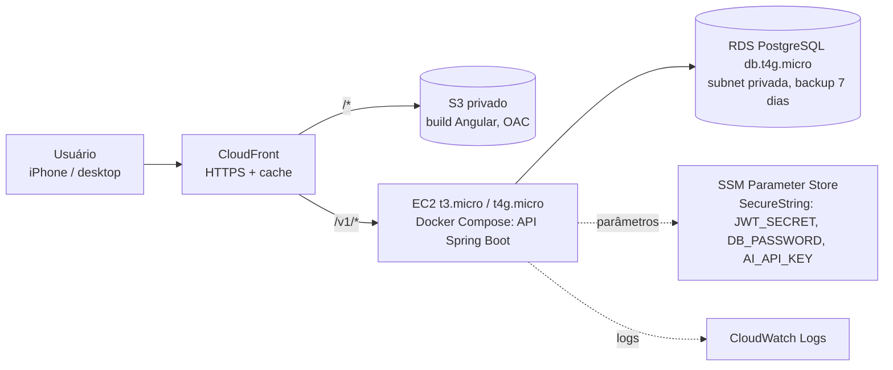

# Arquitetura: moneylog

## 1. Visão geral



Princípios (ADR-001, índice do vault):

- **O backend é a única fonte de cálculo.** Saldos, limites, totais de fatura, consumo por competência, patrimônio, compromissos e projeções são calculados no `core` e entregues prontos pela API. O front formata e exibe, sem somar nem subtrair valores financeiros.
- `core` não depende de framework. `infra` conhece o `core`; o contrário é proibido e verificado por **ArchUnit** (back) e **dependency-cruiser** (front).
- Organização por feature. **Identificadores de código em inglês** (as entidades do PR 01 já estão em inglês: `Account`, `CreditCard`, `Debt`...). Documentação e textos de produto em português (**[S-27]**).

## 2. Repositório

```
moneylog/
├── backend/                 Maven, Spring Boot, Java 21
├── frontend/                Angular standalone + @angular/pwa
├── docs/{adrs,arquitetura,planos,qa,revisoes}/
├── (backend/docker-compose.yml: Postgres local, pinado, com healthcheck)
├── (backend/.env.example: todas as variáveis, sem valores reais)
└── .gitignore               inclui .env, target/, node_modules/, dist/
```

## 3. Backend

### 3.1 Stack

- Java 21 (`JAVA_HOME` do `CLAUDE.md`), Maven com wrapper (`mvnw`), **Spring Boot 4.1.x** (4.1.1 no bootstrap; suporte OSS até 2027-07-31), conferido em 2026-10-03 e registrado na **ADR-004** (**[S-28]**, revisada: a 3.5.x saiu do suporte OSS em 2026-06-30). springdoc 3.1.x (documentação viva gerada do código, só no perfil `dev`; o contrato versionado é `backend/contracts/openapi.yaml`, T21).
- PostgreSQL **17** (local via compose, Testcontainers com a mesma imagem, RDS suporta 17). Flyway. `spring.jpa.hibernate.ddl-auto=validate`.
- Testes: JUnit 5, AssertJ, Mockito, ArchUnit, Testcontainers. `*Test` no surefire (`mvn test`), `*IT` no failsafe (`mvn verify`, tag `i`). JaCoCo com `jacoco:check` mínimo de **90% de linhas no pacote `core`** (**[S-29]**).
- Sem Lombok no `core`: records e construtores explícitos do Java 21 (evita os "construtores duplos" citados em BE 02).

### 3.2 Pacotes (Clean Architecture por feature, BE 01)

```
com.moneylog
├── MoneylogApplication.java
├── core/                                  # sem Spring, JPA, Jackson ou Lombok
│   ├── sk/                                # shared kernel
│   │   ├── money/        Money, CurrencyCode
│   │   ├── time/         Competence, DayOfMonthRule, TimeProvider (porta do relógio)
│   │   ├── ledger/       Posting, BookRef, BookType (T2); PostingSource, LedgerEntry (T4)
│   │   ├── exception/    DomainException, NotFoundException, BusinessRuleException, ConflictException
│   │   └── page/         Slice<T>, PageQuery
│   ├── account/          domain/ exception/ app/{gateways,usecase/command}/
│   ├── category/
│   ├── transaction/      domain/{Transaction, TransactionType, PaymentMethod, TransactionStatus, ...}
│   ├── card/             domain/{CreditCard, CreditCardInvoice, InvoiceStatus (derivado), InvoiceCalendar,
│   │                             InstallmentPlan, TransactionInstallment, InstallmentStatus,
│   │                             AvailableLimitCalculator, CardVoidRules}
│   ├── debt/             domain/{Person, Debt, DebtDirection, DebtStatus (derivado), DebtVoidRules}
│   ├── recurrence/       domain/{RecurringTransaction, Frequency, Occurrence}
│   ├── importing/        domain/{DedupKey, DescriptionNormalizer, ImportBatch, ImportTransaction}
│   ├── finance/          # as "lentes": calculadoras puras sobre postings e agregados
│   │   └── domain/{Ledger, CashPosition, CashFlowReport, ConsumptionReport, EntryReport, NetWorth,
│   │                 CommitmentSchedule, DashboardSummary}
│   ├── goal/             # metas (etapa de metas; modelo em D1 §2.9)
│   ├── note/             # vault (Etapa 6)
│   └── ai/               app/gateways/AIService (porta)
└── infra/
    ├── <feature>/{controller/{openapi,request,response}, gateways, persistence/{specification}}
    ├── config/           <Feature>Config com os @Bean dos casos de uso e fronteira transacional
    ├── security/         JWT, filtro, rotas públicas
    ├── exception/        GlobalExceptionHandler (ProblemDetail)
    └── ai/               implementação do AIService por provedor (AI_PROVIDER)
```

Regras ArchUnit (Etapa 1):

1. `..core..` não depende de `..infra..`, `org.springframework..`, `jakarta.persistence..`, `com.fasterxml..`, `lombok..`.
2. Sem ciclos entre pacotes de feature do `core` (exceto via `core.sk`).
3. Classes `*UseCaseImpl` só em `core.<feature>.app`; `*Entity` só em `infra.<feature>.persistence`.

### 3.3 Casos de uso e transações (BE 03)

- Uma interface por ação (`CreateTransactionUseCase.handle(cmd)`), implementação POJO com campos `final`.
- A fronteira transacional fica no `infra/config` (decorator ou `@Transactional` no bean). A movimentação e seus postings são gravados **na mesma transação de banco**.
- Efeitos colaterais (notificação, IA) só depois do commit (`@TransactionalEventListener(AFTER_COMMIT)`).

### 3.4 Estratégia de cálculo (o backend como única fonte)

1. **Escrita**: o caso de uso monta o agregado (`Transaction`, `CreditCardInvoice`...), que valida as invariantes e gera `postings()`. O gateway grava o agregado e os postings (`ledger_postings`) juntos.
2. **Leitura**: saldos e relatórios são agregações SQL sobre `ledger_postings` (filtro `user_id`, livro, data/competência, **só postings `active`**). Não há `JOIN` com movimentações nem exceção por origem: saldo inicial, reconhecimento e perdão de dívida são postings com `source_type` próprio (D1 §1.1, **[S-45]**). O resultado alimenta as calculadoras do `core.finance`, que aplicam as regras (horizontes, disponível, projeção).
3. **Mesma fonte**: a lista de transações (as duas visões, D1 §2.10), o detalhe (campo `impact`) e o dashboard usam as mesmas consultas e calculadoras, e as listas trazem os totais prontos (**[S-47]**). Não existe um "saldo" gravado à parte que possa divergir.
4. **Estorno** marca a movimentação como `VOIDED` e os postings da origem dela como inativos, na mesma transação, depois de passar pela guarda (D1 §2.4, regra 1). O cancelamento de parcelas desativa só os postings das parcelas canceladas.
5. **Status dependentes do tempo** (fatura, parcela, dívida atrasada, `bucket`) são **derivados na leitura** a partir das datas, dos valores e do `Clock`. Não há job agendado nem coluna de status da fatura (**[S-37]**). O que é gravado são só os fatos (itens, pagamentos, `CANCELED`/`VOIDED`).
6. **Desempenho**: índices parciais `WHERE active` em `(user_id, book_type, book_id, effective_date)` e `(user_id, book_type, competence)`, mais `(source_type, source_id)` para desativar por origem. Um `FinancialSnapshot` mensal só entra se a medição mostrar necessidade (não na Etapa 1).
7. **Concorrência**: `version` (lock otimista) em contas, cartões, faturas, dívidas e movimentações; conflito → `409`.
8. **Idempotência**: `POST /v1/transactions` e `POST /v1/invoices/{id}/payments` aceitam o header `Idempotency-Key` (UUID). A mesma chave em 24h devolve o mesmo resultado, sem duplicar (clique duplo, reenvio offline).
9. **Esquema que o `core` assume (T48, fechado na Etapa 1):**
   - `credit_card_billing_rules(card_id, user_id, effective_from, closing_day, due_day)` é a **única fonte** dos dias de fechamento e vencimento; `credit_cards` **não tem** `closing_day`/`due_day`. A regra de maior `effective_from` ≤ mês de fechamento vale, e a primeira vale também para os meses anteriores (D1 §2.5.1). Toda mudança de dias passa por `CardBillingChanges.changeBillingDays` (troca a regra e realoca parcelas e créditos das faturas `FUTURE` na mesma transação), nunca por `CreditCard.changeBillingDays` sozinho.
   - `transactions.dedup_key` (chave efetiva, entra no índice único parcial `uq_transactions_user_dedup_active`) e `transactions.original_dedup_key` (chave original da linha, sem unicidade). Na duplicata forçada a primeira é a chave derivada do lote, **nunca nula** (S-75, que substitui a S-43); o `DuplicateClassifier` compara as duas colunas das movimentações ativas (D1 §6).
   - **FKs compostas `(id, user_id)`** (`V2.00`, S-76): cada tabela pai tem `UNIQUE (id, user_id)` e as referências entre tabelas de negócio são `FOREIGN KEY (coluna, user_id)`, de modo que o banco recusa uma referência de outro usuário. `ledger_postings.book_id` (polimórfico) fica fora e continua garantido pela aplicação. Tabelas novas seguem a regra.

### 3.5 Segurança e autenticação (um usuário, com `userId`)

> As decisões desta seção estão detalhadas e fechadas na **ADR-003** (`docs/adrs/ADR-003-auth-usuario-unico.md`, T22a): dono como única linha de `users`, refresh rotativo com janela de tolerância de 30 s, `Origin` em `refresh` e `logout`, rate limit de 5 falhas por IP em 15 min com IP só de proxy confiável, cookie sempre `Secure` com HTTPS local (`mkcert`) em dev. Onde esta seção divergir (ex.: "5 tentativas/min"), vale a ADR.

- **Sem cadastro público.** O único usuário é criado no primeiro boot a partir de `MONEYLOG_OWNER_EMAIL` e `MONEYLOG_OWNER_PASSWORD_HASH` (BCrypt), vindos do ambiente (BE 06: "qualquer um pode criar usuário" é antipadrão).
- **Cuidado com o `$` do hash BCrypt** (`$2a$10$...`): o Docker Compose interpola `$` em valores do `.env` e do compose. O valor vai entre **aspas simples** no `.env` (literal) ou com cada `$` escapado como `$$` quando escrito no compose. Como alternativa, o app aceita `MONEYLOG_OWNER_PASSWORD_HASH_FILE` (caminho de um arquivo com o hash). A task de auth da Etapa 2 documenta isso no `.env.example` e no README e tem um teste que lê um hash com `$`.
- Para um app financeiro exposto na internet, a ADR-003 avalia TOTP como segundo fator e bloqueio progressivo no login, além do rate limit.
- `POST /v1/auth/login` → **access token JWT** curto (15 min, claims `sub` = userId) no corpo, guardado **em memória** no front. **Refresh token** opaco e rotativo (30 dias) em cookie `HttpOnly; Secure; SameSite=Strict; Path=/v1/auth`, gravado como hash no banco e revogável (`/v1/auth/logout`).
- Como o refresh usa cookie, `/v1/auth/refresh` e `/v1/auth/logout` verificam o header `Origin` contra a lista de origens permitidas (proteção CSRF). O resto da API é stateless com `Bearer` (CSRF desabilitado).
- Todo gateway recebe o `userId` do token e **filtra por ele**. Recurso de outro usuário → `404` (não revela existência). Sem token → `401`.
- Rotas públicas explícitas: `POST /v1/auth/login`, `POST /v1/auth/refresh`, `GET /actuator/health/**`, Swagger só no perfil `dev`.
- Rate limit no login (5 falhas por IP em 15 min, ADR-003) e na IA. Segredos (`JWT_SECRET`, `DB_PASSWORD`, `AI_API_KEY`) só por variável de ambiente; **gitleaks** na pipeline.
- Erros como `ProblemDetail` (RFC 7807) com `code` e `traceId`. O `500` não devolve a mensagem interna.
- Decisão registrada na **ADR-003** (auth single-user com JWT + refresh em cookie), porque FE 06 recomenda OIDC + PKCE, e um IdP seria excessivo para um usuário (**[S-30]**).

### 3.6 IA

- Porta `AIService` no `core.ai` com `analyzeStatement`, `categorizeTransaction`, `generateFinancialSummary`, `generateInsights`, `generateForecast` e `generateDailyMessage`.
- Implementação escolhida por `AI_PROVIDER` (`none` por padrão → `NoopAIService`, app funciona sem IA). `AI_API_KEY` e `AI_MODEL` só no backend. Cada chamada gera um `AIAnalysis` (o que foi enviado, minimizado, e quando). Fora do escopo da Etapa 1, exceto a porta e o `none`.

## 4. Contrato de API inicial (OpenAPI resumido)

> **Contrato vigente: `backend/contracts/openapi.yaml` (OpenAPI 3.1.0, T21).** É a fonte da verdade da Etapa 2 em diante; as
> tabelas e exemplos desta seção são o resumo de leitura e o delta da Etapa 2 está em §4.8. Se divergirem, vale o arquivo.
> O backend prova a conformidade nos ITs (toda **requisição e** resposta é validada contra o arquivo com o
> `openapi-request-validator-mockmvc` 3.0.0, e o `ContractCoverageIT` confere operação do arquivo × handler mapeado) e o
> front gera os tipos dele com `openapi-typescript`. Lint: `npx @redocly/cli lint backend/contracts/openapi.yaml`.
>
> **Versão do OpenAPI (S-84, spike da T21):** **3.1.0**. O `OpenApiValidatorSpikeTest` provou que o validador (que usa
> `swagger-parser` 2.1.x e `json-schema-validator` 2.x, dialeto 2020-12) carrega o arquivo e valida `oneOf` +
> `discriminator`, `type: [string, "null"]`, `$ref` com irmãos (`description`) e `const`, em requisição e resposta,
> reprovando campo extra, tipo errado, nulo onde não pode e discriminador inválido. O plano B (3.0.3 com `nullable`) não
> foi necessário. Entradas e edições são schemas planos por tipo com `additionalProperties: false`, porque
> `unevaluatedProperties` não atravessa `allOf` de `$ref` fechado.

Convenções (BE 04, FE 05):

- Base `/v1`, JSON, `Authorization: Bearer <token>`.
- **Dinheiro**: `{ "amount": "1200.00", "currency": "BRL" }`, com `amount` em **string decimal com 2 casas** (nunca número de ponto flutuante). Datas `YYYY-MM-DD`; instantes ISO-8601 UTC; competência `YYYY-MM`.
- Criação → `201` + `Location` + **recurso completo** no corpo. Edição → `PUT` com `version` → `200` + recurso. Ações → `200` + recurso atualizado. Sem conteúdo → `204`.
- Listas: `Slice` = `{ "items": [...], "hasNext": true }`, parâmetros `page` (1-indexado), `pageSize` (padrão 10, máximo 50), `order`.
- Erros: `400` validação (`errors[]` por campo), `401`, `404`, `409` (versão, duplicidade, idempotência), `422` (regra de negócio, `code` estável como `INVOICE_NOT_PAYABLE`).
- Todo valor calculado vem pronto (saldo, limite disponível, totais, `impact`). O front não recalcula.

### 4.1 Contas

| Método | Caminho                                    | Corpo                                                                                  | Resposta         |
| ------ | ------------------------------------------ | -------------------------------------------------------------------------------------- | ---------------- |
| GET    | `/v1/accounts?status=ACTIVE`               | —                                                                                      | `Slice<Account>` |
| POST   | `/v1/accounts`                             | `{ name, type, institution?, openingBalance: Money, openingDate }`                     | `201 Account`    |
| GET    | `/v1/accounts/{id}`                        | —                                                                                      | `Account`        |
| PUT    | `/v1/accounts/{id}`                        | `{ name, institution?, version }` (tipo e saldo inicial só se não houver movimentação) | `200 Account`    |
| POST   | `/v1/accounts/{id}/archive` · `/unarchive` | —                                                                                      | `200 Account`    |

```json
Account = {
  "id": "uuid", "name": "Nubank", "type": "CHECKING", "liquidity": "CASH",
  "institution": "Nubank", "openingBalance": {"amount":"20000.00","currency":"BRL"},
  "openingDate": "2026-10-01", "currentBalance": {"amount":"18900.00","currency":"BRL"},
  "status": "ACTIVE", "version": 3, "createdAt": "...", "updatedAt": "..."
}
```

### 4.2 Movimentações

| Método | Caminho                                                                                                    | Corpo                                         | Resposta                                                                                                                                    |
| ------ | ---------------------------------------------------------------------------------------------------------- | --------------------------------------------- | ------------------------------------------------------------------------------------------------------------------------------------------- |
| GET    | `/v1/transactions?from&to&type&accountId&cardId&categoryId&method&status&q&page&pageSize`                  | —                                             | `TransactionSlice` (visão **registros**, D1 §2.10)                                                                                          |
| GET    | `/v1/entries?competence=YYYY-MM&lens=CONSUMPTION\|INCOME&categoryId&cardId&accountId&method&page&pageSize` | —                                             | `EntrySlice` (visão **lançamentos por competência**, D1 §2.10)                                                                              |
| POST   | `/v1/transactions` (header `Idempotency-Key`)                                                              | `TransactionInput` (discriminado por `type`)  | `201 Transaction`                                                                                                                           |
| GET    | `/v1/transactions/{id}`                                                                                    | —                                             | `Transaction`                                                                                                                               |
| PUT    | `/v1/transactions/{id}`                                                                                    | `TransactionInput` + `version` (mesmo `type`) | `200 Transaction`                                                                                                                           |
| POST   | `/v1/transactions/{id}/void`                                                                               | `{ reason }`                                  | `200 Transaction` (`status: VOIDED`) ou `422` com `code` da guarda (`TRANSACTION_IN_CLOSED_INVOICE`, `DEBT_HAS_SETTLEMENTS`, `DEBT_CLOSED`) |
| POST   | `/v1/transactions/{id}/cancel-installments`                                                                | `{ reason }`                                  | `200 Transaction`                                                                                                                           |
| GET    | `/v1/categories?kind=EXPENSE`                                                                              | —                                             | `Category[]`                                                                                                                                |

`TransactionInput` por tipo (campos comuns: `type`, `amount`, `date`, `description`, `notes?`):

| `type`           | Campos específicos                                                                                                                    |
| ---------------- | ------------------------------------------------------------------------------------------------------------------------------------- |
| `EXPENSE`        | `accountId`, `categoryId`, `method` (`CASH`/`DEBIT`/`PIX`/`TRANSFER`/`BOLETO`/`OTHER`); `shares?` só na etapa das dívidas (D1 §2.6.1) |
| `INCOME`         | `accountId`, `categoryId`, `method`, `origin?`                                                                                        |
| `TRANSFER`       | `fromAccountId`, `toAccountId`                                                                                                        |
| `INVESTMENT`     | `cashAccountId`, `investmentAccountId`, `direction` (`CONTRIBUTION`/`REDEMPTION`)                                                     |
| `CARD_PURCHASE`  | `cardId`, `categoryId`, `installments` (1..36)                                                                                        |
| `REFUND`         | `accountId` **ou** `cardId`, `categoryId`, `refundOfTransactionId?`                                                                   |
| `LOAN_GIVEN`     | `accountId`, `newDebt { personId, expectedDate?, description? }` (a dívida `RECEIVABLE` nasce junto, D1 §2.6)                         |
| `MONEY_RECEIVED` | `accountId` e `debtId` (devolução de uma `RECEIVABLE`) **ou** `newDebt` (captação: cria uma `PAYABLE`)                                |
| `DEBT_PAYMENT`   | `accountId`, `debtId`                                                                                                                 |
| `ADJUSTMENT`     | `accountId`, `direction` (`INCREASE`/`DECREASE`), `kind?` (`CORRECTION` padrão \| `YIELD`), `reason`                                  |

`INVOICE_PAYMENT` não é criado aqui: vem de `POST /v1/invoices/{id}/payments`, mas aparece na listagem.

```json
Transaction = {
  "id": "uuid", "type": "CARD_PURCHASE", "status": "ACTIVE",
  "amount": {"amount":"1200.00","currency":"BRL"}, "date": "2026-10-10",
  "description": "Notebook", "category": {"id":"uuid","name":"Tecnologia"},
  "card": {"id":"uuid","name":"Roxinho"}, "account": null, "method": null,
  "installments": [
    {"number":1,"total":6,"amount":{"amount":"200.00","currency":"BRL"},
     "competence":"2026-10","invoiceId":"uuid","invoiceReferenceMonth":"2026-11",
     "invoiceDueDate":"2026-11-05","status":"PENDING","lateEntry":false}
  ],
  "impact": {
    "cash":        {"amount":"0.00","currency":"BRL"},
    "consumption": [{"competence":"2026-10","amount":{"amount":"200.00","currency":"BRL"}}],
    "netWorth":    {"amount":"-200.00","currency":"BRL"},
    "commitment":  {"amount":"1200.00","currency":"BRL"}
  },
  "voidable": false, "voidBlockedBy": "TRANSACTION_IN_CLOSED_INVOICE",
  "source": "MANUAL", "version": 1, "createdAt": "...", "updatedAt": "...", "voidedAt": null
}
```

O exemplo está **truncado**: `installments` e `impact.consumption` trazem uma entrada por parcela (6 na compra em 6x, competências `2026-10`..`2027-03`). `voidable` e `voidBlockedBy` vêm calculados pela mesma guarda do estorno, para o front desabilitar a ação sem decidir regra.

```json
TransactionSlice = { "items": [Transaction], "hasNext": true,
  "totals": { "count": 42,
              "cashFlow": { "in": Money, "out": Money, "net": Money } } }

EntrySlice = { "items": [Entry], "hasNext": false,
  "totals": { "total": Money,
              "byCategory": [{ "category": {"id":"uuid","name":"Tecnologia"}, "amount": Money }] } }

Entry = { "transactionId": "uuid", "transactionType": "CARD_PURCHASE",
  "date": "2026-10-10", "competence": "2026-10", "description": "Notebook",
  "category": {"id":"uuid","name":"Tecnologia"},
  "installment": {"number":1,"total":6},
  "via": "CARD", "method": null, "cardId": "uuid", "accountId": null,
  "amount": {"amount":"200.00","currency":"BRL"} }
```

- `totals` é calculado sobre o **filtro inteiro**, não sobre a página, e o front exibe sem somar.
- Garantias (testadas em T8a/T8b no domínio e por IT na Etapa 2): `GET /v1/entries?competence=M&lens=CONSUMPTION` → `totals.total` = `DashboardSummary.month.consumption`; com `lens=INCOME` → `month.income`; `GET /v1/transactions?from=<1º dia de M>&to=<último dia>` sem outros filtros → `totals.cashFlow` = `month.cashFlow`.
- Na visão de lançamentos, o reembolso aparece com valor negativo (`via` = `ACCOUNT` ou `CARD`).

### 4.3 Cartões e faturas (Etapa 3; fonte da verdade: `backend/contracts/openapi.yaml`)

| Método    | Caminho                                                             | Corpo                                                                                                                                                                                                        | Resposta                                                                                                                                                                                            |
| --------- | ------------------------------------------------------------------- | ------------------------------------------------------------------------------------------------------------------------------------------------------------------------------------------------------------ | --------------------------------------------------------------------------------------------------------------------------------------------------------------------------------------------------- |
| GET       | `/v1/cards?status` (padrão `ACTIVE`)                                | —                                                                                                                                                                                                            | `Slice<Card>`                                                                                                                                                                                       |
| POST      | `/v1/cards`                                                         | `{ name, institution?, limit, closingDay, dueDay, defaultPaymentAccountId? }`                                                                                                                                | `201 Card` + `Location`                                                                                                                                                                             |
| GET / PUT | `/v1/cards/{id}`                                                    | PUT: mesmos campos + `version` (+ `confirmedEffectiveFrom`, obrigatório se mudar dia, D1 §2.5.1 regra 6, T58: sem ele `422 CARD_BILLING_CHANGE_NOT_CONFIRMED`; prévia velha `409 CARD_BILLING_CHANGE_STALE`) | `Card`                                                                                                                                                                                              |
| POST      | `/v1/cards/{id}/archive` · `/unarchive`                             | —                                                                                                                                                                                                            | `200 Card`; `422 CARD_HAS_PENDING_BALANCE` (fatura com saldo, crédito ou parcela futura, S-120)                                                                                                     |
| GET       | `/v1/cards/{id}/invoices?from&to&page&pageSize` (por `closingDate`) | —                                                                                                                                                                                                            | `Slice<InvoiceSummary>`                                                                                                                                                                             |
| GET       | `/v1/cards/{id}/future-installments`                                | —                                                                                                                                                                                                            | `{ total, byInvoice: [{ invoiceId, referenceMonth, dueDate, amount, items }] }`                                                                                                                     |
| POST      | `/v1/cards/{id}/purchase-preview`                                   | `{ amount, installments, date }`                                                                                                                                                                             | `PurchasePreview` (sem gravar; mesmo caminho da criação)                                                                                                                                            |
| GET       | `/v1/cards/{id}/billing-change-preview?closingDay&dueDay`           | —                                                                                                                                                                                                            | `BillingChangePreview { effectiveFromClosingDate, firstNewInvoice, movedInstallments, movedCredits, notice }` (T58; `effectiveFromClosingDate` é o que o `PUT` devolve em `confirmedEffectiveFrom`) |
| GET       | `/v1/invoices/{id}`                                                 | —                                                                                                                                                                                                            | `Invoice` (id determinístico, ADR-006)                                                                                                                                                              |
| GET       | `/v1/invoices/{id}/payment-preview?amount`                          | —                                                                                                                                                                                                            | `PaymentPreview { kind, outstandingAfter, creditCarryAfter }`                                                                                                                                       |
| POST      | `/v1/invoices/{id}/payments` (header `Idempotency-Key`)             | `{ accountId, amount, date }`                                                                                                                                                                                | `200 Invoice` (pagamento em `payments[]`); `422 INVOICE_NOT_PAYABLE` em `FUTURE`/`PAID`                                                                                                             |
| POST      | `/v1/transactions`                                                  | `CARD_PURCHASE { cardId, categoryId, amount, installments, date, description?, notes? }` · `REFUND { cardId \| accountId, ... }` (T56)                                                                       | `201 Transaction` (com `installments[]`, `invoice`, `impact`)                                                                                                                                       |
| POST      | `/v1/transactions/{id}/cancel-installments`                         | `{ reason }` (fica na revisão da compra)                                                                                                                                                                     | `200 Transaction`                                                                                                                                                                                   |
| PUT       | `/v1/transactions/{id}` (`CARD_PURCHASE`)                           | corpo do `POST` + `version`; só `description`, `categoryId` e `notes` mudam (S-121)                                                                                                                          | `200 Transaction`; `422 TRANSACTION_NOT_EDITABLE` se valor, data, parcelas ou cartão mudam                                                                                                          |
| POST      | `/v1/transactions/{id}/void` (cartão)                               | `{ reason }`                                                                                                                                                                                                 | `200 Transaction`; `422 TRANSACTION_IN_CLOSED_INVOICE` (compra com parcela / crédito em fatura fechada), `422 TRANSACTION_HAS_ACTIVE_REFUNDS`; o pagamento de fatura é sempre estornável (S-122)    |

Não existe endpoint para "fechar" fatura nem para "marcar atrasada": o status é derivado na leitura (**[S-37]**). `INVOICE_PAYMENT` só nasce pelo endpoint da fatura (**[S-134]**), mas aparece nas listas como `Transaction` (`type: INVOICE_PAYMENT`, `invoice`). Qualquer valor > 0 é aceito no pagamento; o excedente vira `creditCarry` (D1 §2.5.3).

Formatos (resumo; os schemas completos estão no contrato):

```json
Card = { "id","name","institution","limit":Money,"availableLimit":Money,"overLimit":false,
  "creditBalance":Money,"usedRatio":0.2283,"closingDay":25,"dueDay":5,"defaultPaymentAccountId","status":"ACTIVE",
  "currentInvoice": InvoiceSummary,
  "totalCommitted":Money,    // Σ outstanding das faturas nem PAID nem FUTURE (corrente + fechadas)
  "committedFuture":Money,   // Σ parcelas não canceladas em faturas FUTURE
  "archivable":true,"version":2,"createdAt","updatedAt" }
InvoiceSummary = { "id","cardId","referenceMonth":"2026-11","periodStart","closingDate","dueDate",
  "status":"FUTURE|OPEN|CLOSED|OVERDUE|PAID","total","carryIn","paid","outstanding","creditCarry","hasLateEntries" }
Invoice = InvoiceSummary + { "items":[{ "kind":"INSTALLMENT|CREDIT","transactionId","description","number","totalInstallments",
  "amount","date","lateEntry" }], "payments":[{ "transactionId","accountId","amount","date" }] }
```

`totalCommitted` e `committedFuture` são disjuntos e **nunca somados em outro lugar** (PR 01, regra 1); com `creditBalance = 0`, `limit − availableLimit = totalCommitted + committedFuture`. `creditBalance` = `creditCarry` da última fatura da cadeia. `usedRatio` (0..1) é só para a barra do limite. `Invoice` não tem `version`: a fatura não é editável e pode nem ter linha (ADR-006). `Transaction.voidBlockedBy` ganha `TRANSACTION_IN_CLOSED_INVOICE` (T57); a ordem global de travas dos casos de uso que escrevem na cadeia é movimentações → cartão → contas (a mudança de dias trava antes **todas** as movimentações do cartão). O dashboard (§4.4) lê cartões e faturas dos mesmos `FinancialRecords`, então lista, cartão e Início concordam (T59).

### 4.4 Dashboard

| Método | Caminho                                                                   | Resposta           |
| ------ | ------------------------------------------------------------------------- | ------------------ |
| GET    | `/v1/dashboard/summary?asOf=YYYY-MM-DD` (padrão: hoje no fuso do usuário) | `DashboardSummary` |
| GET    | `/v1/dashboard/upcoming?from&to`                                          | `Upcoming`         |

```json
DashboardSummary = {
  "asOf": "2026-10-10", "isProjection": false,
  "balances": { "inAccounts": Money, "investments": Money, "available": Money,
                "reserved": Money, "committed30d": Money },
  "committed": { "d7": Money, "d30": Money, "d60": Money, "d90": Money, "m6": Money, "m12": Money },
  "projected": { "d30": Money, "d90": Money, "m6": Money, "m12": Money },
  "month": { "competence": "2026-10", "income": Money,
             "expensesPaid": { "total": Money,
                               "byMethod": { "DEBIT": Money, "PIX": Money, "CASH": Money, "BOLETO": Money, "TRANSFER": Money, "OTHER": Money } },
             "credit": Money, "refunds": Money, "consumption": Money,
             "cashFlow": { "in": Money, "out": Money, "net": Money },
             "investedNet": Money, "lent": Money, "received": Money, "net": Money },
  "netWorth": { "accounts": Money, "receivables": Money, "cardLiabilities": Money,
                "payables": Money, "total": Money,
                "cardFutureInstallments": Money }
}
Upcoming = { "items": UpcomingItem[], "undated": UpcomingItem[],
             "totals": { "out": Money, "in": Money } }
UpcomingItem = { "kind": "INVOICE|INVOICE_FORECAST|DEBT_PAYABLE|DEBT_RECEIVABLE|RECURRENCE",
  "bucket": "OVERDUE|TODAY|TOMORROW|NEXT_7_DAYS|NEXT_30_DAYS|LATER",
  "dueDate": "2026-11-05", "direction": "OUT", "amount": Money, "label": "Roxinho",
  "refType": "INVOICE", "refId": "uuid",
  "items": [ { "kind": "INSTALLMENT", "label": "Notebook", "installment": { "number": 4, "total": 10 },
               "amount": Money, "informational": true } ] }
```

- `available` = `inAccounts` − `committed.d30` − `reserved` (**S-21**); `committed30d` repete `committed.d30` para o card de saldo.
- `consumption` = `expensesPaid.total` + `credit` − `refunds`; `net` = `income` − `consumption` (S-23).
- `cardLiabilities` pode ser positivo (crédito no cartão). `cardFutureInstallments` é informativo e **não** entra em `total` (S-8).
- Parcelas só aparecem aninhadas em `items[]` de uma fatura, com `informational: true`. `totals` já vem pronto, e nenhum consumidor soma os itens. `undated` lista as dívidas sem `expectedDate`.
- O `bucket` é calculado no backend (no fuso do usuário), para o front não depender do relógio do aparelho.

### 4.5 Auth (Etapa 2)

`POST /v1/auth/login {email, password}` → `200 { accessToken, expiresAt }` + cookie de refresh · `POST /v1/auth/refresh` → `200 { accessToken, expiresAt }` · `POST /v1/auth/logout` → `204`.

### 4.6 Pessoas e dívidas (etapa das dívidas; esboço para fechar o contrato)

| Método     | Caminho                               | Corpo                                                                                                                                                        | Resposta                                            |
| ---------- | ------------------------------------- | ------------------------------------------------------------------------------------------------------------------------------------------------------------ | --------------------------------------------------- |
| GET / POST | `/v1/people`                          | POST: `{ name, notes? }`                                                                                                                                     | `Slice<Person>` / `201 Person`                      |
| GET / PUT  | `/v1/people/{id}`                     | PUT: `{ name, notes?, version }`                                                                                                                             | `Person`                                            |
| POST       | `/v1/people/{id}/archive`             | —                                                                                                                                                            | `200 Person`                                        |
| GET        | `/v1/debts?direction&status&personId` | —                                                                                                                                                            | `Slice<Debt>`                                       |
| POST       | `/v1/debts`                           | só `WITHOUT_MOVEMENT`: `{ personId, direction, principal, date, expectedDate?, description, categoryId? }` (`categoryId` só na etapa das dívidas, D1 §2.6.1) | `201 Debt`                                          |
| GET        | `/v1/debts/{id}`                      | —                                                                                                                                                            | `Debt` (com quitações)                              |
| PUT        | `/v1/debts/{id}`                      | `{ expectedDate?, description, version }`                                                                                                                    | `200 Debt`                                          |
| POST       | `/v1/debts/{id}/cancel`               | `{ reason }`                                                                                                                                                 | `200 Debt` (`CANCELED`)                             |
| POST       | `/v1/debts/{id}/void`                 | `{ reason }`                                                                                                                                                 | `200 Debt` (`VOIDED`) ou `422 DEBT_HAS_SETTLEMENTS` |

As dívidas `WITH_MOVEMENT` nascem por `POST /v1/transactions` (`LOAN_GIVEN` ou `MONEY_RECEIVED` com `newDebt`), e o `void` delas é o da movimentação de origem.

**Fechado na Etapa 4 (`backend/contracts/openapi.yaml` é a fonte da verdade):** as rotas acima mais `GET /v1/debts?...&overdue`, `PUT` sem mudar o principal, `POST /v1/people/{id}/unarchive`, `/v1/recurrences` (CRUD, `end`, `deactivate`, `summary`, `occurrences`, `occurrences/{date}/realize` com `Idempotency-Key`, `occurrences/{date}/skip`), `shares[]` na `EXPENSE` e `newDebt`/`debtId` nos tipos de dívida. `Person` traz `net` (com sinal), `direction`, `openDebts` e `nextDueDate`; `Debt` traz `settled`, `outstanding`, `overdue`, `settlements[]`, `cancelable`, `voidable` e `voidBlockedBy`. Decisões e suposições: D1 §8.4 (S-222 a S-233).

```json
Debt = { "id":"uuid","person":{"id":"uuid","name":"João"},"direction":"RECEIVABLE",
  "origin":"WITH_MOVEMENT","originTransactionId":"uuid","principal":Money,
  "settled":Money,"outstanding":Money,"status":"OPEN|PARTIALLY_SETTLED|SETTLED|CANCELED|VOIDED",
  "date":"2026-10-10","expectedDate":"2026-11-05","overdue":false,
  "settlements":[{"transactionId":"uuid","amount":Money,"date":"2026-11-05"}], "version":1 }
```

### 4.7 Metas, resumo mensal, projeções e exportação (Etapa 5; fonte da verdade: `backend/contracts/openapi.yaml`)

- **Metas**: `GET/POST /v1/goals` (`?status=ACTIVE|ACHIEVED|ARCHIVED`, o status é o **derivado** do domínio), `GET/PUT /v1/goals/{id}` (PUT com `version`), `POST /v1/goals/{id}/reservations { accountId, amount (string decimal com sinal, negativo = liberação), date, note? }` (header `Idempotency-Key` obrigatório) → `200 Goal`, `POST /v1/goals/{id}/archive` e `/unarchive`. `Goal` traz `current`, `target`, `progress` (razão com 4 casas), `remaining`, `status`, `monthlyNeeded` (estimativa, S-156), `uncovered` (S-148) e `reservations[]`, tudo calculado no backend. **Reserva não cria movimentação nem lançamento** (D1 §2.9). `Account` ganha `reservedAmount` e `uncovered` (campos aditivos) e `DashboardSummary.balances.reserved` passa a ser real.
- **Resumo mensal**: `GET /v1/summaries/{yyyy-MM}` → `MonthlySummary` (receitas, despesas = consumo, investimentos fora do consumo, `net`, `savingsRate`, maior categoria, maior gasto, cartão, parcelas futuras e comparação com o mês anterior), pelas mesmas calculadoras do dashboard e da lista. Mês fora do formato ou da janela: `400 SUMMARY_MONTH_INVALID`.
- **Projeções**: `GET /v1/projections?horizon=D30|D90|M6|M12&includeTrend=false` → `Projection` (`isProjection: true`, `series[]` mensal, `assumptions[]`, `goals`, `trend?` separada e rotulada estimativa).
- **Relatórios do Início (contrato 2.6.0, redesign)**: `GET /v1/reports/income-expenses?period=D7|D30|M3|M12` → `IncomeExpenseSeries` (livros `INCOME` e `EXPENSE` do razão ativo pela data efetiva do lançamento: resultado, **não** caixa; fatura paga, transferência, aplicação, empréstimo e quitação ficam fora) e `GET /v1/reports/spending-by-category?month=&limit=` → `SpendingByCategory` (`base` = Σ categorias positivas, `share` arredondado no backend). Mesmas calculadoras do dashboard (PR 01, regra 10), leitura num instantâneo `REPEATABLE_READ`, `Cache-Control: no-store`. Erros: `400 REPORT_PERIOD_INVALID`, `400 REPORT_MONTH_INVALID`.
- **Busca global**: `GET /v1/search?q=&limit=` → movimentações, contas, categorias, cartões e notas (só título e caminho) do usuário, sem diferenciar acento nem caixa, com limite de tempo por grupo (`truncated`) e 120 pedidos por minuto por usuário; `q` nunca vai para log. Erro: `400 SEARCH_QUERY_INVALID`.
- **Variações do Início**: `balances.inAccountsChange` (saldo em contas desde o fim do mês anterior, exato por data) no dashboard e `savingsRate`/`savingsRateDelta` do mês anterior no resumo mensal. Suposições S-282 a S-302 em `dominio-financeiro.md` §8.6.
- **Exportação**: `GET /v1/exports/transactions.csv` (mesmos filtros da lista, UTF-8 com BOM, `;`, proteção contra injeção de fórmula) e `GET /v1/exports/backup` (JSON versionado por `schemaVersion`, sem segredos).
- Erros novos: `GOAL_NOT_FOUND` (404); `GOAL_ARCHIVED`, `GOAL_ALREADY_ARCHIVED`, `GOAL_NOT_ARCHIVED`, `GOAL_RESERVATION_ACCOUNT_NOT_ELIGIBLE`, `GOAL_RELEASE_EXCEEDS_RESERVED`, `GOAL_RESERVATION_AMOUNT_ZERO`, `GOAL_TARGET_NOT_POSITIVE`, `GOAL_FIELD_REQUIRED`, `GOAL_NAME_REQUIRED`, `GOAL_NAME_TOO_LONG`, `GOAL_TEXT_TOO_LONG` (422); `SUMMARY_MONTH_INVALID` (400).

### 4.8 Delta da Etapa 2 (resumo; o detalhe está em `backend/contracts/openapi.yaml`)

- **Erros**: `application/problem+json` (RFC 9457) com `type` (`urn:moneylog:problem:<code>`), `title`, `status`, `detail`,
  `instance`, `code` e `traceId` (= header `X-Trace-Id`, gerado por requisição) e, no `400 VALIDATION_FAILED`,
  `errors[{ field, code, message }]`. `404` para recurso inexistente ou de outro usuário; `409` (`VERSION_CONFLICT`,
  `CATEGORY_NAME_TAKEN`, `IDEMPOTENCY_KEY_REUSED`); `422` com o `code` da exceção de domínio; `429 TOO_MANY_ATTEMPTS`;
  `500 INTERNAL_ERROR` sem mensagem interna. `amount` de entrada: string `^\d{1,13}(\.\d{1,2})?$` (número JSON e 3 casas
  são `400`); `Money` sempre `{ amount: "0.00", currency: "BRL" }`.
- **Contas**: `GET /v1/accounts?status&page&pageSize` (ordem `name asc`); `Account` ganha `openingEditable` e
  `archivable` (saldo zero em todas as datas, S-92); `PUT` com `type`/`openingBalance`/`openingDate` só se
  `openingEditable` (`422 ACCOUNT_OPENING_LOCKED`).
- **Categorias**: `GET /v1/categories?kind&includeArchived` (lista curta), `POST`, `PUT /{id}` (renomear),
  `POST /{id}/archive` e `/unarchive`; `Category = { id, name, kind, system, archived, version }`; nada é apagado.
- **Movimentações**: `Idempotency-Key` obrigatório no `POST`; `TransactionInput` por `type` (só os de S-58; os outros
  tipos e `REFUND` com `cardId` respondem `422 TRANSACTION_TYPE_NOT_AVAILABLE`); `PUT` com `version`; `POST /void`;
  `Transaction` ganha `editable`, `voidable`, `voidBlockedBy` (`ACCOUNT_ARCHIVED`, `HAS_ACTIVE_REFUNDS`), `voidReason`,
  `voidedAt`, `source`, `refundOf`, `adjustmentKind`, `reason`, `counterpartAccount` e o mapa resposta → entrada (S-90);
  `TransactionSlice.totals = { count, cashFlow { in, out, net } }` com `count` = movimentações ativas do filtro (S-80).
- **Lançamentos**: `GET /v1/entries?competence&lens&categoryId&accountId&method` (sem `cardId` nesta etapa).
- **Dashboard**: `DashboardSummary.hasAccounts` (S-61); `GET /v1/dashboard/upcoming` vazio nesta etapa (S-64).
- **Auth**: `POST /v1/auth/{login,refresh,logout}` com cookie `ml_refresh` (ADR-003).

## 5. Frontend

### 5.1 Stack

- Angular (versão estável atual do CLI, standalone, **OnPush** padrão, signals, controle de fluxo `@if/@for`), Node 24 (`.nvmrc`), lockfile versionado.
- `@angular/pwa` (manifest + `ngsw-config.json`). Cache: app shell e fontes em `prefetch`; dados da API **não** são cacheados na Etapa 1 (a estratégia de leitura offline vem com a integração).
- Lint: ESLint + Prettier, `import/no-relative-parent-imports`, `import/order`; **dependency-cruiser** (`npm run lint:deps`); Husky + lint-staged + commitlint.
- Testes: o runner padrão do CLI da versão adotada + **Angular Testing Library**; E2E (Playwright) a partir da Etapa 2.
- Fontes self-hosted (Fontsource: Geist, Geist Mono, Inter como fallback), para funcionar offline e não vazar acesso a terceiros.

### 5.2 Pastas (FE 01)

```
frontend/src/
├── main.ts                         providers globais (router, i18n, http + interceptors, service worker)
├── styles/                         tokens.css, typography.css, base.css (reset), utilities.css
├── app/                            APRESENTAÇÃO
│   ├── app.routes.ts               rotas lazy
│   ├── config/                     environment, api base url
│   ├── common/
│   │   ├── i18n/                   i18n.ts (AppI18n), i18n.providers.ts, translations/{pt,en,es}.ts
│   │   ├── components/             empty-state, page-layout, section-container, app-shell/{bottom-nav, sidebar}
│   │   ├── pipes/                  money.pipe.ts (moeda do dado, números tabulares)
│   │   ├── guards/ resolvers/ services/ (theme.service.ts)
│   └── features/                   planas
│       ├── home/                   Início (dashboard)
│       ├── transactions/           Movimentações
│       ├── goals/                  Metas
│       ├── more/                   Mais (lista das demais seções no mobile)
│       ├── quick-add/              "+" (/quick-add)
│       ├── accounts/  cards/  people/  planning/  notes/  import/  insights/  settings/
├── modules/                        NEGÓCIO
│   └── dashboard/                  primeiro módulo (valida as camadas)
│       ├── core/                   types, interfaces (porta DashboardGateway), facades/dashboard.facade.ts
│       ├── infra/                  facades/dashboard-requests.facade.ts, endpoints.ts, responses/
│       └── mock-data/              dados vazios até a Etapa 2
├── util/
└── assets/                         ícones do PWA
```

Regras do dependency-cruiser (erro, exceto órfão = aviso):

| Origem                | Proibido                                                                                                                        |
| --------------------- | ------------------------------------------------------------------------------------------------------------------------------- |
| `src/modules/*/core`  | `src/app`, `src/modules/*/infra`                                                                                                |
| `src/modules/*/infra` | `src/app`                                                                                                                       |
| `src/app/**`          | `src/modules/*/infra` (o provider que liga porta → infra fica em `src/main.ts`/`app.config` como exceção explícita, **[S-31]**) |
| `src/modules/A/**`    | `src/modules/B/{core,infra}` (módulos não se importam)                                                                          |
| qualquer              | ciclos                                                                                                                          |

### 5.3 App shell e navegação

- **Mobile (< 768px)**: barra inferior fixa com **Início · Movimentações · + · Metas · Mais** (o "+" é o botão central de captura rápida), respeitando `env(safe-area-inset-bottom)` no iPhone.
- **Tablet (768–1199px)**: sidebar recolhida (só ícones, com tooltip/label acessível).
- **Desktop (≥ 1200px)**: sidebar expandida estilo macOS e área central; espaço reservado para o inspector à direita (3 colunas, ADR-001), sem conteúdo na Etapa 1.
- Itens da sidebar (MVP): Início · Movimentações · Cartões · Contas · Planejamento · Metas · Pessoas · Notas · Importar extrato · Insights · Configurações. **Dream Board fica fora** (pós-MVP, PR 02) e **Notas** foi adicionado por causa do vault no MVP (**[S-32]**).
- Cada rota existe e mostra o **estado vazio** da seção. As ações do estado vazio aparecem **desabilitadas, com a dica "disponível em breve"**, para não simular funcionalidade (PR 02: "nada de funcionalidade fictícia", **[S-33]**).

### 5.4 Design tokens (DS 00)

> **Atualização (ADR-011, 2026-10-10):** a paleta, os raios, as sombras, a pilha de fontes e as durações desta seção foram **refinados** pelo DS 02 (azul Apple, janela flutuante, SF primeiro, 180 a 300 ms). Os valores vigentes estão em `frontend/src/styles/tokens.css` e no ADR-011; a tabela abaixo é o ponto de partida histórico (DS 00).

CSS custom properties em `styles/tokens.css`, com `:root` (light), `@media (prefers-color-scheme: dark)` e override manual via `[data-theme]` (preferência salva em `localStorage`).

| Token                   | Light                        | Dark                         |
| ----------------------- | ---------------------------- | ---------------------------- |
| `--color-canvas`        | `#F7F6F3` (off-white quente) | `#161719` (grafite profundo) |
| `--color-surface`       | `#FFFFFF`                    | `#1E1F22` (carvão elevado)   |
| `--color-surface-muted` | `#F0EEEA`                    | `#25272A`                    |
| `--color-border`        | `#E3E0DA` (pedra)            | `#2F3135`                    |
| `--color-text`          | `#232326` (grafite)          | `#ECEAE5` (off-white quente) |
| `--color-text-muted`    | `#66645F`                    | `#9C9A95`                    |
| `--color-accent`        | `#52657A` (azul-acinzentado) | `#8FA2B8`                    |
| `--color-positive`      | `#3D7A57`                    | `#7DAF90`                    |
| `--color-warning`       | `#9A6B1F`                    | `#CDA765`                    |
| `--color-risk`          | `#A6463A`                    | `#D08A7F`                    |

Valores iniciais propostos: a task de tokens precisa confirmar contraste **≥ 4,5:1** de texto (inclusive `text-muted`, `positive`, `warning` e `risk` sobre `canvas` e `surface`) e ajustar o que falhar.

- Tipografia: `--font-sans: "Geist", "Inter", -apple-system, "SF Pro Text", system-ui, sans-serif`; `--font-mono: "Geist Mono", "SF Mono", ui-monospace, monospace`. Escala 12/13/15/17/20/24/32.
- **Números tabulares**: classe `.num` e o `MoneyPipe`/componente de valor aplicam `font-variant-numeric: tabular-nums` e alinhamento à direita em tabelas.
- Raios: `--radius-control: 12px`, `--radius-card: 14px`, `--radius-panel: 18px`. Bordas 1px sutis, sombras suaves (`--shadow-1`, `--shadow-2`), espaçamento base 4px.
- Movimento: transições de 150–200ms, respeitando `prefers-reduced-motion`.
- Proibido (DS 00): gradientes neon, ícones de moeda/cifrão/banco/cofrinho/cadeado, verde agressivo.

### 5.5 i18n (FE 04)

- `AppI18n` (classe abstrata com todas as chaves) + `pt.ts` (padrão), `en.ts`, `es.ts`. Só o idioma ativo é carregado (`import()` dinâmico). Chaves prefixadas por contexto (`shell.*`, `home.*`, `emptyState.*`).
- Idioma padrão **pt-BR** (**[S-34]**: o DS 00 pede cópia em inglês, mas os exemplos do PR 00 estão em português e o usuário é brasileiro).
- Locale de **moeda do dado** separado do idioma da UI: `registerLocaleData` para `pt` e `en`; `MoneyPipe` usa a `currency` que vem no `Money` da API.

### 5.6 Integração (Etapa 2)

- Componente → facade de negócio (`modules/<ctx>/core`) → facade de requisições (`infra`) → `HttpClient`. Interceptor anexa o `Bearer` só para o prefixo `/v1` da API.
- Tipos gerados de `backend/contracts/openapi.yaml` (`openapi-typescript`) em `src/util/api/schema.gen.ts`, que só `src/modules/*/infra` importa (S-66). O contrato está publicado desde a T21.
- `exhaustMap` nos botões de salvar e `Idempotency-Key` gerado por tentativa de envio.

## 6. Topologia AWS (free tier) — esboço, fora do escopo da Etapa 1



- Um domínio só (CloudFront serve front e `/v1/*`), sem CORS em produção e com o cookie de refresh `SameSite=Strict`.
- EC2 com role IAM para ler o SSM (sem access key no servidor), Security Group aceitando só o CloudFront (prefix list gerenciada) e SSH desabilitado (acesso via SSM Session Manager).
- Alternativa mais barata: Postgres no próprio EC2 com `pg_dump` diário para S3. A escolha fica para a etapa de deploy.
- Imagem `eclipse-temurin:21-jre-alpine`, usuário não-root, `-XX:MaxRAMPercentage=75` (instância de 1 GB).
- CI (GitHub Actions) com OIDC para a AWS, deploy por SHA da imagem, `gitleaks` e testes antes.
- **Roteiro de deploy do banco (Etapa 6, S-279):** a migração `V6.01` roda `CREATE EXTENSION IF NOT EXISTS unaccent` (busca de notas). No RDS PostgreSQL **13 ou superior** a extensão é "trusted": o usuário que o Flyway usa precisa ser o dono do banco (ou ter `CREATE` no banco), por exemplo o usuário mestre; um usuário de migração sem `CREATE` faz o app falhar na subida. Conferir antes do deploy: `SHOW server_version;` (>= 13) e `SELECT * FROM pg_available_extensions WHERE name = 'unaccent';`; o Postgres 17 da imagem de teste e do compose já cobre. Não precisa de `rds_superuser`.
- **Riscos de custo a checar antes do deploy**: o modelo de free tier mudou para contas criadas a partir de julho de 2025 (créditos com prazo, em vez de 12 meses de uso grátis); IPv4 público é cobrado por hora; RDS fora do free tier custa mais que o EC2. Confirmar os limites da conta e criar alarme de orçamento (AWS Budgets) antes de subir qualquer recurso.

## 7. ADRs a registrar

| ADR     | Tema                                                                                                                                                    | Quando                                                                                                                                                                                         |
| ------- | ------------------------------------------------------------------------------------------------------------------------------------------------------- | ---------------------------------------------------------------------------------------------------------------------------------------------------------------------------------------------- |
| ADR-002 | Razão de partidas dobradas (postings), dinheiro em centavos `long`, competência e reconhecimento do passivo do cartão por parcela                       | Etapa 1 (T2). **Adendo em T11**: origem e desativação dos postings (S-45), status derivado na leitura (S-37), identidade da fatura por `closingDate` (S-13) e crédito transportado (S-16/S-18) |
| ADR-003 | Autenticação single-user (JWT curto em memória + refresh rotativo em cookie HttpOnly), desvio de FE 06 (OIDC + PKCE)                                    | Etapa 2, antes da segurança                                                                                                                                                                    |
| ADR-004 | Identificadores de código em inglês e documentação em português (e, se T1 preferir, a versão do Spring Boot com a data da conferência de suporte, S-28) | Etapa 1 (T1)                                                                                                                                                                                   |
| ADR-005 | Topologia AWS e banco (RDS × Postgres no EC2)                                                                                                           | etapa de deploy                                                                                                                                                                                |

## 8. Suposições de arquitetura a validar

Ordenadas por impacto. As de produto estão em D1 §8.

> **Suposições de domínio S-49 a S-55** (recorrência estornada, parcela em fatura paga, totais da fatura, reembolso, contas `CASH`, dívidas e `isProjection`) estão em D1 §8, com as tasks afetadas em D1 §8.1. As de **produto** da Etapa 2 (S-56 a S-73, S-81, S-88, S-89, S-92, S-93) estão resumidas em D1 §8.2, e o texto completo de todas as da Etapa 2 (S-56 a S-76 e S-79 a S-93) está no plano: [`docs/planos/2026-10-04-etapa-2-contas-movimentacoes.md`](../../docs/planos/2026-10-04-etapa-2-contas-movimentacoes.md) §3. A tabela abaixo traz as de **arquitetura** da Etapa 2.

| #                      | Impacto | Suposição                                                                                                                                                                                                          | Motivo                                                                                                                                                                                                                                                                        | Dono                 | Situação                                                                                             |
| ---------------------- | ------- | ------------------------------------------------------------------------------------------------------------------------------------------------------------------------------------------------------------------ | ----------------------------------------------------------------------------------------------------------------------------------------------------------------------------------------------------------------------------------------------------------------------------- | -------------------- | ---------------------------------------------------------------------------------------------------- |
| S-37                   | alto    | Status da fatura (e da parcela, e "atrasado" da dívida) **derivado na leitura** a partir das datas, dos valores e do `Clock`; nenhum status de fatura gravado, nenhum job                                          | sem gatilho, um status gravado ficaria desatualizado. Persistir só `PAID`, como foi sugerido, não cobre a fatura quitada por antecipação ou crédito, que vira `PAID` no fechamento sem nenhum evento. Por isso tudo é derivado e só os fatos (itens, pagamentos) são gravados | Arquitetura          | nova                                                                                                 |
| S-45                   | alto    | `ledger_postings` com `source_type` (`TRANSACTION`, `ACCOUNT_OPENING`, `DEBT_RECOGNITION`, `DEBT_CANCELLATION`), `source_id`, `installment_id?` e `active`; as lentes leem só `active`                             | saldo inicial, dívida sem movimentação e perdão geram postings sem `Transaction`; a parcela cancelada desativa só parte da compra                                                                                                                                             | Arquitetura          | nova                                                                                                 |
| S-47                   | alto    | Lista com duas visões (registros por data e lançamentos por competência), cada uma com `totals` calculados pelo backend sobre o filtro inteiro                                                                     | é a única forma de a lista bater com o dashboard por competência sem o front somar                                                                                                                                                                                            | Backend/Arquitetura  | nova                                                                                                 |
| S-28                   | médio   | Spring Boot na linha com suporte OSS vigente (provavelmente 4.x), conferida em T1                                                                                                                                  | começar uma base nova numa linha sem patches públicos contradiz "menor risco"                                                                                                                                                                                                 | Arquitetura          | revisada (era 3.5.x)                                                                                 |
| S-30                   | médio   | Login próprio com JWT + refresh em cookie, sem IdP/OIDC; ADR-003 avalia TOTP e bloqueio progressivo                                                                                                                | um único usuário; um IdP adicionaria custo e infraestrutura sem ganho                                                                                                                                                                                                         | Arquitetura          | mantida                                                                                              |
| S-29                   | baixo   | Quality gate de 90% de linhas no `core`                                                                                                                                                                            | o core é onde mora a regra financeira; o `infra` é coberto por IT nas etapas seguintes                                                                                                                                                                                        | Arquitetura          | mantida                                                                                              |
| S-27                   | baixo   | Código em inglês, docs e produto em português                                                                                                                                                                      | o PR 01 nomeia as entidades em inglês; misturar idiomas no código é o antipadrão de nomenclatura citado em BE 01                                                                                                                                                              | Arquitetura          | mantida                                                                                              |
| S-31                   | baixo   | A ligação porta → implementação `infra` no front fica só no bootstrap (`app.config`/`main.ts`), como exceção explícita do dependency-cruiser                                                                       | FE 01 proíbe `app` → `infra`; alguém precisa registrar o provider                                                                                                                                                                                                             | Arquitetura          | mantida                                                                                              |
| S-32                   | baixo   | Sidebar sem Dream Board e com Notas                                                                                                                                                                                | Dream Board é pós-MVP; o vault entrou no MVP                                                                                                                                                                                                                                  | Produto/UX           | mantida                                                                                              |
| S-33                   | baixo   | Ações dos estados vazios desabilitadas com "disponível em breve" na Etapa 1                                                                                                                                        | evita funcionalidade fictícia sem esconder a estrutura                                                                                                                                                                                                                        | UX                   | mantida                                                                                              |
| S-34                   | baixo   | UI em pt-BR por padrão (en e es também disponíveis)                                                                                                                                                                | usuário brasileiro e exemplos do PR 00 em português; o DS 00 sugere inglês                                                                                                                                                                                                    | Produto/UX           | mantida                                                                                              |
| S-75                   | médio   | Duplicata forçada gravada com `dedup_key` = chave derivada do lote e `original_dedup_key` = chave original; o classificador compara as duas. **Substitui a S-43.** Texto e motivo em D1 §8                         | toda importada tem chave efetiva; o índice único protege contra aplicar o mesmo lote duas vezes                                                                                                                                                                               | Produto/Backend      | revisada (BUG-QA-04, M3); T47 verificou, T48 documentou                                              |
| S-76                   | médio   | FKs compostas `(id, user_id)` entre tabelas de negócio (`V2.00`); `book_id` do razão fica fora                                                                                                                     | defesa em profundidade no isolamento por usuário                                                                                                                                                                                                                              | Arquitetura          | aplicada (T46)                                                                                       |
| S-77                   | médio   | Vencimento nunca no mesmo dia do fechamento nem antes (clamp em mês curto vai para o mês seguinte). Texto em D1 §2.5.1 e §8                                                                                        | o CHECK `ck_credit_card_invoices_due_after_closing` continua válido                                                                                                                                                                                                           | Produto              | nova (BUG-QA-01, M2)                                                                                 |
| S-78                   | médio   | Teto de R$ 999.999.999,99 por valor de entrada (`AmountLimit`). Texto em D1 §2.1 e §8                                                                                                                              | barra erro de digitação e protege o `long`                                                                                                                                                                                                                                    | Produto              | nova (BUG-QA-03)                                                                                     |
| S-65                   | médio   | Auth de usuário único: hash BCrypt só no ambiente, JWT HS256 de 15 min (Resource Server), refresh opaco rotativo em cookie, rate limit, sem CORS. Fechada na **ADR-003**                                           | menor número de peças para um usuário                                                                                                                                                                                                                                         | Arquitetura          | aceita na ADR-003 (T22a); [plano §3.2](../../docs/planos/2026-10-04-etapa-2-contas-movimentacoes.md) |
| S-66                   | alto    | Contrato primeiro: `backend/contracts/openapi.yaml` (OpenAPI **3.1.0**) é a fonte da verdade; ITs validam requisição e resposta; o front gera os tipos                                                                     | trabalho paralelo front/back sem divergência                                                                                                                                                                                                                                  | Arquitetura          | feita (T21); §4                                                                                      |
| S-67                   | médio   | Mock do front só por `fileReplacements` (`mock`, `production-mock`); projetos Playwright `mock`, `prod`, `integration`                                                                                             | a tela não sabe se é mock                                                                                                                                                                                                                                                     | Arquitetura/Frontend | plano §3.2 (T30)                                                                                     |
| S-72, S-87             | médio   | Idempotência de `POST /v1/transactions`: chave gravada na mesma transação da criação, `request_hash` do comando canônico, erros não memorizados, replay devolve o estado atual                                     | clique duplo e reenvio não duplicam                                                                                                                                                                                                                                           | Arquitetura          | plano §3.2 (T26b)                                                                                    |
| S-62, S-74, S-90, S-91 | médio   | Flags calculadas no backend; lista por `Slice` sem `COUNT`; nomes de entrada × saída com mapa no contrato; contas nos selects com `loadAll`                                                                        | o front só exibe                                                                                                                                                                                                                                                              | Arquitetura          | plano §3.2                                                                                           |
| S-79, S-80             | alto    | Caminho único de cálculo: lista, entries, dashboard e saldos usam as mesmas calculadoras do `core.finance` sobre o mesmo carregamento (`FinancialRecordsGateway`); `totals.count` = movimentações ativas do filtro | lista e dashboard não divergem por construção (PR 01 regra 10)                                                                                                                                                                                                                | Arquitetura          | plano §3.2 (T24, T28, T29)                                                                           |
| S-82                   | alto    | O dono é a única linha de `users`; trocar o e-mail no `.env` mantém o `id`                                                                                                                                         | os dados não ficam órfãos                                                                                                                                                                                                                                                     | Arquitetura          | ADR-003                                                                                              |
| S-83                   | médio   | Janela de tolerância de 30 s na detecção de reuso do refresh                                                                                                                                                       | duas abas não derrubam a sessão                                                                                                                                                                                                                                               | Arquitetura          | ADR-003                                                                                              |
| S-84                   | alto    | OpenAPI 3.1.0 validado por spike (`openapi-request-validator-mockmvc` 3.0.0); plano B 3.0.3 não foi necessário                                                                                                     | a garantia de conformidade do back existe                                                                                                                                                                                                                                     | Arquitetura          | feita (T21); §4                                                                                      |
| S-85, S-86             | médio   | Cookie sempre `Secure` com HTTPS local (`mkcert`) em dev; IP do rate limit só de proxy confiável                                                                                                                   | Safari descarta `Secure` em `http://localhost`; CloudFront esconde o IP                                                                                                                                                                                                       | Arquitetura          | ADR-003                                                                                              |
| S-35                   | baixo   | Ícone do PWA provisório (marca mínima de "logbook": linhas de razão num documento arredondado), até o design entregar o definitivo                                                                                 | DS 00 descreve a direção, mas não há arte final                                                                                                                                                                                                                               | UX                   | mantida                                                                                              |
