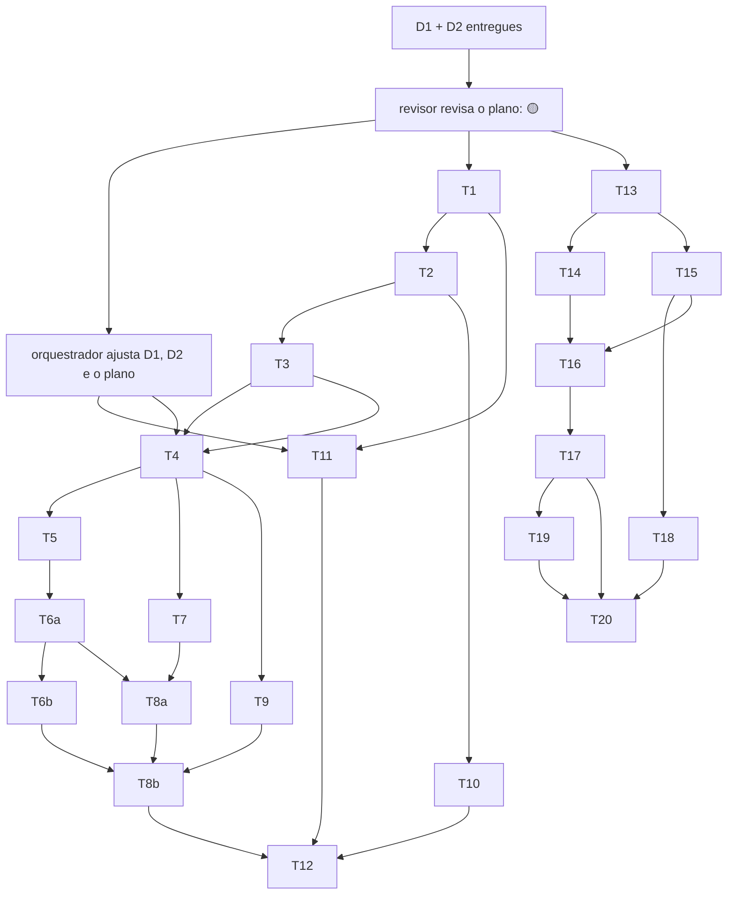

# Plano: Etapa 1 — domínio, arquitetura e fundação

## 1. Objetivo

Deixar o moneylog com o domínio financeiro modelado e provado por testes (todos os casos do PR 01), a arquitetura e o contrato de API inicial documentados, e as fundações de backend (Spring Boot + core puro + Flyway + Postgres local) e frontend (Angular PWA com camadas verificadas, i18n, tokens de design e app shell responsivo) prontas para a Etapa 2.

## 2. Escopo

### 2.1 Entra

| #   | Entregável                                                                                                                                                                                                                                                                                                                                             | Quem                                                 |
| --- | ------------------------------------------------------------------------------------------------------------------------------------------------------------------------------------------------------------------------------------------------------------------------------------------------------------------------------------------------------ | ---------------------------------------------------- |
| D1  | Modelagem do domínio: `docs/arquitetura/dominio-financeiro.md`                                                                                                                                                                                                                                                                                         | orquestrador (**entregue; ajustado após a revisão**) |
| D2  | Arquitetura + contrato de API inicial + estratégia de cálculo + segurança + topologia AWS: `docs/arquitetura/arquitetura.md`                                                                                                                                                                                                                           | orquestrador (**entregue; ajustado após a revisão**) |
| B   | Backend: bootstrap Maven/Spring Boot (Java 21), **core de domínio puro** (Money, Account, Transaction e tipos, Transfer, CreditCard, Installments, Invoice, Debt, recorrência e chave de deduplicação), lentes financeiras, testes de todos os casos do PR 01 e das regras críticas, ArchUnit, migrações Flyway iniciais, `docker-compose` do Postgres | dev-backend (T1–T5, T6a, T6b, T7, T8a, T8b, T9–T11)  |
| F   | Frontend: Angular standalone + PWA, pastas do FE 01 com dependency-cruiser, i18n tipado, tokens de design (DS 00), app shell responsivo com estados vazios, primeiro módulo (`dashboard`) com as camadas ligadas a mock vazio                                                                                                                          | dev-frontend (T13–T19)                               |
| Q   | Validação de back e front                                                                                                                                                                                                                                                                                                                              | tester (T12, T20)                                    |

### 2.2 Não entra (fica para a Etapa 2 ou depois)

- Casos de uso, gateways JPA, controllers REST, `GlobalExceptionHandler` e autenticação (o contrato está em D2, mas a implementação é da Etapa 2).
- Integração real front ↔ back, formulários de registro, `/quick-add` funcional, tipos gerados do OpenAPI.
- Importação de arquivos (parsers CSV/OFX), IA (além da porta), notificações e projeções além das lentes.
- **Metas**: modeladas em D1 §2.9 (reserva lógica, S-39), sem task nem tabela nesta etapa (Etapa 5).
- **Divisão de despesa** e dívida com categoria: modeladas em D1 §2.6.1 (S-40), implementadas na etapa das dívidas (Etapa 4).
- **Vault de notas**: modelado em D1 §5, implementado na **Etapa 6** (S-44).
- Ajuste manual da alocação de um item entre faturas (mover item para a fatura vizinha): não é necessário com S-14 + S-16 e fica como melhoria futura.
- Deploy na AWS (só o esboço da topologia em D2).
- E2E (Playwright) e pipeline de CI (entram com a integração).

### 2.3 Roadmap de etapas (proposta, **[S-44]**)

Segue a ordem do PR 02 (domínio primeiro; cada etapa validada antes da seguinte; IA por último). O PWA (item 15) evolui em todas.

| Etapa | Conteúdo (itens do MVP do PR 02)                                                                                                                                                                                               |
| ----- | ------------------------------------------------------------------------------------------------------------------------------------------------------------------------------------------------------------------------------ |
| 1     | Domínio, arquitetura e fundação (este plano)                                                                                                                                                                                   |
| 2     | Auth, contas, categorias (seed sem "Investimentos" como despesa, S-38), movimentações de conta (gasto, receita, Pix, débito, transferência, investimento, ajuste, reembolso), lista nas duas visões e dashboard v1 (itens 1–8) |
| 3     | Cartões, parcelamento e faturas, com lançamento tardio e crédito transportado (itens 9–11)                                                                                                                                     |
| 4     | Pessoas e dívidas, divisão de despesa (S-40) e recorrências (itens 12–13)                                                                                                                                                      |
| 5     | Metas com reserva (S-39), resumo mensal e projeções básicas (itens 14, 19, 20)                                                                                                                                                 |
| 6     | **Vault de notas Markdown** (item 21), com vínculos a transações, metas, pessoas e resumos                                                                                                                                     |
| 7     | Importação CSV/OFX e notificações (itens 16–17)                                                                                                                                                                                |
| 8     | IA para categorização e análise (item 18), atrás do `AIService`, com o app funcionando sem ela                                                                                                                                 |

## 3. Perguntas em aberto / suposições a validar com o usuário

O usuário pediu para **não bloquear**: cada regra que faltava foi resolvida com a opção mais conservadora **que não impede registrar uma situação real**, e registrada abaixo. A revisão do plano (🟡, `docs/revisoes/2026-10-03-revisao-plano-etapa-1.md`) levou a revisar S-8, S-13 a S-16, S-18, S-21, S-26 e S-28 e a criar S-36 a S-48. Os detalhes estão em D1 §8 e D2 §8. **Se o usuário mudar alguma delas, as tasks afetadas estão indicadas.** Os testes dessas regras ficam parametrizáveis (valores e datas em factories), para que uma mudança de decisão altere dados de teste e não a estrutura.

### 3.1 A validar com o usuário (ordenadas por impacto)

Impacto **alto** = muda números do dashboard ou decide se um registro real é aceito.

| #    | Impacto | Suposição                                                                                                                                                                                                                                                                           | Motivo                                                                                                             | Dono            | Situação                     | Tasks afetadas                |
| ---- | ------- | ----------------------------------------------------------------------------------------------------------------------------------------------------------------------------------------------------------------------------------------------------------------------------------- | ------------------------------------------------------------------------------------------------------------------ | --------------- | ---------------------------- | ----------------------------- |
| S-8  | alto    | Passivo do cartão entra no patrimônio **por competência da parcela**; parcelas futuras ficam em compromissos e no campo informativo `netWorth.cardFutureInstallments`                                                                                                               | casa patrimônio com consumo. Alternativa: −1.200 na data da compra. A UI explica o que fica de fora                | Produto/UX      | revisada (campo informativo) | T2 (ADR), T5, T8a             |
| S-16 | alto    | Pagamento de fatura **acima do saldo devedor é aceito**; o excedente vira **crédito transportado** (`creditCarry`) que abate as faturas seguintes                                                                                                                                   | o usuário paga o valor real da fatura do banco; recusar bloqueava o registro                                       | Produto         | revisada (era: rejeitado)    | T6a, T6b, T8b                 |
| S-14 | alto    | **Lançamento tardio**: item datado num ciclo cuja fatura está fechada e não paga entra nela (`lateEntry`); se ela já foi paga, entra na fatura corrente                                                                                                                             | a fatura do app precisa bater com a do banco; fatura paga não muda                                                 | Produto         | revisada                     | T6a, T6b                      |
| S-18 | alto    | Reembolso no cartão maior que a fatura aberta é **aceito**; o total fica negativo e vira crédito transportado                                                                                                                                                                       | estorno real costuma ser maior que a fatura aberta                                                                 | Produto         | revisada (era: rejeitado)    | T6a                           |
| S-15 | alto    | **Pagamento antecipado** em fatura `OPEN` é aceito                                                                                                                                                                                                                                  | registrar a realidade; o excedente é transportado                                                                  | Produto         | revisada (era: proibido)     | T6a                           |
| S-36 | alto    | **Estorno com guarda**: compra/reembolso no cartão com item em fatura fechada (`CLOSED`/`OVERDUE`/`PAID`) não é estornado (correção: cancelar as parcelas restantes + reembolso); origem de dívida só é estornada sem quitações; estornar uma quitação recalcula o status da dívida | sem guarda, o estorno deixava fatura e dívida inconsistentes. Alternativa mais permissiva: travar só fatura `PAID` | Produto         | nova                         | T4, T6b, T7                   |
| S-21 | alto    | Disponível = em contas − **comprometido em 30 dias** − reservado                                                                                                                                                                                                                    | "até o fim do mês" saltava na virada; d30 é mais conservador e estável                                             | Produto         | revisada                     | T8b                           |
| S-12 | alto    | Compra no dia do fechamento vai para a fatura seguinte                                                                                                                                                                                                                              | regra mais comum; S-14 e S-16 absorvem as diferenças entre bancos                                                  | Produto         | mantida                      | T5                            |
| S-39 | alto    | **Metas**: contribuição é **reserva lógica** sobre o saldo de uma conta, sem posting; "reservado" = reservas em contas CASH; implementação na etapa de metas                                                                                                                        | evita dupla contagem; mover dinheiro de verdade continua sendo `TRANSFER`/`INVESTMENT`                             | Produto         | nova                         | — (Etapa 5)                   |
| S-38 | médio   | "Investimentos" do PR 00 §10 **não é categoria `EXPENSE`**: aplicação é o tipo `INVESTMENT` e aparece como linha própria nos relatórios                                                                                                                                             | categoria de despesa "Investimentos" contaria investimento como gasto                                              | Produto         | nova                         | seed da Etapa 2 (T3 não muda) |
| S-40 | médio   | **Divisão de despesa** (`EXPENSE` com `shares`) e dívida `PAYABLE` com categoria geram consumo; fica para a etapa das dívidas                                                                                                                                                       | casos comuns que o PR 01 não cobre                                                                                 | Produto         | nova                         | — (Etapa 4)                   |
| S-41 | médio   | Dívida `WITH_MOVEMENT` tem **uma** movimentação de origem, criada junto; status derivado; perdão não pode ser desfeito na Etapa 1                                                                                                                                                   | simplifica estorno e saldo; emprestar de novo = nova dívida                                                        | Produto         | nova                         | T7, T11                       |
| S-13 | médio   | Mês de referência = mês do vencimento, **só como rótulo**; identidade da fatura = `(cartão, data de fechamento)`                                                                                                                                                                    | a unicidade por referência quebrava com mudança de vencimento                                                      | Produto         | revisada                     | T5, T11                       |
| S-42 | médio   | Mudança de fechamento/vencimento vale da fatura **seguinte à corrente**; o novo fechamento cai no mês seguinte ao último mantido                                                                                                                                                    | não altera fatura corrente nem fechada; um fechamento por mês                                                      | Produto         | nova                         | T5                            |
| S-46 | médio   | Limite disponível = limite + saldo do livro `CARD` em todas as datas; pagamento parcial devolve limite; com crédito, passa do limite                                                                                                                                                | igual ao banco                                                                                                     | Produto         | nova                         | T6b                           |
| S-11 | médio   | Limite disponível pode ficar negativo (sinalizado)                                                                                                                                                                                                                                  | o banco às vezes aprova acima do limite                                                                            | Produto         | mantida                      | T6b                           |
| S-17 | médio   | Pagamento parcial sem juros/rotativo; o saldo devedor fica na própria fatura (só crédito é transportado)                                                                                                                                                                            | o app não inventa número                                                                                           | Produto         | mantida                      | T6a                           |
| S-23 | médio   | Saldo líquido do mês = receitas − consumo por competência; fluxo de caixa separado                                                                                                                                                                                                  | coerente com a lente de consumo                                                                                    | Produto         | mantida                      | T8a, T8b                      |
| S-10 | médio   | Reembolso reduz o consumo na competência **do reembolso**                                                                                                                                                                                                                           | não reescreve meses já revisados                                                                                   | Produto         | mantida                      | T4, T8a                       |
| S-19 | médio   | Perdão de dívida zera o saldo via patrimônio, sem despesa/receita                                                                                                                                                                                                                   | não distorce consumo/receita                                                                                       | Produto         | mantida                      | T7                            |
| S-6  | médio   | "Dinheiro recebido" cobre devolução (`RECEIVABLE`) e captação (cria `PAYABLE`)                                                                                                                                                                                                      | PR 01 não tem tipo para captação; nenhum dos dois é renda                                                          | Produto         | mantida                      | T7                            |
| S-26 | baixo   | Rendimento = `ADJUSTMENT` com `kind = YIELD` na conta de investimento, sem virar receita                                                                                                                                                                                            | separa rendimento de correção                                                                                      | Produto         | revisada (`kind`)            | T4                            |
| S-43 | baixo   | ~~Duplicata forçada gravada com `dedup_key` nulo~~ substituída pela S-75                                                                                                                                                                                                            | ver S-75                                                                                                           | Produto/Backend | substituída                  | T10, T11                      |
| S-75 | médio   | **Duplicata forçada (revisada, M3):** `dedup_key` = chave derivada do lote (`DedupKey.forcedIn`); chave original em `original_dedup_key`; o `DuplicateClassifier` compara as duas colunas das ativas                                                                                | índice único simples, retry do lote não duplica, e a reimportação continua `DUPLICATE` após estornar a original    | Produto/Backend | revisada (BUG-QA-04)         | T10, T11                      |
| S-77 | médio   | Vencimento que cairia no dia do fechamento ou antes (clamp em mês curto) vai para o mesmo dia de vencimento do mês seguinte (clamp); `due > closing` sempre                                                                                                                         | cartão utilizável em fevereiro; o CHECK do banco continua válido                                                   | Produto         | nova (BUG-QA-01, M2)         | T5, T11                       |
| S-78 | médio   | Teto de R$ 999.999.999,99 por movimentação, limite de cartão, saldo inicial (módulo), principal de dívida e recorrência; acima: `AMOUNT_ABOVE_LIMIT` (422)                                                                                                                          | barra erro de digitação; nenhuma soma razoável transborda o `long`                                                 | Produto         | nova (BUG-QA-03)             | T2, T3, T4, T5, T7, T9        |
| S-49 | médio   | Ocorrência de recorrência cuja realização foi estornada pode ser realizada de novo (índice único só entre ativas)                                                                                                                                                                   | não bloquear o registro da realidade                                                                               | Produto         | nova (M6)                    | T9, T11                       |
| S-50 | médio   | Lançamento tardio parcelado: cada parcela segue a anterior e passa pela regra da S-14; parcela cuja fatura já foi paga vai para a corrente. Vale também para a recorrência no cartão                                                                                                | fatura `PAID` nunca recebe item novo                                                                               | Produto         | nova (M6)                    | T6a, T9                       |
| S-51 | médio   | `total`/`paid`/`outstanding`/status da fatura consideram todos os itens e pagamentos ativos, de qualquer data (pagamento futuro já conta)                                                                                                                                           | bate com a invariante do livro `CARD` em todas as datas                                                            | Produto         | nova (M6)                    | T6a                           |
| S-52 | baixo   | Reembolso com `refundOf`: mesma categoria da original; original ativa e `EXPENSE` ou `CARD_PURCHASE`                                                                                                                                                                                | não reduzir consumo de outra categoria                                                                             | Produto         | nova (M6)                    | T4, T6a                       |
| S-53 | baixo   | Despesa, receita, reembolso em conta, pagamento de fatura e dívida exigem conta `CASH`; `YIELD` aceita aumento e diminuição                                                                                                                                                         | investimento só por `INVESTMENT`                                                                                   | Produto         | nova (M6)                    | T4, T7                        |
| S-54 | baixo   | Nova movimentação ligada a dívida existente = `DEBT_ALREADY_HAS_ORIGIN`; dívida perdoada não aceita estorno do registro; quitada não aceita perdão; ocorrência pulada não é realizada                                                                                               | simplifica estorno e saldo                                                                                         | Produto         | nova (M6)                    | T7, T9                        |
| S-55 | baixo   | `isProjection` = `asOf` depois de hoje; compromissos de recorrência vão do início da agenda até hoje + 12 meses                                                                                                                                                                     | projeção explícita e limitada                                                                                      | Produto         | nova (M6)                    | T8b                           |
| S-44 | baixo   | Roadmap de etapas (§2.3), com o **vault na Etapa 6**                                                                                                                                                                                                                                | o vault depende de metas e do resumo mensal como alvos de vínculo                                                  | Produto         | nova                         | —                             |
| S-48 | baixo   | Vault: wikilink resolvido pelo nome do arquivo; renomear reescreve links; anexos fora do MVP                                                                                                                                                                                        | compatibilidade real com o Obsidian                                                                                | Produto         | nova                         | — (Etapa 6)                   |
| S-1  | baixo   | Fuso fixo `America/Sao_Paulo`                                                                                                                                                                                                                                                       | competência e "hoje" dependem do fuso                                                                              | Produto         | mantida                      | T2, T8a                       |
| S-2  | baixo   | Só BRL no MVP (`Money` já carrega moeda)                                                                                                                                                                                                                                            | sem requisito de multi-moeda                                                                                       | Produto         | mantida                      | T2                            |
| S-3  | baixo   | Resto do parcelamento na 1ª parcela                                                                                                                                                                                                                                                 | prática comum dos emissores; soma exata                                                                            | Produto         | mantida                      | T5                            |
| S-4  | baixo   | Conta só arquiva com saldo zero                                                                                                                                                                                                                                                     | não "sumir" dinheiro do patrimônio                                                                                 | Produto         | mantida                      | T3                            |
| S-5  | baixo   | Saldo negativo permitido e sinalizado                                                                                                                                                                                                                                               | registrar a realidade (cheque especial)                                                                            | Produto         | mantida                      | T3, T4                        |
| S-7  | baixo   | Parcelas limitadas a 1..36                                                                                                                                                                                                                                                          | sanidade contra erro de digitação                                                                                  | Produto         | mantida                      | T5                            |
| S-9  | baixo   | Reembolso com `refundOf` opcional; se informado, ≤ valor **efetivamente cobrado** (compra no cartão: Σ parcelas não canceladas) − reembolsos anteriores                                                                                                                             | nem toda despesa original está registrada; evita reverter o consumo duas vezes                                     | Produto         | revisada (A1)                | T4, T6a                       |
| S-20 | baixo   | Recorrência nunca é realizada automaticamente                                                                                                                                                                                                                                       | só vira transação com confirmação                                                                                  | Produto         | mantida                      | T9                            |
| S-22 | baixo   | Reservado = 0 até a etapa de metas (regra em S-39)                                                                                                                                                                                                                                  | sem metas implementadas                                                                                            | Produto         | mantida                      | T8b                           |
| S-24 | baixo   | Notas excluídas vão para a lixeira (`deletedAt`)                                                                                                                                                                                                                                    | "nada é apagado em silêncio"                                                                                       | Produto         | mantida                      | — (Etapa 6)                   |
| S-25 | baixo   | Possível duplicata com lançamento manual (mesmo valor/conta, data ±1 dia) exige decisão                                                                                                                                                                                             | não perder nem duplicar                                                                                            | Produto         | mantida                      | T10                           |
| S-32 | baixo   | Sidebar sem Dream Board e com Notas                                                                                                                                                                                                                                                 | Dream Board é pós-MVP; vault entrou no MVP                                                                         | Produto/UX      | mantida                      | T17                           |
| S-34 | baixo   | UI em pt-BR por padrão (en e es disponíveis)                                                                                                                                                                                                                                        | usuário e exemplos do PR 00 em português; DS 00 sugere inglês                                                      | Produto/UX      | mantida                      | T14                           |
| S-33 | baixo   | Ações dos estados vazios desabilitadas com "disponível em breve"                                                                                                                                                                                                                    | sem funcionalidade fictícia (PR 02)                                                                                | UX              | mantida                      | T16, T17                      |
| S-35 | baixo   | Ícone do PWA provisório ("logbook") até o design entregar o definitivo                                                                                                                                                                                                              | DS 00 descreve a direção, mas não há arte final                                                                    | UX              | mantida                      | T18                           |

### 3.2 Decisões de arquitetura (dono: Arquitetura; o usuário só precisa saber)

| #    | Impacto | Decisão                                                                                                                                                                                                                                                                                                                                                 | Motivo                                                                | Situação             | Tasks afetadas                         |
| ---- | ------- | ------------------------------------------------------------------------------------------------------------------------------------------------------------------------------------------------------------------------------------------------------------------------------------------------------------------------------------------------------- | --------------------------------------------------------------------- | -------------------- | -------------------------------------- |
| S-37 | alto    | **Status da fatura derivado na leitura** (`FUTURE`/`OPEN`/`CLOSED`/`OVERDUE`/`PAID`) a partir das datas, do `outstanding` e do `Clock`; nada de status de fatura gravado e nenhum job. A sugestão "persistir só `PAID`" não foi seguida: a fatura quitada por antecipação ou por crédito vira `PAID` no fechamento sem nenhum evento que grave o status | determinístico, testável com relógio fixo, sem gatilho a esquecer     | nova                 | T6a, T8b, T11                          |
| S-45 | alto    | `ledger_postings` com `source_type`/`source_id`/`installment_id`/`active`; lentes leem só `active`                                                                                                                                                                                                                                                      | saldo inicial, dívida sem movimentação e perdão não têm `Transaction` | nova                 | T4, T8a, T11                           |
| S-47 | alto    | Lista com duas visões (registros por data; lançamentos por competência) e `totals` do backend sobre o filtro inteiro                                                                                                                                                                                                                                    | a lista bate com o dashboard sem o front somar                        | nova                 | T8a, T8b, T19 (tipos)                  |
| S-28 | médio   | Spring Boot na linha com suporte OSS vigente (provavelmente 4.x), conferida em T1                                                                                                                                                                                                                                                                       | 3.5.x pode estar fora do suporte OSS                                  | revisada (era 3.5.x) | T1 (**sem mudar critérios**, ver §5.0) |
| S-30 | médio   | Login próprio (JWT curto + refresh em cookie HttpOnly), sem IdP; ADR-003 avalia TOTP e bloqueio progressivo; cuidado com o `$` do hash BCrypt no `.env` (D2 §3.5)                                                                                                                                                                                       | um usuário só                                                         | mantida              | Etapa 2                                |
| S-29 | baixo   | Quality gate de 90% de linhas no `core`                                                                                                                                                                                                                                                                                                                 | o core concentra a regra financeira                                   | mantida              | T1, T12                                |
| S-27 | baixo   | Código em inglês; docs e produto em português                                                                                                                                                                                                                                                                                                           | um idioma só no código (BE 01)                                        | mantida              | T1, T13                                |
| S-31 | baixo   | Ligação porta → `infra` no front só no bootstrap                                                                                                                                                                                                                                                                                                        | FE 01 proíbe `app → infra`                                            | mantida              | T13, T19                               |

## 4. Contrato de API

O contrato inicial (contas, movimentações, cartões/faturas, dashboard e auth) está em **D2 §4** e segue BE 04 / FE 05: criação devolve `201` + `Location` + recurso completo, edição é `PUT` com `version`, ações devolvem o recurso atualizado, listas usam `Slice { items, hasNext }`, dinheiro é `{ amount: "1200.00", currency: "BRL" }` (string decimal) e todo valor calculado (saldo, limite disponível, totais, `impact`, `bucket`) vem pronto do backend.

**Nesta etapa nenhum endpoint é implementado.** O front da Etapa 1 só define, em T19, os tipos de `DashboardSummary` espelhados de D2 §4.4 e usa mock vazio. Isso está marcado como dependência do contrato D2; os tipos serão substituídos pelos gerados do OpenAPI na Etapa 2.

Resumo:

| Recurso                           | Endpoints                                                                                                                                                                                                                                                                                         |
| --------------------------------- | ------------------------------------------------------------------------------------------------------------------------------------------------------------------------------------------------------------------------------------------------------------------------------------------------- |
| Contas                            | `GET/POST /v1/accounts`, `GET/PUT /v1/accounts/{id}`, `POST /v1/accounts/{id}/archive\|unarchive`                                                                                                                                                                                                 |
| Movimentações                     | `GET/POST /v1/transactions` (registros + `totals`), `GET /v1/entries?competence&lens` (lançamentos por competência + `totals`), `GET/PUT /v1/transactions/{id}`, `POST /v1/transactions/{id}/void` (com guarda), `POST /v1/transactions/{id}/cancel-remaining-installments`, `GET /v1/categories` |
| Cartões/faturas                   | `GET/POST /v1/cards`, `GET/PUT /v1/cards/{id}`, `POST /v1/cards/{id}/archive`, `GET /v1/cards/{id}/invoices`, `GET /v1/cards/{id}/future-installments`, `GET /v1/invoices/{id}`, `POST /v1/invoices/{id}/payments` (sem endpoint de fechar: status derivado)                                      |
| Dashboard                         | `GET /v1/dashboard/summary?asOf` (com `month.consumption`, `month.cashFlow`, `netWorth.cardFutureInstallments`), `GET /v1/dashboard/upcoming?from&to` (parcelas aninhadas + `totals`)                                                                                                             |
| Auth (Etapa 2)                    | `POST /v1/auth/login`, `POST /v1/auth/refresh`, `POST /v1/auth/logout`                                                                                                                                                                                                                            |
| Pessoas/dívidas (Etapa 4, esboço) | `/v1/people`, `/v1/debts`, `POST /v1/debts/{id}/cancel`, `POST /v1/debts/{id}/void`                                                                                                                                                                                                               |
| Metas (Etapa 5, esboço)           | `/v1/goals`, `POST /v1/goals/{id}/reservations`                                                                                                                                                                                                                                                   |

A lista e o dashboard batem por construção: `GET /v1/entries?competence=M&lens=CONSUMPTION` → `totals.total` = `month.consumption`, e `GET /v1/transactions` do mês → `totals.cashFlow` = `month.cashFlow` (D2 §4.2, D1 §2.10).

## 5. Tasks

> Convenções para todas as tasks de backend: comandos com `export JAVA_HOME=/opt/homebrew/opt/openjdk@21/libexec/openjdk.jdk/Contents/Home`; `./mvnw test` (unitários) e `./mvnw verify` (com ITs) verdes; testes de domínio em JUnit puro (sem Spring) com `@DisplayName` em português e factories `umX()`/`umaX()` com **UUIDs e datas fixos** (BE 07); tempo sempre via `TimeProvider`/`Clock` fixo.
> Convenções para todas as tasks de frontend: `npm run lint`, `npm run lint:deps`, `npm run typecheck`, `npm test` e `npm run build` verdes; nenhum texto fixo; `data-cy` em todo elemento interativo; OnPush.
> A definição de pronto do PR 02 vale para todas as tasks no que se aplica a elas.

### 5.0 Situação das tasks depois da revisão

- **Em andamento, sem mudança de escopo nem de critérios:** T1, T2, T3, T10 e T13–T18. Os números foram mantidos.
- **Duas notas para o dev de T1** (não mudam critérios; a sessão principal repassa):
  1. S-28 foi revisada: antes de fixar a versão, conferir a política de suporte OSS do Spring Boot. Se a 3.5.x estiver fora do suporte, usar a 4.x mais recente (springdoc 3.x) e registrar a escolha na ADR-004 ou no README. Nenhum critério de T1 cita a versão.
  2. Opcional: no `.env.example`, comentar que `MONEYLOG_OWNER_PASSWORD_HASH` vai entre aspas simples por causa do `$` do BCrypt (D2 §3.5). O tratamento completo é da task de auth da Etapa 2.
- **T2:** a origem dos postings (`PostingSource`, `LedgerEntry`) entra em **arquivos novos** criados por T4, sem editar os arquivos de T2. O adendo da ADR-002 é feito em T11.
- **T3:** não muda. A decisão sobre "Investimentos" (S-38) afeta só a seed da Etapa 2.
- **T10:** não muda. A duplicata forçada (S-43) afeta só o schema (T11) e a etapa de importação.
- **Liberadas pela revisão:** T4, T6 (agora **T6a** e **T6b**), T7, T8 (agora **T8a** e **T8b**) e T11. T5 foi ajustada (CA4, CA5 e CA9 novo) e T9 não mudou; as duas seguem dependendo de T4.
- **T19:** só o espelho dos tipos de `DashboardSummary` acompanha a versão ajustada de D2 §4.4.

---

### T1 · dev-backend · Bootstrap do backend e infraestrutura local

**Objetivo:** criar o projeto Maven Spring Boot (Java 21) com a estrutura `core`/`infra`, as regras ArchUnit, o Postgres local e a separação de testes, sem nenhuma regra de negócio ainda.

**Arquivos/camadas:** `backend/pom.xml`, `backend/mvnw*`, `backend/src/main/java/com/moneylog/{MoneylogApplication.java, core/, infra/}` (pastas com `package-info.java`), `backend/src/main/resources/application.yaml` (+ `application-dev.yaml`, `application-it.yaml`), `backend/src/test/java/com/moneylog/architecture/ArchitectureTest.java`, `backend/src/test/java/com/moneylog/util/IntegrationTest.java`, `docker-compose.yml`, `.env.example`, `.gitignore`, `backend/README.md` (como rodar), `docs/adrs/ADR-004-idioma-do-codigo.md`.

**Critérios de aceite**

1. **Dado** o repositório recém-clonado e o `JAVA_HOME` do CLAUDE.md, **quando** rodo `./mvnw -q verify` em `backend/`, **então** o build termina com sucesso usando Java 21 (o `maven-enforcer-plugin` exige Java 21 e falha com outra versão).
2. **Dado** o `docker-compose.yml` na raiz, **quando** rodo `docker compose up -d`, **então** sobe um único serviço `postgres:17` (versão pinada) com `healthcheck`, porta e credenciais lidas de `.env` (nenhum valor de senha no compose ou no `application*.yaml`).
3. **Dado** o Postgres local saudável e o perfil `dev`, **quando** inicio a aplicação, **então** `GET /actuator/health` responde `200 {"status":"UP"}`, Flyway roda sem erro e `spring.jpa.hibernate.ddl-auto` é `validate`. Só `health` fica exposto no actuator.
4. **Dado** o `ArchitectureTest`, **quando** uma classe em `com.moneylog.core..` importa `org.springframework..`, `jakarta.persistence..`, `com.fasterxml..`, `lombok..` ou `com.moneylog.infra..`, **então** o teste falha (verificado com uma classe de violação temporária durante o desenvolvimento, removida antes da entrega e mencionada no relatório).
5. **Dado** o `pom.xml`, **quando** rodo `./mvnw test`, **então** só `*Test` executam (surefire); **e quando** rodo `./mvnw verify`, **então** os `*IT` (tag `i`, failsafe) também executam. JaCoCo gera relatório e `jacoco:check` exige ≥ 90% de linhas em `com.moneylog.core..` (S-29), começando a valer quando T2 adicionar código ao core.
6. **Dado** o `.env.example`, **quando** comparo com as variáveis usadas no `application*.yaml` e no compose, **então** toda variável existe no exemplo (`DB_URL`, `DB_USER`, `DB_PASSWORD`, `JWT_SECRET`, `AI_PROVIDER=none`, `AI_API_KEY`, `AI_MODEL`, `MONEYLOG_OWNER_EMAIL`, `MONEYLOG_OWNER_PASSWORD_HASH`) sem valor real, e `.env` está no `.gitignore`.
7. **Dado** o `IntegrationTest`, **quando** um `*IT` o usa, **então** sobe Testcontainers com a mesma imagem `postgres:17` do compose (sem H2).

**Depende de:** — (D2 entregue)

---

### T2 · dev-backend · Shared kernel: Money, tempo, razão e exceções

**Objetivo:** implementar os blocos que todas as features usam: `Money`, `CurrencyCode`, `Competence`, `DayOfMonthRule`, `TimeProvider`, `Posting`/`BookRef`/`BookType` e a hierarquia de exceções. Registrar a ADR-002.

**Arquivos/camadas:** `core/sk/{money,time,ledger,exception,page}/`, testes em `src/test/java/com/moneylog/core/sk/...`, `docs/adrs/ADR-002-razao-e-dinheiro.md`.

**Critérios de aceite**

1. **Dado** `Money.of("0.10")` e `Money.of("0.20")`, **quando** somo, **então** o resultado é exatamente `Money.of("0.30")` (centavos `long`, sem `double` em nenhum ponto do core; um teste ArchUnit ou grep no build falha se `double`/`float` aparecer em `core.sk.money`).
2. **Dado** `Money` em BRL e outro em USD, **quando** somo, **então** é lançada `CurrencyMismatchException` (subclasse de `BusinessRuleException`).
3. **Dado** `Money.of("1000.00").allocate(3)`, **quando** executo, **então** recebo `[333.34, 333.33, 333.33]`, cuja soma é exatamente 1000.00 (S-3). **Dado** `Money.of("0.05").allocate(6)`, **então** é lançada exceção (parcela menor que 1 centavo).
4. **Dado** um valor com mais de 2 casas (`"10.005"`), **quando** crio `Money`, **então** é rejeitado (sem arredondamento silencioso). Overflow em soma lança exceção (`Math.addExact`).
5. **Dado** `DayOfMonthRule(31)`, **quando** aplico a fevereiro de 2027, **então** a data é 28/02/2027; em fevereiro de 2028, 29/02/2028.
6. **Dado** `Competence.of(2026, 12)`, **quando** somo 1 mês, **então** obtenho `2027-01`.
7. **Dado** uma lista de `Posting`, **quando** chamo `Postings.assertBalanced(list)`, **então** passa se Σ = 0 e lança `UnbalancedPostingsException` caso contrário.
8. **Dado** a hierarquia de exceções, **então** existem `DomainException` (base) → `NotFoundException`, `BusinessRuleException` (com `code` estável em string) e `ConflictException`, sem dependência de Spring.
9. **Dado** a ADR-002, **então** ela tem Contexto / Decisão / Consequências / Alternativas, cobrindo centavos `long`, razão de partidas dobradas, competência e S-8.

**Depende de:** T1

---

### T3 · dev-backend · Conta e categoria

**Objetivo:** entidades `Account` (tipos, classe de liquidez, status, saldo inicial como posting) e `Category` (tipo EXPENSE/INCOME, sistema/arquivada), com invariantes e exceções.

**Arquivos/camadas:** `core/account/{domain,exception}/`, `core/category/{domain,exception}/`, factories `AccountTestFactory`, `CategoryTestFactory`, testes de domínio.

**Critérios de aceite**

1. **Dado** uma conta `CHECKING` com saldo inicial 20.000,00 em 01/10/2026, **quando** peço os postings de abertura, **então** recebo `ACCOUNT(conta) +20.000,00` e `EQUITY −20.000,00` em 01/10/2026 (Σ = 0).
2. **Dado** os tipos `CHECKING`, `SAVINGS`, `WALLET`, **então** a liquidez é `CASH`; **dado** `INVESTMENT`, **então** é `INVESTMENT` (teste parametrizado com `@EnumSource`).
3. **Dado** nome em branco, moeda diferente de BRL ou `userId` nulo, **quando** crio a conta, **então** recebo a exceção específica da feature (sem `NullPointerException` genérica).
4. **Dado** uma conta com saldo diferente de zero, **quando** chamo `archive(saldoAtual)`, **então** recebo `AccountWithBalanceCannotBeArchivedException` (S-4); com saldo zero, a conta vira `ARCHIVED`, e `unarchive()` volta para `ACTIVE`. A matriz de transições inválidas (arquivar arquivada etc.) é testada.
5. **Dado** uma conta `ARCHIVED`, **quando** verifico `ensureCanReceiveTransactions()`, **então** lança `AccountArchivedException`.
6. **Dado** uma categoria `INCOME`, **quando** ela é validada para uso em despesa (`ensureKind(EXPENSE)`), **então** lança `CategoryKindMismatchException`.
7. **Dado** as entidades, **então** não há setters públicos; a alteração é por métodos de negócio (`rename`, `archive`) que reaplicam as invariantes do construtor.

**Depende de:** T2

---

### T4 · dev-backend · Movimentação: agregado e tipos de conta (inclui Transfer e investimento)

> Ajustada após a revisão: porta de guarda do estorno, origem dos postings e `kind` do ajuste.

**Objetivo:** agregado `Transaction` com `TransactionType` **completo** (os 11 tipos do PR 01), `PaymentMethod`, `TransactionStatus`, estorno com guarda (porta `TransactionVoidPolicy`), a origem dos postings (`PostingSource`, `LedgerEntry`) e as fábricas dos tipos que só envolvem contas: `EXPENSE`, `INCOME`, `TRANSFER`, `INVESTMENT`, `ADJUSTMENT`, `REFUND` (em conta). As fábricas dos demais tipos ficam em arquivos próprios (T5, T6a, T7), para essas tasks não editarem o mesmo arquivo.

**Arquivos/camadas:** `core/transaction/domain/{Transaction, TransactionType, PaymentMethod, TransactionStatus, TransactionSource, AdjustmentKind, TransactionVoidPolicy, AccountTransactions (fábricas deste grupo)}`, `core/sk/ledger/{PostingSource, LedgerEntry}.java` (**arquivos novos**; não editam os arquivos de T2), `core/transaction/exception/TransactionExceptions.java`, `TransactionTestFactory`, testes.

**Critérios de aceite**

1. **Dado** uma despesa de 100,00 via PIX na categoria Alimentação, conta Nubank, em 10/10/2026, **quando** peço os postings, **então** recebo `EXPENSE(Alimentação, 2026-10) +100,00` e `ACCOUNT(Nubank) −100,00`, e cada `LedgerEntry` tem origem `TRANSACTION` com o id da movimentação e `active = true`.
2. **Dado** `EXPENSE` com método `CREDIT` (ou sem método), **quando** crio, **então** a criação é rejeitada (`CREDIT` nem existe em `PaymentMethod`; compra no crédito é `CARD_PURCHASE`). **Dado** `INCOME` sem método, **então** também é rejeitada.
3. **Dado** uma transferência de 1.000,00 Nubank → XP, **então** os postings são `ACCOUNT(XP) +1.000,00` e `ACCOUNT(Nubank) −1.000,00`, e nenhum posting de `EXPENSE`/`INCOME`. **Dado** origem = destino, **então** `SameAccountTransferException`. **Dado** contas de liquidez diferentes (CASH → INVESTMENT), **então** `TransferAcrossLiquidityException` (o caso correto é `INVESTMENT`).
4. **Dado** `INVESTMENT` CONTRIBUTION de 10.000,00 Nubank → XP Invest, **então** `ACCOUNT(XP Invest) +10.000,00` / `ACCOUNT(Nubank) −10.000,00`; REDEMPTION inverte os sinais. A conta de investimento precisa ser do tipo `INVESTMENT` e a outra `CASH`.
5. **Dado** `INCOME` com categoria `EXPENSE`, ou `EXPENSE` com categoria `INCOME`, **então** `CategoryKindMismatchException`.
6. **Dado** `REFUND` de 50,00 na Nubank, categoria Alimentação, com `refundOf` = despesa de 100,00 sem reembolsos anteriores, **então** os postings são `ACCOUNT +50,00` / `EXPENSE(Alimentação, competência do reembolso) −50,00` (S-10). **Dado** um reembolso de 60,00 quando já houve 50,00 de reembolso dessa despesa de 100,00, **então** `RefundExceedsOriginalException` (S-9).
7. **Dado** `ADJUSTMENT` DECREASE de 30,00 sem motivo, **então** é rejeitado; com motivo, os postings são `ACCOUNT −30,00` / `EQUITY +30,00` e o `kind` padrão é `CORRECTION`; com `kind = YIELD` (rendimento, S-26) a conta precisa ser `INVESTMENT`.
8. **Dado** qualquer fábrica deste grupo, **quando** o valor é zero ou negativo, **então** `NonPositiveAmountException`; **dado** conta/categoria de outro `userId`, **então** `NotFoundException` da feature.
9. **Dado** uma transação `ACTIVE` deste grupo, **quando** chamo `voidTransaction("motivo", agora, policy)`, **então** a `TransactionVoidPolicy` é consultada, o status vira `VOIDED`, `voidReason` e `voidedAt` são preenchidos e todas as `LedgerEntry` da movimentação ficam `active = false`. **Dado** uma policy (stub de teste) que recusa com o código `TRANSACTION_IN_CLOSED_INVOICE`, **então** é lançada `TransactionVoidRefusedException` com esse `code` e a transação continua `ACTIVE`. Estornar de novo lança `TransactionAlreadyVoidedException`; motivo em branco é rejeitado. Para os tipos deste grupo a policy padrão sempre permite (S-36).
10. **Dado** o enum `TransactionType`, **quando** um teste parametrizado cria uma movimentação válida de cada tipo deste grupo, **então** Σ postings = 0 em todas, antes e depois do estorno (só contando os ativos).

**Depende de:** T3

---

### T5 · dev-backend · Cartão, calendário de fatura e parcelamento

> Ajustada após a revisão: identidade da fatura por data de fechamento (S-13) e mudança de dia (S-42), CA9.

**Objetivo:** `CreditCard`, `InvoiceCalendar` (fechamento, vencimento, referência, período, mudança de dia) e `InstallmentPlan` → `TransactionInstallment`, além da fábrica `CardTransactions.purchase(...)` (tipo `CARD_PURCHASE`).

**Arquivos/camadas:** `core/card/domain/{CreditCard, InvoiceCalendar, InvoicePeriod, InstallmentPlan, TransactionInstallment, InstallmentStatus}`, `core/transaction/domain/CardTransactions.java`, `core/card/exception/CardExceptions.java`, `CreditCardTestFactory`, testes.

**Critérios de aceite**

1. **Dado** cartão com fechamento 25 e vencimento 5, **quando** calculo a fatura de uma compra em 24/10/2026, **então** ela fecha em 25/10/2026, vence em 05/11/2026, tem referência `2026-11` e período 25/09/2026–24/10/2026. **Dado** compra em 25/10/2026, **então** fecha em 25/11/2026 e vence em 05/12/2026 (S-12, S-13). **Dado** compra em 26/10/2026, **então** a mesma de 25/10.
2. **Dado** fechamento 3 e vencimento 10 (vencimento > fechamento), **quando** compro em 01/03/2027, **então** a fatura fecha em 03/03/2027 e vence em 10/03/2027 (mesmo mês).
3. **Dado** fechamento 31, **quando** compro em 15/02/2027, **então** a fatura fecha em 28/02/2027. **Dado** compra em 20/12/2026 com fechamento 25 e vencimento 5, **então** vence em 05/01/2027 (virada de ano).
4. **Dado** compra de 1.200,00 em 6x em 10/10/2026 nesse cartão, **quando** gero as parcelas, **então** são 6 parcelas de 200,00 numeradas 1/6..6/6, com competências `2026-10`..`2027-03` e faturas com fechamento 25/10/2026..25/03/2027 (referências `2026-11`..`2027-04`).
5. **Dado** a mesma compra, **quando** peço os postings, **então** há, para cada parcela k, `EXPENSE(cat, comp_k) +200,00` / `CARD −200,00` com data efetiva = 10 do mês k (clamp no fim do mês), origem `TRANSACTION` com o `installmentId` da parcela, e **nenhum** posting em `ACCOUNT` (caixa 0). Em `2026-10` o consumo dessa compra é 200,00 e **não** 1.200,00.
6. **Dado** compra de 1.000,00 em 3x, **então** as parcelas são 333,34 / 333,33 / 333,33 (S-3). **Dado** compra em 31/01/2027 em 2x, **então** a parcela 2 tem data efetiva 28/02/2027.
7. **Dado** `installments` = 0 ou 37, **então** `InvalidInstallmentCountException` (S-7). **Dado** cartão arquivado, **então** `CardArchivedException`.
8. **Dado** `closingDay`/`dueDay` fora de 1..31, limite ≤ 0 ou nome em branco, **então** a criação do cartão é rejeitada. O cartão não tem campo para número completo nem CVV.
9. **Dado** fechamento 25 e vencimento 5, com a fatura corrente fechando em 25/10/2026, **quando** o vencimento muda para 28 em 15/10/2026, **então** a corrente continua com fechamento 25/10/2026 e vencimento 05/11/2026 (ref. `2026-11`) e a seguinte fecha em 25/11/2026 e vence em 28/11/2026 (ref. `2026-11` também). **Dado** que o fechamento muda de 25 para 10 em 15/10/2026, **então** a corrente mantém 25/10/2026 e a seguinte fecha em 10/11/2026 (mês seguinte ao do último fechamento mantido) e vence em 05/12/2026. Nos dois casos as datas de fechamento geradas são estritamente crescentes, uma por mês, e a identidade da fatura é `closingDate` (S-13, S-42).

**Depende de:** T4

---

### T6a · dev-backend · Fatura: status derivado, alocação, pagamento e crédito transportado

> Substitui a primeira metade da antiga T6. Decisões: S-14, S-15, S-16, S-17, S-18, S-37.

**Objetivo:** agregado `CreditCardInvoice` com valores calculados (`total`, `carryIn`, `paid`, `outstanding`, `creditCarry`), status **derivado** de `hoje` (`FUTURE`/`OPEN`/`CLOSED`/`OVERDUE`/`PAID`), alocação de itens com lançamento tardio, e as fábricas `CardTransactions.invoicePayment(...)` e `refundToCard(...)`.

**Arquivos/camadas:** `core/card/domain/{CreditCardInvoice, InvoiceStatus, InvoiceItem, InvoiceChain (cadeia de faturas de um cartão: carryIn/creditCarry), InvoiceAllocator}`, `core/transaction/domain/CardTransactions.java` (mesmo arquivo de T5, por isso vem depois de T5), `core/card/exception/`, testes.

**Critérios de aceite** (cartão Roxinho: fechamento 25, vencimento 5; fatura ref. `2026-11` = período 25/09–24/10/2026, fecha em 25/10, vence em 05/11)

1. **Dado** a fatura ref. `2026-11` com total 1.283,00 (parcela 1/6 de 200,00 + compra à vista de 1.083,00) e sem pagamentos, **quando** consulto `statusAt(hoje)`, **então** 24/09 → `FUTURE`; 25/09 e 24/10 → `OPEN`; 25/10 e 05/11 → `CLOSED`; 06/11 → `OVERDUE`. Com `outstanding = 0` em 25/10 → `PAID`. É um teste parametrizado; não existe método `close`/`markOverdue` nem campo de status gravado (S-37).
2. **Dado** essa fatura em 05/11, **quando** registro um `INVOICE_PAYMENT` de 1.283,00 da Nubank, **então** os postings são `CARD +1.283,00` / `ACCOUNT(Nubank) −1.283,00`, **nenhum** posting de `EXPENSE`, a fatura fica `PAID` e as parcelas dela ficam `PAID` (derivado).
3. **Dado** a fatura `CLOSED`, **quando** pago 500,00, **então** ela continua `CLOSED` com `outstanding` 783,00 e sem juros (S-17); em 06/11 fica `OVERDUE` (parcelas `OVERDUE`); **quando** pago mais 783,00, **então** fica `PAID`.
4. **Dado** a fatura `CLOSED` de 1.283,00, **quando** pago 1.300,00, **então** o pagamento é aceito, a fatura fica `PAID` com `creditCarry` 17,00, e a fatura seguinte (ref. `2026-12`, total 200,00) tem `carryIn` 17,00 e `outstanding` 183,00 (S-16). **Dado** a fatura `OPEN` de 200,00 em 20/10, **quando** pago 300,00, **então** é aceito (antecipação, S-15) e em 25/10 a fatura está `PAID` com `creditCarry` 100,00. **Dado** uma fatura `FUTURE` ou `PAID`, **quando** tento pagar, **então** `InvalidInvoiceOperationException` com `code = INVOICE_NOT_PAYABLE`.
5. **Dado** a fatura `OPEN` com total 200,00, **quando** registro um reembolso de 80,00 no cartão, **então** os postings são `CARD +80,00` / `EXPENSE(cat) −80,00` e o total cai para 120,00. **Dado** um reembolso de 250,00, **então** ele é aceito, o total fica −50,00, `outstanding` 0 e `creditCarry` 50,00 para a fatura seguinte (S-18).
6. **Dado** a fatura ref. `2026-11` `CLOSED` e não paga, **quando** em 27/10 aloco (`targetInvoiceFor`) uma compra de 90,00 datada de 20/10, **então** ela entra nessa fatura com `lateEntry = true` e o total vai a 1.373,00. **Dado** que essa fatura já está `PAID`, **então** a compra entra na fatura corrente (ref. `2026-12`) com `lateEntry = true`, e as parcelas seguintes seguem a partir dela. **Dado** uma data num ciclo `OPEN` ou `FUTURE`, **então** `lateEntry = false`. Fatura `PAID` nunca recebe item (S-14).
7. **Dado** uma fatura `PAID` cujo único pagamento é estornado, **então** o status recalculado é `CLOSED` em 01/11 e `OVERDUE` em 06/11, com o `outstanding` reaberto.
8. **Dado** cenários parametrizados (pagamento parcial, a maior, antecipado, reembolso maior que a fatura, lançamento tardio, estorno de pagamento), **quando** comparo, **então** Σ `outstanding` de todas as faturas − `creditCarry` da última = Σ `total` − Σ `paid` = −(saldo do livro `CARD` em todas as datas). Nenhum valor é contado duas vezes.
9. **Dado** a matriz `InvoiceStatus × operação` (`addItem`, `registerPayment`), **quando** rodo o teste parametrizado (`@EnumSource`), **então** `FUTURE`/`OPEN` aceitam item, `CLOSED`/`OVERDUE` aceitam item só como lançamento tardio, `PAID` recusa item, o pagamento segue o CA4, e toda operação inválida lança `InvalidInvoiceOperationException` com `code` estável.

**Depende de:** T5

---

### T6b · dev-backend · Limite disponível, cancelamento de parcelas e guardas de estorno do cartão

> Substitui a segunda metade da antiga T6. Decisões: S-11, S-36, S-46.

**Objetivo:** `AvailableLimitCalculator` (limite + saldo do livro `CARD` em todas as datas), `cancelRemainingInstallments` e as regras de estorno do cartão (`CardVoidRules`, implementação da `TransactionVoidPolicy` de T4 para `CARD_PURCHASE`, `REFUND` no cartão e `INVOICE_PAYMENT`).

**Arquivos/camadas:** `core/card/domain/{AvailableLimitCalculator, CardVoidRules}`, `core/card/domain/InstallmentPlan.java` (cancelamento), testes.

**Critérios de aceite**

1. **Dado** limite 10.000,00 e a compra de 1.200,00 em 6x, **quando** calculo o limite disponível, **então** é 8.800,00; depois de pagar a fatura com a parcela 1 (200,00), é 9.000,00. **Dado** um pagamento parcial de 500,00 numa fatura de 1.283,00, **então** o disponível sobe exatamente 500,00. **Dado** limite 1.000,00, uma compra de 200,00 e um pagamento de 300,00, **então** o disponível é 1.100,00 e o crédito no cartão é 100,00 (S-46). **Dado** compras acima do limite, **então** o disponível fica negativo com `overLimit = true`, sem exceção (S-11).
2. **Dado** a compra de 6x com a parcela 1 numa fatura `CLOSED`, **quando** chamo `cancelRemainingInstallments(hoje = 26/10/2026)`, **então** as parcelas 2..6 (faturas `OPEN`/`FUTURE`) viram `CANCELED`, só os postings delas ficam inativos, a parcela 1 não muda, Σ postings ativos da compra continua 0 e o limite disponível volta em 1.000,00.
3. **Dado** uma `CARD_PURCHASE` com todas as parcelas em faturas `OPEN`/`FUTURE`, **quando** estorno, **então** o estorno é aceito e as parcelas ficam `CANCELED`. **Dado** a mesma compra com a parcela 1 em fatura `CLOSED`, `OVERDUE` ou `PAID`, **então** a recusa vem com `code = TRANSACTION_IN_CLOSED_INVOICE` e a compra continua `ACTIVE`. A mesma compra datada de 10/10 é estornável em 24/10 e não é em 25/10 (relógio fixo) (S-36).
4. **Dado** um `REFUND` no cartão cujo crédito está em fatura `OPEN`, **então** é estornável; em fatura fechada, é recusado com o mesmo `code`. **Dado** um `INVOICE_PAYMENT`, **então** ele é sempre estornável.
5. **Dado** uma compra de 90,00 lançada por engano numa fatura `CLOSED` não paga, **quando** registro o reembolso recomendado (90,00 no cartão, datado no mesmo ciclo), **então** ele cai na mesma fatura (lançamento tardio), o total volta ao valor anterior e o consumo líquido da competência é 0.

**Depende de:** T6a

---

### T7 · dev-backend · Pessoas, dívidas e empréstimos

> Ajustada após a revisão: status derivado, origem única, guardas de estorno e origem dos postings (S-36, S-41, S-45).

**Objetivo:** `Person`, `Debt` (`RECEIVABLE`/`PAYABLE`, com e sem movimentação, status derivado, quitação, perdão, estorno do registro), a fábrica `DebtTransactions` (`LOAN_GIVEN`, `MONEY_RECEIVED`, `DEBT_PAYMENT`) e as regras de estorno das movimentações de dívida (`DebtVoidRules`, implementação da `TransactionVoidPolicy` de T4).

**Arquivos/camadas:** `core/debt/{domain,exception}/` (inclui `DebtVoidRules`), `core/transaction/domain/DebtTransactions.java`, `PersonTestFactory`, `DebtTestFactory`, testes.

**Critérios de aceite**

1. **Dado** um `LOAN_GIVEN` de 300,00 da Nubank para o João com `newDebt` (previsão 05/11/2026), **quando** crio, **então** nascem juntas a movimentação e a dívida `RECEIVABLE` `WITH_MOVEMENT` com `originTransactionId` = a movimentação e principal 300,00; os postings são `RECEIVABLE(dívida) +300,00` / `ACCOUNT(Nubank) −300,00`, sem `EXPENSE`.
2. **Dado** essa dívida, **quando** registro `MONEY_RECEIVED` de 300,00, **então** os postings são `ACCOUNT +300,00` / `RECEIVABLE −300,00`, **sem** `INCOME`, e o status derivado é `SETTLED`. Com 100,00, é `PARTIALLY_SETTLED` com saldo 200,00.
3. **Dado** "eu devo 200,00 ao Pedro" sem movimentação, **quando** crio a dívida `PAYABLE` `WITHOUT_MOVEMENT`, **então** os postings são `PAYABLE −200,00` / `EQUITY +200,00` na data da dívida, com origem `DEBT_RECOGNITION`, sem `ACCOUNT` nem `EXPENSE`.
4. **Dado** essa dívida, **quando** registro `DEBT_PAYMENT` de 200,00 da Nubank, **então** `PAYABLE +200,00` / `ACCOUNT −200,00`, e a dívida fica `SETTLED`.
5. **Dado** uma captação (`MONEY_RECEIVED` com `newDebt` `PAYABLE`) de 500,00, **então** `ACCOUNT +500,00` / `PAYABLE −500,00`, sem `INCOME` (S-6).
6. **Dado** `LOAN_GIVEN` ligado a dívida `PAYABLE`, ou `DEBT_PAYMENT` ligado a `RECEIVABLE`, **então** `DebtDirectionMismatchException`. **Dado** quitação acima do saldo devedor, **então** `SettlementExceedsOutstandingException`. **Dado** uma segunda movimentação de origem para a mesma dívida, **então** `code = DEBT_ALREADY_HAS_ORIGIN` (S-41).
7. **Dado** uma dívida com saldo 200,00, **quando** chamo `cancel("perdão", hoje)`, **então** ela fica `CANCELED` e gera postings com origem `DEBT_CANCELLATION` que zeram o saldo contra `EQUITY`, sem `EXPENSE`/`INCOME` (S-19). Depois disso, nova quitação e estorno de quitação são recusados com `code = DEBT_CLOSED`.
8. **Dado** dívida com `expectedDate` anterior a hoje e saldo > 0, **então** `isOverdue(hoje)` é `true`; se `SETTLED`, `CANCELED` ou `VOIDED`, é `false`.
9. **Dado** uma dívida `SETTLED` por um `MONEY_RECEIVED` de 300,00, **quando** estorno essa quitação, **então** o status derivado volta a `OPEN` com saldo 300,00. **Dado** o `LOAN_GIVEN` de origem com quitação ativa, **quando** tento estornar, **então** a recusa vem com `code = DEBT_HAS_SETTLEMENTS` e nada muda; sem quitações, o estorno é aceito, os postings da origem ficam inativos e a dívida fica `VOIDED` (S-36).
10. **Dado** uma dívida `WITHOUT_MOVEMENT` sem quitações, **quando** chamo `voidRecord("registro errado")`, **então** os postings `DEBT_RECOGNITION` ficam inativos e a dívida fica `VOIDED`; com quitação ativa, a recusa vem com `DEBT_HAS_SETTLEMENTS`. A matriz de operações × status de `Debt` é testada com `@EnumSource`.

**Depende de:** T4 (pode rodar em paralelo com T5/T6a/T6b, porque edita arquivos diferentes)

---

### T8a · dev-backend · Lentes de caixa, consumo/receita e patrimônio, visões de leitura e suíte do PR 01

> Primeira metade da antiga T8 (achado 10). Decisões: S-8, S-23, S-45, S-47.

**Objetivo:** razão em memória (`Ledger` sobre `LedgerEntry` ativos) e calculadoras puras em `core/finance` (`CashPosition`, `CashFlowReport`, `ConsumptionReport`, `EntryReport`, `NetWorth`), mais a suíte `IntegridadeFinanceiraPR01Test` (caixa, consumo/receita e patrimônio dos 9 casos) e o ciclo cartão → parcelas → fatura → pagamento sem dupla contagem.

**Arquivos/camadas:** `core/finance/domain/{Ledger, CashPosition, CashFlowReport, ConsumptionReport, EntryReport, NetWorth}`, `src/test/java/com/moneylog/core/finance/{IntegridadeFinanceiraPR01Test, CicloCartaoSemDuplaContagemTest, ListaDashboardConsistenciaTest}`, `FinanceScenarioFactory` (cenário base de D1 §3).

**Critérios de aceite**

1. **Dado** o cenário base de D1 §3 (Nubank 20.000,00, XP 0, XP Invest, cartão Roxinho com fechamento 25 e vencimento 5, data 10/10/2026), **quando** aplico cada um dos casos 1 a 9, **então** caixa, consumo/receita e patrimônio batem **exatamente** com a tabela de D1 §3. São 9 testes nomeados pelo caso, verificando as três lentes antes e depois. (A coluna "Compromisso" é verificada em T8b.)
2. **Dado** a compra de 1.200,00 em 6x e o pagamento das 6 faturas nos vencimentos, **quando** consulto as lentes em 30/04/2027, **então** Σ consumo da compra = 1.200,00, Σ caixa dos pagamentos = −1.200,00, saldo do livro `CARD` = 0 e nenhum mês tem mais de 200,00 dessa compra. **Dado** a variante em que a 1ª fatura é paga com 17,00 a mais e a 2ª com 17,00 a menos, **então** os mesmos totais se mantêm.
3. **Dado** uma movimentação com data futura (20/10/2026), **quando** consulto o caixa em 10/10/2026, **então** ela não entra no saldo; em 20/10/2026, entra.
4. **Dado** uma movimentação estornada, **então** ela não aparece em nenhuma lente, inclusive em competências passadas. **Dado** saldo inicial, dívida sem movimentação e perdão, **então** eles entram nas lentes pelas suas origens (`ACCOUNT_OPENING`, `DEBT_RECOGNITION`, `DEBT_CANCELLATION`), sem `Transaction`, e um saldo inicial corrigido conta só o par ativo.
5. **Dado** uma lista mista de movimentações de todos os tipos e de todas as origens (teste parametrizado), **quando** somo os postings ativos até qualquer data, **então** a soma é 0 (o razão fecha), no total e por origem.
6. **Dado** o caso 2 em 10/10/2026, **então** `NetWorth.cardFutureInstallments` = 1.000,00 e não entra no total (S-8). **Dado** um crédito no cartão, **então** `cardLiabilities` fica positivo.
7. **Dado** um mês com despesas por vários métodos, uma compra parcelada, reembolsos em conta e no cartão, uma transferência CASH → CASH, uma aplicação e um saldo inicial, **quando** calculo os relatórios de 2026-10, **então** `expensesPaid.total` + `credit` − `refunds` = Σ livro `EXPENSE` = `EntryReport(CONSUMPTION, 2026-10).total`; `EntryReport(INCOME, 2026-10).total` = receitas; `CashFlowReport` não conta a transferência nem o saldo inicial e conta a aplicação como saída. A visão de lançamentos traz a compra como uma linha de 200,00 (parcela 1/6) e o reembolso negativo (S-47).

**Depende de:** T6a, T7

---

### T8b · dev-backend · Compromissos, horizontes, disponível e `DashboardSummary`

> Segunda metade da antiga T8 (achado 10). Decisões: S-21, S-22, S-23.

**Objetivo:** `CommitmentSchedule` (faturas, previsões de fatura com parcelas aninhadas, dívidas, recorrências), horizontes, disponível, projeção e `DashboardSummary` montado a partir das calculadoras de T8a.

**Arquivos/camadas:** `core/finance/domain/{CommitmentSchedule, Commitment, DashboardSummary}`, testes (`CompromissosPR01Test`, `DashboardSummaryTest`).

**Critérios de aceite**

1. **Dado** os 9 casos de D1 §3, **então** a coluna "Compromisso" bate exatamente (casos 2, 3, 6, 7 e 8).
2. **Dado** a compra de 1.200,00 em 6x, **quando** consulto os compromissos em 10/10/2026, **então** há 1.200,00 comprometidos: 200,00 na previsão da fatura ref. `2026-11` (vence 05/11/2026) e 1.000,00 nas faturas `2026-12`..`2027-04`. As parcelas só aparecem aninhadas e informativas e **não** são somadas de novo. Depois de `cancelRemainingInstallments`, o compromisso cai 1.000,00.
3. **Dado** a fatura ref. `2026-11` paga com 17,00 a mais, **então** a previsão da fatura ref. `2026-12` cai de 200,00 para 183,00.
4. **Dado** os horizontes 7, 30, 60, 90 dias, 6 e 12 meses, **então** `committed.dX` = Σ saídas previstas com vencimento ≤ hoje + H, e os itens vencidos e não pagos entram em **todos** os horizontes. Uma dívida sem `expectedDate` fica fora dos horizontes e vai para `undated`. Uma ocorrência de recorrência prevista entra no horizonte da sua data (T9).
5. **Dado** Nubank com 20.000,00 e a fatura ref. `2026-11` com `outstanding` 1.283,00 vencendo em 05/11/2026, **quando** calculo o disponível em 10/10/2026 e em 30/10/2026, **então** os dois dão 18.717,00 = em contas − `committed.d30` − reservado (reservado = 0) (S-21, S-22). Não há salto na virada do mês.
6. **Dado** o `DashboardSummary` de 2026-10, **então** `month.consumption`, `month.income` e `month.cashFlow` são **iguais** aos valores de `EntryReport` e `CashFlowReport` de T8a para o mesmo filtro, e `month.net` = receitas − consumo (S-23; regra 10 do PR 01).
7. **Dado** a fatura `CLOSED` com saldo em 06/11/2026, **então** o item do compromisso é `INVOICE` com `bucket` `OVERDUE`, calculado pela mesma função de status de T6a.

**Depende de:** T8a, T6b, T9

---

### T9 · dev-backend · Recorrência (domínio puro)

**Objetivo:** `RecurringTransaction`, `Frequency` e a geração de ocorrências previstas, com realização única por ocorrência e "pular" ocorrência.

**Arquivos/camadas:** `core/recurrence/{domain,exception}/`, testes.

**Critérios de aceite**

1. **Dado** uma recorrência mensal no dia 31 a partir de 31/01/2027, **quando** gero as ocorrências até 30/04/2027, **então** recebo 31/01, 28/02, 31/03 e 30/04.
2. **Dado** frequências `DAILY`, `WEEKLY`, `YEARLY` e `CUSTOM` (a cada 2 semanas; a cada 3 meses), **então** as datas geradas batem com casos fixos (teste parametrizado), incluindo 29/02 anual (vira 28/02 em ano não bissexto).
3. **Dado** `endDate` ou `maxOccurrences`, **então** nenhuma ocorrência é gerada depois do limite.
4. **Dado** uma ocorrência já realizada (`recurrenceId` + `occurrenceDate`), **quando** tento realizar de novo, **então** `OccurrenceAlreadyRealizedException`; uma ocorrência pulada não aparece mais como prevista.
5. **Dado** uma ocorrência prevista e não realizada, **então** ela é um compromisso e **não** gera posting nenhum (não entra no consumo). Nada é realizado automaticamente (S-20).
6. **Dado** recorrências ativas semanal de 50,00 e mensal de 119,00, **quando** calculo o custo fixo mensal estimado, **então** é 50,00 × 52 / 12 + 119,00 = 335,67 (arredondamento HALF_EVEN documentado), rotulado como estimativa.

**Depende de:** T4 (a realização usa as fábricas de movimentação; a geração só usa T2)

---

### T10 · dev-backend · Chave de deduplicação da importação (domínio puro)

**Objetivo:** `DescriptionNormalizer` e `DedupKey` (D1 §6), sem parsers de arquivo.

**Arquivos/camadas:** `core/importing/domain/{DescriptionNormalizer, DedupKey, ImportLine}`, testes.

**Critérios de aceite**

1. **Dado** `"  Ifood *XYZ  - São Paulo "`, **quando** normalizo, **então** obtenho `"IFOOD XYZ SAO PAULO"` (maiúsculas, sem acento, pontuação vira espaço, espaços colapsados, dígitos mantidos).
2. **Dado** duas linhas idênticas (mesma conta, data, valor, direção e descrição) no mesmo arquivo, **quando** gero as chaves, **então** recebo duas chaves diferentes (ordinais 1 e 2); **quando** reprocesso o mesmo arquivo, **então** as mesmas duas chaves se repetem (determinístico).
3. **Dado** linhas que diferem só em valor, data, direção ou conta, **então** as chaves são diferentes. **Dado** um `FITID` (OFX), **então** ele substitui a descrição na chave.
4. **Dado** uma chave já existente em movimentação ativa, **quando** classifico a linha, **então** ela é `DUPLICATE`; **dado** uma movimentação manual com mesma conta e valor e data ±1 dia, **então** `POSSIBLE_DUPLICATE` (S-25); caso contrário, `PENDING`.

**Depende de:** T2

---

### T11 · dev-backend · Migrações Flyway iniciais

> Ajustada após a revisão (achados 4, 5, 13, 14, 22 e 28). Decisões: S-13, S-37, S-41, S-43, S-45.

**Objetivo:** schema inicial das entidades desta etapa, com constraints que reforçam as invariantes de D1 no banco, mais um IT que aplica as migrações num Postgres real, e o adendo da ADR-002.

**Arquivos/camadas:** `backend/src/main/resources/db/migration/V1.00__create_table_users.sql`, `V1.01__create_table_categories.sql`, `V1.02__create_table_accounts.sql`, `V1.03__create_table_credit_cards.sql`, `V1.04__create_table_credit_card_invoices.sql`, `V1.05__create_table_persons_debts.sql`, `V1.06__create_table_transactions.sql`, `V1.07__create_table_transaction_installments.sql`, `V1.08__create_table_ledger_postings.sql`; `src/test/java/com/moneylog/infra/migration/FlywayMigrationIT.java`; adendo em `docs/adrs/ADR-002-razao-e-dinheiro.md` (depois do merge de T2).

> **Migrações editáveis até o primeiro deploy:** enquanto não existir banco fora do ambiente de desenvolvimento, as `V1.*` podem ser editadas no lugar, em vez de acumular migrações de correção, caso uma suposição mude o schema. A partir do primeiro banco fora do dev, valem as regras normais (nunca editar migração aplicada).

**Critérios de aceite**

1. **Dado** um Postgres 17 vazio (Testcontainers), **quando** o `FlywayMigrationIT` roda, **então** todas as migrações aplicam sem erro, e o IT confere em `pg_constraint`/`pg_indexes` que cada constraint e índice citado nesta task existe com o nome exato. (Na Etapa 1 não há `@Entity`, então o `ddl-auto: validate` não serve de evidência.)
2. **Dado** as tabelas, **então** todas têm `id UUID` (sem default de banco; gerado pela aplicação), `user_id` NOT NULL com FK para `users`, `created_at`/`updated_at TIMESTAMPTZ`, e as editáveis têm `version BIGINT`. Valores em `*_cents BIGINT` + `currency CHAR(3)`; nenhuma coluna `numeric`/`float` para dinheiro.
3. **Dado** um `INSERT` com `amount_cents <= 0` em `transactions` ou `transaction_installments`, **quando** executo no IT, **então** o banco rejeita (CHECK nomeado, ex.: `ck_transactions_amount_positive`).
4. **Dado** `credit_card_invoices`, **então** ela tem `period_start`, `closing_date`, `due_date` e `reference_month` e **não tem coluna de status** (S-37). Duas faturas com o mesmo `(card_id, closing_date)` violam `uq_credit_card_invoices_card_closing`; duas com o mesmo `reference_month` e fechamentos diferentes são aceitas (S-13); `ck_credit_card_invoices_period` exige `period_start < closing_date`. **Dado** `transaction_installments`, **então** ela tem `invoice_id`, `late_entry BOOLEAN` e `canceled_at` (o único status gravado é o cancelamento), e duas parcelas com o mesmo `(transaction_id, number)` violam `uq_installments_transaction_number`. Créditos de reembolso no cartão guardam `invoice_id` e `late_entry` em `transactions`.
5. **Dado** duas movimentações `ACTIVE` com o mesmo `(user_id, dedup_key)`, **então** viola o índice único parcial `uq_transactions_user_dedup_active`; se uma delas estiver `VOIDED`, ou se a segunda for uma duplicata forçada gravada com `dedup_key` nulo (S-43), a inserção passa.
6. **Dado** duas realizações com o mesmo `(recurrence_id, occurrence_date)`, **então** viola `uq_transactions_recurrence_occurrence` (a coluna já existe; a tabela de recorrências vem na etapa dela).
7. **Dado** `ledger_postings`, **então** ela tem `source_type` (CHECK com `TRANSACTION`, `ACCOUNT_OPENING`, `DEBT_RECOGNITION`, `DEBT_CANCELLATION`), `source_id` NOT NULL, `transaction_id` e `installment_id` anuláveis (FK), `book_type`, `book_id`, `competence`, `effective_date`, `amount_cents`, `active BOOLEAN NOT NULL`, `deactivated_at` e `deactivation_reason`. `ck_ledger_postings_transaction_source` garante que `transaction_id` é preenchido se e somente se `source_type = 'TRANSACTION'`, e `installment_id` só existe com `TRANSACTION` (S-45). Os índices `ix_ledger_postings_book` `(user_id, book_type, book_id, effective_date)` e `ix_ledger_postings_competence` `(user_id, book_type, competence)` são parciais `WHERE active`, e `ix_ledger_postings_source` cobre `(source_type, source_id)`.
8. **Dado** `debts`, **então** ela tem `origin`, `origin_transaction_id` (único quando preenchido, `uq_debts_origin_transaction`, FK `DEFERRABLE INITIALLY DEFERRED` porque a dívida e a origem são gravadas na mesma transação), `closure` (CHECK: nulo, `CANCELED` ou `VOIDED`) com data e motivo, e **nenhuma** coluna para `OPEN`/`PARTIALLY_SETTLED`/`SETTLED` (derivados, S-41). `ck_debts_origin_transaction` exige `origin_transaction_id` preenchido em `WITH_MOVEMENT` e nulo em `WITHOUT_MOVEMENT`.
9. **Dado** os enums (`type`, `status`, `direction`, `book_type`, `source_type`...), **então** cada coluna tem CHECK com os valores exatos de D1 (ex.: `TransactionType` com 11 valores). **Dado** `closing_day`/`due_day` fora de 1..31, ou `installments` fora de 1..36, **então** o banco rejeita.
10. Todas as constraints e índices são nomeados (BE 05) e não há `DROP`/`DELETE` em migração. A ADR-002 recebe o adendo "Origem dos postings, status derivado e crédito transportado" (S-45, S-37, S-13, S-16/S-18).

**Depende de:** T1 (o schema vem de D1, agora fechado; pode rodar em paralelo com T2–T10. O adendo da ADR-002 espera o merge de T2. O tester confere em T12 se schema e domínio continuam alinhados)

---

### T12 · tester · Validação do backend da Etapa 1

**Objetivo:** confirmar com testes rodados que o domínio cumpre D1 e o PR 01, e completar os testes que faltarem.

**Arquivos/camadas:** testes em `backend/src/test/...` (só testes), relatório `docs/qa/2026-10-XX-etapa-1-backend.md`.

**Critérios de aceite**

1. **Dado** o backend após T1–T11 (incluindo T6a/T6b e T8a/T8b), **quando** rodo `./mvnw verify` com o `JAVA_HOME` do CLAUDE.md, **então** o build passa e o relatório cola a saída real (testes executados, falhas = 0, cobertura do `core` ≥ 90%).
2. **Dado** a tabela do PR 01 (9 casos) e as regras críticas de D1 §3, **quando** cruzo cada linha com um teste existente, **então** o relatório traz a matriz caso → teste → resultado, e todo caso sem teste ganha um.
3. **Dado** as máquinas de estado e os status derivados (`CreditCardInvoice` × `hoje`/`outstanding`, `Debt`, `Transaction`, `Account`), **então** existe teste da matriz completa, inclusive das guardas de estorno (D1 §2.4, regra 1).
4. **Dado** casos de borda (fechamento no dia 31, virada de ano, 29/02, parcela com resto, 0,01 em 1x, estorno de pagamento de fatura, reembolso maior que o original, pagamento a maior, antecipação, reembolso maior que a fatura aberta, lançamento tardio com fatura paga e não paga, mudança de dia de vencimento), **então** cada um tem teste, e as falhas viram bugs com severidade. A invariante do cartão (D1 §4, item 11) tem teste.
5. **Dado** as migrações (T11) e o domínio (T2–T10), **quando** comparo enums, limites e unicidades, **então** não há divergência (ex.: `TransactionType` com 11 valores nos dois lados; `source_type` com as 4 origens; fatura sem coluna de status); divergência é bug 🟠.
6. **Dado** o `ArchitectureTest`, **quando** adiciono temporariamente uma violação `core → infra`, **então** o build falha (evidência no relatório; a violação é removida).
7. Parecer final ✅/🟡/🔴 justificado.

**Depende de:** T8a, T8b, T9, T10, T11 (T6a e T6b vêm por T8a/T8b)

---

### T13 · dev-frontend · Bootstrap do Angular, PWA e verificação de camadas

**Objetivo:** criar o projeto Angular standalone com `@angular/pwa`, alias `~/*`, ESLint/Prettier, dependency-cruiser, test runner com Testing Library e hooks de commit, com a estrutura de pastas do FE 01 e READMEs por camada.

**Arquivos/camadas:** `frontend/` (`package.json`, `package-lock.json`, `angular.json`, `tsconfig*.json`, `.nvmrc`, `.eslintrc`/`eslint.config.js`, `.prettierrc`, `.dependency-cruiser.cjs`, `ngsw-config.json`, `src/manifest.webmanifest`), `frontend/src/{app/{config,common,features},modules,util,styles,assets}/README.md`, `.husky/`, `commitlint.config.*`.

**Critérios de aceite**

1. **Dado** Node 24 (`.nvmrc`), **quando** rodo `npm ci && npm run build`, **então** o build de produção gera `ngsw-worker.js` e `manifest.webmanifest` em `dist/`.
2. **Dado** o `package.json`, **então** existem os scripts `start`, `start:local` (proxy para `http://localhost:8080`), `build`, `test`, `lint`, `lint:deps`, `typecheck` e `format`; o lockfile está versionado; `strict: true` no TypeScript e `strictTemplates` no Angular.
3. **Dado** um import `../` entre pastas, **quando** rodo `npm run lint`, **então** falha (`import/no-relative-parent-imports`); imports usam `~/*`.
4. **Dado** as regras de D2 §5.2, **quando** crio temporariamente um arquivo em `src/app/features/x` que importa `src/modules/dashboard/infra/...`, **então** `npm run lint:deps` falha com erro; o mesmo para `core → app`, `core → infra`, módulo A → módulo B e ciclos. A única exceção permitida é o arquivo de bootstrap que registra os providers (S-31). Os arquivos de violação são removidos e citados no relatório.
5. **Dado** os schematics, **então** componentes novos nascem standalone e com `ChangeDetectionStrategy.OnPush` (configurado no `angular.json`).
6. **Dado** um commit com mensagem fora do Conventional Commits, **quando** o hook roda, **então** o commitlint bloqueia; o pre-commit roda lint nos arquivos alterados + `lint:deps`.
7. **Dado** `npm test`, **então** roda o runner padrão do CLI com `@testing-library/angular` disponível e um teste de exemplo do `App` passando; há `coverageThreshold` configurado (mínimo 80% de linhas em `src/modules/*/core` e `src/app/common`).

**Depende de:** — (D2 entregue)

---

### T14 · dev-frontend · i18n tipado e formatação de dinheiro

**Objetivo:** contrato `AppI18n` com pt (padrão), en e es, carregamento só do idioma ativo e `MoneyPipe` que formata pela moeda do dado com números tabulares.

**Arquivos/camadas:** `src/app/common/i18n/{i18n.ts, i18n.providers.ts, translations/{pt,en,es}.ts}`, `src/app/common/pipes/money.pipe.ts`, `src/main.ts`/`app.config.ts` (providers), testes.

**Critérios de aceite**

1. **Dado** uma chave adicionada em `AppI18n` e ausente em `es.ts`, **quando** rodo `npm run typecheck`, **então** falha (o compilador cobra a chave).
2. **Dado** o idioma ativo `pt`, **quando** inspeciono o bundle inicial (`npm run build` + stats), **então** `en` e `es` estão em chunks separados (carregados por `import()` só quando escolhidos).
3. **Dado** nenhuma preferência salva, **então** o idioma é pt-BR (S-34); a troca de idioma é persistida (try/catch no storage) e o `<html lang>` acompanha.
4. **Dado** `{ amount: "1234.56", currency: "BRL" }` com a UI em inglês, **quando** uso o `MoneyPipe`, **então** exibe `R$ 1.234,56` (locale do dado, não da UI) com `font-variant-numeric: tabular-nums` no elemento; valores negativos exibem o sinal de menos tipográfico. Sem `NG0701` no console (`registerLocaleData` para `pt` e `en`).
5. **Dado** o `MoneyPipe`, **então** ele só formata: não soma, não arredonda e não converte para `number` para fazer conta (teste com `"0.10"` e `"0.20"` exibidos separadamente).
6. **Dado** as chaves das telas da Etapa 1 (shell, navegação, estados vazios), **então** todas estão em sentence case nos três idiomas e prefixadas por contexto (`shell.*`, `nav.*`, `emptyState.*`).

**Depende de:** T13

---

### T15 · dev-frontend · Design tokens, tipografia e tema

**Objetivo:** implementar os tokens de D2 §5.4 (paleta light/dark, tipografia Geist/Inter + mono self-hosted, números tabulares, raios, sombras, espaçamento, movimento) e o serviço de tema.

**Arquivos/camadas:** `src/styles/{tokens.css, typography.css, base.css, utilities.css}`, `angular.json` (styles), dependências Fontsource, `src/app/common/services/theme.service.ts`, testes.

**Critérios de aceite**

1. **Dado** o sistema em modo escuro e nenhuma preferência salva, **quando** abro o app, **então** os tokens dark de D2 §5.4 se aplicam; **dado** `data-theme="light"` escolhido pelo usuário, **então** o light vale mesmo com o sistema escuro, e a escolha persiste.
2. **Dado** cada par texto/fundo dos tokens (`text`, `text-muted`, `accent`, `positive`, `warning`, `risk` sobre `canvas` e `surface`, nos dois temas), **quando** calculo o contraste (script ou teste automatizado), **então** todos ficam ≥ 4,5:1; os valores que falharem são ajustados e a tabela final vai no README de `styles/`.
3. **Dado** o app offline depois da primeira carga, **então** as fontes Geist/Geist Mono carregam do próprio domínio (nenhuma requisição a Google Fonts ou outro terceiro na aba Network).
4. **Dado** a classe `.num`, **então** aplica `font-variant-numeric: tabular-nums` e `font-feature-settings: "tnum"`.
5. **Dado** `prefers-reduced-motion: reduce`, **então** as transições do shell são desativadas.
6. **Dado** o CSS, **então** nenhuma cor hexadecimal aparece fora de `tokens.css` (verificado por stylelint ou grep no lint), e não há gradiente nem ícone de moeda/banco/cofrinho/cadeado (DS 00).

**Depende de:** T13

---

### T16 · dev-frontend · Componentes base de apresentação

**Objetivo:** componentes presentational reutilizáveis usados pelo shell e pelas telas: `EmptyState`, `PageLayout`, `SectionContainer` e um conjunto de ícones de traço fino coerente com o DS 00.

**Arquivos/camadas:** `src/app/common/components/{empty-state, page-layout, section-container, icon}/`, testes com Testing Library.

**Critérios de aceite**

1. **Dado** `EmptyState` com título, texto e uma ação, **quando** a ação está marcada como indisponível, **então** o botão é renderizado `disabled`, com `aria-disabled`, a dica i18n "disponível em breve" e `data-cy` (S-33); quando disponível, emite o evento ao clicar (teste de comportamento).
2. **Dado** `EmptyState`, **então** a ilustração é abstrata e mínima (fragmentos de grid/linhas em SVG inline com `currentColor`), sem moeda, cofrinho ou mascote.
3. **Dado** os componentes, **então** são standalone, OnPush, só `input()`/`output()` e não injetam serviço de dados.
4. **Dado** `PageLayout` com título e conteúdo, **então** há um único `<h1>` por página e landmarks (`main`) corretos; o teste com `axe` (ou `jest-axe`/equivalente) não aponta violação.

**Depende de:** T14, T15

---

### T17 · dev-frontend · App shell responsivo, rotas e estados vazios

**Objetivo:** shell com barra inferior no mobile e sidebar no tablet/desktop, rotas lazy para todas as seções do MVP e o estado vazio de cada uma.

**Arquivos/camadas:** `src/app/common/components/app-shell/{app-shell, bottom-nav, sidebar}/`, `src/app/app.routes.ts`, `src/app/features/{home, transactions, goals, more, quick-add, accounts, cards, people, planning, notes, import, insights, settings}/` (cada uma com `<feature>.routes.ts` com `export default` e `pages/`), chaves de i18n, testes.

**Critérios de aceite**

1. **Dado** viewport de 375 × 812, **quando** abro o app, **então** vejo a barra inferior com exatamente **Início · Movimentações · + · Metas · Mais**, nessa ordem, fixa no rodapé, respeitando `env(safe-area-inset-bottom)`, sem sidebar; o "+" é o botão central destacado e navega para `/quick-add`.
2. **Dado** viewport de 768 × 1024, **então** a barra inferior some e aparece a sidebar recolhida (ícones com label acessível); **dado** 1280 × 800, **então** a sidebar expandida mostra Início · Movimentações · Cartões · Contas · Planejamento · Metas · Pessoas · Notas · Importar extrato · Insights · Configurações (sem Dream Board, S-32), e não há scroll horizontal em nenhum dos três tamanhos.
3. **Dado** a rota `/more` no mobile, **então** ela lista as seções que não estão na barra inferior (Cartões, Contas, Planejamento, Pessoas, Notas, Importar extrato, Insights, Configurações).
4. **Dado** qualquer rota da navegação, **quando** a abro, **então** o componente é carregado por `loadComponent`/`loadChildren` (chunk separado no build) e mostra o `EmptyState` da seção com título e texto do i18n e ações indisponíveis (S-33). Rota desconhecida mostra uma página "não encontrada" com link para o Início.
5. **Dado** a navegação, **então** o item ativo é destacado (`aria-current="page"`), todos os itens têm `data-cy`, são alcançáveis por teclado com foco visível, e a troca de rota não recarrega a página.
6. **Dado** o shell, **então** nenhum componente injeta `HttpClient`, nenhum texto é fixo e não há erro nem warning no console ao navegar por todas as rotas.

**Depende de:** T16

---

### T18 · dev-frontend · PWA: manifest, ícones e instalação

**Objetivo:** deixar a PWA instalável no iPhone, Android e desktop, com identidade do moneylog e cache só do app shell.

**Arquivos/camadas:** `src/manifest.webmanifest`, `src/assets/icons/` (SVG fonte + PNGs 192/512, maskable e `apple-touch-icon` 180), `src/index.html` (metas iOS, `theme-color` light/dark), `ngsw-config.json`.

**Critérios de aceite**

1. **Dado** o build de produção servido em HTTPS local (`npx http-server dist/... -S` ou equivalente), **quando** rodo o Lighthouse/checagem de instalabilidade do Chrome, **então** o app é instalável (manifest válido, service worker ativo, ícones 192 e 512, um deles `maskable`).
2. **Dado** o manifest, **então** `name`/`short_name` = "moneylog", `display: standalone`, `start_url` e `scope` relativos ao `baseHref`, `background_color`/`theme_color` iguais aos tokens de canvas do tema claro, e `<meta name="theme-color">` com variantes `media="(prefers-color-scheme: dark)"`.
3. **Dado** Safari iOS, **então** `index.html` tem `apple-touch-icon` 180×180, `apple-mobile-web-app-capable`, título e `viewport-fit=cover` (para as safe areas do shell).
4. **Dado** o `ngsw-config.json`, **então** o app shell, CSS, JS e fontes ficam em `prefetch`, imagens em `lazy`, e **não existe** `dataGroups` para `/v1/**` nesta etapa (não cachear dados financeiros antes de definir a estratégia).
5. **Dado** o ícone provisório (S-35), **então** é uma marca mínima de "logbook" (documento arredondado com linhas de razão), fundo fosco suave, sem cifrão, moeda, banco ou cadeado.

**Depende de:** T13, T15 (paralelo com T16/T17)

---

### T19 · dev-frontend · Módulo `dashboard` com as camadas ligadas (sem integração real)

**Objetivo:** criar o primeiro módulo de negócio seguindo FE 01 e ligar a página Início a ele: componente → facade de negócio → porta → facade de requisições → mock vazio. Prova que as camadas e o dependency-cruiser funcionam com código real.

**Arquivos/camadas:** `src/modules/dashboard/core/{types/dashboard-summary.ts, interfaces/dashboard.gateway.ts, facades/dashboard.facade.ts}`, `src/modules/dashboard/infra/{facades/dashboard-requests.facade.ts, endpoints.ts, responses/dashboard-summary.response.ts}`, `src/modules/dashboard/mock-data/empty-dashboard.ts`, provider em `app.config.ts`, `src/app/features/home/pages/home.page.ts`, testes.

**Critérios de aceite**

1. **Dado** os tipos de `core/types`, **então** eles espelham `DashboardSummary` de D2 §4.4 (versão ajustada em 2026-10-03: `month.expensesPaid`, `month.consumption`, `month.cashFlow`, `netWorth.cardFutureInstallments`), com `Money` = `{ amount: string; currency: string }`. Não existe função no front que some, subtraia ou calcule saldo/compromisso (revisão de código + teste do facade verificando que os valores exibidos são os recebidos).
2. **Dado** a facade de requisições em modo mock (flag de ambiente), **quando** a página Início carrega, **então** ela chama a facade de negócio, que usa a porta `DashboardGateway`, e recebe um resumo **vazio** (sem contas), e a página mostra o estado vazio do Início; com a flag de mock desligada, a facade de requisições chamaria `GET /v1/dashboard/summary` (endpoint centralizado em `endpoints.ts`), mas isso **não é exercitado** nesta etapa (dependência: backend da Etapa 2).
3. **Dado** a facade de negócio, **então** ela expõe o estado da tela (`loading`, `empty`, `error`, `data`) por signals, e o teste unitário cobre os 4 estados (o erro com "tentar de novo" vem de uma falha simulada na porta).
4. **Dado** `npm run lint:deps`, **então** passa: `app/features/home` importa só `modules/dashboard/core`, e a ligação porta → `infra` existe só no bootstrap (S-31).
5. **Dado** as interfaces `*Response` em `infra/responses`, **então** nenhum arquivo de `src/app` as importa.

**Depende de:** T17 e o contrato D2 §4.4 (o endpoint real é da Etapa 2)

---

### T20 · tester · Validação do frontend da Etapa 1

**Objetivo:** validar build, camadas, PWA, responsividade, temas, i18n e acessibilidade do shell, com evidências.

**Arquivos/camadas:** testes em `frontend/src/**` (só testes), relatório `docs/qa/2026-10-XX-etapa-1-frontend.md`.

**Critérios de aceite**

1. **Dado** o frontend após T13–T19, **quando** rodo `npm ci`, `npm run lint`, `npm run lint:deps`, `npm run typecheck`, `npm test` e `npm run build`, **então** todos passam e o relatório cola a saída real.
2. **Dado** violações propositais de camada (feature → infra, core → app, ciclo), **quando** rodo `lint:deps`, **então** cada uma falha; evidência no relatório e violações removidas.
3. **Dado** o app rodando, **quando** navego por todas as rotas em 375, 768 e 1280 px, nos temas claro e escuro e nos idiomas pt, en e es, **então** a navegação bate com T17 (CA 1–3), não há scroll horizontal, nenhum texto aparece como chave crua e o console fica limpo; capturas de tela anexadas ao relatório.
4. **Dado** a checagem de instalabilidade (Lighthouse PWA ou DevTools → Application), **então** o manifest e o service worker estão válidos; o relatório registra o resultado.
5. **Dado** uma verificação de acessibilidade (axe) no shell e nos estados vazios, **então** não há violações críticas ou sérias; foco visível e navegação por teclado funcionam na barra inferior e na sidebar.
6. **Dado** a aba Network, **então** nenhuma requisição sai para domínios de terceiros (fontes incluídas) e nenhuma chamada a `/v1` acontece nesta etapa.
7. Parecer final ✅/🟡/🔴 justificado.

**Depende de:** T17, T18, T19

## 6. Ordem de execução e paralelismo

| Onda | Backend                                                                | Frontend                         |
| ---- | ---------------------------------------------------------------------- | -------------------------------- |
| 0    | revisor revisa o plano (🟡); orquestrador ajusta (feito)               | —                                |
| 1    | **T1** (em andamento)                                                  | **T13** (em andamento)           |
| 2    | **T2** (em andamento) ∥ **T11** (liberada; começa assim que T1 entrar) | **T14** ∥ **T15** (em andamento) |
| 3    | **T3** ∥ **T10** (em andamento)                                        | **T16** ∥ **T18** (em andamento) |
| 4    | **T4** (liberada; começa depois de T3)                                 | **T17** (em andamento)           |
| 5    | **T5** ∥ **T7** ∥ **T9**                                               | **T19**                          |
| 6    | **T6a**                                                                | **T20** (tester)                 |
| 7    | **T6b** ∥ **T8a**                                                      | —                                |
| 8    | **T8b**                                                                | —                                |
| 9    | **T12** (tester)                                                       | —                                |

- As trilhas de backend e frontend são **totalmente independentes** nesta etapa (nenhuma task de front depende de código de back; T19 depende só do contrato D2 §4.4, já ajustado).
- T5, T7 e T9 podem rodar em paralelo porque T4 entrega o `TransactionType` completo, a porta `TransactionVoidPolicy` e as fábricas em arquivos separados (`CardTransactions`, `DebtTransactions`, recorrência no próprio pacote). T6a vem depois de T5 porque edita `CardTransactions` e usa o calendário; T6b vem depois de T6a porque as guardas e o limite dependem do status derivado.
- T6b e T8a podem rodar em paralelo: T8a usa pagamentos e créditos de T6a e dívidas de T7, mas não o limite nem as guardas do cartão.
- T11 roda em paralelo ao domínio porque deriva de D1, agora fechado; o alinhamento schema × domínio é verificado em T12.
- Cada task de dev passa por revisão de código (revisor) antes de a seguinte que depende dela começar.

## 7. Riscos

| Risco                                                                                            | Impacto                                     | Mitigação                                                                                                                                  |
| ------------------------------------------------------------------------------------------------ | ------------------------------------------- | ------------------------------------------------------------------------------------------------------------------------------------------ |
| Usuário ausente: as suposições viram fato por inércia (S-8, S-14 a S-18, S-21, S-36, S-39)       | regra errada consolidada em testes e schema | §3.1 ordenado por impacto para a volta do usuário; testes parametrizados por factories; `V1.*` editáveis até o primeiro deploy (T11)       |
| Calendário determinístico × alocação real do banco (data de processamento, compra internacional) | fatura do app diverge da do banco           | lançamento tardio (S-14) e crédito transportado (S-16) absorvem a diferença sem bloquear o pagamento; conciliação com o extrato na Etapa 7 |
| Status derivado (S-37) custar caro em leitura (cadeia de faturas para o `carryIn`)               | lentidão em cartões com muito histórico     | cadeia por cartão é pequena (uma fatura por mês); medir na Etapa 3 antes de pensar em cache                                                |
| Schema (T11) e domínio divergirem por rodarem em paralelo                                        | bug de persistência na Etapa 2              | T12 cruza enums, limites, unicidades e origens; D1 é a fonte única                                                                         |
| Conflito de arquivos entre T5/T6a/T6b/T7/T9                                                      | retrabalho de merge                         | fábricas e regras de estorno separadas por grupo (porta definida em T4)                                                                    |
| Tasks já em andamento (T1, T2, T3, T10, T13–T18) divergirem dos documentos ajustados             | retrabalho                                  | nenhum critério delas mudou; as duas notas de §5.0 vão para os devs de T1                                                                  |
| Versões (Spring Boot 3.5 × 4, Angular atual, runner de testes do CLI)                            | build quebrado ou base sem patches          | T1 confere o suporte OSS (S-28); atualização coordenada (FE 08)                                                                            |
| Contraste da paleta proposta não atingir AA                                                      | acessibilidade                              | T15 mede e ajusta, com a tabela final documentada                                                                                          |
| Custo AWS fora do free tier (modelo novo de créditos, IPv4 pago, RDS)                            | custo inesperado                            | fora desta etapa; ADR-005 e AWS Budgets antes do deploy                                                                                    |
| Ausência de auth nesta etapa                                                                     | nenhum (não há API exposta)                 | auth é a primeira task da Etapa 2 (ADR-003)                                                                                                |

## 8. ADRs

| ADR     | Tema                                                                                                                                  | Task                                                                                                     |
| ------- | ------------------------------------------------------------------------------------------------------------------------------------- | -------------------------------------------------------------------------------------------------------- |
| ADR-002 | Razão de partidas dobradas, centavos `long`, competência, passivo do cartão por parcela                                               | T2; **adendo** (origem dos postings, status derivado, identidade da fatura, crédito transportado) em T11 |
| ADR-004 | Identificadores de código em inglês, docs em português (e, opcionalmente, a versão do Spring Boot e a data da conferência de suporte) | T1                                                                                                       |
| ADR-003 | Auth single-user (JWT curto + refresh em cookie HttpOnly), desvio de FE 06; avalia TOTP e bloqueio progressivo                        | Etapa 2                                                                                                  |
| ADR-005 | Topologia AWS e banco (RDS × Postgres no EC2)                                                                                         | etapa de deploy                                                                                          |

## 9. Rastreabilidade da revisão (2026-10-03)

| Achado                                      | Sev. | Resolução                                                                                 | Onde                                                |
| ------------------------------------------- | ---- | ----------------------------------------------------------------------------------------- | --------------------------------------------------- |
| 1 Estorno sem guarda                        | 🟠   | guarda por tipo; porta `TransactionVoidPolicy`; status da dívida derivado (S-36, S-41)    | D1 §2.4 regra 1, §2.6; T4 CA9, T6b CA3–5, T7 CA9–10 |
| 2 S-14 + S-16                               | 🟠   | lançamento tardio em fatura fechada não paga + pagamento livre com crédito transportado   | D1 §2.5.3; T6a CA4, CA6                             |
| 3 S-18                                      | 🟠   | reembolso maior que a fatura vira crédito transportado                                    | D1 §2.5.3; T6a CA5                                  |
| 4 Postings sem movimentação                 | 🟠   | `source_type`/`source_id`/`active` (S-45)                                                 | D1 §1.1; D2 §3.4; T4, T8a CA4, T11 CA7              |
| 5 Gatilho das transições da fatura          | 🟠   | status derivado na leitura, sem coluna e sem job (S-37)                                   | D1 §2.5.3; D2 §3.4 item 5; T6a CA1, T11 CA4         |
| 6 Lista × dashboard                         | 🟠   | duas visões com `totals` do backend; `month.consumption`/`cashFlow` (S-47)                | D1 §2.10; D2 §4.2/§4.4; T8a CA7, T8b CA6            |
| 7 Metas                                     | 🟠   | reserva lógica sem posting; fora da Etapa 1 (S-39)                                        | D1 §2.9; D2 §4.7; roadmap §2.3                      |
| 8 Categoria "Investimentos"                 | 🟠   | não é categoria `EXPENSE` (S-38); T3 não muda                                             | D1 §2.3                                             |
| 9 Spring Boot 3.5                           | 🟠   | linha com suporte OSS vigente, conferida em T1 (S-28)                                     | D2 §3.1; §5.0                                       |
| 10 T8 grande                                | 🟡   | dividida em T8a e T8b; T6 também dividida em T6a e T6b                                    | §5                                                  |
| 11 Limite × pagamento parcial               | 🟡   | limite + saldo do livro `CARD` em todas as datas (S-46)                                   | D1 §2.5; T6b CA1                                    |
| 12 Fatura futura                            | 🟡   | status `FUTURE`; "fatura corrente" = a única `OPEN`                                       | D1 §2.5.3                                           |
| 13 Unicidade × mudança de dia               | 🟡   | identidade por `closing_date`; regra de transição (S-13, S-42)                            | D1 §2.5.1; T5 CA9; T11 CA4                          |
| 14 Duplicata forçada                        | 🟡   | `dedup_key` nulo na movimentação forçada (S-43)                                           | D1 §6; T11 CA5                                      |
| 15 Vault (`path`, wikilink, rename, anexos) | 🟡   | índice parcial, resolução por nome de arquivo, rename reescreve links, anexos fora (S-48) | D1 §5                                               |
| 16 Etapa do vault                           | 🟡   | Etapa 6 no roadmap (S-44)                                                                 | §2.3                                                |
| 17 Divisão de despesa                       | 🟡   | `EXPENSE` com `shares` e dívida com categoria, na Etapa 4 (S-40)                          | D1 §2.6.1                                           |
| 18 `INSTALLMENT` × `INVOICE_FORECAST`       | 🟡   | parcelas só aninhadas, `informational`, `totals` prontos                                  | D1 §2.8; D2 §4.4                                    |
| 19 S-8 sem campo                            | 🟡   | `netWorth.cardFutureInstallments`                                                         | D1 §2.8; D2 §4.4; T8a CA6                           |
| 20 Contrato de pessoas e dívidas            | 🟡   | esboço em D2 §4.6 (Etapa 4)                                                               | D2 §4.6                                             |
| 21 BCrypt no `.env`                         | 🟡   | aspas simples / `$$` / `_FILE`; tratado na auth da Etapa 2                                | D2 §3.5; §5.0                                       |
| 22 Migrações editáveis                      | 🟡   | `V1.*` editáveis até existir banco fora do dev                                            | T11                                                 |
| 23 Vencidos nos horizontes                  | 🟢   | "entram em todos os horizontes" unificado                                                 | D1 §2.8; T8b CA4                                    |
| 24 `INCOME.method`                          | 🟢   | método obrigatório na tabela de tipos                                                     | D1 §2.4; T4 CA2                                     |
| 25 `impact.consumption` truncado            | 🟢   | nota de exemplo truncado                                                                  | D2 §4.2                                             |
| 26 Reembolso no "Mês atual"                 | 🟢   | `month.refunds` e identidade do consumo                                                   | D1 §2.8; D2 §4.4                                    |
| 27 Rendimento como `ADJUSTMENT`             | 🟢   | `kind = YIELD` (S-26)                                                                     | D1 §2.4; T4 CA7                                     |
| 28 T11 CA1 vazio                            | 🟢   | IT confere constraints em `pg_constraint`/`pg_indexes`                                    | T11 CA1                                             |
| 29 S-35 fora de D2 §8                       | 🟢   | incluída                                                                                  | D2 §8                                               |
