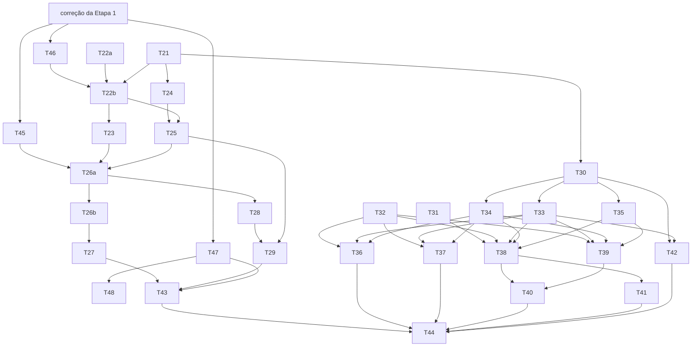

# Plano: Etapa 2 — contas, categorias e movimentações de ponta a ponta

## 1. Objetivo

Permitir que o usuário entre no moneylog, cadastre contas, registre receitas, despesas (Pix, débito e outros métodos), transferências, aplicações/resgates, ajustes e reembolsos em conta, e veja os mesmos números na lista de movimentações (duas visões, com totais do backend) e no dashboard real, tudo persistido no Postgres e calculado só no backend.

## 2. Escopo

### 2.1 Entra

| #   | Entregável                                                                                                                                                                                                                                                                                                                        | Quem         | Tasks      |
| --- | --------------------------------------------------------------------------------------------------------------------------------------------------------------------------------------------------------------------------------------------------------------------------------------------------------------------------------- | ------------ | ---------- |
| C   | Contrato da Etapa 2 em `contracts/openapi.yaml` (fonte da verdade do contrato), fundação web (erros, `Money`, `Slice`, relógio), springdoc                                                                                                                                                                                        | dev-backend  | T21        |
| A   | Auth de usuário único (ADR-003, S-30): ADR antes do código, dono criado no boot, login, refresh rotativo em cookie, logout, rate limit                                                                                                                                                                                            | dev-backend  | T22a, T22b |
| B   | Persistência JPA (entities, mappers, gateways), casos de uso e API de categorias (com seed, S-38), razão (`ledger_postings`), contas, movimentações (criar, consultar, editar, estornar, idempotência), visões da lista (registros e lançamentos com `totals`, S-47) e dashboard real (`/summary` com `hasAccounts`, `/upcoming`) | dev-backend  | T23–T29    |
| H   | Pendências herdadas do backend da Etapa 1 (§2.4): reidratação de `Transaction`/`Debt`/`RecurringTransaction`, FKs compostas, verificação da duplicata forçada (corrigida pela revisão de código da Etapa 1), D1/D2 atualizados                                                                                                    | dev-backend  | T45–T48    |
| F   | Tipos gerados do OpenAPI, ambiente real × mock por `fileReplacements`, auth no front (login, interceptor, 401), telas de contas, categorias, `/quick-add`, lista estilo planilha, detalhe/edição/estorno, dashboard ligado à API; BUG-02 e BUG-04                                                                                 | dev-frontend | T30–T42    |
| Q   | ITs com Testcontainers e conformidade com o contrato (back); E2E Playwright com backend real e contrato front/back                                                                                                                                                                                                                | tester       | T43, T44   |

Tipos de movimentação desta etapa (roadmap §2.3, itens 1–8 do PR 02): `EXPENSE` (métodos `CASH`, `DEBIT`, `PIX`, `TRANSFER`, `BOLETO`, `OTHER`), `INCOME`, `TRANSFER`, `INVESTMENT`, `ADJUSTMENT` e `REFUND` **em conta**.

### 2.2 Não entra

- Cartões, faturas, `CARD_PURCHASE`, `INVOICE_PAYMENT` e `REFUND` no cartão (Etapa 3). A ação rápida "Crédito" aparece desabilitada com "disponível em breve" (S-33, S-58).
- Pessoas, dívidas (`LOAN_GIVEN`, `MONEY_RECEIVED`, `DEBT_PAYMENT`), divisão de despesa e recorrências (Etapa 4). O compromisso futuro dessas fontes fica vazio no dashboard (S-64).
- Metas e reservado (Etapa 5; `reserved` = 0, S-22).
- Captura em texto livre ("café, 18, reunião…") com extração de campos (DS 01 B): fica para a etapa de IA/importação. O `/quick-add` desta etapa é um formulário curto (S-69).
- Importação, notificações, vault, IA, busca global, gráficos, inspector de 3 colunas no desktop (o detalhe abre como página/painel simples).
- TOTP e bloqueio por conta (ADR-003 avalia; S-65). Deploy na AWS e CI (a suíte fica pronta para entrar no CI).
- Edição inline na tabela e paleta de comandos (DS 01 A/E): a lista é só leitura com navegação para o detalhe.

### 2.3 Regra de trabalho com a Etapa 1

- O backend da Etapa 1 está **concluído** (T1–T11, 403 testes unitários e 56 ITs verdes). As dependências de domínio desta etapa estão satisfeitas; a coluna "Etapa 1" de §6.1 fica só como rastreabilidade.
- Nenhuma task desta etapa reescreve regra do domínio da Etapa 1. O `core` recebe arquivos novos (`core/<feature>/app/...`) ou métodos novos (fábricas de reidratação, T45). O schema novo entra em migrações **`V2.*`** com a numeração fixada neste plano (`V2.00` T46, `V2.01` T22b, `V2.02` T23, `V2.03` T26b, `V2.04` T27); as `V1.*` continuam editáveis até o primeiro deploy (regra de T11), mas esta etapa não as edita.
- Se uma assinatura ou `code` do domínio divergir do contrato, prevalece o domínio e o contrato é ajustado na task em curso.

### 2.4 Pendências herdadas do backend da Etapa 1

| Pendência (relatório do backend da Etapa 1)                                                                                                                                              | Destino                                                                                                                                                                                                                                                         |
| ---------------------------------------------------------------------------------------------------------------------------------------------------------------------------------------- | --------------------------------------------------------------------------------------------------------------------------------------------------------------------------------------------------------------------------------------------------------------- |
| Reidratação (`restore`) de `Transaction`, `Debt` e `RecurringTransaction` para os mappers da infra (`Account`, `Category`, `CreditCard` e `Person` já têm)                               | **T45** (as três; `Transaction` é pré-requisito de T26a)                                                                                                                                                                                                        |
| Gateways JPA e lentes SQL sobre `ledger_postings WHERE active`                                                                                                                           | **T24** (gravação, saldos e agregações por livro/competência, com prova de igualdade com o `Ledger` em memória), **T28** (lista) e **T29** (dashboard)                                                                                                          |
| Chave da duplicata forçada (S-43: `dedup_key` nulo × T10: chave derivada) e uso de `original_dedup_key` no `DuplicateClassifier`                                                         | **S-75 revisada** (chave derivada, decisão da revisão de código da Etapa 1, M3/BUG-QA-04). A correção está sendo aplicada pelo dev-backend agora; **T47** só verifica e completa o que faltar; os documentos ficam em **T48** (a importação em si é da Etapa 7) |
| FKs compostas `(id, user_id)` para o banco garantir que referências são do mesmo usuário                                                                                                 | decisão **S-76** e **T46** (`V2.00`)                                                                                                                                                                                                                            |
| Realização de recorrência no cartão usando a alocação de fatura (S-14)                                                                                                                   | **fora desta etapa**: entra no plano da Etapa 4 (recorrências), que depende da persistência de cartões da Etapa 3. Registrado em §7                                                                                                                             |
| Atualizar D1/D2 com `credit_card_billing_rules`, `original_dedup_key` e as suposições S-49 a S-55, S-77 (vencimento nunca no mesmo dia do fechamento) e S-78 (teto de R$ 999.999.999,99) | **T48** (só documentação; o que a correção da Etapa 1 já tiver escrito em D1/D2 é só conferido)                                                                                                                                                                 |

## 3. Perguntas em aberto e suposições

O usuário pediu para não bloquear. Cada lacuna foi resolvida com a opção mais conservadora e registrada abaixo, continuando a numeração depois da última em uso: S-48 no plano da Etapa 1 e **S-49 a S-55 registradas pelo backend da Etapa 1** (ex.: S-49, ocorrência de recorrência estornada pode ser realizada de novo; S-50, parcela cuja fatura já foi paga vai para a corrente; T48 as consolida em D1/D2). As novas começam em S-56. **S-77** (vencimento do cartão nunca no mesmo dia do fechamento) e **S-78** (teto de valor de R$ 999.999.999,99) foram registradas pela correção da Etapa 1, que está em andamento; as suposições do ajuste pós-revisão deste plano começam em **S-79**. As suposições da Etapa 1 continuam valendo (em especial S-1, S-4, S-5, S-9, S-10, S-22, S-26, S-30, S-33, S-34, S-38 e S-47).

### 3.1 A validar com o usuário (ordenadas por impacto)

| #    | Impacto | Suposição                                                                                                                                                                                                                                                                                                                                                                                                                                                                                                                                               | Motivo                                                                                                                                                                                                                          | Dono       | Tasks afetadas |
| ---- | ------- | ------------------------------------------------------------------------------------------------------------------------------------------------------------------------------------------------------------------------------------------------------------------------------------------------------------------------------------------------------------------------------------------------------------------------------------------------------------------------------------------------------------------------------------------------------- | ------------------------------------------------------------------------------------------------------------------------------------------------------------------------------------------------------------------------------- | ---------- | -------------- |
| S-58 | alto    | Na Etapa 2 a API aceita só os tipos em conta (`EXPENSE`, `INCOME`, `TRANSFER`, `INVESTMENT`, `ADJUSTMENT`, `REFUND` com `accountId`). Os demais tipos respondem `422 TRANSACTION_TYPE_NOT_AVAILABLE` até a etapa deles                                                                                                                                                                                                                                                                                                                                  | cartão e dívida precisam de persistência e telas próprias; aceitar o tipo sem a fatura/dívida gravaria um registro incompleto                                                                                                   | Produto    | T21, T26a, T38 |
| S-61 | alto    | `DashboardSummary.hasAccounts` = existe ao menos uma conta do usuário, **ativa ou arquivada**. O Início mostra o estado vazio só quando é `false`. O módulo `dashboard` do front deixa de chamar `GET /v1/accounts`                                                                                                                                                                                                                                                                                                                                     | conta com saldo zero não é "nada registrado" (README de `modules`); contar arquivadas evita esconder o histórico do mês de quem arquivou tudo; um campo no resumo evita a 3ª requisição e o acoplamento do dashboard com contas | Produto/UX | T21, T29, T42  |
| S-63 | alto    | `totals.cashFlow` da visão de registros: **sem** filtro de conta, é o efeito líquido de cada movimentação nas contas `CASH` (transferência CASH → CASH = 0; aplicação = saída; saldo inicial fora), igual a `month.cashFlow`. **Com** `accountId`, é o efeito só no livro daquela conta (a transferência aparece como saída numa conta e entrada na outra). Os dois casos saem das calculadoras do `core.finance` pelo caminho único de S-79                                                                                                            | é o que o usuário espera ao filtrar uma conta; sem filtro, mantém a identidade com o dashboard (D1 §2.10)                                                                                                                       | Produto    | T21, T28, T39  |
| S-68 | médio   | **Edição** (`PUT /v1/transactions/{id}`) dos tipos desta etapa: muda tudo menos `type`; grava a versão anterior em `transaction_revisions` (snapshot JSON) e troca os postings (os antigos ficam inativos com motivo `EDIT`). Movimentação estornada não é editável. A edição respeita o invariante do reembolso (S-81)                                                                                                                                                                                                                                 | BE 04 pede edição de verdade; D1 §2.4 regra 2 pede revisão anterior; trocar postings mantém o razão como única fonte                                                                                                            | Produto    | T27, T40       |
| S-73 | médio   | Movimentação que toca conta **arquivada** não pode ser editada nem estornada (`422 ACCOUNT_ARCHIVED`); o caminho é desarquivar a conta                                                                                                                                                                                                                                                                                                                                                                                                                  | a conta só arquiva com saldo zero (S-4); editar/estornar mudaria o saldo de uma conta arquivada                                                                                                                                 | Produto    | T27            |
| S-81 | alto    | **Edição × reembolso (revisão A3):** (a) uma `EXPENSE` com reembolsos ativos não pode mudar de categoria (`422 REFUND_CATEGORY_LOCKED`) e o novo valor tem de ser ≥ Σ dos reembolsos ativos ligados a ela (`422 REFUND_EXCEEDS_ORIGINAL`); (b) a edição de um `REFUND` com `refundOfTransactionId` revalida a origem por `validateRefundOrigin` com `alreadyRefunded` calculado **sem** contar o próprio reembolso (teto = valor da original − outros reembolsos ativos). D1 §2.4 regra 2 ganha a regra análoga à da dívida ("principal ≥ Σ quitações") | sem isso a edição cria consumo negativo por categoria ou reembolso maior que a despesa (S-9, PR 01 caso 9)                                                                                                                      | Produto    | T27, T40       |
| S-89 | médio   | **Estorno da despesa original com reembolso ativo (revisão A15), opção conservadora:** é **bloqueado**. A despesa vem com `voidable: false` e `voidBlockedBy: "HAS_ACTIVE_REFUNDS"`, e o `POST /void` responde `422 TRANSACTION_HAS_ACTIVE_REFUNDS`. O caminho é estornar antes os reembolsos. Revoga a frase "o reembolso continua ativo" do antigo T27 CA5                                                                                                                                                                                            | evita o estado "reembolso ativo apontando para original estornada" (consumo negativo na categoria e reembolso sem edição possível); é reversível e nada é apagado                                                               | Produto    | T27, T40       |
| S-88 | médio   | **Flags × conta arquivada (revisão A14):** se a movimentação toca uma conta arquivada (S-73), `editable = false`, `voidable = false` e `voidBlockedBy = "ACCOUNT_ARCHIVED"`. As flags vêm da policy **e** do estado das contas                                                                                                                                                                                                                                                                                                                          | o front não descobre a regra pelo erro; a recusa continua no backend                                                                                                                                                            | Produto    | T26a, T27, T40 |
| S-92 | médio   | **`archivable` (refina S-4, revisão A21):** a conta só arquiva com saldo zero **em todas as datas** (`Ledger.balanceAllDates`), contando movimentações futuras e saldo inicial com data futura; senão `422 ACCOUNT_WITH_BALANCE_CANNOT_BE_ARCHIVED`                                                                                                                                                                                                                                                                                                     | evita conta arquivada cujo saldo muda depois                                                                                                                                                                                    | Produto    | T25, T36       |
| S-93 | baixo   | **Refresh silencioso offline (revisão A10):** erro de rede (`status 0`) no refresh do boot não limpa a sessão nem leva a `/login`; o app abre o shell com o estado de erro/offline e "tentar de novo". Só `401 REFRESH_INVALID` leva ao `/login`                                                                                                                                                                                                                                                                                                        | o PWA aberto offline não expulsa o usuário                                                                                                                                                                                      | Produto/UX | T33            |
| S-59 | médio   | Seed de categorias no primeiro boot (quando o dono é criado): 13 `EXPENSE` do PR 00 §10 (Alimentação, Transporte, Moradia, Saúde, Educação, Lazer, Assinaturas, Tecnologia, Compras, Impostos, Contas, Família, Outros), **sem "Investimentos"** (S-38), e 3 `INCOME` (Salário, Trabalho extra, Outras receitas). Os nomes são dados do usuário em pt-BR (S-34); cada categoria de sistema tem `system_key` estável para o seed ser idempotente                                                                                                         | o PR 00 não lista categorias de receita e sem elas não dá para registrar receita; rendimento não é receita (S-26)                                                                                                               | Produto    | T23            |
| S-69 | médio   | `/quick-add` sem texto livre: modos **Despesa · Pix · Débito · Receita · Transferência** (e "Mais tipos": aplicação/resgate, ajuste, reembolso). Padrões: data = hoje no fuso `America/Sao_Paulo` (S-1), conta = a última usada (preferência local) ou a única ativa; Pix/Débito fixam o método; Despesa e Receita exigem escolher o método                                                                                                                                                                                                             | "velocidade vale mais que quantidade de campos" (PR 00 §15) sem simular extração que ainda não existe                                                                                                                           | Produto/UX | T38, T41       |
| S-70 | médio   | Categorias: criar, renomear, arquivar e desarquivar em Configurações → Categorias. **Nenhuma categoria é apagada** (nem as criadas pelo usuário); nome único por `kind` entre as não arquivadas (sem diferenciar maiúsculas)                                                                                                                                                                                                                                                                                                                            | "nada é apagado em silêncio"; movimentações antigas continuam apontando para a categoria                                                                                                                                        | Produto    | T23, T37       |
| S-71 | médio   | Lista: abre na visão **Registros** do mês corrente (1º ao último dia), `status = ACTIVE`; estornadas aparecem com o filtro "mostrar estornadas", riscadas e fora dos totais. Visão **Por competência** abre no mês corrente com `lens = CONSUMPTION`. Página de 50 linhas com "carregar mais"                                                                                                                                                                                                                                                           | o mês é o recorte do dashboard; estornada não conta em lente nenhuma (D1 §2.4)                                                                                                                                                  | Produto/UX | T28, T39       |
| S-60 | baixo   | O campo `origin?` de `INCOME` (D2 §4.2) sai do contrato desta etapa: não há coluna e a descrição cobre o caso. Volta, se fizer falta, com recorrências/importação                                                                                                                                                                                                                                                                                                                                                                                       | não inventar coluna sem regra                                                                                                                                                                                                   | Produto    | T21            |
| S-64 | baixo   | `GET /v1/dashboard/upcoming` sem parâmetros usa `from = hoje` e `to = hoje + 30 dias`; vencidos não pagos entram sempre. Nesta etapa as fontes de compromisso (faturas, dívidas, recorrências) ainda não são persistidas: o resumo devolve todos os campos com zero e `upcoming` vazio, calculados pelo mesmo `CommitmentSchedule`                                                                                                                                                                                                                      | sem funcionalidade fictícia; quando as fontes chegarem, só os adaptadores mudam                                                                                                                                                 | Produto    | T29, T42       |
| S-56 | baixo   | **BUG-02:** um nome só para a seção ("Movimentações"/"Transactions"/"Movimientos"). Na barra inferior o rótulo usa a tipografia de tab bar (10 px, peso médio, sem padding lateral, sem reticências), como a tab bar do iOS. Sem rótulo curto alternativo                                                                                                                                                                                                                                                                                               | rótulo curto criaria dois nomes para o mesmo destino, que é o problema apontado no BUG-04, e um nome acessível diferente do visível fere a WCAG 2.5.3                                                                           | UX         | T31            |
| S-57 | baixo   | **BUG-04:** a ação e a página de `/quick-add` se chamam **"Novo registro"** (en "New entry", es "Nuevo registro") em todo lugar: botão da sidebar, nome acessível do "+", título da página e chave `nav.quickAdd`. A rota continua **`/quick-add`**                                                                                                                                                                                                                                                                                                     | o PR 00 §15 nomeia a rota e os atalhos do iOS/Android dependem dela; "captura rápida" sugere a extração de texto livre, que não entra nesta etapa                                                                               | UX         | T31            |

### 3.2 Decisões de arquitetura (dono: Arquitetura; o usuário só precisa saber)

| #    | Impacto | Decisão                                                                                                                                                                                                                                                                                                                                                                                                                                                                                                                                                                                                                                                                                                                                                                                                                                                                                                                                                                                                                                                                                                                                                                                                                                                                                       | Motivo                                                                                                                                                                                                                     | Tasks                                                             |
| ---- | ------- | --------------------------------------------------------------------------------------------------------------------------------------------------------------------------------------------------------------------------------------------------------------------------------------------------------------------------------------------------------------------------------------------------------------------------------------------------------------------------------------------------------------------------------------------------------------------------------------------------------------------------------------------------------------------------------------------------------------------------------------------------------------------------------------------------------------------------------------------------------------------------------------------------------------------------------------------------------------------------------------------------------------------------------------------------------------------------------------------------------------------------------------------------------------------------------------------------------------------------------------------------------------------------------------------- | -------------------------------------------------------------------------------------------------------------------------------------------------------------------------------------------------------------------------- | ----------------------------------------------------------------- |
| S-66 | alto    | **Contrato primeiro:** `contracts/openapi.yaml` (versão do OpenAPI decidida por S-84, escrito à mão em T21) é a fonte da verdade. O back prova conformidade (toda **requisição e** resposta dos ITs é validada contra o arquivo, e um teste confere que cada operação do arquivo tem handler e vice-versa); o front gera os tipos dele (`openapi-typescript`) em `src/util/api/schema.gen.ts`, que só `src/modules/*/infra` pode importar (regra nova no dependency-cruiser). springdoc continua gerando a documentação viva no perfil `dev`                                                                                                                                                                                                                                                                                                                                                                                                                                                                                                                                                                                                                                                                                                                                                  | o front trabalha em paralelo desde o início, e a divergência quebra build/teste nos dois lados (FE 05 "contrato vivo")                                                                                                     | T21, T30, T43, T44                                                |
| S-65 | médio   | Auth (ADR-003): o hash BCrypt do dono fica **só no ambiente** (`MONEYLOG_OWNER_PASSWORD_HASH` ou `..._FILE`), não no banco; `users` tem **uma única linha**, o dono (S-82). JWT HS256 de 15 min via Spring Security Resource Server (Nimbus, sem jjwt), `JWT_SECRET` com ≥ 32 bytes (o app não sobe com menos). Refresh opaco de 30 dias, rotativo, gravado como hash, com detecção de reuso (reuso revoga a família inteira) e janela de tolerância (S-83). Rate limit em memória: 5 falhas de login por IP em 15 min → `429` com `Retry-After`, com o IP resolvido como em S-86. Cookie sempre `Secure` (S-85). Sem CORS (dev usa proxy; produção usa um domínio só). TOTP fica fora desta etapa e a ADR-003 registra a reavaliação antes do deploy                                                                                                                                                                                                                                                                                                                                                                                                                                                                                                                                         | um usuário, uma instância; trocar a senha é trocar o `.env`; o menor número de bibliotecas novas                                                                                                                           | T22a, T22b, T33                                                   |
| S-67 | médio   | **Mock só por configuração de build:** `src/app/config/environment.ts` passa a ter `apiMocks: false` (API real) e `environment.mock.ts` (`apiMocks: true`) entra por `fileReplacements` na configuração `mock` (`npm run start:mock`) e na configuração `production-mock` (build de produção + `environment.mock.ts`, só para o projeto Playwright `prod`, que testa o PWA/SW). Produção e `start:local` usam a API real. Em modo mock, cada módulo responde com `mock-data` vazio e a auth devolve uma sessão falsa, para a suíte E2E do shell (Etapa 1) continuar rodando sem backend. **Nomes dos projetos Playwright (revisão A11):** `mock` (suíte do shell, `start:mock`; substitui o antigo `dev`), `prod` (PWA sobre `production-mock`) e `integration` (backend real, T44)                                                                                                                                                                                                                                                                                                                                                                                                                                                                                                           | a Etapa 1 pediu o desligamento por `fileReplacements`; a tela não sabe se é mock (FE 05)                                                                                                                                   | T30, T33, T44                                                     |
| S-72 | médio   | **Idempotência** (D2 §3.4 item 8) em `POST /v1/transactions`: tabela `idempotency_keys (user_id, scope, key, request_hash, resource_id, created_at)` com `user_id` → `users` (S-76), única por `(user_id, scope, key)`, válida por 24 h; o mecanismo está em S-87. Mesma chave + mesmo corpo → mesma resposta (`201` com o mesmo recurso); mesma chave + corpo diferente → `409 IDEMPOTENCY_KEY_REUSED`. Sem job de limpeza nesta etapa (chaves vencidas são ignoradas e sobrescritas)                                                                                                                                                                                                                                                                                                                                                                                                                                                                                                                                                                                                                                                                                                                                                                                                        | clique duplo e reenvio não duplicam (PR 02, definição de pronto)                                                                                                                                                           | T26b                                                              |
| S-62 | médio   | Flags calculadas no backend para o front não decidir regra: `Account.openingEditable` (sem movimentação ativa), `Account.archivable` (`ACTIVE` e saldo zero em todas as datas, S-4/S-92), `Transaction.editable` e `Transaction.voidable`/`voidBlockedBy` (D2 §4.2), considerando a conta arquivada (S-88) e os reembolsos ativos (S-89)                                                                                                                                                                                                                                                                                                                                                                                                                                                                                                                                                                                                                                                                                                                                                                                                                                                                                                                                                      | o front só habilita/desabilita a ação; a recusa continua no backend                                                                                                                                                        | T21, T25, T26a, T27                                               |
| S-74 | baixo   | Leitura da lista: a página de `items` é por `Slice` (sem `COUNT`, consulta SQL com filtro e ordem `date desc, created_at desc, id desc`). Os `totals` **não** vêm de agregação SQL: saem das calculadoras do `core.finance` sobre o filtro inteiro, pelo caminho único de S-79; `totals.count` segue S-80 _(revisão A1/A2: substitui "agregação SQL entregue às calculadoras", que não existe no `core`)_                                                                                                                                                                                                                                                                                                                                                                                                                                                                                                                                                                                                                                                                                                                                                                                                                                                                                     | BE 05 (sem `COUNT` na página) e D2 §3.4 (mesma fonte para lista e dashboard)                                                                                                                                               | T28                                                               |
| S-75 | médio   | **Duplicata forçada (revisada pela revisão de código da Etapa 1, M3, e BUG-QA-04):** **substitui S-43**. A movimentação forçada é gravada com a **chave derivada** (`DedupKey.forcedIn(lote)`, não nula, dentro do índice único) em `dedup_key`, e a chave original da linha vai para `original_dedup_key`. O `DuplicateClassifier` compara a chave da linha nova com `dedup_key` **e** `original_dedup_key` das movimentações **ativas**, para que reimportar o mesmo arquivo marque também a linha antes forçada como `DUPLICATE`                                                                                                                                                                                                                                                                                                                                                                                                                                                                                                                                                                                                                                                                                                                                                           | toda movimentação importada tem chave efetiva; o índice único também barra aplicar duas vezes a mesma linha forçada (retry do lote); a decisão de forçar não se perde numa reimportação, nem depois de estornar a original | correção da Etapa 1 (em andamento), T47 (verificação), T48 (docs) |
| S-76 | médio   | **FKs compostas** `(id, user_id)`: cada tabela pai ganha `UNIQUE (id, user_id)` e as referências entre tabelas de negócio passam a `FOREIGN KEY (x_id, user_id)`, de modo que o banco recusa uma movimentação apontando para conta/categoria de outro usuário. `ledger_postings.book_id` (polimórfico) fica fora e continua garantido pela aplicação. As tabelas novas desta etapa seguem a regra (revisão A13): `refresh_tokens.user_id` → `users`; `idempotency_keys.user_id` → `users` (`resource_id` é polimórfico por `scope` e fica sem FK); `transaction_revisions` tem `user_id` e `FOREIGN KEY (transaction_id, user_id)` → `transactions (id, user_id)`                                                                                                                                                                                                                                                                                                                                                                                                                                                                                                                                                                                                                             | defesa em profundidade num app financeiro; o filtro por `userId` dos gateways continua sendo a primeira barreira                                                                                                           | T46, T22b, T26b, T27                                              |
| S-79 | alto    | **Caminho único de cálculo (revisão A1):** lista, entries, dashboard e saldo das contas usam **as mesmas calculadoras do `core.finance`** sobre o mesmo carregamento. Uma porta `FinancialRecordsGateway.load(userId)` (T24) devolve o `FinancialRecords` do usuário (contas, movimentações ativas e estornadas, postings ativos; `records.ledger()` monta o `Ledger`). `month.cashFlow` e `totals.cashFlow` saem da **mesma** função `CashFlowReport.between`, que ganha uma sobrecarga com um predicado de movimentação (a versão atual delega com "todas"); os filtros `type`/`categoryId`/`method`/`q`/`status` viram esse predicado. O filtro `accountId` usa uma **função nova** do `core.finance`, `CashFlowReport.forAccount(records, ledger, accountId, from, to, filtro)` (efeito de cada movimentação no livro daquela conta), com teste unitário próprio. `EntryReport.of` ganha a mesma sobrecarga com predicado. `currentBalance` das contas sai de `Ledger.balance` sobre o mesmo carregamento. A igualdade lista = dashboard vale **por construção** (PR 01 regra 10, D1 §2.10); os ITs de §4.7 continuam como prova. Agregação SQL dos totais fica como otimização futura, só com a prova de igualdade e se a medição de T28 CA7 pedir (`FinancialSnapshot`, D2 §3.4 item 6) | dois caminhos para o mesmo número divergem em silêncio quando alguém otimiza só um lado; carregar tudo em memória é aceitável para um usuário no MVP                                                                       | T24, T25, T28, T29                                                |
| S-80 | médio   | **`totals.count` (revisão A2):** número de movimentações **ativas** que casam com o filtro inteiro (período, tipo, conta, categoria, método, `q`), com a mesma definição em todos os critérios; não sai de `CashFlowReport.count` (que conta só efeito ≠ 0). A transferência CASH → CASH conta (T28 CA1: 6). Com `status=VOIDED`, `count` = 0 e `cashFlow` zerado, embora `items` traga as estornadas; o rodapé do front diz "estornadas não entram nos totais". `CashFlowReport.count` continua existindo no `core`, mas não é exposto no contrato                                                                                                                                                                                                                                                                                                                                                                                                                                                                                                                                                                                                                                                                                                                                           | um número só para "registros" no rodapé, independente da implementação                                                                                                                                                     | T21, T28, T39                                                     |
| S-82 | alto    | **Dono = a única linha de `users` (revisão A4):** no boot, se `users` está vazia, o dono é criado com `MONEYLOG_OWNER_EMAIL` e `OwnerCreated` é publicado; se já existe a linha e o e-mail é outro, o **e-mail é atualizado mantendo o `id`** (log `INFO` com o e-mail antigo mascarado) e `OwnerCreated` não é publicado. Nunca existe uma segunda linha criada pelo app: o `EnsureOwnerUseCase` só insere com a tabela vazia, e um IT prova isso. **Sem** constraint de linha única no banco, porque os ITs de isolamento precisam inserir um segundo usuário                                                                                                                                                                                                                                                                                                                                                                                                                                                                                                                                                                                                                                                                                                                               | trocar o e-mail no `.env` não pode deixar todos os dados órfãos (filtrados por `userId`)                                                                                                                                   | T22b                                                              |
| S-83 | médio   | **Tolerância na detecção de reuso do refresh (revisão A5):** um refresh já rotacionado, reapresentado em até **30 s** depois da rotação, não é reuso: gera um novo par **da mesma família** (o sucessor anterior continua válido até expirar ou ser rotacionado) e não revoga nada. Depois de 30 s, ou se o token já tinha sido revogado por logout/reuso, vale a regra de reuso (revoga a família). A janela é `moneylog.auth.refresh.reuse-grace` (padrão `PT30S`). Single-flight entre abas no front (Web Locks/`BroadcastChannel`) fica opcional                                                                                                                                                                                                                                                                                                                                                                                                                                                                                                                                                                                                                                                                                                                                          | duas abas, F5 durante um refresh ou o `provideAppInitializer` em duas abas não podem derrubar a sessão                                                                                                                     | T22b, T22a                                                        |
| S-84 | alto    | **Versão do OpenAPI e validação (revisão A6):** T21 começa com um spike que prova que o `swagger-request-validator-mockmvc` (versão fixada) carrega e valida um arquivo **OpenAPI 3.1** com os recursos que o contrato usa (`oneOf` + `discriminator`, `type: [string, "null"]`, `$ref` com irmãos). Se o spike falhar em qualquer um deles, o contrato é escrito em **OpenAPI 3.0.3** (`nullable: true`), que `openapi-typescript`, Redocly e `ajv` (draft-04/OpenAPI 3.0) também suportam; o resultado fica registrado em D2 §4 e no relatório de T21. Os ITs validam **requisições e respostas** contra o arquivo                                                                                                                                                                                                                                                                                                                                                                                                                                                                                                                                                                                                                                                                          | sem isso, a garantia do lado do back em S-66 pode não existir; um campo renomeado no DTO de entrada só apareceria no E2E                                                                                                   | T21, T30, T44                                                     |
| S-85 | médio   | **Cookie `Secure` em dev (revisão A7):** caminho principal = **HTTPS local com `mkcert`**: `ng serve --ssl` com o certificado do `mkcert` (CA local instalada no Mac e, via perfil, no iPhone), host `moneylog.localhost` e o IP da LAN no certificado, proxy `/v1` igual; o cookie é **sempre** `Secure`. Plano B (só se o caminho principal não servir): `moneylog.auth.cookie.secure` com padrão `true`, aceito como `false` **só** com o perfil `dev` ativo **e** todas as `MONEYLOG_ALLOWED_ORIGINS` em `localhost`/`127.0.0.1`; em qualquer outro caso o app não sobe. Sem prefixo `__Host-` (exige `Path=/`)                                                                                                                                                                                                                                                                                                                                                                                                                                                                                                                                                                                                                                                                           | Safari/WebKit descarta `Secure` em `http://localhost`; um toggle solto pode levar `secure=false` para produção                                                                                                             | T22a, T22b, T30                                                   |
| S-86 | médio   | **Rate limit atrás do CloudFront (revisão A8):** o IP do cliente vem de `X-Forwarded-For` **só** quando a conexão chega de um proxy confiável (`server.forward-headers-strategy=NATIVE` + `moneylog.security.trusted-proxies`, lista de CIDRs; vazio = usa o IP remoto e ignora o header). Login com e-mail errado compara a senha com um hash BCrypt fictício (tempo constante). `logout` também checa o `Origin`                                                                                                                                                                                                                                                                                                                                                                                                                                                                                                                                                                                                                                                                                                                                                                                                                                                                            | sem isso todos os clientes têm o mesmo IP (um erro de qualquer um bloqueia o dono) ou o limite é contornável forjando o header                                                                                             | T22a, T22b                                                        |
| S-87 | médio   | **Mecanismo da idempotência (revisão A12):** a chave é gravada **na mesma transação de banco** da criação. Uma requisição concorrente com a mesma chave bloqueia no índice único; depois do commit da primeira, lê a chave e devolve o recurso (`201`, mesmo `id`). Se a primeira falhar (4xx ou 5xx), a chave sai no rollback: **erros não são memorizados** (documentado no contrato). `request_hash` = SHA-256 do **comando canônico** (campos do comando normalizados, `amount` com 2 casas, ordem fixa), não dos bytes do corpo. `scope` = rota (`POST /v1/transactions`), para reutilizar a tabela em `/invoices/{id}/payments`. O replay devolve o **estado atual** do recurso, não uma cópia da primeira resposta. Sem coluna `status`                                                                                                                                                                                                                                                                                                                                                                                                                                                                                                                                                | evita o estado "em andamento" sem regra e é o que o T26b CA testa em paralelo                                                                                                                                              | T26b                                                              |
| S-90 | médio   | **Nomes de entrada × saída de `Transaction` (revisão A18):** a resposta mantém os nomes genéricos (`account`, `counterpartAccount`, `adjustmentKind`, `refundOf`), bons para a lista, e ganha `voidReason`, `voidedAt` e `source` (`MANUAL` nesta etapa). O contrato documenta, por `type`, o mapa resposta → `TransactionInput` (ex.: `TRANSFER`: `account.id` → `fromAccountId`, `counterpartAccount.id` → `toAccountId`; `INVESTMENT`: `account.id` → `cashAccountId`, `counterpartAccount.id` → `investmentAccountId`; `ADJUSTMENT`: `adjustmentKind` → `kind`; `REFUND`: `refundOf.id` → `refundOfTransactionId`). O front implementa esse mapa num lugar só (`transactions-response.mapper.ts`, T35)                                                                                                                                                                                                                                                                                                                                                                                                                                                                                                                                                                                    | o formulário de edição (T40) precisa reconstruir a entrada; T40 exibe o motivo do estorno                                                                                                                                  | T21, T26a, T35, T40                                               |
| S-91 | baixo   | **Contas nos selects (revisão A20):** o contrato de `GET /v1/accounts` continua paginado (D2 §4.1). Para selects, a facade de contas tem `loadAll(status)`, que pede `pageSize=50` e pagina até `hasNext=false`                                                                                                                                                                                                                                                                                                                                                                                                                                                                                                                                                                                                                                                                                                                                                                                                                                                                                                                                                                                                                                                                               | a conta 11+ não pode sumir do select do `/quick-add`                                                                                                                                                                       | T34, T38, T41                                                     |

### 3.3 Suposições registradas pelo dev-backend na onda 1 (T21, T22a, T45–T48)

Opções conservadoras adotadas sem bloquear; a validar. Continuam a numeração depois de S-93.

| #    | Impacto | Suposição                                                                                                                                                                                                                                                                                                                                                                                                                                                                                                            | Motivo                                                                                             | Dono                | Tasks      |
| ---- | ------- | -------------------------------------------------------------------------------------------------------------------------------------------------------------------------------------------------------------------------------------------------------------------------------------------------------------------------------------------------------------------------------------------------------------------------------------------------------------------------------------------------------------------- | -------------------------------------------------------------------------------------------------- | ------------------- | ---------- |
| S-94 | baixo   | **Estado gravado corrompido na reidratação** (`Transaction.restore`, `Debt.restore`, `RecurringTransaction.restore`) lança `TransactionStateInconsistentException` / `DebtStateInconsistentException` / `RecurrenceStateInconsistentException` (`TRANSACTION_STATE_INCONSISTENT`, `DEBT_STATE_INCONSISTENT`, `RECURRENCE_STATE_INCONSISTENT`), que estendem `DomainException` direto e viram **500**, não 422. As validações de construção (`BusinessRuleException`) que falham na reidratação são embrulhadas nelas | dado corrompido ou bug de mapeamento não é erro do usuário; o `500` não vaza a mensagem            | Arquitetura         | T45        |
| S-95 | baixo   | `Debt` e `RecurringTransaction` **não** ganham `version` no domínio na T45 (só `Transaction`, como pede a revisão A17); o lock otimista delas fica na entity JPA e entra no domínio quando a Etapa 4 precisar                                                                                                                                                                                                                                                                                                        | escopo mínimo da T45; `Account`, `Category` e `CreditCard` já têm                                  | Arquitetura         | T45        |
| S-96 | baixo   | `ProblemDetail` sempre com `type` = `urn:moneylog:problem:<code>` e `instance` (caminho); erros de rota do Spring MVC ganham `code` (`NOT_FOUND`, `METHOD_NOT_ALLOWED`, `NOT_ACCEPTABLE`, `UNSUPPORTED_MEDIA_TYPE`). Erros de validação: `errors[].code` é a constraint em UPPER_SNAKE (`NOT_BLANK`, `PATTERN`) ou `REQUIRED`, `INVALID_FORMAT`, `MALFORMED_JSON`, `OUT_OF_RANGE`                                                                                                                                    | o contrato exige `type` e o validador reprova campo não declarado                                  | Arquitetura         | T21        |
| S-97 | baixo   | Trocar a senha do dono **não** revoga os refresh tokens já emitidos; para derrubar todas as sessões, trocar o `JWT_SECRET` e limpar `refresh_tokens` (registrado na ADR-003)                                                                                                                                                                                                                                                                                                                                         | a senha vive só no ambiente e não há rota de troca; revogar tudo na reinicialização seria surpresa | Produto/Arquitetura | T22a, T22b |
| S-98 | baixo   | No contrato, `amount` de **movimentação** é string `^\d{1,13}(\.\d{1,2})?$` (aceita `"18"` e `"18.5"`), mas `Money` (saldo inicial, respostas) é sempre `{ amount: "0.00" }` com 2 casas; `Money` de entrada com 1 casa é recusado pelo validador do contrato e aceito pelo backend                                                                                                                                                                                                                                  | segue §4.1 para o `amount` da movimentação e D2 §4 para `Money`                                    | Arquitetura         | T21        |
| S-99 | baixo   | A `V2.00` renomeia as FKs simples para `fk_<tabela>_<coluna>_user` (com `DROP CONSTRAINT` + `ADD CONSTRAINT`, sem apagar tabela nem linha); o teste que proibia qualquer `DROP` nas migrações passou a proibir só `DROP TABLE`, `DROP COLUMN`, `DROP SCHEMA`, `TRUNCATE` e `DELETE`                                                                                                                                                                                                                                  | T46 só pode trocar FKs trocando constraints                                                        | Arquitetura         | T46        |

## 4. Contrato de API (delta sobre D2 §4)

O contrato completo vai para `contracts/openapi.yaml` em T21, e T21 atualiza D2 §4 com este delta. Convenções de D2 §4 continuam: `Money = { amount: "1200.00", currency: "BRL" }`, criação `201` + `Location` + recurso, edição `PUT` com `version`, ações `200` + recurso, `Slice = { items, hasNext }`, valores calculados prontos.

### 4.1 Erros (todas as rotas)

`ProblemDetail` (RFC 9457) com extensões: `{ type, title, status, detail, code, traceId, errors?: [{ field, code, message }] }`.

| Status | Quando                                                                                                            | `code`                                                                                                                                                                                                                                                                                                                                                                                                                                                                                                                                                                                                                                                                                                                                                                                                                                                                                                                                                                                                 |
| ------ | ----------------------------------------------------------------------------------------------------------------- | ------------------------------------------------------------------------------------------------------------------------------------------------------------------------------------------------------------------------------------------------------------------------------------------------------------------------------------------------------------------------------------------------------------------------------------------------------------------------------------------------------------------------------------------------------------------------------------------------------------------------------------------------------------------------------------------------------------------------------------------------------------------------------------------------------------------------------------------------------------------------------------------------------------------------------------------------------------------------------------------------------ |
| 400    | Bean Validation, JSON inválido, `amount` fora de `^\d{1,13}(\.\d{1,2})?$`, enum desconhecido                      | `VALIDATION_FAILED` (com `errors[]`)                                                                                                                                                                                                                                                                                                                                                                                                                                                                                                                                                                                                                                                                                                                                                                                                                                                                                                                                                                   |
| 401    | sem token, token inválido/expirado                                                                                | `UNAUTHENTICATED`                                                                                                                                                                                                                                                                                                                                                                                                                                                                                                                                                                                                                                                                                                                                                                                                                                                                                                                                                                                      |
| 404    | recurso inexistente **ou de outro usuário**                                                                       | `<FEATURE>_NOT_FOUND`                                                                                                                                                                                                                                                                                                                                                                                                                                                                                                                                                                                                                                                                                                                                                                                                                                                                                                                                                                                  |
| 409    | `version` desatualizada; nome de categoria repetido (inclusive ao desarquivar); chave de idempotência reutilizada | `VERSION_CONFLICT`, `CATEGORY_NAME_TAKEN`, `IDEMPOTENCY_KEY_REUSED`                                                                                                                                                                                                                                                                                                                                                                                                                                                                                                                                                                                                                                                                                                                                                                                                                                                                                                                                    |
| 422    | regra de negócio                                                                                                  | o `code` estável da exceção do domínio (T3/T4). Esperados: `ACCOUNT_WITH_BALANCE_CANNOT_BE_ARCHIVED`, `ACCOUNT_ARCHIVED`, `ACCOUNT_OPENING_LOCKED`, `CATEGORY_ARCHIVED`, `CATEGORY_KIND_MISMATCH`, `TRANSFER_SAME_ACCOUNT`, `TRANSFER_ACROSS_LIQUIDITY`, `INVESTMENT_ACCOUNTS_MISMATCH`, `REFUND_EXCEEDS_ORIGINAL`, `ADJUSTMENT_REASON_REQUIRED`, `TRANSACTION_ALREADY_VOIDED`, `TRANSACTION_NOT_EDITABLE`, `TRANSACTION_TYPE_NOT_AVAILABLE`; e os que o domínio já lança nestes fluxos: `TRANSACTION_ACCOUNT_NOT_CASH`, `TRANSACTION_PAYMENT_METHOD_REQUIRED`, `ADJUSTMENT_YIELD_REQUIRES_INVESTMENT_ACCOUNT`, `REFUND_INVALID_ORIGINAL`, `TRANSACTION_VOID_REASON_REQUIRED`, `ACCOUNT_ALREADY_ARCHIVED`, `ACCOUNT_NOT_ARCHIVED`, `CATEGORY_ALREADY_ARCHIVED`, `CATEGORY_NOT_ARCHIVED` _(revisão 2026-10-04: nomes alinhados aos `code` reais do `core`)_; novos desta etapa (ajuste pós-revisão, entram no `core` em T27): `REFUND_CATEGORY_LOCKED` (S-81) e `TRANSACTION_HAS_ACTIVE_REFUNDS` (S-89) |
| 429    | rate limit do login                                                                                               | `TOO_MANY_ATTEMPTS` (+ `Retry-After`)                                                                                                                                                                                                                                                                                                                                                                                                                                                                                                                                                                                                                                                                                                                                                                                                                                                                                                                                                                  |
| 500    | inesperado                                                                                                        | `INTERNAL_ERROR`, sem mensagem interna                                                                                                                                                                                                                                                                                                                                                                                                                                                                                                                                                                                                                                                                                                                                                                                                                                                                                                                                                                 |

Se o domínio já usa outro nome para um desses `code`, vale o do domínio e T21/T26a ajustam o contrato (a lista acima é a referência para o front).

### 4.2 Auth

| Método | Caminho            | Corpo                 | Resposta                                                                                                                                                                                                         |
| ------ | ------------------ | --------------------- | ---------------------------------------------------------------------------------------------------------------------------------------------------------------------------------------------------------------- |
| POST   | `/v1/auth/login`   | `{ email, password }` | `200 { accessToken, expiresAt }` + `Set-Cookie: ml_refresh=…; HttpOnly; Secure; SameSite=Strict; Path=/v1/auth; Max-Age=2592000`; `401 INVALID_CREDENTIALS` (mesma resposta para e-mail ou senha errados); `429` |
| POST   | `/v1/auth/refresh` | — (cookie)            | `200 { accessToken, expiresAt }` + cookie novo (rotação); `401 REFRESH_INVALID`; `403 ORIGIN_NOT_ALLOWED` quando o `Origin` não está em `MONEYLOG_ALLOWED_ORIGINS`                                               |
| POST   | `/v1/auth/logout`  | — (cookie)            | `204` + cookie expirado; revoga a família do refresh; `403 ORIGIN_NOT_ALLOWED` como no refresh (S-86)                                                                                                            |

O cookie é **sempre** `Secure` (S-85). O refresh reapresentado até 30 s depois de rotacionado devolve um par novo da mesma família, sem revogar (S-83). O IP do rate limit segue S-86.

Rotas públicas: as três acima, `GET /actuator/health`, e `/v3/api-docs/**` + `/swagger-ui/**` só no perfil `dev`.

### 4.3 Contas

D2 §4.1, com:

- `GET /v1/accounts?status=ACTIVE|ARCHIVED&page&pageSize` (sem `status` = todas), ordem `name asc`.
- `Account` ganha `openingEditable: boolean` e `archivable: boolean` (S-62; `archivable` exige saldo zero em todas as datas, S-92). `currentBalance` sai do mesmo cálculo do dashboard (S-79).
- Selects de conta no front usam `pageSize=50` e paginam até `hasNext=false` (S-91); o contrato não muda.
- `PUT /v1/accounts/{id}` `{ name, institution?, type?, openingBalance?, openingDate?, version }`: `type`, `openingBalance` e `openingDate` só são aceitos com `openingEditable = true` (senão `422 ACCOUNT_OPENING_LOCKED`). A correção do saldo inicial desativa o par `ACCOUNT_OPENING` antigo e grava um novo (D1 §2.2).
- `POST /v1/accounts/{id}/archive` → `422 ACCOUNT_WITH_BALANCE_CANNOT_BE_ARCHIVED` com saldo ≠ 0; `/unarchive` → `200`.

### 4.4 Categorias

| Método | Caminho                                                     | Corpo                                 | Resposta                                                    |
| ------ | ----------------------------------------------------------- | ------------------------------------- | ----------------------------------------------------------- |
| GET    | `/v1/categories?kind=EXPENSE\|INCOME&includeArchived=false` | —                                     | `Category[]` (lista curta, sem paginação), ordem `name asc` |
| POST   | `/v1/categories`                                            | `{ name, kind }`                      | `201 Category`                                              |
| PUT    | `/v1/categories/{id}`                                       | `{ name, version }` (`kind` não muda) | `200 Category`                                              |
| POST   | `/v1/categories/{id}/archive` · `/unarchive`                | —                                     | `200 Category`                                              |

`Category = { id, name, kind, system, archived, version }`. `unarchive` com nome igual ao de outra categoria ativa do mesmo `kind` → `409 CATEGORY_NAME_TAKEN`.

### 4.5 Movimentações

D2 §4.2, com:

- `POST /v1/transactions` aceita só os tipos de S-58; `INCOME` sem `origin` (S-60). Header `Idempotency-Key` (UUID) **obrigatório** nesta rota (sem ele, `400`). Mecanismo em S-87: replay com o mesmo comando → `201` com o estado **atual** do recurso; erros não são memorizados (a mesma chave pode ser reenviada depois de um 4xx/5xx).
- `REFUND` desta etapa: `{ type, amount, date, description, notes?, accountId, categoryId (EXPENSE), refundOfTransactionId? }`.
- `ADJUSTMENT`: `{ ..., accountId, direction, kind?, reason }`; `INVESTMENT`: `{ ..., cashAccountId, investmentAccountId, direction }`; `TRANSFER`: `{ ..., fromAccountId, toAccountId }`.
- `Transaction` (resposta) para estes tipos: `account` (`{id,name}`: conta da despesa/receita/ajuste/reembolso, origem da transferência, conta CASH do investimento), `counterpartAccount` (destino da transferência, conta de investimento), `category`, `method`, `direction`, `adjustmentKind`, `reason`, `refundOf` (`{id, description}` ou `null`), `impact` (`cash`, `consumption[]`, `netWorth`, `commitment` = 0), `editable`, `voidable`, `voidBlockedBy` (nesta etapa: `null`, `ACCOUNT_ARCHIVED` ou `HAS_ACTIVE_REFUNDS`; S-88, S-89), `status`, `voidReason`, `voidedAt`, `source` (`MANUAL`), `version`, timestamps. `card` e `installments` vêm `null`/`[]`.
- O contrato documenta, por `type`, o mapa resposta → `TransactionInput` (S-90).
- `PUT /v1/transactions/{id}`: mesmo corpo do `POST` do tipo + `version` (S-68). `type` diferente → `422 TRANSACTION_NOT_EDITABLE`. Despesa com reembolsos ativos: trocar categoria → `422 REFUND_CATEGORY_LOCKED`; valor < Σ reembolsos ativos → `422 REFUND_EXCEEDS_ORIGINAL` (S-81).
- `POST /v1/transactions/{id}/void` `{ reason }` → `200 Transaction` com `status: VOIDED` e `voidReason`; despesa com reembolso ativo → `422 TRANSACTION_HAS_ACTIVE_REFUNDS` (S-89).
- `GET /v1/transactions`: filtros de D2 §4.2 (`from`, `to`, `type`, `accountId`, `categoryId`, `method`, `status` padrão `ACTIVE`, `q`), `TransactionSlice` com `totals { count, cashFlow { in, out, net } }` (S-63, S-74, S-79); `count` = movimentações ativas que casam com o filtro (S-80).
- `GET /v1/entries?competence&lens&categoryId&accountId&method`: `EntrySlice` de D2 §4.2, com `totals { total, byCategory[] }`. Com `lens = INCOME` os valores vêm positivos; reembolso aparece negativo em `CONSUMPTION`.

### 4.6 Dashboard

D2 §4.4, com:

- `DashboardSummary.hasAccounts: boolean` (S-61).
- `GET /v1/dashboard/upcoming?from&to` com o padrão de S-64.

### 4.7 Garantias testadas (por IT em T29 e por E2E em T44)

As igualdades valem **por construção** (mesmas calculadoras sobre o mesmo carregamento, S-79); os testes são a prova. Para o mês M do `asOf`:

- `GET /v1/entries?competence=M&lens=CONSUMPTION` → `totals.total` = `summary.month.consumption`;
- `lens=INCOME` → `totals.total` = `summary.month.income`;
- `GET /v1/transactions?from=<1º de M>&to=<último dia de M>` (sem outros filtros) → `totals.cashFlow` = `summary.month.cashFlow`;
- Σ `currentBalance` das contas `CASH` ativas e arquivadas = `summary.balances.inAccounts`.

## 5. Tasks

> Convenções de backend: `export JAVA_HOME=/opt/homebrew/opt/openjdk@21/libexec/openjdk.jdk/Contents/Home`; `./mvnw test` e `./mvnw verify` verdes; caso de uso = interface `XxxUseCase.handle(cmd)` + `XxxUseCaseImpl` POJO em `core/<feature>/app` (BE 03), sem Spring; porta em `core/<feature>/app/gateways`; `infra/<feature>/{controller/{openapi,request,response}, gateways, persistence}`; `infra/config/<Feature>Config` com a fronteira transacional (BE 09); todo gateway filtra por `userId`; testes de caso de uso com Mockito e `verify`/`ArgumentCaptor`; ITs com `@IntegrationTest` (Testcontainers `postgres:17`) e UUIDs/datas fixos; tempo sempre pelo `TimeProvider` (relógio fixo nos testes). Toda requisição e toda resposta de IT passam pela validação contra `contracts/openapi.yaml` (a partir de T21, S-84). Migrações novas em `V2.*`, constraints nomeadas.
> Convenções de frontend: `npm run lint`, `lint:deps`, `typecheck`, `test` e `build` verdes; OnPush; nenhum texto fixo (pt/en/es, sentence case); `data-cy` em todo interativo; estados carregando/vazio/erro com "tentar de novo"/sucesso; formulários Reactive tipados com erro só depois de `touched`; `exhaustMap` no salvar; depois de uma ação, usar a resposta do backend; nenhuma soma, subtração ou arredondamento de dinheiro no front (o `amount` é string do começo ao fim).
> A definição de pronto do PR 02 vale para todas.

---

### T21 · dev-backend · Contrato da Etapa 2 e fundação web

**Objetivo:** provar a ferramenta de validação (spike de S-84), escrever `contracts/openapi.yaml` com todos os endpoints de §4, e montar a fundação que todos os controllers usam: `GlobalExceptionHandler`, serialização de `Money`/`Slice`, parâmetros de paginação, `TimeProvider` com o fuso, springdoc e a validação de conformidade dos ITs.

**Arquivos/camadas:** `contracts/openapi.yaml` (novo), `backend/pom.xml` (springdoc 3.x, `swagger-request-validator-mockmvc` em teste, versões fixas), `infra/exception/GlobalExceptionHandler.java`, `infra/web/{MoneyJson, SliceResponse, PageQueryResolver, TraceIdFilter}`, `infra/config/{TimeConfig, OpenApiConfig, WebConfig}.java`, `application-dev.yaml` (swagger ligado), `src/test/java/com/moneylog/util/{ContractValidation, ContractCoverageIT, OpenApiValidatorSpikeTest}.java`, D2 §4 e §5.6 atualizados com o delta deste plano (incluindo a versão do OpenAPI escolhida e o motivo).

**Critérios de aceite** 0. **Primeiro passo (S-84). Dado** um `openapi.yaml` mínimo em **3.1** com `oneOf` + `discriminator`, `type: [string, "null"]` e `$ref` com irmãos, **quando** o `OpenApiValidatorSpikeTest` valida com o `swagger-request-validator-mockmvc` uma requisição e uma resposta corretas e uma de cada inválida, **então** as corretas passam e as inválidas falham com a mensagem do validador. Se qualquer caso não funcionar, o contrato é escrito em **3.0.3** (`nullable: true`) e o spike é repetido em 3.0.3 até passar. A versão escolhida e o resultado do spike vão para o relatório da task e para D2 §4; o spike fica no repositório como teste.

1. **Dado** `contracts/openapi.yaml`, **quando** rodo o lint na versão escolhida em CA0 (ex.: `npx @redocly/cli lint`), **então** passa sem erro, e o arquivo cobre todas as operações de §4.2 a §4.6 com os schemas `Money`, `Slice*`, `Account`, `Category`, `Transaction`, `TransactionInput` (discriminado por `type`, com schemas só para os tipos de S-58; o enum de `type` lista os 11 tipos, e os que não são de S-58 — ou `REFUND` com `cardId` — chegam ao caso de uso e respondem `422 TRANSACTION_TYPE_NOT_AVAILABLE`, não `400`, como exige T26 CA5), `TransactionSlice` (com `totals.count` descrito como em S-80), `EntrySlice`, `DashboardSummary` (com `hasAccounts`), `Upcoming` e `Problem`. `Transaction` tem `voidReason`, `voidedAt` e `source`, e a descrição de `TransactionInput` traz o mapa resposta → entrada por `type` (S-90). O header `Idempotency-Key` documenta que erros não são memorizados (S-87).
2. **Dado** uma `NotFoundException` de qualquer feature, uma `BusinessRuleException` com `code = X`, uma `ConflictException` e uma `RuntimeException` qualquer lançadas por um controller de teste, **quando** chamo a rota, **então** recebo `404`, `422` com `code: "X"`, `409` e `500` com `code: "INTERNAL_ERROR"` e **sem** a mensagem interna; todas têm `traceId` igual ao header `X-Trace-Id` da resposta.
3. **Dado** um corpo com `amount: "10.005"`, `amount: 10.5` (número) ou campo obrigatório ausente, **então** `400 VALIDATION_FAILED` com `errors[].field` apontando o campo. **Dado** `Money.of("1234.5")` serializado, **então** sai `{"amount":"1234.50","currency":"BRL"}` (string, sempre 2 casas).
4. **Dado** `pageSize=51` ou `page=0`, **então** `400`; sem parâmetros, `page=1` e `pageSize=10`.
5. **Dado** o perfil `dev`, **então** `/swagger-ui.html` e `/v3/api-docs` respondem; **dado** o perfil padrão, **então** respondem `404`.
6. **Dado** o utilitário `ContractValidation`, **quando** um IT recebe uma resposta que não bate com o schema do arquivo (teste com um controller de exemplo devolvendo um campo a mais ou de tipo errado), **então** o IT falha com a mensagem do validador. **Quando** um IT **envia** uma requisição que não bate com o schema (campo renomeado no corpo, parâmetro de query fora do enum), **então** também falha (S-84; testes de erro `400` desligam a validação da requisição de forma explícita, por teste). **Dado** o `ContractCoverageIT`, **então** ele lista as operações do arquivo e os handlers mapeados e falha se faltar um dos dois lados (nesta task, as operações ainda sem handler ficam numa lista de pendências explícita no teste, que cada task seguinte esvazia; em T29 a lista está vazia).
7. **Dado** `TimeProvider` como bean, **então** "hoje" é calculado em `moneylog.zone` (`America/Sao_Paulo`, S-1) e os ITs conseguem fixar o relógio.

**Depende de:** — (T1 e T2 já prontas). **Pode começar já**, pelo spike de CA0; a lista de `code` de §4.1 só fecha depois do merge da correção da Etapa 1 (§6.3).

---

### T22a · dev-backend · ADR-003: auth de usuário único (só documentação)

**Objetivo:** fechar as decisões de auth antes do código (S-30, S-65, S-82, S-83, S-85, S-86), para T22b implementar sem decidir regra. _(Revisão A23: a ADR saiu de T22 para reduzir o tamanho da revisão de código.)_

**Arquivos/camadas:** `docs/adrs/ADR-003-auth-usuario-unico.md`; nota curta em D2 §3.5 apontando para a ADR.

**Critérios de aceite**

1. **Dado** a ADR-003, **então** ela tem Contexto / Decisão / Consequências / Alternativas, cobrindo: o desvio do FE 06 (OIDC + PKCE), o token em memória no front, o cookie `ml_refresh` (`HttpOnly`, `Secure` sempre, `SameSite=Strict`, `Path=/v1/auth`, sem `__Host-`), o CSRF por `Origin` (refresh **e** logout), o rate limit, a reavaliação de TOTP antes do deploy e a troca para armazenamento compartilhado do rate limit se houver mais de uma instância.
2. **Dado** a ADR-003, **então** registra: o dono como a única linha de `users` e a troca de e-mail mantendo o `id` (S-82); a janela de tolerância de 30 s na detecção de reuso, com o comportamento dentro e fora dela (S-83); a resolução do IP só a partir de proxy confiável atrás do CloudFront, o hash fictício para tempo constante (S-86); o HTTPS local com `mkcert` como caminho principal de dev e o plano B `secure=false` restrito ao perfil `dev` + origens `localhost`, com o app recusando subir fora disso (S-85).
3. **Dado** a ADR, **então** não contradiz §4.2 nem S-65; qualquer divergência encontrada vira ajuste no plano antes de T22b começar.

**Depende de:** — (só documentação). **Pode começar já.**

---

### T22b · dev-backend · Auth de usuário único (implementação)

**Objetivo:** dono criado no boot, login, refresh rotativo com tolerância, logout, rate limit, resolução do `userId` em todas as rotas, conforme a ADR-003 (T22a).

**Arquivos/camadas:** `db/migration/V2.01__create_table_refresh_tokens.sql`; `core/auth/{domain,exception,app/{gateways,usecase/command}}` (`LoginUseCase`, `RefreshSessionUseCase`, `LogoutUseCase`, `EnsureOwnerUseCase`, portas `PasswordVerifier`, `TokenIssuer`, `RefreshTokenGateway`, `UserGateway`); `infra/security/{SecurityConfig, JwtConfig, LoginRateLimiter, ClientIpResolver, OriginCheck, CookieSecurityGuard, CurrentUserArgumentResolver, OwnerBootstrap}`; `infra/auth/{controller, gateways, persistence}`; `application.yaml` (`MONEYLOG_ALLOWED_ORIGINS`, `moneylog.auth.cookie.secure` = `true`, `moneylog.auth.refresh.reuse-grace` = `PT30S`, `moneylog.security.trusted-proxies`, `server.forward-headers-strategy`); **`src/test/resources/application-it.yaml`** (segredo JWT de teste com **≥ 32 bytes** e hash BCrypt válido de uma senha de teste, revisão A22); `.env.example` e `backend/README.md` (aspas simples no hash, `$$` no compose, `..._FILE`); evento `OwnerCreated` publicado depois do commit.

**Critérios de aceite**

1. **Dado** um banco vazio e `MONEYLOG_OWNER_EMAIL=dono@moneylog.test`, **quando** a aplicação sobe, **então** existe exatamente um registro em `users` com esse e-mail; ao subir de novo, continua um só (idempotente), e o evento `OwnerCreated` só é publicado na primeira vez.
2. **Dado** o dono já criado com `dono@moneylog.test` e o id `U`, **quando** a aplicação sobe com `MONEYLOG_OWNER_EMAIL=novo@moneylog.test`, **então** `users` continua com **um** registro, com id `U` e e-mail `novo@moneylog.test`; `OwnerCreated` não é publicado; os dados do id `U` continuam visíveis após o login com o e-mail novo; o log registra a troca sem o e-mail completo (S-82).
3. **Dado** o hash BCrypt de `"senha-forte-123"` (com `$`) em `MONEYLOG_OWNER_PASSWORD_HASH` entre aspas simples no `.env`, ou num arquivo apontado por `MONEYLOG_OWNER_PASSWORD_HASH_FILE`, **quando** faço `POST /v1/auth/login` com essa senha, **então** recebo `200 { accessToken, expiresAt }` com `expiresAt` = agora + 15 min e o cookie `ml_refresh` com `HttpOnly`, `Secure`, `SameSite=Strict`, `Path=/v1/auth` (teste lendo o hash com `$` dos dois jeitos).
4. **Dado** e-mail ou senha errados, **então** `401 INVALID_CREDENTIALS` com corpo idêntico nos dois casos, e o e-mail errado também passa por uma verificação BCrypt (hash fictício; teste com `verify` no `PasswordVerifier`). **Dado** 5 falhas do mesmo IP em 15 min, **então** a 6ª tentativa (mesmo com senha certa) recebe `429 TOO_MANY_ATTEMPTS` com `Retry-After`.
5. **Dado** `trusted-proxies` vazio e requisições com `X-Forwarded-For` diferentes vindas do mesmo IP remoto, **então** contam como o mesmo IP (o header é ignorado). **Dado** o IP remoto dentro de `trusted-proxies`, **então** o IP do cliente é o do `X-Forwarded-For` e dois clientes diferentes têm limites separados (S-86).
6. **Dado** um refresh válido e `Origin` permitido, **quando** chamo `/v1/auth/refresh`, **então** recebo um access token novo e um cookie novo, e o refresh antigo fica marcado como substituído. **Quando** reapresento o refresh antigo **10 s** depois (relógio fixo), **então** `200` com um par novo da mesma família, e o sucessor emitido antes continua funcionando (S-83). **Quando** reapresento o refresh antigo **31 s** depois, **então** `401 REFRESH_INVALID` e **toda a família** é revogada (os sucessores deixam de funcionar). **Dado** um refresh revogado por logout, reapresentado em qualquer momento, **então** `401` (a tolerância não vale para revogados). **Dado** duas requisições de refresh **em paralelo** com o mesmo cookie (duas threads no IT), **então** as duas recebem `200` e a família continua válida. **Dado** `Origin` fora da lista, **então** `403 ORIGIN_NOT_ALLOWED`.
7. **Dado** `/v1/auth/logout` com o cookie e `Origin` permitido, **então** `204`, cookie expirado e a família revogada no banco; com `Origin` fora da lista, `403 ORIGIN_NOT_ALLOWED` e nada é revogado.
8. **Dado** qualquer rota `/v1/**` fora das públicas, **quando** chamo sem token, com token expirado (relógio fixo) ou com assinatura inválida, **então** `401 UNAUTHENTICATED` (`ProblemDetail`); com token válido, o `userId` chega ao controller pelo resolver.
9. **Dado** `JWT_SECRET` com menos de 32 bytes, **então** a aplicação não sobe e o log diz por quê (sem imprimir o segredo). **Dado** o `application-it.yaml` desta task, **então** os 56 ITs da Etapa 1 continuam subindo e verdes.
10. **Dado** o perfil padrão, **então** o cookie sai com `Secure` (IT). **Dado** `moneylog.auth.cookie.secure=false` sem o perfil `dev`, ou com o perfil `dev` mas uma origem fora de `localhost`/`127.0.0.1` em `MONEYLOG_ALLOWED_ORIGINS`, **então** a aplicação não sobe e o log diz por quê (S-85, plano B).
11. **Dado** a tabela `refresh_tokens`, **então** ela guarda só o hash (SHA-256) do token, com `family_id`, `expires_at`, `revoked_at`, `replaced_by`, `replaced_at`, `user_id` com FK para `users` e constraints nomeadas.
12. **Dado** `backend/README.md`, **então** explica as propriedades novas (`trusted-proxies`, `reuse-grace`, `cookie.secure` e a restrição do plano B) e aponta para o `frontend/README.md`, onde T30 documenta o HTTPS local com `mkcert` (S-85).

**Depende de:** T21, T22a, T46 (ordem das migrações). Etapa 1: T11 (concluída) e as correções da revisão de código da Etapa 1 (rebase, §6.3).

---

### T23 · dev-backend · Categorias: persistência, seed e API

**Objetivo:** gateway JPA, casos de uso (listar, criar, renomear, arquivar, desarquivar), seed idempotente no `OwnerCreated` (S-38, S-59, S-70).

**Arquivos/camadas:** `db/migration/V2.02__alter_table_categories_system_key.sql` (coluna `system_key`, `uq_categories_user_system_key`, índice único parcial `uq_categories_user_kind_name_active` em `(user_id, kind, lower(name)) WHERE NOT archived`); `core/category/app/{gateways/CategoryGateway, usecase/..., SeedSystemCategoriesUseCaseImpl, SystemCategories}`; `infra/category/{controller, gateways, persistence}`; `infra/config/CategoryConfig`; testes; D1 §2.3 atualizado com a lista de S-59.

**Critérios de aceite**

1. **Dado** o evento `OwnerCreated`, **quando** o seed roda, **então** existem 13 categorias `EXPENSE` e 3 `INCOME` de sistema com os nomes de S-59; **quando** roda de novo, **então** nada é duplicado (`system_key` único).
2. **Dado** o seed, **então** nenhuma categoria `EXPENSE` de sistema tem `system_key` ou nome que represente investimento (teste explícito de S-38: `INVESTMENTS`/"Investimentos" ausente).
3. **Dado** `GET /v1/categories?kind=EXPENSE`, **então** recebo só as `EXPENSE` não arquivadas, em ordem alfabética; com `includeArchived=true`, as arquivadas também.
4. **Dado** `POST /v1/categories { name: "Pets", kind: "EXPENSE" }`, **então** `201` + `Location` + `Category`; **dado** "pets" de novo no mesmo `kind`, **então** `409 CATEGORY_NAME_TAKEN`; no outro `kind`, aceita.
5. **Dado** uma categoria de sistema, **quando** renomeio e arquivo, **então** os dois funcionam; não existe rota de exclusão (`DELETE` → `405`). `PUT` com `version` antiga → `409 VERSION_CONFLICT`.
6. **Dado** uma categoria de outro usuário (inserida no IT), **então** todas as rotas respondem `404 CATEGORY_NOT_FOUND`.
7. **Dado** "Pets" arquivada e uma "pets" ativa criada depois no mesmo `kind`, **quando** desarquivo a primeira, **então** `409 CATEGORY_NAME_TAKEN` e ela continua arquivada (revisão A24).
8. Requisições e respostas validadas contra o contrato; as operações de categorias saem da lista de pendências do `ContractCoverageIT`.

**Depende de:** T21, T22b. Etapa 1: T3, T11 (concluídas).

---

### T24 · dev-backend · Persistência do razão e carregamento único dos registros financeiros

**Objetivo:** gravar e desativar `LedgerEntry` em `ledger_postings` e ler os postings ativos de um usuário agrupados por origem (`LedgerReadGateway.activeEntries(userId)`), que os mappers de conta e de movimentação usam para reidratar os agregados. É a base do carregamento único `FinancialRecordsGateway.load(userId)` de S-79, que T25 cria (contas) e T26a completa (movimentações). Sem agregação SQL de totais nesta etapa.

**Arquivos/camadas:** `core/finance/app/gateways/{LedgerWriteGateway, LedgerReadGateway}` (arquivos novos), `infra/ledger/{persistence/LedgerPostingEntity, LedgerPostingRepositoryJpa, gateways/LedgerRepositoryMapper, LedgerWriteGatewayImpl, LedgerReadGatewayImpl}`, testes.

**Critérios de aceite**

1. **Dado** as `LedgerEntry` de um saldo inicial (`ACCOUNT_OPENING`) e de uma despesa (`TRANSACTION`), **quando** gravo, **então** as linhas têm `source_type`, `source_id`, `transaction_id` (só na despesa), `book_type`, `book_id`, `competence`, `effective_date`, `amount_cents` e `active = true`, e a soma por origem é 0.
2. **Dado** `deactivateBySource(TRANSACTION, id, reason="VOID", agora)`, **então** só os postings daquela origem ficam `active = false` com `deactivated_at` e `deactivation_reason`, em uma única instrução SQL.
3. **Dado** Nubank com saldo inicial 1.000,00 em 01/10/2026, despesa de 100,00 em 10/10 e outra de 50,00 em 20/10 gravadas, **quando** leio `activeEntries(userId)` e pergunto a um `Ledger` montado com elas (`balance(ACCOUNT(Nubank), d)`), **então** 900,00 em 15/10; 850,00 em 20/10; com a despesa de 10/10 desativada, 950,00 em 20/10.
4. **Dado** a consulta de carregamento dos postings (`user_id = ? AND active`), **então** o plano de execução usa um índice parcial `WHERE active` (IT com `EXPLAIN` sobre ~1.000 linhas), sem seq scan.
5. **Dado** postings e contas de outro usuário, **então** o carregamento não os retorna.
6. **Dado** um conjunto de entries com Σ ≠ 0 para a mesma origem, **quando** tento gravar, **então** a gravação é recusada antes do SQL (`Postings.assertBalanced`).
7. **Dado** o cenário base de D1 §3 gravado no Postgres, **quando** leio `activeEntries`, **então** as entries lidas são exatamente as entries ativas (origem, livro, competência, data, centavos) que o `FinancialRecords` em memória montado com as mesmas fábricas produz, e o `Ledger` das duas dá os mesmos saldos (IT parametrizado, igualdade exata em centavos). _(Revisão A1: substitui a prova de igualdade entre agregação SQL e `Ledger`; a agregação SQL fica como otimização futura, S-79.)_

**Depende de:** T21. Etapa 1: T4 e T11 (concluídas) e as correções da revisão de código da Etapa 1 (rebase, §6.3).

---

### T25 · dev-backend · Contas: persistência, casos de uso e API

**Objetivo:** CRUD de contas com saldo inicial como posting, saldo atual pelo razão, flags `openingEditable`/`archivable`, arquivar/desarquivar (S-4, S-62).

**Arquivos/camadas:** `core/account/domain/Account.java` (método novo `correctOpening(type, balance, date)`, que devolve as postings novas do saldo inicial; revisão A16), `core/account/app/{gateways/AccountGateway, usecase/{Create,Update,Archive,Unarchive,Get,List}AccountUseCase + command}`, `Impl`s; `infra/account/{controller(+openapi,request,response), gateways, persistence}`; `infra/config/AccountConfig`; testes. Cria a porta `core/finance/app/gateways/FinancialRecordsGateway` e `infra/finance/gateways/FinancialRecordsGatewayImpl`, que monta o `FinancialRecords` com as contas reidratadas (`Account.restore` + postings de abertura de `activeEntries`) e, até T26a, lista de movimentações vazia. `currentBalance` e `archivable` saem de `records.ledger()`, o mesmo cálculo do dashboard (S-79).

**Critérios de aceite**

1. **Dado** `POST /v1/accounts { name: "Nubank", type: "CHECKING", openingBalance: {amount:"20000.00",currency:"BRL"}, openingDate: "2026-10-01" }` com relógio em 10/10/2026, **então** `201` + `Location` + `Account` com `liquidity: "CASH"`, `currentBalance` 20.000,00, `openingEditable: true`, `archivable: false`, e o par `ACCOUNT +20.000,00 / EQUITY −20.000,00` gravado com origem `ACCOUNT_OPENING`, na mesma transação de banco (falha no posting → nenhuma conta gravada).
2. **Dado** `openingDate` futura (20/10), **então** `currentBalance` em 10/10 é 0,00.
3. **Dado** a conta sem movimentações, **quando** faço `PUT` trocando `openingBalance` para 15.000,00, **então** o par antigo fica inativo, um par novo é gravado e `currentBalance` = 15.000,00. **Dado** uma movimentação ativa na conta (inserida por SQL no IT), **então** o mesmo `PUT` dá `422 ACCOUNT_OPENING_LOCKED` e `openingEditable: false`; trocar só `name`/`institution` continua aceito.
4. **Dado** saldo 0,00, **quando** `POST /archive`, **então** `200` com `status: ARCHIVED`; com saldo ≠ 0, `422 ACCOUNT_WITH_BALANCE_CANNOT_BE_ARCHIVED` e a conta não muda (S-4). `unarchive` volta para `ACTIVE`. **Dado** saldo 0,00 hoje mas uma despesa com data futura (ou `openingDate` futura com saldo inicial ≠ 0), **então** `archivable: false` e o `archive` dá `422 ACCOUNT_WITH_BALANCE_CANNOT_BE_ARCHIVED` (S-92, `Ledger.balanceAllDates`).
5. **Dado** `GET /v1/accounts?status=ACTIVE`, **então** só ativas, por nome; sem `status`, todas; `Slice` com `hasNext` correto para `pageSize=1` e 2 contas.
6. **Dado** `PUT` com `version` antiga, **então** `409 VERSION_CONFLICT`. **Dado** id de outro usuário, **então** `404 ACCOUNT_NOT_FOUND`.
7. **Dado** saldo negativo (S-5), **então** a conta é aceita e o `currentBalance` vem negativo, sem erro.
8. **Dado** `Account.correctOpening`, **então** teste de domínio: muda tipo/saldo/data e devolve o par novo balanceado; chamado com movimentação ativa (informada pelo caso de uso), lança `ACCOUNT_OPENING_LOCKED`; a cobertura do `core` continua ≥ 90%.

**Depende de:** T24, T22b. Etapa 1: T3, T4 (concluídas).

---

### T26a · dev-backend · Movimentações: criar e consultar

**Objetivo:** persistir `Transaction` com os postings, criar os 6 tipos de S-58 pelas fábricas de `AccountTransactions` e consultar por id com `impact`, `editable`, `voidable`/`voidBlockedBy` (S-88), `voidReason`, `voidedAt` e `source` (S-90). Completa o `FinancialRecordsGateway` com as movimentações (S-79). _(Revisão A23: a idempotência saiu para T26b.)_

**Arquivos/camadas:** `core/transaction/app/{gateways/TransactionGateway, usecase/{CreateTransactionUseCase, GetTransactionUseCase} + commands por tipo, CreateTransactionUseCaseImpl, TransactionImpactCalculator, TransactionFlags}` (novos; o cálculo de `impact` usa as lentes de `core.finance`; `TransactionFlags` combina a policy com o estado das contas, S-88); `infra/transaction/{controller(+openapi, request discriminado por type, response), gateways/{TransactionRepositoryMapper, TransactionRepositoryGatewayImpl}, persistence}`; `infra/finance/gateways/FinancialRecordsGatewayImpl` (passa a carregar as movimentações); `infra/config/TransactionConfig`; testes.

**Critérios de aceite** (cenário: Nubank CHECKING 20.000,00, XP CHECKING 0, XP Invest INVESTMENT 0, relógio 10/10/2026)

1. **Dado** `EXPENSE` 100,00 `PIX` Alimentação Nubank em 10/10, **quando** faço `POST` com `Idempotency-Key`, **então** `201` + `Location` + `Transaction` com `impact.cash` −100,00, `impact.consumption = [{competence:"2026-10", amount:"100.00"}]`, `impact.netWorth` −100,00, `impact.commitment` 0,00, `voidable: true`, `voidBlockedBy: null`, `editable: true`, `source: "MANUAL"`, `voidReason: null`; a Nubank passa a 19.900,00; movimentação e postings estão na mesma transação de banco.
2. **Dado** `TRANSFER` 1.000,00 Nubank → XP, **então** `impact.cash` 0,00, `consumption` vazio, `netWorth` 0,00; saldos 18.900,00 / 1.000,00 (caso 4 do PR 01). **Dado** Nubank → XP Invest, **então** `422 TRANSFER_ACROSS_LIQUIDITY`; origem = destino, `422 TRANSFER_SAME_ACCOUNT`.
3. **Dado** `INVESTMENT` `CONTRIBUTION` 10.000,00 Nubank → XP Invest, **então** consumo 0 e patrimônio 0 (caso 5); `REDEMPTION` inverte os saldos.
4. **Dado** `INCOME` 3.000,00 Salário, método `TRANSFER`, **então** receita na competência; `INCOME` com categoria `EXPENSE` → `422 CATEGORY_KIND_MISMATCH`. **Dado** `REFUND` 50,00 na Nubank, Alimentação, `refundOfTransactionId` = a despesa do CA1, **então** `consumption` −50,00 em `2026-10` (caso 9, S-10); um segundo reembolso de 60,00 → `422 REFUND_EXCEEDS_ORIGINAL` (S-9). **Dado** `ADJUSTMENT` `DECREASE` sem `reason`, **então** `422`/`400` conforme o domínio; com `reason`, aceito.
5. **Dado** `CARD_PURCHASE`, `LOAN_GIVEN`, `MONEY_RECEIVED`, `DEBT_PAYMENT`, `INVOICE_PAYMENT` ou `REFUND` com `cardId`, **então** `422 TRANSACTION_TYPE_NOT_AVAILABLE` e nada é gravado (S-58).
6. **Dado** o `POST` sem o header `Idempotency-Key`, **então** `400 VALIDATION_FAILED` (a deduplicação pela chave é de T26b).
7. **Dado** conta ou categoria arquivada, ou de outro usuário, **então** `422 ACCOUNT_ARCHIVED`/`CATEGORY_ARCHIVED` ou `404` respectivamente; nada é gravado.
8. **Dado** `GET /v1/transactions/{id}`, **então** o recurso igual ao do `POST` (mesmo `impact`); de outro usuário, `404 TRANSACTION_NOT_FOUND`. **Dado** a transferência do CA2 depois de a XP ser arquivada (saldo zerado por outra transferência), **então** o `GET` traz `editable: false`, `voidable: false`, `voidBlockedBy: "ACCOUNT_ARCHIVED"` (S-88).
9. **Dado** o `FinancialRecordsGateway` depois desta task, **então** ele carrega as movimentações do usuário (ativas e estornadas, por `Transaction.restore`) com os postings ativos, e o saldo da conta em `GET /v1/accounts/{id}` reflete o CA1 (mesmo carregamento, S-79).
10. Teste de caso de uso (Mockito) para cada tipo verificando, com `ArgumentCaptor`, que o gateway recebe a movimentação e as entries balanceadas, e que nada é gravado quando o domínio lança exceção. Requisições e respostas validadas contra o contrato.

**Depende de:** T24, T25, T23, **T45** (`Transaction.restore` no mapper). Etapa 1: T4, T8a (concluídas) e as correções da revisão de código da Etapa 1 (rebase, §6.3).

---

### T26b · dev-backend · Idempotência da criação de movimentações

**Objetivo:** `Idempotency-Key` em `POST /v1/transactions` com o mecanismo de S-72/S-87.

**Arquivos/camadas:** `db/migration/V2.03__create_table_idempotency_keys.sql` (`user_id` com FK → `users`, `scope`, `key`, `request_hash`, `resource_id`, `created_at`; `uq_idempotency_keys_user_scope_key`; S-76/A13); `core/transaction/app/{gateways/IdempotencyGateway, CanonicalCommandHash}` (novos), `CreateTransactionUseCaseImpl` (grava a chave na mesma transação); `infra/transaction/gateways/IdempotencyGatewayImpl`, `infra/transaction/persistence/IdempotencyKeyEntity`; testes.

**Critérios de aceite** (mesmo cenário de T26a)

1. **Dado** o mesmo corpo enviado duas vezes com a mesma `Idempotency-Key`, **então** só uma movimentação existe e a segunda resposta é `201` com o mesmo `id` e o estado **atual** do recurso (se ele foi editado entre os envios, o replay traz a versão nova).
2. **Dado** os dois envios **em paralelo** (duas threads no IT), **então** só uma movimentação existe, as duas respostas são `201` com o mesmo `id`, e nenhuma é `409`/`500` (a segunda espera o commit da primeira no índice único e lê a chave).
3. **Dado** a mesma chave com outro comando, **então** `409 IDEMPOTENCY_KEY_REUSED`. **Dado** o mesmo comando com JSON reordenado, espaços diferentes ou `amount: "100.0"` × `"100.00"`, **então** é o mesmo `request_hash` (hash do comando canônico, teste unitário de `CanonicalCommandHash`).
4. **Dado** um primeiro envio que falha com `422` (ex.: conta arquivada), **quando** reenvio com a mesma chave depois de desarquivar a conta, **então** `201` e a movimentação é criada (erros não são memorizados; a chave saiu no rollback).
5. **Dado** a chave com mais de 24 h (relógio avançado), **então** um corpo novo cria outra movimentação (a chave vencida é sobrescrita).
6. **Dado** a mesma chave usada por outro usuário, **então** não há conflito (a unicidade é por `user_id` + `scope` + `key`).
7. **Dado** a tabela `idempotency_keys`, **então** as constraints são nomeadas e a FK de `user_id` existe (IT em `pg_constraint`).

**Depende de:** T26a. Vem antes de T27 na ordem de merge (`V2.03` antes de `V2.04`).

---

### T27 · dev-backend · Edição com revisões e estorno

**Objetivo:** `PUT /v1/transactions/{id}` (S-68) com o invariante do reembolso (S-81) e `POST /void` com a guarda de T4 (S-36), respeitando conta arquivada (S-73, S-88) e reembolsos ativos (S-89).

**Arquivos/camadas:** `db/migration/V2.04__create_table_transaction_revisions.sql` (`transaction_id`, `user_id`, `revision`, `snapshot JSONB`, `edited_at`, `uq_transaction_revisions_transaction_revision`, `fk_transaction_revisions_transaction_user` em `(transaction_id, user_id)` → `transactions (id, user_id)`; S-76/A13); `core/transaction/domain/RefundRules` (ou métodos em `AccountTransactions`: validação da edição de despesa com reembolsos e de `REFUND` excluindo a si mesmo), `core/transaction/exception` (`REFUND_CATEGORY_LOCKED`, `TRANSACTION_HAS_ACTIVE_REFUNDS`); `core/transaction/app/{usecase/{UpdateTransactionUseCase, VoidTransactionUseCase}, Impl, gateways/TransactionRevisionGateway}`; `TransactionFlags` (T26a) passa a considerar `HAS_ACTIVE_REFUNDS`; `infra/transaction/...` (rotas novas, gateway de revisões); D1 §2.4 regra 2 (regra do reembolso, S-81); testes.

**Critérios de aceite**

1. **Dado** a despesa de 100,00 do T26a CA1 (`version` 0), **quando** faço `PUT` para 120,00 e categoria Lazer com `version: 0`, **então** `200` com `version: 1`, `impact.consumption` 120,00 em Lazer; os postings antigos ficam inativos com motivo `EDIT`, os novos ativos; `transaction_revisions` tem a revisão 1 com o estado anterior (100,00, Alimentação) e o `user_id` do dono; a Nubank fica com 19.880,00. Tudo numa transação de banco.
2. **Dado** `PUT` com `version` antiga, **então** `409 VERSION_CONFLICT` e nada muda. **Dado** `type` diferente, **então** `422 TRANSACTION_NOT_EDITABLE`.
3. **Dado** a despesa de 100,00 Alimentação com um reembolso ativo de 50,00 ligado a ela (S-81): `PUT` trocando a categoria para Lazer → `422 REFUND_CATEGORY_LOCKED`; `PUT` para 40,00 → `422 REFUND_EXCEEDS_ORIGINAL`; `PUT` para 50,00 → `200`; `PUT` para 80,00 mantendo Alimentação → `200`. Nos casos recusados, nada muda (postings, revisões, `version`).
4. **Dado** a despesa de 100,00 com dois reembolsos ativos de 30,00 (R1) e 20,00 (R2), **quando** edito R1 para 80,00, **então** `200` (teto = 100 − 20 = 80, sem contar R1); para 80,01, `422 REFUND_EXCEEDS_ORIGINAL`. **Quando** edito R1 trocando a categoria para outra diferente da original, **então** `422 REFUND_INVALID_ORIGINAL`. Teste de domínio para cada regra e IT pela API.
5. **Dado** `POST /void { reason: "lançado em duplicidade" }`, **então** `200` com `status: VOIDED`, `voidedAt`, `voidReason: "lançado em duplicidade"`, `voidable: false`, `editable: false`; os postings da movimentação ficam inativos e o saldo volta. Estornar de novo → `422 TRANSACTION_ALREADY_VOIDED`; `reason` em branco → `400`. `PUT` em estornada → `422 TRANSACTION_NOT_EDITABLE`.
6. **Dado** uma transferência Nubank → XP em que a XP foi arquivada depois (saldo zerado por outra transferência), **quando** tento estornar ou editar a primeira, **então** `422 ACCOUNT_ARCHIVED` (S-73), coerente com as flags de T26a CA8.
7. **Dado** uma despesa com reembolso ativo, **então** o `GET` traz `voidable: false` e `voidBlockedBy: "HAS_ACTIVE_REFUNDS"`, e o `POST /void` dá `422 TRANSACTION_HAS_ACTIVE_REFUNDS` sem mudar nada. **Quando** estorno antes o reembolso, **então** a despesa volta a `voidable: true` e o estorno dela é aceito (S-89; substitui o antigo CA5, que aceitava o estorno com o reembolso ativo).
8. **Dado** D1 §2.4 regra 2, **então** descreve a regra do reembolso de S-81 e a de S-89 ao lado da regra da dívida.
9. Requisições e respostas validadas contra o contrato; teste de caso de uso com `verify` de que a revisão é gravada antes da troca de postings.

**Depende de:** T26b (ordem das migrações; T26a e T45 por ela). Etapa 1: T4 (concluída).

---

### T28 · dev-backend · Visões da lista: registros e lançamentos por competência

**Objetivo:** `GET /v1/transactions` e `GET /v1/entries` com filtros, `Slice` e `totals` sobre o filtro inteiro, calculados pelas **mesmas** calculadoras do `core.finance` que o dashboard usa, sobre o carregamento único do `FinancialRecordsGateway` (S-47, S-63, S-71, S-74, S-79, S-80).

**Arquivos/camadas:** `core/finance/domain/CashFlowReport.java` (sobrecarga `between(records, ledger, from, to, Predicate<Transaction>)`, para a qual a versão atual delega com "todas"; função nova `forAccount(records, ledger, accountId, from, to, Predicate<Transaction>)`), `core/finance/domain/EntryReport.java` (sobrecarga com o mesmo predicado), `core/transaction/app/{usecase/{ListTransactionsUseCase, ListEntriesUseCase}, query/{TransactionQuery, EntryQuery, TransactionFilter}}` (`TransactionFilter` converte os filtros em predicado e calcula `count`, S-80), `infra/transaction/persistence/specification/TransactionSpecification` (só a página de `items`), controllers; testes. **Nenhuma** consulta SQL de soma sobre `ledger_postings` nesta task.

**Critérios de aceite** (cenário do T26a em outubro: saldo inicial Nubank, despesa Pix 100,00 Alimentação, despesa débito 40,00 Transporte, receita 3.000,00, transferência 1.000,00 Nubank → XP, aplicação 500,00, reembolso 50,00, uma despesa de 30,00 estornada, e uma despesa de 70,00 em 05/11)

1. **Dado** `GET /v1/transactions?from=2026-10-01&to=2026-10-31`, **então** `items` traz as 6 movimentações ativas de outubro (sem a estornada, sem a de novembro; o saldo inicial não é movimentação), em `date desc, created_at desc`; `totals.count` = 6 e `totals.cashFlow` = `in` 3.050,00, `out` 640,00 (100 + 40 + 500), `net` 2.410,00 — a transferência e o saldo inicial não entram (S-63).
2. **Dado** `pageSize=2`, **então** `items` tem 2, `hasNext: true`, e `totals` é **o mesmo** do CA1 (filtro inteiro, não a página).
3. **Dado** `accountId=XP`, **então** a transferência aparece, `totals.count` = 1 e `totals.cashFlow.in` = 1.000,00 (S-63). **Dado** `status=VOIDED`, **então** `items` traz só a estornada, `totals.count` = 0 e `totals.cashFlow` zerado (S-80). **Dado** `q=mercado`, **então** filtra a descrição sem diferenciar maiúsculas (`ILIKE`); acentos não são normalizados nesta etapa. **Dado** `type`, `categoryId` e `method`, **então** cada filtro restringe items e totals.
4. **Dado** `GET /v1/entries?competence=2026-10&lens=CONSUMPTION`, **então** 3 linhas (100,00 Alimentação, 40,00 Transporte, −50,00 Alimentação do reembolso), `totals.total` 90,00 e `byCategory` Alimentação 50,00 / Transporte 40,00. Com `lens=INCOME`, 1 linha de 3.000,00 positiva e `total` 3.000,00.
5. **Dado** a mesma consulta depois de estornar a despesa de 40,00, **então** ela some das duas visões e dos totais.
6. **Dado** filtros inválidos (`from > to`, `competence=2026-13`, `lens=X`), **então** `400 VALIDATION_FAILED`.
7. **Dado** 2.000 movimentações no IT, **então** `GET /v1/transactions` de um mês responde em < 300 ms no Testcontainers (medição registrada, não é gate rígido; se passar muito, o relatório propõe o `FinancialSnapshot` de S-79 em vez de agregação SQL solta) e a consulta da página usa índices.
8. **Dado** os testes unitários do `core.finance`, **então**: `between` sem predicado dá o mesmo resultado de antes (testes de T8a verdes sem mudança); `between` com predicado conta só as movimentações aceitas; `forAccount` numa conta CASH mostra a transferência de saída como `out` e a de entrada como `in`, e numa conta `INVESTMENT` a aplicação aparece como `in`; uma movimentação estornada nunca entra. Cobertura do `core` ≥ 90%.
9. **Dado** o caso de uso da lista e o do dashboard (T29), **então** os dois obtêm o fluxo de caixa chamando `CashFlowReport.between` sobre o `FinancialRecords` do `FinancialRecordsGateway` (teste de caso de uso com o gateway falso devolvendo o mesmo `FinancialRecords` e asserção de igualdade, mais revisão de código).

**Depende de:** T26a. Etapa 1: T8a (concluída) e as correções da revisão de código da Etapa 1 (rebase, §6.3).

---

### T29 · dev-backend · Dashboard real

**Objetivo:** `GET /v1/dashboard/summary` (com `hasAccounts`) e `GET /v1/dashboard/upcoming`, montados por `DashboardSummary`/`CommitmentSchedule` de T8b sobre o `FinancialRecords` do `FinancialRecordsGateway` (o mesmo carregamento da lista, S-79); fontes de compromisso ainda inexistentes ligadas a adaptadores vazios (S-61, S-64).

**Arquivos/camadas:** `core/finance/app/{usecase/{GetDashboardSummaryUseCase, GetUpcomingUseCase}, gateways/CommitmentSourcesGateway}`, `infra/dashboard/{controller, gateways/{DashboardReadGatewayImpl, EmptyCommitmentSources}}`, `infra/config/DashboardConfig`; `src/test/java/com/moneylog/infra/dashboard/ListaDashboardConsistenciaIT.java`; testes.

**Critérios de aceite**

1. **Dado** um usuário sem contas, **então** `summary.hasAccounts = false` e todos os `Money` = 0,00. **Dado** só uma conta arquivada, **então** `hasAccounts = true` (S-61).
2. **Dado** o cenário do T28 com `asOf=2026-10-31`, **então** `balances.inAccounts` = Σ saldos `CASH` (Nubank + XP), `balances.investments` = 500,00, `committed.*` = 0,00, `available` = `inAccounts` (S-21, S-22, S-64), `month.income` 3.000,00, `month.expensesPaid.total` 140,00 com `byMethod.PIX` 100,00 e `DEBIT` 40,00, `month.refunds` 50,00, `month.consumption` 90,00, `month.cashFlow` = o `totals.cashFlow` do T28 CA1, `month.investedNet` 500,00, `month.net` 2.910,00.
3. **Dado** o `ListaDashboardConsistenciaIT`, **quando** comparo as garantias de §4.7 para outubro e novembro, **então** todas são iguais (asserção campo a campo, não aproximada).
4. **Dado** `asOf` maior que hoje, **então** `isProjection = true`; sem `asOf`, hoje no fuso do usuário (relógio fixo).
5. **Dado** `GET /v1/dashboard/upcoming` sem parâmetros, **então** `{ items: [], undated: [], totals: { out: 0,00, in: 0,00 } }`; com `from > to`, `400`.
6. **Dado** o `ContractCoverageIT`, **então** a lista de pendências está vazia: todas as operações do contrato têm handler.
7. **Dado** `GetDashboardSummaryUseCase`, **então** ele não lê `ledger_postings` por outro caminho: recebe o `FinancialRecords` do `FinancialRecordsGateway` e chama `DashboardSummary.of` (teste de caso de uso com `verify` no gateway; S-79).

**Depende de:** T28, T25. Etapa 1: T8b, T9 (concluídas).

---

### T45 · dev-backend · Reidratação do domínio para os mappers

**Objetivo:** fábricas `restore(...)` para `Transaction`, `Debt` e `RecurringTransaction`, no padrão das que `Account`, `Category`, `CreditCard` e `Person` já têm, para os mappers da infra reconstruírem o agregado gravado sem passar pelas validações de criação nem regerar ids.

**Arquivos/camadas:** `core/transaction/domain/Transaction.java` (+ `TransactionSnapshot`/record de estado, se preciso; ganha o campo `version`, como `Account`, revisão A17), `core/debt/domain/Debt.java`, `core/recurrence/domain/RecurringTransaction.java`; testes de domínio.

**Critérios de aceite**

1. **Dado** uma `Transaction` de cada tipo em conta criada pela fábrica, **quando** extraio o estado e chamo `Transaction.restore(estado, entries)`, **então** o agregado restaurado é igual ao original (id, status, `version`, entries com `active`, `voidReason`/`voidedAt`) e `postings()` devolve a mesma lista (teste parametrizado por tipo, incluindo uma estornada).
2. **Dado** uma `Debt` com quitações e uma `RecurringTransaction` com ocorrências realizadas e puladas, **então** o mesmo ida-e-volta preserva status derivado, saldo e próximas ocorrências.
3. **Dado** um estado inconsistente (ex.: entries de outra origem, Σ ≠ 0, `VOIDED` sem `voidedAt`), **então** `restore` lança a exceção da feature: reidratar não aceita estado corrompido em silêncio.
4. `restore` não gera id, não consulta relógio nem `TransactionVoidPolicy`; ArchUnit e cobertura do `core` ≥ 90% continuam verdes.

**Depende de:** — (domínio da Etapa 1 concluído). **Espera o merge da correção da Etapa 1** (§6.3), que mexe em `Transaction` e `Debt`.

---

### T46 · dev-backend · FKs compostas `(id, user_id)`

**Objetivo:** aplicar S-76 numa migração nova, sem editar as `V1.*`.

**Arquivos/camadas:** `db/migration/V2.00__add_composite_user_foreign_keys.sql`; `FlywayMigrationIT` ganha casos novos (arquivo de teste existente, só acréscimo) ou `CompositeUserForeignKeysIT` novo.

**Critérios de aceite**

1. **Dado** as tabelas pai (`accounts`, `categories`, `credit_cards`, `credit_card_invoices`, `persons`, `debts`, `transactions`, `transaction_installments`), **então** cada uma tem `uq_<tabela>_id_user` em `(id, user_id)`.
2. **Dado** as referências entre tabelas de negócio (conta, contrapartida, cartão, categoria, fatura, dívida, `refund_of`, parcela → transação, `ledger_postings.transaction_id`/`installment_id` etc.), **então** cada FK simples equivalente é substituída por `fk_<tabela>_<coluna>_user` em `(coluna, user_id)`, preservando `DEFERRABLE INITIALLY DEFERRED` onde T11 usou (`debts.origin_transaction_id`).
3. **Dado** um `INSERT` de movimentação do usuário A apontando para uma conta do usuário B, **então** o banco recusa com a constraint nomeada; o mesmo para categoria e para posting → transação.
4. **Dado** o IT que confere `pg_constraint`, **então** todas as constraints novas existem com o nome exato, as antigas substituídas não existem mais, e a migração não tem `DROP TABLE`/`DELETE`.

**Depende de:** — **Espera o merge da correção da Etapa 1** (§6.3). Vem antes de T22b na ordem de merge (numeração `V2.00`).

---

### T47 · dev-backend · Verificação da duplicata forçada (S-75 revisada)

**Objetivo:** confirmar que a correção da Etapa 1 que está em andamento (revisão de código M3 e BUG-QA-04: chave derivada na duplicata forçada + `original_dedup_key` no classificador) cobre S-75 revisada, e completar **só** o que faltar. Se a correção cobrir tudo, a task fecha sem mudança de código, com o relatório apontando os testes que provam cada critério. A importação em si continua na Etapa 7.

**Arquivos/camadas:** leitura de `core/importing/domain/{DuplicateClassifier, ExistingEntry, DedupKey, ImportLineReview}.java`, de `DeduplicacaoQaTest` (o `@Disabled` do BUG-QA-04 deve ter saído) e do comentário da `V1.06`; só se faltar algo: os mesmos arquivos e testes de `importing`. Documentos ficam em T48.

**Critérios de aceite**

1. **Dado** uma movimentação ativa gravada como duplicata forçada (`dedupKey` = chave derivada `DedupKey.forcedIn(lote)`, não nula; `originalDedupKey = K`), **quando** classifico de novo uma linha com chave `K`, **então** o resultado é `DUPLICATE`, inclusive depois de estornar a movimentação original que tinha `dedupKey = K` (cenário do BUG-QA-04).
2. **Dado** uma movimentação estornada com `dedupKey` ou `originalDedupKey = K`, **então** a linha com `K` não é `DUPLICATE` (só ativas contam); as regras de `POSSIBLE_DUPLICATE` (S-25) não mudam.
3. **Dado** a mesma linha forçada aplicada duas vezes no mesmo lote, **então** a segunda é barrada pela chave derivada (teste de domínio; o índice único em si é provado na Etapa 7).
4. **Dado** `./mvnw test`, **então** verde, com o teste do BUG-QA-04 ativo (sem `@Disabled`) e cobertura do `core` ≥ 90%.
5. **Dado** o relatório da task, **então** ele traz a matriz critério → teste (classe e método) → resultado, e diz se houve mudança de código ou se foi só verificação.

**Depende de:** a correção da revisão de código da Etapa 1 (M3/BUG-QA-04) mergeada. Não começa antes disso (§6.3).

---

### T48 · dev-backend · Documentos: D1/D2 com o que o backend da Etapa 1 decidiu

**Objetivo:** alinhar D1 e D2 ao código entregue e corrigido: `credit_card_billing_rules` (histórico de dias de fechamento/vencimento, S-42), a duplicata forçada com chave derivada e `original_dedup_key` (S-75 revisada, que substitui S-43), as suposições S-49 a S-55 registradas pelo backend e S-77/S-78 registradas pela correção da Etapa 1. O que a correção já tiver escrito nos documentos é só conferido.

**Arquivos/camadas:** `docs/arquitetura/dominio-financeiro.md` (§2.5.1, §6, §8), `docs/arquitetura/arquitetura.md` (§3.4 e §8), adendo 6 da ADR-002 (S-43 → S-75 revisada), adendo curto na ADR-002 se o histórico de regras mudar a identidade da fatura (não deve mudar).

**Critérios de aceite**

1. **Dado** D1 §8 e D2 §8, **então** S-49 a S-55 e S-77/S-78 aparecem com texto, motivo, dono e tasks afetadas, copiados do relatório do backend e da correção sem renumerar, e S-56 a S-76 e S-79 a S-93 deste plano aparecem com link para ele. S-43 aparece como substituída por S-75.
2. **Dado** D1 §2.5.1, **então** descreve `credit_card_billing_rules` (vigência a partir de qual fechamento, como o calendário escolhe a regra) coerente com `V1.03` e `BillingRule`.
3. **Dado** uma busca por `original_dedup_key`, `dedup_key` e `credit_card_billing_rules` nos dois documentos e na ADR-002, **então** cada termo aparece onde o schema é descrito, sem contradizer as migrações nem o código corrigido (nenhum texto diz mais "`dedup_key` nulo na duplicata forçada").
4. **Dado** D1, **então** S-77 (vencimento nunca no mesmo dia do fechamento) está em §2.5.1 e S-78 (teto de R$ 999.999.999,99) está onde `Money`/valores são descritos, coerentes com o código corrigido.

**Depende de:** a correção da revisão de código da Etapa 1 mergeada (§6.3) e T47 (para descrever S-75 como o código ficou). Só documentação; não toca `backend/` nem `frontend/`.

---

### T30 · dev-frontend · Tipos gerados, ambiente real × mock e utilitários de API

**Objetivo:** gerar os tipos do contrato, trocar o ambiente para API real com `fileReplacements` para o modo mock (S-66, S-67) e criar os utilitários que todos os módulos usam.

**Arquivos/camadas:** `package.json` (`openapi-typescript` fixo; scripts `api:types`, `api:check`, `start:mock`), `src/util/api/{schema.gen.ts (gerado), problem.ts (ProblemDetail → falha tipada), idempotency-key.ts}`, `src/app/config/{environment.ts (apiMocks false), environment.mock.ts}`, `angular.json` (configurações `mock` e `production-mock` em build e serve com `fileReplacements`; `serve` com `ssl`/`sslCert`/`sslKey` apontando para os certificados do `mkcert` fora do repositório, S-85), `playwright.config.ts` (projetos `mock`, `prod` e, a partir de T44, `integration`; revisão A11), `.gitignore` (certificados locais), `.dependency-cruiser.cjs` (só `src/modules/*/infra` importa `schema.gen.ts`), `modules/dashboard/infra/responses/*` passam a ser aliases dos schemas gerados; `frontend/README.md` (inclui o HTTPS local com `mkcert`: gerar o certificado para `moneylog.localhost` e o IP da LAN, instalar a CA no Mac e no iPhone, `npm run start:local` em `https://`).

**Critérios de aceite**

1. **Dado** `contracts/openapi.yaml`, **quando** rodo `npm run api:types`, **então** `src/util/api/schema.gen.ts` é gerado; **quando** rodo `npm run api:check` com o arquivo desatualizado (mudança temporária no yaml), **então** falha; atualizado, passa.
2. **Dado** um arquivo em `src/app` ou em `src/modules/*/core` importando `schema.gen.ts`, **quando** rodo `npm run lint:deps`, **então** falha (violação temporária citada no relatório e removida).
3. **Dado** `npm run build` (produção) e `npm run start:local`, **então** `apiMocks` é `false`; **dado** `npm run start:mock`, **então** é `true` pela substituição de arquivo (teste lendo o `environment` de cada configuração ou checagem do bundle).
4. **Dado** os `*Response` do dashboard, **então** são `components['schemas'][...]` do arquivo gerado; uma mudança de tipo no contrato quebra o `typecheck` no mapper (verificado com mudança temporária).
5. **Dado** `toProblem(HttpErrorResponse)`, **então** devolve `{ status, code, fieldErrors }` para 400/401/404/409/422/429/500 e para erro de rede (`status 0` → `code: "NETWORK"`), com teste unitário de cada caso. **Dado** `newIdempotencyKey()`, **então** devolve um UUID v4 novo a cada chamada.
6. **Dado** `npm run e2e` da Etapa 1, **então** o projeto Playwright **`mock`** (antigo `dev`) sobe com `start:mock` e o projeto **`prod`** serve o build `production-mock`; os dois continuam sem chamada a `/v1` e verdes, inclusive depois de T33 (a sessão falsa do mock evita o redirecionamento para `/login`). Só a configuração muda nesta task; os ajustes de expectativa ficam em T44 (S-67, revisão A11).
7. **Dado** `npm run start:local` com os certificados do `mkcert` presentes, **então** o app abre em `https://moneylog.localhost:4200` com o proxy `/v1` funcionando; sem os certificados, o README diz o que fazer (S-85).

**Depende de:** T21 (contrato). Não espera o backend implementado.

---

### T31 · dev-frontend · BUG-02 e BUG-04 (rótulos do shell)

**Objetivo:** aplicar S-56 e S-57.

**Arquivos/camadas:** `app/common/i18n/translations/{pt,en,es}.ts`, `app/common/i18n/i18n.ts` (se uma chave sair), `app-shell/bottom-nav/bottom-nav.component.css`, `app-shell/sidebar/*`, `features/quick-add/pages/quick-add.page.ts`, testes e2e/unitários de rótulo.

**Critérios de aceite**

1. **Dado** 375 × 812 em pt, en e es, **quando** abro qualquer rota, **então** os 4 rótulos da barra inferior aparecem completos (`scrollWidth ≤ clientWidth` em cada `.bottom-nav__label`), com fonte calculada ≥ 10 px, sem reticências e sem scroll horizontal (S-56).
2. **Dado** o nome acessível do item de Movimentações na barra inferior, **então** contém o texto visível (WCAG 2.5.3).
3. **Dado** 1280 e 375, **então** o botão da sidebar, o nome acessível do "+" e o `<h1>`/título da página de `/quick-add` são todos "Novo registro" (en "New entry", es "Nuevo registro"); "Captura rápida" não aparece em nenhum idioma (busca nas traduções) e a rota continua `/quick-add` (S-57).
4. Lint, testes e a suíte E2E do shell continuam verdes (com os rótulos novos atualizados em `e2e/support.ts`).

**Depende de:** — (shell da Etapa 1 pronto). **Pode começar já.**

---

### T32 · dev-frontend · Componentes de formulário compartilhados

**Objetivo:** componentes presentational reutilizados por contas, categorias, `/quick-add` e edição: `MoneyInput`, `DateField`, `SegmentedControl` (modos/métodos), `OptionSelect` (lista de opções recebida por `input()`), `FieldError`, `ConfirmDialog` (motivo obrigatório) e `Toast`.

**Arquivos/camadas:** `src/app/common/components/forms/{money-input, date-field, segmented-control, option-select, field-error}/`, `src/app/common/components/{confirm-dialog, toast}/`, `src/app/common/services/toast.service.ts`, `src/util/money-input.ts` (parse/format de string decimal), chaves i18n `form.*`, testes Testing Library.

**Critérios de aceite**

1. **Dado** o `MoneyInput` em pt, **quando** digito `1.234,5`, **então** o valor do controle é a string `"1234.50"` e o campo exibe `1.234,50`; digitando `0,1` + `0,2` em dois campos, os valores são `"0.10"` e `"0.20"` (nenhum `number`/`parseFloat` no caminho, verificado por teste e por grep no lint). Valores com mais de 2 casas, letras ou vazio deixam o controle inválido com a mensagem i18n; o teclado mobile é `inputmode="decimal"`.
2. **Dado** o `DateField`, **então** o valor é `YYYY-MM-DD`, e o padrão "hoje" é calculado em `America/Sao_Paulo` (S-1) por uma função de `src/util/date.ts` testada com relógio fixo às 23:30 de 31/10 em UTC−3.
3. **Dado** o `SegmentedControl` e o `OptionSelect`, **então** funcionam por teclado (setas, Enter, Espaço), com `role` e `aria-checked`/`aria-selected` corretos, `data-cy` por opção e axe sem violação.
4. **Dado** um controle inválido ainda não tocado, **então** o `FieldError` não aparece; depois de `touched`, aparece com a mensagem do i18n e `aria-describedby` ligado ao campo.
5. **Dado** o `ConfirmDialog` com motivo obrigatório, **então** o botão confirmar fica desabilitado com o motivo em branco, o foco fica preso no diálogo e volta ao gatilho ao fechar; Esc cancela.
6. Todos standalone, OnPush, só `input()`/`output()`, sem serviço de dados.

**Depende de:** — (T14–T16 prontos). **Pode começar já.**

---

### T33 · dev-frontend · Autenticação no front

**Objetivo:** login, token em memória, restauração silenciosa da sessão, interceptor de `Bearer` só para `/v1`, tratamento de 401 com refresh único e logout (S-65, D2 §3.5).

**Arquivos/camadas:** `src/modules/auth/{core/{types, interfaces/auth.gateway.ts, facades/session.facade.ts}, infra/{facades/auth-requests.facade.ts, endpoints.ts, auth.providers.ts}, mock-data/}`, `src/app/common/interceptors/{auth.interceptor.ts, unauthorized.interceptor.ts}`, `src/app/common/guards/auth.guard.ts` (`canMatch` funcional), `src/app/features/login/` (rota `/login` fora do shell), `app.routes.ts`, `app.config.ts` (interceptors, `provideAppInitializer` para o refresh silencioso), item "Sair" em Configurações, i18n `auth.*`, testes.

**Critérios de aceite**

1. **Dado** o storage limpo e nenhum cookie, **quando** abro `/transactions`, **então** o app tenta `POST /v1/auth/refresh` uma vez, recebe 401 e redireciona para `/login?returnUrl=%2Ftransactions`, sem exibir conteúdo protegido antes.
2. **Dado** `/login`, **quando** envio credenciais certas, **então** o token fica só em memória (nada em `localStorage`/`sessionStorage`, verificado em teste) e navego para o `returnUrl` (só caminhos internos; `returnUrl=https://x` vira `/`). Credenciais erradas mostram "E-mail ou senha incorretos" sem limpar o e-mail; `429` mostra a espera em minutos a partir do `Retry-After`; botão com `exhaustMap` (clique duplo = uma requisição).
3. **Dado** uma requisição a `/v1/accounts`, **então** sai com `Authorization: Bearer …`; **dado** uma requisição a outra origem ou a `/assets`, **então** sai **sem** o header (teste do interceptor com lista por prefixo).
4. **Dado** três requisições paralelas que recebem 401 com token expirado, **então** o front faz **um** `refresh` só, repete as três uma vez com o token novo; se o refresh falhar, limpa a sessão e vai para `/login?returnUrl=<rota atual>`. Uma requisição que já foi repetida e volta 401 não entra em loop. **Dado** um 401 vindo de `/v1/auth/login`, `/v1/auth/refresh` ou `/v1/auth/logout`, **então** o interceptor nunca dispara refresh nem redireciona: o login mostra "E-mail ou senha incorretos" e o refresh falho segue o fluxo do CA1 (teste do interceptor para as três rotas; revisão A9).
5. **Dado** F5 com sessão válida (cookie), **então** o app restaura a sessão pelo refresh silencioso antes de ativar as rotas, sem passar pela tela de login. **Dado** o refresh do boot com erro de rede (`status 0`, PWA offline), **então** a sessão não é limpa, o app não vai para `/login` e o shell abre com o estado de erro/offline e "tentar de novo"; só `401 REFRESH_INVALID` leva ao `/login` (S-93).
6. **Dado** "Sair" em Configurações, **então** chama `/v1/auth/logout`, limpa o token e vai para `/login`.
7. **Dado** o modo mock (`start:mock`), **então** a sessão falsa vem de `mock-data`, nenhuma chamada a `/v1` acontece e o shell abre direto.
8. `lint:deps` passa: `features/login` importa só `modules/auth/core`; a ligação porta → infra fica no bootstrap (S-31).

**Depende de:** T30. Integração real: T22b (verificada em T44).

---

### T34 · dev-frontend · Módulos `accounts` e `categories` (negócio)

**Objetivo:** camadas de negócio de contas e categorias: tipos, portas, facades de estado e facades de requisições com mapeamento dos tipos gerados, mais `mock-data` vazio.

**Arquivos/camadas:** `src/modules/accounts/{core/{types, interfaces/accounts.gateway.ts, facades/{accounts-list.facade.ts, account-form.facade.ts}}, infra/{facades/accounts-requests.facade.ts, endpoints.ts, accounts.providers.ts}, mock-data/}`; o mesmo para `src/modules/categories/`; providers no `app.config.ts`; testes.

**Critérios de aceite**

1. **Dado** a facade de lista de contas com um gateway falso, **então** expõe `loading`/`empty`/`error`/`data` por signals, e `data` traz `currentBalance`, `openingEditable` e `archivable` exatamente como recebidos (teste de que o valor exibido é o recebido; nenhuma soma de saldos no front).
2. **Dado** `create`, `update`, `archive` e `unarchive`, **então** cada um devolve o recurso da resposta e a lista é atualizada a partir dela (sem "chutar" estado); um `422 ACCOUNT_WITH_BALANCE_CANNOT_BE_ARCHIVED` vira uma falha tipada com `code` que a tela traduz.
3. **Dado** a facade de categorias, **então** carrega por `kind`, cacheia a lista por sessão e invalida depois de criar/renomear/arquivar.
4. **Dado** `loadAll(status)` das contas com 11 contas no gateway falso, **então** pede `pageSize=50` e continua pedindo páginas até `hasNext=false`, devolvendo as 11 (teste com `HttpTestingController` e 2 páginas; S-91). É o que os selects de T38/T41 usam.
5. **Dado** `API_MOCKS = true`, **então** as facades de requisições respondem com listas vazias sem HTTP; com `false`, chamam os endpoints de §4.3 e §4.4 (teste com `HttpTestingController`).
6. `lint:deps` passa: `accounts` e `categories` não se importam; `core` não importa `infra` nem `schema.gen.ts`.

**Depende de:** T30. Integração real: T25, T23 (verificada em T44).

---

### T35 · dev-frontend · Módulo `transactions` (negócio)

**Objetivo:** camadas de negócio de movimentações: tipos por `type`, porta, facade do formulário (criar/editar com `Idempotency-Key` por tentativa), facade da lista (filtros ↔ URL, duas visões, "carregar mais", `totals` recebidos), facade do detalhe (estorno).

**Arquivos/camadas:** `src/modules/transactions/{core/{types/{transaction.ts, transaction-input.ts, entry.ts, list-filters.ts}, interfaces/transactions.gateway.ts, facades/{transaction-form.facade.ts, transactions-list.facade.ts, transaction-detail.facade.ts}}, infra/{facades/transactions-requests.facade.ts, endpoints.ts, transactions.providers.ts, facades/transactions-response.mapper.ts}, mock-data/}`; testes.

**Critérios de aceite**

1. **Dado** um envio do formulário, **então** a chave `Idempotency-Key` é gerada **por tentativa de envio** e reutilizada se o usuário tocar "tentar de novo" depois de um erro de rede no mesmo envio (teste: duas chamadas com a mesma chave); um envio novo gera chave nova. Clique duplo no salvar gera uma requisição (`exhaustMap`).
2. **Dado** os filtros da lista, **então** viram query params (`view`, `from`, `to`, `competence`, `lens`, `type`, `accountId`, `categoryId`, `method`, `status`, `q`) e voltam deles depois de F5; padrões de S-71.
3. **Dado** "carregar mais", **então** a facade pede a página seguinte e anexa os `items`; os `totals` exibidos são sempre os da última resposta (não somados no front) — teste com duas páginas e `totals` iguais.
4. **Dado** uma busca digitada, **então** a facade usa `switchMap` com debounce de 300 ms (a requisição anterior é cancelada).
5. **Dado** o estorno, **então** a facade envia o motivo, substitui a movimentação pela resposta (`status: VOIDED`) e recarrega a lista/totais do backend.
6. **Dado** `422`/`409`/`400`, **então** a facade expõe a falha tipada com `code` e `fieldErrors` (os campos do formulário recebem o erro do backend).
7. **Dado** `API_MOCKS = true`, **então** responde com slices vazios e `totals` zerados sem HTTP.
8. **Dado** uma `Transaction` recebida de cada tipo desta etapa, **quando** o `transactions-response.mapper.ts` gera o valor inicial do formulário de edição, **então** segue o mapa de S-90 (ex.: `TRANSFER` → `fromAccountId`/`toAccountId`; `INVESTMENT` → `cashAccountId`/`investmentAccountId`; `ADJUSTMENT` → `kind`; `REFUND` → `refundOfTransactionId`), com teste parametrizado por tipo; o mapa existe só nesse arquivo. O tipo de domínio da movimentação traz `voidReason`, `voidedAt` e `voidBlockedBy`.

**Depende de:** T30. Integração real: T26a, T26b, T27, T28 (verificada em T44).

---

### T36 · dev-frontend · Telas de contas

**Objetivo:** lista, criação, edição, arquivar/desarquivar em `/accounts`, com estado vazio funcional (S-33 deixa de valer para esta seção).

**Arquivos/camadas:** `src/app/features/accounts/{accounts.routes.ts, pages/{accounts.page.ts, account-form.page.ts}, components/{account-row, account-type-label}}` (rotas `/accounts`, `/accounts/new`, `/accounts/:id/edit`), i18n `accounts.*`, testes.

**Critérios de aceite**

1. **Dado** nenhuma conta, **então** o estado vazio mostra "Adicionar conta" **habilitado**, levando a `/accounts/new`.
2. **Dado** contas, **então** a lista mostra nome, tipo, instituição e `currentBalance` com o `MoneyPipe` (números tabulares, alinhados à direita), separando ativas e arquivadas (filtro na URL); saldo negativo aparece com a cor de risco e sem bloquear nada (S-5).
3. **Dado** o formulário de criação, **então** pede nome, tipo, instituição (opcional), saldo inicial (`MoneyInput`, padrão 0,00) e data (padrão hoje); salvar cria e volta para a lista com toast de sucesso, usando a conta devolvida.
4. **Dado** a edição de uma conta com `openingEditable: false`, **então** tipo, saldo inicial e data aparecem desabilitados com a explicação "já existem movimentações nesta conta"; `409 VERSION_CONFLICT` mostra "esta conta mudou em outro lugar" e recarrega.
5. **Dado** `archivable: false`, **então** "Arquivar" fica desabilitado com a dica "a conta precisa estar com saldo zero"; com `true`, arquiva após confirmação e a conta vai para "Arquivadas".
6. **Dado** 375 px, **então** a lista vira cards empilhados; 1280 px, tabela. Estados carregando/erro com "tentar de novo" testados.

**Depende de:** T32, T34, T33. Integração real: T25 (T44).

---

### T37 · dev-frontend · Categorias em Configurações

**Objetivo:** seção Configurações → Categorias com abas Despesa/Receita, criar, renomear, arquivar e desarquivar (S-70).

**Arquivos/camadas:** `src/app/features/settings/{settings.routes.ts (rota filha `categories`), pages/categories.page.ts, components/category-row}`, i18n `categories.*`, testes.

**Critérios de aceite**

1. **Dado** a página, **então** lista as categorias do `kind` ativo, com "de sistema" sinalizado e as arquivadas num grupo recolhido.
2. **Dado** "Nova categoria", **quando** salvo "Pets", **então** ela aparece na lista a partir da resposta; `409 CATEGORY_NAME_TAKEN` mostra "já existe uma categoria com esse nome" no campo.
3. **Dado** renomear (inline com Enter/Esc) e arquivar com confirmação, **então** funcionam por teclado; não existe ação de excluir.
4. Estados carregando/vazio/erro e 375/1280 px testados.

**Depende de:** T32, T34, T33. Integração real: T23 (T44).

---

### T38 · dev-frontend · `/quick-add` (Novo registro)

**Objetivo:** formulário curto com os modos Despesa · Pix · Débito · Receita · Transferência; "Crédito" desabilitado com "disponível em breve" (S-58, S-69).

**Arquivos/camadas:** `src/app/features/quick-add/{quick-add.routes.ts, pages/quick-add.page.ts, components/{expense-form, income-form, transfer-form, mode-switch}}`, `src/util/last-used-account.ts` (preferência local com try/catch), i18n `quickAdd.*`, testes.

**Critérios de aceite**

1. **Dado** `/quick-add`, **então** o foco vai para o valor, o modo padrão é Despesa e a ordem dos campos é valor → descrição → categoria → conta → data (→ método quando não é Pix/Débito); `?mode=pix|debit|expense|income|transfer` abre o modo indicado (para atalhos do iOS/Android).
2. **Dado** o modo Pix, **quando** preencho 35,00, "almoço", Alimentação e salvo, **então** o `POST` leva `type: EXPENSE`, `method: PIX`, `amount: "35.00"` e a data de hoje; o toast mostra o registro salvo com "Ver movimentações" e "Novo registro"; o formulário limpa valor e descrição e mantém conta e modo.
3. **Dado** o modo Débito, **então** `method: DEBIT`; **dado** Despesa, **então** o método é obrigatório (CASH, DEBIT, PIX, TRANSFER, BOLETO, OTHER, rótulos i18n) e não há opção "crédito".
4. **Dado** Despesa, Pix, Débito ou Receita, **então** o select de conta mostra só contas ativas com `liquidity = CASH` (o domínio exige conta CASH: `TRANSACTION_ACCOUNT_NOT_CASH`; revisão A19), carregadas por `loadAll` (S-91). **Dado** Receita, **então** só categorias `INCOME` e método obrigatório; **dado** Transferência, **então** os campos são valor, de, para, data e descrição, a conta de destino exclui a de origem e só mostra contas da mesma liquidez (a lista vem filtrada pelo `liquidity` recebido; o backend continua sendo quem recusa).
5. **Dado** nenhuma conta ativa, **então** a página mostra o estado vazio "cadastre uma conta para registrar" com ação para `/accounts/new`.
6. **Dado** `422`/`400` do backend, **então** o erro aparece no campo correspondente (`fieldErrors`) ou como mensagem do `code`, sem perder o que foi digitado; erro de rede mantém os dados e oferece "tentar de novo" com a mesma `Idempotency-Key`.
7. **Dado** "Crédito", **então** aparece desabilitado com `aria-disabled` e "disponível em breve" (S-33).
8. Conta padrão: a última usada (se ainda ativa e compatível com o modo) ou a única ativa compatível; nada de saldo calculado no front.

**Depende de:** T31, T32, T34, T35, T33. Integração real: T26a, T26b (T44).

---

### T39 · dev-frontend · Lista de movimentações estilo planilha

**Objetivo:** `/transactions` com as visões Registros e Por competência, filtros na URL, tabela com linha de totais fixa vinda do backend, lista no mobile, "carregar mais" (S-47, S-63, S-71).

**Arquivos/camadas:** `src/app/features/transactions/{transactions.routes.ts, pages/transactions.page.ts, components/{view-switch, filters-bar, records-table, entries-table, totals-row, transaction-list-item}}`, i18n `transactions.*`, testes.

**Critérios de aceite**

1. **Dado** 1280 px na visão Registros, **então** a tabela tem as colunas Data · Descrição · Tipo · Categoria · Conta · Método · Valor (valor com números tabulares, à direita, sinal pela direção) e uma linha de totais **fixa** no rodapé com `count`, entradas, saídas e líquido exatamente iguais a `totals` da resposta (teste: o componente recebe `totals` diferentes da soma das linhas e exibe os recebidos).
2. **Dado** a visão Por competência, **então** a coluna principal é Competência/Parcela, o reembolso aparece negativo, há seletor de mês e de lente (Consumo/Receitas) e o rodapé mostra `totals.total` e a quebra `byCategory`.
3. **Dado** filtros (período, tipo, conta, categoria, método, busca, "mostrar estornadas"), **então** ficam na URL, sobrevivem ao F5, e "limpar filtros" volta aos padrões de S-71. Estornadas aparecem riscadas, com o rótulo "estornada", e não mudam o rodapé (o backend já as exclui dos totais). Com o filtro só de estornadas (`status=VOIDED`), o rodapé mostra os `totals` recebidos (`count` 0) e a nota "estornadas não entram nos totais" (S-80).
4. **Dado** 375 px, **então** cada linha vira um item de lista (descrição, categoria/conta, data, valor) e o total fica num resumo fixo acima da lista; sem scroll horizontal.
5. **Dado** `hasNext`, **então** "carregar mais" busca a próxima página; navegação por teclado entre linhas (setas e Enter abre o detalhe); cada linha tem `data-cy`.
6. **Dado** nenhuma movimentação no filtro, **então** o estado vazio do log (Etapa 1) com "Adicionar movimentação" **habilitado** → `/quick-add`; erro com "tentar de novo".
7. **Dado** a lista e o detalhe, **então** nenhum valor é somado ou recalculado no front (revisão + teste da facade).

**Depende de:** T32, T34, T35, T33. Integração real: T28 (T44).

---

### T40 · dev-frontend · Detalhe, edição e estorno

**Objetivo:** `/transactions/:id` com resumo, `impact` (caixa, consumo por competência, patrimônio), edição reaproveitando os formulários de T38/T41 e estorno com motivo.

**Arquivos/camadas:** `src/app/features/transactions/{pages/transaction-detail.page.ts, components/{impact-panel, void-action}}`, rota `/transactions/:id/edit` usando os componentes de formulário do `quick-add` exportados como presentational, i18n, testes.

**Critérios de aceite**

1. **Dado** uma despesa, **então** o detalhe mostra os dados e o painel de impacto com os valores de `impact` recebidos (rótulos "No caixa", "No consumo de out/2026", "No patrimônio"), sem cálculo.
2. **Dado** `editable: true`, **quando** edito o valor e salvo, **então** o `PUT` leva `version`; o detalhe passa a mostrar a resposta; `409` mostra "este registro mudou em outro lugar" e recarrega. Com `editable: false`, a ação não aparece.
3. **Dado** `voidable: true`, **quando** estorno com motivo, **então** o detalhe mostra "estornada" com `voidedAt` e `voidReason` da resposta; com `voidable: false`, a ação fica desabilitada com o texto do `voidBlockedBy` (i18n por `code`: `ACCOUNT_ARCHIVED` → "desarquive a conta para corrigir este registro"; `HAS_ACTIVE_REFUNDS` → "estorne antes os reembolsos desta despesa"; S-88, S-89). Os `422` equivalentes (`ACCOUNT_ARCHIVED`, `TRANSACTION_HAS_ACTIVE_REFUNDS`) mostram o mesmo texto.
4. **Dado** 1280 px, **então** o detalhe abre como painel lateral sobre a lista (fecha com Esc e devolve o foco à linha); 375 px, como página.
5. **Dado** um id inexistente, **então** a página "não encontrado" com link para a lista.
6. **Dado** a edição de uma despesa com reembolso ativo, **quando** o backend responde `422 REFUND_CATEGORY_LOCKED` ou `REFUND_EXCEEDS_ORIGINAL`, **então** o erro aparece no campo categoria ou valor, sem perder o que foi digitado (S-81). A edição usa o mapa de S-90 (T35) para preencher o formulário.

**Depende de:** T38, T39, T35. Integração real: T26a, T27 (T44).

---

### T41 · dev-frontend · Aplicação/resgate, ajuste e reembolso em conta

**Objetivo:** completar os tipos em conta da etapa em "Mais tipos" no `/quick-add` (S-69).

**Arquivos/camadas:** `src/app/features/quick-add/components/{investment-form, adjustment-form, refund-form}`, i18n, testes.

**Critérios de aceite**

1. **Dado** Aplicação/Resgate, **então** os campos são valor, conta (só `CASH`), conta de investimento (só `INVESTMENT`), direção e data; o `POST` leva `type: INVESTMENT` com `cashAccountId`/`investmentAccountId`. Sem conta de investimento cadastrada, o modo mostra a ação "cadastrar conta de investimento".
2. **Dado** Ajuste, **então** pede conta, direção (aumentar/diminuir), tipo (correção/rendimento; rendimento só com conta `INVESTMENT`) e motivo obrigatório; o texto de ajuda explica que ajuste não é receita nem despesa.
3. **Dado** Reembolso, **então** pede valor, conta (só `CASH`), categoria de despesa e, opcionalmente, a despesa original (busca por descrição na lista de despesas do período); com a original escolhida, a categoria vem dela e fica travada (o domínio exige a mesma categoria; revisão A19); `422 REFUND_EXCEEDS_ORIGINAL` aparece no campo valor. As contas vêm de `loadAll` (S-91).
4. Os três formulários são reutilizados na edição (T40) e têm testes de comportamento.

**Depende de:** T38. Integração real: T26a (T44).

---

### T42 · dev-frontend · Dashboard ligado à API real

**Objetivo:** o Início usa `/v1/dashboard/summary` e `/upcoming` reais, com `hasAccounts` (S-61) e sem a chamada a `/v1/accounts`; ações do estado vazio habilitadas.

**Arquivos/camadas:** `src/modules/dashboard/{core/interfaces/dashboard.gateway.ts, core/facades/dashboard.facade.ts, infra/facades/*, infra/endpoints.ts, mock-data/empty-dashboard.ts}`, `src/app/features/home/*`, testes.

**Critérios de aceite**

1. **Dado** a facade do dashboard, **então** o estado vazio vem de `summary.hasAccounts === false`; a porta não tem mais `hasAccounts()` e nenhuma requisição a `/v1/accounts` sai do Início (teste com `HttpTestingController` contando requisições: exatamente 2).
2. **Dado** o estado vazio, **então** "Adicionar conta" está habilitado → `/accounts/new`; "Importar extrato" continua desabilitado com "disponível em breve".
3. **Dado** dados, **então** os cards mostram os valores recebidos (disponível, em contas, comprometido 30 dias, mês atual com receitas/consumo/fluxo de caixa/saldo líquido, patrimônio), e a lista de próximos compromissos mostra o estado "nada nos próximos 30 dias" quando `items` está vazio.
4. **Dado** que volto do `/quick-add` depois de salvar, **então** o Início recarrega o resumo (sem cache velho).
5. **Dado** o modo mock, **então** o Início continua mostrando o estado vazio sem HTTP.

**Depende de:** T30, T33. Integração real: T29 (T44).

---

### T43 · tester · Validação do backend da Etapa 2 (ITs e contrato)

**Objetivo:** confirmar com testes rodados que persistência, API, auth e cálculos cumprem este plano, D1, D2 e o PR 01, e completar os ITs que faltarem.

**Arquivos/camadas:** testes em `backend/src/test/...` (só testes), relatório `docs/qa/2026-10-XX-qa-backend-etapa-2.md`.

**Critérios de aceite**

1. **Dado** o backend após T21–T29 (com T22a/T22b e T26a/T26b), **quando** rodo `./mvnw verify` com o `JAVA_HOME` do CLAUDE.md e Docker ativo, **então** passa, e o relatório cola a saída real (testes, falhas = 0, cobertura do `core` ≥ 90%).
2. **Dado** os casos 1, 4, 5 e 9 do PR 01 (os desta etapa), **quando** executados **pela API** num Postgres real (IT ponta a ponta: login → criar contas → `POST` → `GET` saldo/lista/entries/summary), **então** caixa, consumo e patrimônio batem exatamente com D1 §3; o relatório traz a matriz caso → IT → resultado.
3. **Dado** as garantias de §4.7, **então** um IT parametrizado com 3 cenários (mês vazio, mês com estornos, mês com reembolso maior que as despesas de uma categoria) passa campo a campo.
4. **Dado** a matriz de segurança (sem token, token expirado, token de outro segredo, recurso de outro usuário em todas as rotas de leitura e escrita, refresh reutilizado fora e dentro da janela de 30 s, refresh em paralelo, `Origin` inválido no refresh e no logout, rate limit com e sem proxy confiável, troca do e-mail do dono mantendo o `id`, cookie `Secure` no perfil padrão), **então** cada caso tem IT com o status esperado.
5. **Dado** concorrência (dois `PUT` com a mesma `version`; dois `POST` com a mesma `Idempotency-Key` em paralelo), **então** um vence e o outro recebe `409`/a mesma resposta; nada duplica.
6. **Dado** o invariante do reembolso (S-81, S-89), **então** há IT pela API para: trocar a categoria da despesa reembolsada, baixar o valor abaixo de Σ reembolsos, editar um reembolso até o teto sem contar a si mesmo, e estornar a original com reembolso ativo; e o consumo por categoria nunca fica negativo nesses fluxos.
7. **Dado** o `ContractCoverageIT` e a validação de requisições e respostas (S-84), **então** todas as operações estão cobertas e nenhuma requisição ou resposta de IT viola o contrato.
8. **Dado** as migrações `V2.00`–`V2.04`, **então** aplicam em ordem sobre as `V1.*` num banco vazio, o `ddl-auto: validate` passa com todas as `@Entity`, e um IT prova que as FKs compostas (S-76) recusam referência cruzada entre usuários também pelo caminho da API (o gateway devolve `404` antes, e o banco seria a segunda barreira).
9. Parecer final (aprovado / aprovado com ressalvas / reprovado) justificado.

**Depende de:** T22b, T23, T24, T25, T26a, T26b, T27, T28, T29 e T45–T47 (T21 e T22a por elas). T12 (validação do domínio da Etapa 1) é recomendada antes, mas não bloqueia: o backend da Etapa 1 já está verde.

---

### T44 · tester · E2E com backend real e contrato front/back

**Objetivo:** provar no navegador, contra o backend real, o fluxo "criar conta → lançar despesa → ver no dashboard e na lista com os mesmos números", os fluxos de auth e os modos do `/quick-add`, validar as respostas reais contra o contrato e adaptar a suíte da Etapa 1.

**Arquivos/camadas:** `frontend/e2e/integration/*.e2e.ts`, `frontend/e2e/stack/` (global setup que sobe um `postgres:17` descartável por execução, o backend com variáveis de teste e o `ng serve --configuration local`), `frontend/e2e/support/contract.ts` (validação ajv das respostas `/v1` contra `contracts/openapi.yaml`, com o dialeto da versão escolhida em S-84), ajuste do `playwright.config.ts` (acrescenta o projeto `integration` = backend real aos projetos `mock` e `prod` de T30; S-67), ajustes de expectativa na suíte da Etapa 1 (rótulos de S-56/S-57 e seções que deixaram de ser "disponível em breve"), relatório `docs/qa/2026-10-XX-qa-etapa-2.md` com evidências em `docs/qa/evidencias/etapa-2/`.

**Critérios de aceite**

1. **Dado** um banco vazio, **quando** faço login, crio "Nubank" (corrente, saldo inicial 1.000,00, data de hoje) e lanço pelo `/quick-add` um Pix de 100,00 "almoço" em Alimentação, **então**:
   - o Início mostra em contas 900,00, disponível 900,00, consumo do mês 100,00, fluxo de caixa do mês com saída 100,00 e saldo líquido −100,00;
   - a lista (Registros, mês corrente) mostra a linha de 100,00 e o rodapé com 1 registro, saídas 100,00, líquido −100,00, **iguais** ao fluxo de caixa do Início;
   - a visão Por competência mostra total 100,00 e Alimentação 100,00, **igual** ao consumo do Início;
   - a conta mostra saldo 900,00.
     Os números são lidos da tela e comparados entre si **e** com as respostas da API capturadas no mesmo teste.
2. **Dado** o mesmo cenário, **quando** lanço uma transferência de 200,00 para "XP" e uma receita de 3.000,00, **então** em contas = 3.900,00, consumo continua 100,00, fluxo de caixa do mês = entradas 3.000,00 / saídas 100,00 (a transferência não aparece em despesas nem no fluxo líquido), e as visões continuam batendo com o Início. **Quando** estorno a despesa, **então** o consumo vai a 0,00 e a linha aparece riscada só com "mostrar estornadas".
3. **Dado** clique duplo no salvar do `/quick-add` e reenvio com a rede cortada e restaurada (`context.setOffline`), **então** existe uma movimentação só.
4. **Dado** os fluxos de auth, **então**: sem sessão → `/login` preservando o destino; senha errada → mensagem; access token expirado (backend com expiração curta no stack de teste) → a navegação continua sem ir ao login (refresh transparente); duas abas abertas ao mesmo tempo com a mesma sessão → as duas continuam logadas (S-83); logout → `/login` e o refresh antigo não funciona mais; F5 mantém a sessão.
5. **Dado** todas as respostas `/v1` capturadas nos testes de integração, **então** cada uma valida contra o schema do `contracts/openapi.yaml` (o teste falha listando a operação e o caminho do erro); e `npm run api:check` passa (tipos do front iguais ao contrato).
6. **Dado** 375, 768 e 1280 px, temas claro e escuro, e pt/en/es, **então** contas, `/quick-add`, lista, detalhe e Início não têm scroll horizontal, chave i18n crua, erro de console nem violação axe crítica/séria; nenhuma requisição duplicada ou a terceiros; o `Authorization` só vai para `/v1`.
7. **Dado** a suíte da Etapa 1 nos projetos `mock` e `prod` (este sobre o build `production-mock`), **então** continua verde (sem chamada a `/v1`), com as expectativas atualizadas e listadas no relatório.
8. Parecer final justificado, com bugs no formato do FE 07.

**Depende de:** T43 e T30–T42.

## 6. Ordem de execução e paralelismo

### 6.1 Dependências

O backend da Etapa 1 está concluído, mas a **correção da revisão de código da Etapa 1** (C1/A1/A2/A3/M1/M3/M4 e BUG-QA-01 a 06, com S-75 revisada, S-77 e S-78) está em andamento: as tasks marcadas com "correção E1" esperam o merge dela ou fazem rebase antes de começar (§6.3). A coluna "Etapa 1" mostra de que parte do domínio cada task depende, para rastrear o impacto se alguma suposição da Etapa 1 mudar.

| Task | Agente             | Depende de (Etapa 2)                        | Correção E1                  | Usa da Etapa 1 (concluída) |
| ---- | ------------------ | ------------------------------------------- | ---------------------------- | -------------------------- |
| T21  | dev-backend        | —                                           | lista de `code` fecha depois | T1, T2                     |
| T22a | dev-backend (docs) | —                                           | —                            | —                          |
| T45  | dev-backend        | —                                           | espera o merge               | T4, T7, T9                 |
| T46  | dev-backend        | —                                           | espera o merge               | T11                        |
| T47  | dev-backend        | — (verificação)                             | espera o merge               | T10, T11                   |
| T48  | dev-backend (docs) | T47                                         | espera o merge               | T5, T10, T11               |
| T22b | dev-backend        | T21, T22a, T46                              | rebase                       | T11                        |
| T23  | dev-backend        | T21, T22b                                   | —                            | T3, T11                    |
| T24  | dev-backend        | T21                                         | rebase                       | T4, T8a, T11               |
| T25  | dev-backend        | T24, T22b                                   | rebase                       | T3, T4                     |
| T26a | dev-backend        | T24, T25, T23, T45                          | rebase                       | T4, T8a                    |
| T26b | dev-backend        | T26a                                        | —                            | —                          |
| T27  | dev-backend        | T26b                                        | —                            | T4                         |
| T28  | dev-backend        | T26a                                        | rebase                       | T8a                        |
| T29  | dev-backend        | T28, T25                                    | rebase                       | T8b, T9                    |
| T30  | dev-frontend       | T21 (contrato)                              | —                            | —                          |
| T31  | dev-frontend       | —                                           | —                            | —                          |
| T32  | dev-frontend       | —                                           | —                            | —                          |
| T33  | dev-frontend       | T30                                         | —                            | —                          |
| T34  | dev-frontend       | T30                                         | —                            | —                          |
| T35  | dev-frontend       | T30                                         | —                            | —                          |
| T36  | dev-frontend       | T32, T33, T34                               | —                            | —                          |
| T37  | dev-frontend       | T32, T33, T34                               | —                            | —                          |
| T38  | dev-frontend       | T31, T32, T33, T34, T35                     | —                            | —                          |
| T39  | dev-frontend       | T32, T33, T34, T35                          | —                            | —                          |
| T40  | dev-frontend       | T35, T38, T39                               | —                            | —                          |
| T41  | dev-frontend       | T38                                         | —                            | —                          |
| T42  | dev-frontend       | T30, T33                                    | —                            | —                          |
| T43  | tester             | T22b, T23–T25, T26a, T26b, T27–T29, T45–T47 | —                            | (T12 recomendada)          |
| T44  | tester             | T43, T30–T42                                | —                            | —                          |

Nenhuma task de frontend depende de código de backend para ser desenvolvida: o front trabalha contra o contrato (T21) com gateways falsos nos testes unitários, e a integração real de cada tela é provada em T44.

### 6.2 Grafo

### 6.3 Ondas

| Onda                                     | Backend                                                          | Frontend                              |
| ---------------------------------------- | ---------------------------------------------------------------- | ------------------------------------- |
| 0                                        | revisor revisou o plano (🟡); este ajuste resolve os achados     | —                                     |
| 1 (já)                                   | **T21** (começa pelo spike de S-84) ∥ **T22a** (ADR-003, só doc) | **T31** ∥ **T32** (escopo inalterado) |
| 1b (após o merge da correção da Etapa 1) | **T45** ∥ **T46** ∥ **T47** (verificação) → **T48**              | —                                     |
| 2                                        | **T22b** ∥ **T24**                                               | **T30** (depois de T21)               |
| 3                                        | **T23** ∥ **T25**                                                | **T33** ∥ **T34** ∥ **T35**           |
| 4                                        | **T26a**                                                         | **T36** ∥ **T37** ∥ **T42** ∥ **T39** |
| 5                                        | **T26b** ∥ **T28**                                               | **T38**                               |
| 6                                        | **T27** ∥ **T29**                                                | **T40** ∥ **T41**                     |
| 7                                        | **T43** (tester)                                                 | —                                     |
| 8                                        | **T44** (tester)                                                 | —                                     |

- Contrato primeiro (T21), depois back e front em paralelo. A trilha de front não fica parada esperando o domínio.
- Onda 1 sem conflito: T21 (`infra/web`, contrato, testes de contrato) e T22a (só `docs/adrs/`). No front, T31 (rótulos do shell) e T32 (componentes de formulário) seguem como estavam.
- Ordem de merge das migrações fixa: T46 (`V2.00`) → T22b (`V2.01`) → T23 (`V2.02`) → T26b (`V2.03`) → T27 (`V2.04`). As dependências T46 → T22b → T23 → T26a → T26b → T27 garantem isso.
- Paralelos sem conflito de arquivo: T22b × T24 (pacotes `auth` e `ledger`); T23 × T25 (`category` e `account`); T26b × T28 (idempotência no caso de uso de criação × casos de uso de lista e `core.finance`); T27 × T29 (rotas de edição/estorno × dashboard). T28 e T29 tocam `core.finance` (T28 cria as sobrecargas, T29 só as usa), por isso T29 vem depois de T28. No front, T36/T37/T39/T42 tocam features diferentes; T38 e T41 tocam a mesma feature e são sequenciais.
- Cada task passa pela revisão de código antes da seguinte que depende dela começar (CLAUDE.md).
- **Colisão com a correção da Etapa 1 (dev-backend aplicando agora C1/A1/A2/A3/M1/M3/M4 da revisão de código e BUG-QA-01 a 06):** até essas correções serem mergeadas, **seguram** T45 (`Transaction`, `Debt`, `RecurringTransaction`), T46 (constraints das `V1.*`, que podem ser renomeadas ou já receber FKs compostas), T47 (`DuplicateClassifier`, `ExistingEntry`; a correção implementa S-75 revisada, e T47 só verifica) e T48 (D1/D2; S-75 revisada, S-77, S-78). T21 pode começar, mas a lista de `code` de §4.1 só fecha depois dessas correções (renomear um `code` no `core` muda o contrato; S-77 e S-78 podem trazer `code` novos, que entram em §4.1 se forem lançados nos fluxos desta etapa). T22b (`application-it.yaml`), T24 (`Ledger`, `LedgerEntry`, `Postings`), T25 (`Account`, que ganha `correctOpening`), T26a/T28/T29 (`AccountTransactions` e calculadoras de T8a/T8b) fazem rebase sobre essas correções antes de começar. Frontend sem colisão.

## 7. Riscos

| Risco                                                                                                                                                                                             | Impacto                                                                         | Mitigação                                                                                                                                                                                                        |
| ------------------------------------------------------------------------------------------------------------------------------------------------------------------------------------------------- | ------------------------------------------------------------------------------- | ---------------------------------------------------------------------------------------------------------------------------------------------------------------------------------------------------------------- |
| `code` de exceção do domínio (já entregue) não bater com a lista do contrato                                                                                                                      | front traduz o código errado                                                    | T21 lê os `code` reais do `core` antes de fechar o contrato; T26a confere; `api:check` e `typecheck` acusam mudança no front                                                                                     |
| Realização de recorrência no cartão (S-14) ficar sem dono entre as Etapas 3 e 4                                                                                                                   | recorrência de assinatura no cartão cair na fatura errada                       | registrada em §2.4 com destino Etapa 4; o plano da Etapa 4 deve citá-la como critério de aceite                                                                                                                  |
| `restore` (T45) aceitar estado inconsistente vindo do banco                                                                                                                                       | agregado corrompido carregado sem aviso                                         | T45 CA3 recusa estado inconsistente; FKs compostas (T46) e CHECKs de T11 reduzem a chance no banco                                                                                                               |
| Contrato escrito à mão divergir da implementação                                                                                                                                                  | front e back "certos" isoladamente e quebrados juntos                           | validação de toda resposta de IT contra o arquivo + cobertura de operações (T21, T43) + validação das respostas reais no E2E (T44)                                                                               |
| Cookie `Secure` em `http://localhost` no Safari                                                                                                                                                   | refresh não funciona no dev local do iPhone, ou `secure=false` chega à produção | HTTPS local com `mkcert` como caminho principal (S-85, T30 CA7); plano B `secure=false` só com perfil `dev` + origens `localhost`, e o app não sobe fora disso; IT garante `Secure` no perfil padrão (T22b CA10) |
| Totais sobre o filtro inteiro ficarem lentos com histórico grande (carregamento em memória, S-79)                                                                                                 | lista e dashboard lentos                                                        | aceitável para um usuário no MVP; medição em T28 CA7; se pedir, `FinancialSnapshot` (D2 §3.4 item 6) **mantendo** as mesmas calculadoras; agregação SQL só com prova de igualdade                                |
| Lista e dashboard calcularem o mesmo número por caminhos diferentes                                                                                                                               | divergência silenciosa (PR 01 regra 10)                                         | S-79: uma porta de carregamento e as mesmas funções do `core.finance` (T28 CA9, T29 CA7); ITs de §4.7 como prova                                                                                                 |
| Spike de S-84 mostrar que nem 3.1 nem 3.0.3 funcionam com o validador                                                                                                                             | S-66 perde a garantia do lado do back                                           | troca do validador (ex.: `openapi4j`/`networknt json-schema-validator`) decidida em T21 e registrada em D2 §4; T21 não fecha sem validação de requisição e resposta                                              |
| Correção da Etapa 1 mudar `code`, constraints ou assinaturas usadas aqui                                                                                                                          | rebase pesado ou contrato errado                                                | §6.3: T45–T48 esperam o merge; T21 fecha `code` depois; demais fazem rebase antes de começar                                                                                                                     |
| Suposições virarem fato por inércia (S-58, S-61, S-63, S-68, S-79, S-81, S-89)                                                                                                                    | regra errada consolidada                                                        | §3.1 ordenado por impacto; cenários de teste em factories; migrações `V2.*` editáveis até o primeiro deploy (mesma regra da Etapa 1)                                                                             |
| E2E instável (portas, Docker, relógio real perto da virada do mês)                                                                                                                                | falso negativo                                                                  | stack descartável por execução; datas do cenário = hoje; o teste evita rodar o cenário de mês entre 23:50 e 00:10 do último dia (pula com mensagem)                                                              |
| Suíte da Etapa 1 quebrar com o fim dos mocks e com os rótulos novos                                                                                                                               | CI vermelho sem bug real                                                        | projeto `mock` dedicado (S-67, T30 CA6) e ajuste de expectativas em T31/T44                                                                                                                                      |
| Seed em pt-BR com a UI em en/es                                                                                                                                                                   | nomes de categoria em português para quem trocar o idioma                       | registrado em S-59; categorias são renomeáveis; tradução de categorias de sistema por `system_key` fica como melhoria                                                                                            |
| Rate limit em memória com mais de uma instância                                                                                                                                                   | limite contornável                                                              | uma instância no MVP (ADR-001); a ADR-003 registra a troca para armazenamento compartilhado se escalar                                                                                                           |
| Achados 🟢 da revisão não tratados neste ajuste: A25 (com `accountId` de investimento, o rodapé deveria dizer "movimento da conta") e A26 (`npm start` sem proxy e `API_MOCKS` com padrão `true`) | rótulo enganoso; mock ligado em silêncio                                        | pendências registradas para o dev-frontend tratar em T39 (A25) e T30 (A26) se couber sem aumentar o escopo; senão, entram na Etapa 3                                                                             |

## 8. ADRs e documentos

| Documento                                           | Tema                                                                                                                                                                                                                                               | Task                 |
| --------------------------------------------------- | -------------------------------------------------------------------------------------------------------------------------------------------------------------------------------------------------------------------------------------------------- | -------------------- |
| ADR-003                                             | Auth de usuário único (JWT curto em memória + refresh rotativo em cookie HttpOnly com tolerância de 30 s, dono como linha única, CSRF por `Origin`, rate limit com proxy confiável, HTTPS local; desvio do FE 06; TOTP reavaliado antes do deploy) | T22a                 |
| D2 §4 e §5.6                                        | Delta de contrato deste plano, `contracts/openapi.yaml` como fonte da verdade, versão do OpenAPI (S-84), tipos gerados e modo mock                                                                                                                 | T21 (§4), T30 (§5.6) |
| D1 §2.4 regra 2                                     | Invariante do reembolso na edição e no estorno (S-81, S-89)                                                                                                                                                                                        | T27                  |
| D1 §2.3                                             | Lista do seed de categorias (S-59)                                                                                                                                                                                                                 | T23                  |
| D1 §2.5.1, §6, §8, D2 §3.4, §8 e ADR-002 (adendo 6) | `credit_card_billing_rules`, S-75 revisada (chave derivada + `original_dedup_key`), S-49 a S-55, S-77, S-78, S-56 a S-76 e S-79 a S-93                                                                                                             | T48                  |
| `backend/README.md` / `frontend/README.md`          | como rodar com auth, HTTPS local com `mkcert`, `start:mock`, `api:types`, stack de E2E                                                                                                                                                             | T22b, T30, T44       |

## 9. Registro: campos opcionais com padrão no servidor (contrato 2.11.0)

Pedido do dono (menos burocracia). Só afrouxa o contrato: cliente antigo continua válido. O servidor resolve o padrão; o front pode omitir os campos.

- `description` opcional em todos os inputs de movimentação, `DebtInput`, `RecurrenceInput` (e nos `*Update` correspondentes); ausente fica `null` (o front gera o rótulo). Listas, busca, CSV, backup e importação já tratavam nulo; coberto em `OptionalFieldsIT`.
- `categoryId` opcional em despesa, receita, reembolso, compra no cartão e recorrência: resolve para `OTHER_EXPENSE` / `OTHER_INCOME` do usuário (`SystemCategories.DEFAULT_*_KEY`, `CategoryGateway.findBySystemKey`). Reembolso com `refundOfTransactionId` herda a categoria da original. Categoria padrão ausente ou arquivada: `422 DEFAULT_CATEGORY_UNAVAILABLE`.
- `method` opcional em despesa, receita e recorrência de conta (padrão `OTHER`); `installments` opcional na compra no cartão (padrão 1); `openingBalance` (0,00) e `openingDate` (hoje, relógio injetado) opcionais em `AccountInput`; `priority` opcional em `GoalInput` (`MEDIUM`).
- Partida dobrada intacta: a categoria resolvida continua sendo a contrapartida; testes provam soma zero e impacto idêntico ao caso explícito (PR 01).
- Continuam obrigatórios: valor, data, conta/cartão, tipo/direção, pessoa da dívida, dias do cartão, limite, alvo da meta, motivo do ajuste e nomes.
- Mudou o teste que esperava `400` para `installments` ausente (`CardPurchaseIT`): agora é `201` com 1x.
