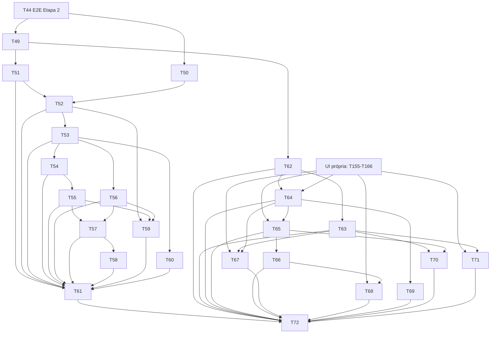

# Plano: Etapa 3 — cartões, faturas, parcelas e recorrências no cartão

## 1. Objetivo

Permitir que o usuário cadastre cartões, registre compras à vista e parceladas, acompanhe fatura atual, faturas futuras, parcelas e limite, pague faturas (inclusive parcial, antecipado e a maior), mude fechamento/vencimento sem corromper faturas, e veja os mesmos números em cartão, lista de movimentações e dashboard, com cada compra contada **uma vez só** (compra → parcela → fatura → pagamento).

## 2. Escopo

### 2.1 Entra

| #   | Entregável                                                                                                                                                                                                                                               | Quem         | Tasks        |
| --- | -------------------------------------------------------------------------------------------------------------------------------------------------------------------------------------------------------------------------------------------------------- | ------------ | ------------ |
| C   | Contrato `contracts/openapi.yaml` (adições compatíveis: `/v1/cards`, `/v1/invoices`, tipos `CARD_PURCHASE`/`REFUND` com `cardId` em `POST /v1/transactions`, prévias) e ADR-006 (persistência de faturas)                                                | dev-backend  | T49, T50     |
| P   | Persistência de cartões, regras de fechamento, faturas, parcelas e carregamento único com cartões (`FinancialRecordsGateway`)                                                                                                                            | dev-backend  | T51, T52     |
| U   | Casos de uso: compra (à vista/parcelada, com prévia), leituras de fatura e limite, pagamento de fatura, reembolso no cartão, estorno/cancelamento de parcelas/edição limitada, mudança de dias (`CardBillingChanges.changeBillingDays`), `realizeOnCard` | dev-backend  | T53–T58, T60 |
| D   | Dashboard e compromissos com cartões, sem dupla contagem                                                                                                                                                                                                 | dev-backend  | T59          |
| F   | Telas: cartões, compra parcelada, fatura, pagamento de fatura, limite, mudança de dias, cartão na lista/detalhe e no Início                                                                                                                              | dev-frontend | T62–T71      |
| Q   | Validação do backend e E2E com backend real                                                                                                                                                                                                              | tester       | T61, T72     |

### 2.2 Não entra

- Importação de fatura/extrato de cartão (Etapa 7): a regra de não duplicar pagamento de fatura na importação está em S-133.
- Pessoas, dívidas e a **API** de recorrências (Etapa 4). A Etapa 3 entrega o lado do cartão (`realizeOnCard` como caso de uso e porta, T60); a persistência/API das recorrências e a tela de realização ficam na Etapa 4 (T79, T80, T88), que fecha o critério "recorrência no cartão" ponta a ponta.
- Juros, rotativo, multa, anuidade e IOF (S-17): o app não inventa número.
- Número do cartão, CVV, bandeira ou últimos dígitos (PR 00 §26: nunca armazenar).
- Metas/reservado (Etapa 5; `reserved` continua 0).

### 2.3 Regra de trabalho com as etapas anteriores

- **Pacotes (ArchUnit `featuresDoCoreSemCiclos`, `ArchitectureTest`):** `core.card` só depende de `sk`; `core.transaction` depende de `card`, `debt` e `importing`; `core.recurrence` depende de `transaction`; `core.finance` depende de todos. Um caso de uso que precisa de `CardTransactions`/`CardInvoices` (pacote `transaction`) **não pode** morar em `core.card.app` (ciclo card↔transaction) nem em `core.recurrence.app` (`finance`→`recurrence` já existe). Por isso, e como já foi feito para contas (`core/finance/app/accounts`) e movimentações (`core/finance/app/transactions`), **os casos de uso da Etapa 3 vivem em `core/finance/app/cards/usecase`, `core/finance/app/transactions/{handlers,usecase}` e `core/finance/app/recurrences/usecase`**; só as portas (`CardGateway`, `RecurrenceGateway`) ficam em `core/card/app/gateways` e `core/recurrence/app/gateways`. Os nomes de pacote citados nas tasks abaixo já seguem esta regra (revisão 2026-10-05).
- O domínio de cartão (T5, T6a, T6b, `CardBillingChanges`, `CardTransactions`, `CardVoidRules`, `InvoiceChain`) está concluído e **não é reescrito** aqui. Tasks novas criam arquivos novos (`core/card/app/...`, `infra/card/...`) ou métodos novos. Se uma assinatura ou `code` divergir do contrato, prevalece o domínio e o contrato é ajustado.
- Esta etapa **depende de T44** (E2E da Etapa 2) concluído. Só T49 e T50 (documentos) podem começar antes.
- Migrações `V3.*` (numeração em §6.3). Antes do primeiro deploy as `V1.*`/`V2.*` continuam editáveis, mas **não** se edita migração já aplicada na stack de E2E: o que for novo entra em `V3.*`.
- O frontend **só usa componentes de formulário/overlay da etapa transversal "UI própria"** (`docs/planos/2026-10-05-etapa-ui-propria.md`): nenhuma tela nova usa `<select>`, `type=date|month|checkbox`, `
` ou `title=` nativos (a guarda de lint falha). Por isso T64, T67, T68 e T69 dependem de tasks daquele plano (ver §6.1).

## 3. Perguntas em aberto e suposições

O usuário pediu para não bloquear: cada lacuna foi resolvida com a opção conservadora e registrada. Numeração do backend continua em **S-119** (a S-118 foi a última da Etapa 2); a do frontend usa **FE-S** a partir da FE-S-112.

### 3.1 A validar com o usuário (ordenadas por impacto)

| #     | Impacto | Suposição                                                                                                                                                                                                                                                                                                                                                                                                                                                                                                                                                                                                                                                                                                                                                                              | Motivo                                                                                                                                                                                                         | Dono         | Tasks         |
| ----- | ------- | -------------------------------------------------------------------------------------------------------------------------------------------------------------------------------------------------------------------------------------------------------------------------------------------------------------------------------------------------------------------------------------------------------------------------------------------------------------------------------------------------------------------------------------------------------------------------------------------------------------------------------------------------------------------------------------------------------------------------------------------------------------------------------------- | -------------------------------------------------------------------------------------------------------------------------------------------------------------------------------------------------------------- | ------------ | ------------- |
| S-119 | alto    | **Faturas persistidas com id determinístico** (UUID v5 de `cardId + closingDate`) e linha em `credit_card_invoices` **materializada só quando recebe item ou pagamento**; fatura sem item (ex.: `OPEN` vazia) é calculada na leitura com o mesmo id. A mudança de dias (S-42) recria as linhas `FUTURE` com os novos fechamentos e **remove as linhas `FUTURE` que ficaram sem nenhuma referência** na mesma transação (estrutura, não histórico)                                                                                                                                                                                                                                                                                                                                      | o domínio identifica a fatura por `(cartão, fechamento)` (S-13) e o schema exige `invoice_id` em parcelas/pagamentos; id determinístico dá ids estáveis para a URL `/v1/invoices/{id}` sem criar linhas vazias | Arquitetura  | T50, T52, T58 |
| S-121 | alto    | **Compra no cartão editável só em descrição, categoria e observação.** Valor, data, nº de parcelas e cartão não mudam; para corrigir: estornar (se a guarda permitir) e relançar, ou cancelar parcelas restantes + reembolso                                                                                                                                                                                                                                                                                                                                                                                                                                                                                                                                                           | reescrever parcelas/faturas na edição arriscaria dupla contagem e mexeria em fatura fechada                                                                                                                    | Produto      | T57           |
| S-122 | alto    | **Estorno de compra/crédito no cartão** segue `CardVoidRules` (S-36): com parcela em fatura fechada (`CLOSED`/`OVERDUE`/`PAID`) responde `422 TRANSACTION_IN_CLOSED_INVOICE`; o caminho é `cancel-installments` + reembolso. `INVOICE_PAYMENT` é estornável (recalcula o status)                                                                                                                                                                                                                                                                                                                                                                                                                                                                                                       | evita fatura que muda depois de cobrada                                                                                                                                                                        | Produto      | T55, T57      |
| S-120 | alto    | **Arquivar cartão** só sem fatura com `outstanding > 0`, sem `creditCarry > 0` na última fatura e sem parcela futura não cancelada; senão `422 CARD_HAS_PENDING_BALANCE` (código novo, listado em T49). Cartão arquivado não recebe compra (`CARD_ARCHIVED`), mas pode ser **desarquivado** (`POST /v1/cards/{id}/unarchive`, acréscimo compatível, por simetria com contas)                                                                                                                                                                                                                                                                                                                                                                                                           | D2 §4.3 pede "nenhuma fatura com saldo e nenhum crédito"; parcelas futuras também são saldo                                                                                                                    | Produto      | T51           |
| S-124 | alto    | **Prévia de compra sem efeito colateral**: `POST /v1/cards/{id}/purchase-preview { amount, installments, date }` devolve parcelas (valores pelo mesmo `Money.allocate`), competência, fatura alvo (fechamento/vencimento), `lateEntry`, limite disponível depois e `overLimit`. Usa o **mesmo caminho de código** da criação (sem gravar). O front **nunca** calcula parcela                                                                                                                                                                                                                                                                                                                                                                                                           | a regra de arredondamento e a fatura alvo são do backend; o formulário precisa mostrar "6x de 200,00, 1ª em 05/11"                                                                                             | Arquitetura  | T53, T67      |
| S-125 | médio   | Compra acima do limite é **aceita** e sinalizada (`overLimit`, S-11); a UI avisa, nunca bloqueia                                                                                                                                                                                                                                                                                                                                                                                                                                                                                                                                                                                                                                                                                       | o banco às vezes aprova acima do limite; registrar a realidade                                                                                                                                                 | Produto      | T53, T67      |
| S-128 | médio   | Mudança de dias: `PUT /v1/cards/{id}` aplica `CardBillingChanges.changeBillingDays` (cartão e movimentações realocadas na mesma transação, `version` otimista). **Prévia** `GET /v1/cards/{id}/billing-change-preview?closingDay&dueDay` devolve a primeira fatura afetada (fechamento/vencimento), quantas parcelas/créditos mudam de fatura e o aviso de S-42. `409 CARD_BILLING_CHANGE_STALE` quando a prévia ficou velha                                                                                                                                                                                                                                                                                                                                                           | S-42 não é óbvia (vale da fatura seguinte); o usuário precisa ver antes                                                                                                                                        | Produto      | T58, T69      |
| S-123 | médio   | Pagamento de fatura: conta `CASH` obrigatória (S-53), valor padrão sugerido = `outstanding` **vindo do backend**, qualquer valor > 0 aceito (S-15/S-16), `Idempotency-Key` obrigatório, resposta = `Invoice` atualizada. Conta padrão = `defaultPaymentAccountId` do cartão, se houver                                                                                                                                                                                                                                                                                                                                                                                                                                                                                                 | segue D1 §2.5.3; o excedente vira `creditCarry`                                                                                                                                                                | Produto      | T55, T68      |
| S-134 | médio   | `CARD_PURCHASE` e `REFUND` com `cardId` entram em `POST /v1/transactions` (a prévia e a lista usam o mesmo recurso `Transaction`); **`INVOICE_PAYMENT` só pelo endpoint da fatura**, mas aparece na lista como `Transaction` com `type: INVOICE_PAYMENT`. `POST /v1/transactions` com `INVOICE_PAYMENT` segue `422 TRANSACTION_TYPE_NOT_AVAILABLE`                                                                                                                                                                                                                                                                                                                                                                                                                                     | uma porta por intenção; pagar fatura exige a fatura                                                                                                                                                            | Arquitetura  | T49, T53, T55 |
| S-129 | médio   | Campos do cartão calculados pelo backend: `availableLimit`, `overLimit`, `creditBalance`, `currentInvoice`, `committedFuture` (Σ parcelas não canceladas em faturas `FUTURE`: "você já comprometeu R$ X em compras futuras"), **`usedRatio`** (acréscimo: razão decimal 0..1 do limite usado, calculada no backend, só para a largura da barra) e **`totalCommitted`** (acréscimo: Σ `outstanding` das faturas **não `PAID` e não `FUTURE`**, isto é, a corrente e as fechadas/atrasadas: o "total comprometido no cartão" do PR 00 §4; é **disjunto** de `committedFuture`, e `limite − disponível = totalCommitted + committedFuture`; revisão 2026-10-05: a redação anterior incluía as `FUTURE` e dava 2.283,00 no cenário, contra os 1.283,00 dos critérios de T54 CA1 e T65 CA1) | PR 00 §4 pede os dois números; ambos saem do mesmo carregamento (S-79)                                                                                                                                         | Produto      | T54           |
| S-126 | baixo   | `GET /v1/cards?status=ACTIVE                                                                                                                                                                                                                                                                                                                                                                                                                                                                                                                                                                                                                                                                                                                                                           | ARCHIVED`(padrão`ACTIVE`), `Slice`, como contas (S-91: a facade de cartões tem `loadAll`)                                                                                                                      | consistência | Arquitetura   | T51, T62 |
| S-130 | baixo   | Pagamento com data futura é aceito e já conta no `outstanding` (S-51); a UI avisa "pagamento agendado"                                                                                                                                                                                                                                                                                                                                                                                                                                                                                                                                                                                                                                                                                 | segue S-51                                                                                                                                                                                                     | Produto      | T55, T68      |
| S-131 | baixo   | Lista de faturas do cartão: janela padrão = da primeira fatura com item até a última fatura `FUTURE` com item (no máximo 12 meses à frente da corrente); `from/to` por `closingDate`                                                                                                                                                                                                                                                                                                                                                                                                                                                                                                                                                                                                   | evita lista infinita de faturas vazias                                                                                                                                                                         | Produto      | T54           |
| S-132 | médio   | A ação rápida "Crédito" do Início/`/quick-add` é **habilitada** nesta etapa (S-33/S-58 deixam de valer para ela); sem cartão ativo, o estado vazio leva a "Adicionar cartão"                                                                                                                                                                                                                                                                                                                                                                                                                                                                                                                                                                                                           | funcionalidade real                                                                                                                                                                                            | Produto/UX   | T67, T71      |
| S-133 | médio   | Importação de extrato de cartão (Etapa 7) **rejeita por padrão** as linhas de pagamento de fatura (já registradas como `INVOICE_PAYMENT` na conta) e trata linha com padrão `n/N` como "precisa de decisão"                                                                                                                                                                                                                                                                                                                                                                                                                                                                                                                                                                            | evita dupla contagem; ver plano da Etapa 7 (S-161)                                                                                                                                                             | Produto      | — (Etapa 7)   |

### 3.2 Decisões de arquitetura

| #     | Decisão                                                                                                                                                                                                                                                                                 | Tasks    |
| ----- | --------------------------------------------------------------------------------------------------------------------------------------------------------------------------------------------------------------------------------------------------------------------------------------- | -------- |
| S-127 | O `CreateTransactionUseCaseImpl` passa a despachar por **handlers por tipo** (`TransactionTypeHandler`, registro por enum): T53 faz a refatoração sem mudar comportamento (testes da Etapa 2 verdes) e as Etapas 4 e 7 só adicionam handlers. Evita conflito entre T53, T56, T76 e T78  | T53      |
| S-135 | `CardInvoices.chainFor` continua a única forma de montar a cadeia; nenhum cálculo de fatura em SQL (S-79). A lista de faturas de um cartão carrega só as movimentações **daquele cartão** (`findByUserIdAndCardId`) para não carregar o histórico inteiro                               | T52, T54 |
| S-136 | **Prévia do pagamento** (acréscimo): `GET /v1/invoices/{id}/payment-preview?amount` devolve `kind` (`FULL`, `PARTIAL`, `OVERPAY`, `PREPAY`), `outstandingAfter` e `creditCarryAfter`, pelo mesmo caminho do pagamento e sem gravar. O front não subtrai valores (mesmo motivo de S-124) | T55, T68 |

## 4. Contrato de API (delta sobre D2 §4.3)

Fonte da verdade: `contracts/openapi.yaml` (T49). Só adições compatíveis: nenhum campo/rota da Etapa 2 muda de significado. Formatos `Card`, `InvoiceSummary` e `Invoice` seguem D2 §4.3 (com `totalCommitted` de S-129).

| Método    | Caminho                                                   | Corpo / observação                                                                                                                                              | Resposta                                                      |
| --------- | --------------------------------------------------------- | --------------------------------------------------------------------------------------------------------------------------------------------------------------- | ------------------------------------------------------------- |
| GET       | `/v1/cards?status`                                        | `Slice`                                                                                                                                                         | `Slice<Card>`                                                 |
| POST      | `/v1/cards`                                               | `{ name, institution?, limit, closingDay, dueDay, defaultPaymentAccountId? }`                                                                                   | `201 Card` + `Location`                                       |
| GET / PUT | `/v1/cards/{id}`                                          | PUT: mesmos campos + `version` (mudança de dia = S-128, com `confirmedEffectiveFrom` da prévia, T58 CA4)                                                        | `Card`                                                        |
| POST      | `/v1/cards/{id}/archive` · `/unarchive`                   | —                                                                                                                                                               | `200 Card`; `422 CARD_HAS_PENDING_BALANCE`                    |
| GET       | `/v1/cards/{id}/invoices?from&to`                         | por `closingDate` (S-131)                                                                                                                                       | `Slice<InvoiceSummary>`                                       |
| GET       | `/v1/cards/{id}/future-installments`                      | —                                                                                                                                                               | `{ total, byInvoice[] }` (D2 §4.3)                            |
| POST      | `/v1/cards/{id}/purchase-preview`                         | `{ amount, installments, date }` (S-124)                                                                                                                        | `PurchasePreview`                                             |
| GET       | `/v1/cards/{id}/billing-change-preview?closingDay&dueDay` | (S-128)                                                                                                                                                         | `BillingChangePreview`                                        |
| GET       | `/v1/invoices/{id}`                                       | —                                                                                                                                                               | `Invoice` (itens, pagamentos)                                 |
| GET       | `/v1/invoices/{id}/payment-preview?amount`                | (S-136)                                                                                                                                                         | `PaymentPreview { kind, outstandingAfter, creditCarryAfter }` |
| POST      | `/v1/invoices/{id}/payments`                              | header `Idempotency-Key`; `{ accountId, amount, date }`                                                                                                         | `200 Invoice`                                                 |
| POST      | `/v1/transactions`                                        | `CARD_PURCHASE { cardId, categoryId, amount, installments, date, description?, notes? }`; `REFUND { cardId, categoryId, amount, date, refundOfTransactionId? }` | `201 Transaction` (com `installments[]`, `invoice`, `impact`) |
| POST      | `/v1/transactions/{id}/cancel-installments`               | `{ reason }`                                                                                                                                                    | `200 Transaction`                                             |
| PUT       | `/v1/transactions/{id}`                                   | `CARD_PURCHASE`: só `description`, `categoryId`, `notes` (S-121)                                                                                                | `200 Transaction`                                             |

`PurchasePreview = { installments:[{ number, total, amount, competence, invoice:{ closingDate, dueDate, referenceMonth, status }, lateEntry }], total, availableLimitAfter, overLimit, warnings:["LATE_ENTRY","OVER_LIMIT","FUTURE_DATE"] }`.
`PaymentPreview = { kind:"FULL|PARTIAL|OVERPAY|PREPAY", outstandingAfter, creditCarryAfter }`.
`BillingChangePreview = { effectiveFromClosingDate, firstNewInvoice:{ closingDate, dueDate }, movedInstallments, movedCredits, notice:"FROM_NEXT_INVOICE" }`.

Erros novos (código real do domínio; T49 lê os `code` de `CardExceptions`, `InvoiceChain`, `CardVoidRules` e fecha a lista; o que não existir como código é criado com o prefixo do agregado): `CARD_NOT_FOUND`, `CARD_ARCHIVED`, `CARD_ALREADY_ARCHIVED`, `CARD_HAS_PENDING_BALANCE` (novo), `CARD_INVALID_BILLING_DAY`, `CARD_INVALID_LIMIT`, `CARD_INVALID_INSTALLMENT_COUNT`, `CARD_NO_INSTALLMENTS_TO_CANCEL`, `CARD_BILLING_CHANGE_STALE`, `INVOICE_NOT_FOUND`, `INVOICE_NOT_PAYABLE`, `INVOICE_PAID`, `INVOICE_CLOSED_REQUIRES_LATE_ENTRY`, `INVOICE_CHAIN_INCONSISTENT`, `TRANSACTION_IN_CLOSED_INVOICE`, `AMOUNT_ABOVE_LIMIT`, `VERSION_CONFLICT`, e os que já existem no domínio e os critérios usam: `CARD_NAME_REQUIRED`, `CARD_NAME_TOO_LONG`, `CARD_INSTITUTION_TOO_LONG`, `CARD_INVALID_INSTALLMENT`, `TRANSACTION_NOT_CANCELABLE`, `CARD_BILLING_CHANGE_NOT_HERE` (provisório, removido na T58).

### 4.1 Garantias testadas (IT em T61, E2E em T72)

1. Σ consumo das 6 competências de uma compra 6x = total; Σ caixa = −total depois das 6 faturas pagas; saldo do livro `CARD` = 0.
2. Lista (registros e lançamentos por competência), dashboard, cartão e fatura concordam (S-79).
3. Pagar a fatura não cria consumo; estornar o pagamento volta o status e o limite.
4. `Σ outstanding − creditCarry da última = −saldo CARD` para todo cartão e toda data (invariante D1 §2.5.3).

## 5. Tasks

> Convenções de backend e frontend: as da Etapa 2 (`docs/planos/2026-10-04-etapa-2-contas-movimentacoes.md` §5). Em especial: caso de uso = `XxxUseCase` + `XxxUseCaseImpl` POJO em `core/<feature>/app`; `infra/<feature>/{controller,gateways,persistence}`; todo gateway filtra por `userId`; ITs com `@IntegrationTest` e validação contra o contrato; frontend OnPush, i18n pt/en/es, `data-cy`, estados carregando/vazio/erro, **dinheiro sempre string da API, sem somas no front**.
> **Cenário padrão** dos critérios (relógio 10/10/2026, fuso `America/Sao_Paulo`): conta Nubank CHECKING 20.000,00; cartão **Roxinho** (instituição Nubank) limite 10.000,00, fechamento 25, vencimento 5, conta padrão Nubank; categorias Alimentação e Tecnologia. A fatura que fecha em 25/10/2026 vence em 05/11/2026 e tem referência `2026-11`.
> A definição de pronto do PR 02 vale para todas.

---

### T49 · dev-backend · Contrato da Etapa 3

**Objetivo:** escrever em `contracts/openapi.yaml` todas as rotas e schemas de §4 (`Card`, `CardInput`, `InvoiceSummary`, `Invoice`, `InvoiceItem`, `InvoicePayment`, `PurchasePreview`, `PaymentPreview`, `BillingChangePreview`, `FutureInstallments`, `TransactionInput` com `CARD_PURCHASE`/`REFUND(cardId)`, `Transaction.installments[]`/`invoice`), fechar a lista de `code` lendo o domínio e atualizar D2 §4.3.

**Arquivos/camadas:** `contracts/openapi.yaml`, `docs/arquitetura/arquitetura.md` (§4.3), teste `ContractCoverageIT` ajustado (a cobertura exige handler para cada operação nova: as operações ainda sem handler entram numa lista explícita e temporária de "pendentes" que cada task remove).

**Critérios de aceite**

1. **Dado** o contrato, **quando** rodo o lint do OpenAPI (mesmo comando de T21), **então** passa; as operações de §4 existem com schemas `Money`/`Slice*` reaproveitados e `amount` de movimentação como string (S-98).
2. **Dado** `CARD_PURCHASE` com `installments` 0 ou 37 ou ausente, **então** o validador do contrato recusa (`1..36`, padrão 1); `REFUND` com `cardId` **e** `accountId`, **então** recusado (`oneOf`).
3. **Dado** os `code` de §4, **então** cada um aparece na tabela de erros do contrato **e** existe no código (teste de conferência lendo as constantes de `CardExceptions`/`InvoiceChain`/`CardVoidRules`); os que faltam (`CARD_HAS_PENDING_BALANCE`) ficam registrados como "a criar em T51".
4. **Dado** o contrato antigo (Etapa 2), **quando** comparo com o novo (`oasdiff` ou diff estrutural), **então** só há adições (nenhuma remoção, nenhum campo obrigatório novo em resposta existente).
5. **Dado** `npm run api:types` no front, **então** gera os tipos novos sem erro (verificado por T62).

**Depende de:** — (documento; pode começar antes de T44 terminar, só toca `contracts/` e docs; rebase se T44 mexer no contrato).

### T50 · dev-backend · ADR-006: persistência de faturas e alocação (só documentação)

**Objetivo:** registrar S-119 em `docs/adrs/ADR-006-persistencia-de-faturas.md`: id determinístico, materialização preguiçosa, relação com `transactions.invoice_id`/`transaction_installments.invoice_id`, mudança de dias, concorrência (duas compras simultâneas no mesmo ciclo criando a mesma linha), e a regra "o domínio fala em `closingDate`; só o mapper conhece `invoice_id`".

**Arquivos/camadas:** `docs/adrs/ADR-006-*.md`; D1 §2.5.3 (nota de persistência).

**Critérios de aceite**

1. **Dado** a ADR, **então** descreve o algoritmo de `findOrCreate(cardId, closingDate)` com `INSERT ... ON CONFLICT (card_id, closing_date) DO NOTHING` seguido de `SELECT` (sem exceção de unicidade vazando) e o formato do UUID v5 (namespace fixo documentado).
2. **Dado** a mudança de dias, **então** a ADR define quais linhas são recriadas, quais são removidas (só `FUTURE` sem referência) e que o `INVOICE_CHAIN_INCONSISTENT` nunca é silenciado.
3. **Dado** as alternativas (linha por mês pré-criada; id gerado e busca por `(card, closing)`), **então** ficam registradas com o motivo da recusa.
4. **Dado** `GET /v1/invoices/{id}` de uma fatura **sem linha** (UUID v5 é de mão única: não dá para extrair `(cardId, closingDate)` do id), **então** a ADR define a resolução: (a) busca por `id` + `user_id` em `credit_card_invoices`; (b) se não achar, para cada cartão do usuário, calcula o id de cada fechamento do calendário na janela `[hoje − 24 meses, hoje + 36 meses]` e compara; fora da janela ou sem cartão correspondente → `404 INVOICE_NOT_FOUND`. A lista de faturas (`/cards/{id}/invoices`) devolve ids que sempre caem nessa janela.

**Depende de:** —.

### T51 · dev-backend · Cartões: persistência, CRUD e arquivar

**Objetivo:** persistir `CreditCard` e `credit_card_billing_rules`, expor `GET/POST /v1/cards`, `GET/PUT /v1/cards/{id}` (PUT sem mudança de dias; a mudança fica em T58), `archive`/`unarchive` com a guarda de S-120.

**Arquivos/camadas:** `core/card/app/gateways/CardGateway`, `core/finance/app/cards/usecase/{CreateCard, UpdateCardDetails, GetCard, ListCards, ArchiveCard, UnarchiveCard}UseCase + Impl` (arquivar precisa da cadeia, logo fica em `finance`); `infra/card/{controller(+openapi,request,response), gateways/{CardRepositoryMapper, CardRepositoryGatewayImpl}, persistence/{CardEntity, BillingRuleEntity, CardRepositoryJpa}}`; `infra/config/CardConfig`; migração `V3.00` só se faltar índice/coluna (as tabelas existem desde `V1.03`); testes.

**Critérios de aceite**

1. **Dado** o cenário, **quando** `POST /v1/cards` com Roxinho (limite 10.000,00, fecha 25, vence 5), **então** `201` + `Location` + `Card` com `availableLimit` 10.000,00, `overLimit: false`, `creditBalance` 0,00, `closingDay: 25`, `dueDay: 5`, `status: ACTIVE`, `version: 0`; existe **uma** regra em `credit_card_billing_rules` (`effective_from` = mês de fechamento da fatura corrente, S-42).
2. **Dado** `closingDay` 0 ou 32, limite 0 ou acima do teto (S-78), nome vazio ou > 100, **então** `422 CARD_INVALID_BILLING_DAY` / `CARD_INVALID_LIMIT` / `AMOUNT_ABOVE_LIMIT` / `CARD_NAME_REQUIRED`/`CARD_NAME_TOO_LONG`; nada gravado.
3. **Dado** `PUT` mudando nome, instituição, limite e conta padrão (conta de outro usuário ou arquivada → `404`/`422 ACCOUNT_ARCHIVED`), **então** `200` com `version` +1; `PUT` com `version` velha → `409 VERSION_CONFLICT`; `PUT` com `closingDay`/`dueDay` diferentes dos atuais → `422 CARD_BILLING_CHANGE_NOT_HERE` até T58 existir (a task T58 remove essa recusa).
4. **Dado** um cartão com fatura `CLOSED` de 1.283,00 em aberto, **quando** `archive`, **então** `422 CARD_HAS_PENDING_BALANCE`; **dado** o cartão sem saldo, crédito e parcelas futuras, **então** `200` `ARCHIVED`; arquivar de novo → `422 CARD_ALREADY_ARCHIVED`; `unarchive` volta `ACTIVE`.
5. **Dado** dois usuários, **então** `GET /v1/cards/{id}` de outro → `404 CARD_NOT_FOUND`; a lista só traz os do usuário; `?status=ARCHIVED` filtra.
6. **Dado** o `CardRepositoryMapper`, **então** `toDomain(toEntity(card))` devolve cartão igual (inclusive várias regras de fechamento) e nenhum campo guarda número de cartão/CVV (teste que lista as colunas de `credit_cards`).
7. Testes de caso de uso (Mockito) para cada operação com `ArgumentCaptor`; ITs com contrato.

**Depende de:** T49. Etapa 2 (T24/T25 como modelo, T45 `restore` do cartão já existe).

### T52 · dev-backend · Parcelas e faturas persistidas; carregamento único com cartões

**Objetivo:** estender o mapper de `Transaction` (hoje recusa `cardId`/parcelas/`invoiceClosingDate`) para `CARD_PURCHASE`, `REFUND` no cartão e `INVOICE_PAYMENT`; implementar `findOrCreate(cardId, closingDate)` (ADR-006); gravar parcelas em `transaction_installments` com os postings por parcela (`installment_id`); e fazer o `FinancialRecordsGatewayImpl` carregar `cards` (com regras) junto das movimentações, no mesmo carregamento (S-79).

**Arquivos/camadas:** `infra/card/gateways/{InvoiceRowGateway, InvoiceIds}`; `infra/transaction/gateways/TransactionRepositoryMapper` (casos de cartão), `infra/transaction/persistence/{InstallmentEntity, InstallmentRepositoryJpa}`; `infra/finance/gateways/FinancialRecordsGatewayImpl`; migração `V3.01` (índices `ix_transactions_user_card`, `ix_ledger_postings_installment`); testes.

**Critérios de aceite**

1. **Dado** uma `CARD_PURCHASE` de 1.200,00 em 6x (cenário, 10/10), construída pela fábrica do domínio e gravada pelo gateway, **então** há 6 linhas em `transaction_installments` (200,00 cada; competências `2026-10`…`2027-03`; faturas com fechamentos 25/10, 25/11, 25/12, 25/01, 25/02, 25/03), 6 linhas em `credit_card_invoices` (uma por fechamento) e postings `EXPENSE +200`/`CARD −200` por parcela com `installment_id`; ao recarregar, `Transaction.restore` devolve parcelas e `invoiceClosingDate` iguais.
2. **Dado** duas compras em threads concorrentes no mesmo ciclo, **quando** ambas fazem `findOrCreate` do mesmo fechamento, **então** existe **uma** linha de fatura e nenhuma exceção de unicidade chega ao chamador (IT de concorrência, 20 repetições).
3. **Dado** o id da fatura de `(Roxinho, 25/10/2026)`, **então** é sempre o mesmo UUID (teste de propriedade) e não existe linha para faturas sem item.
4. **Dado** `REFUND` no cartão (crédito de 50,00 em 12/10) e `INVOICE_PAYMENT` de 150,00 gravados, **então** o mapper preserva `invoiceClosingDate`, `lateEntry` e `invoice_id`; a cadeia reconstruída por `CardInvoices.chainFor` bate com a da memória (teste de igualdade com 20 cenários gerados).
5. **Dado** `FinancialRecordsGateway.load`, **então** devolve `cards` com as regras e as transações do cartão; o razão em memória e o SQL do livro `CARD` fecham em zero e são iguais (prova de igualdade de T24 estendida para o livro `CARD`).
6. **Dado** estado gravado inconsistente (parcela apontando para fatura de outro cartão), **então** a reidratação lança `TransactionStateInconsistentException` e não devolve parcial (S-94).
7. **Dado** os ITs da Etapa 2 (contas/movimentações), **então** continuam verdes sem alteração.

**Depende de:** T50, T51. Etapa 2: T24, T26a, T45 (concluídas); T44 concluída.

### T53 · dev-backend · Compra no cartão (à vista e parcelada) e prévia

**Objetivo:** criar `CARD_PURCHASE` por `POST /v1/transactions` (handler por tipo, S-127) com a regra de alocação de `CardTransactions.purchase`, e `POST /v1/cards/{id}/purchase-preview` (S-124) pelo mesmo caminho.

**Arquivos/camadas:** `core/finance/app/transactions/handlers/{TransactionTypeHandler, AccountTypeHandlers..., CardPurchaseHandler}` (refatoração do `switch` de `AccountTransactionFactory.build`/`lockFor`/`accountIdsOf` sobre o `CreateTransactionCommand` selado, que hoje recusa `Refund` com `cardId` e tem o ponto `Unavailable`; `CreateTransactionUseCaseImpl` e `UpdateTransactionUseCaseImpl` usam a mesma fábrica; sem mudar o comportamento; `lockFor` ganha a trava do cartão, ordem: movimentações → cartão → contas por id), `core/finance/app/cards/usecase/PreviewCardPurchaseUseCase(+Impl)`, `infra/card/controller/CardPurchaseController` (prévia), `infra/transaction/controller` (tipo novo no corpo discriminado), `TransactionImpactCalculator`/`TransactionDetailsAssembler` (parcelas e `invoice`), testes.

**Critérios de aceite** (cenário padrão)

1. **Dado** `CARD_PURCHASE` 1.200,00 em 6x, Tecnologia, 10/10 ("Notebook"), **quando** `POST` com `Idempotency-Key`, **então** `201` com `installments[6]` (200,00; `status: PENDING`; faturas 25/10…25/03; `lateEntry: false`), `impact.cash` 0,00, `impact.consumption` = 6 itens de 200,00 de `2026-10` a `2027-03`, `impact.commitment` 1.000,00 (5 parcelas futuras) e `netWorth` conforme S-8 (passivo do cartão = −200,00 em 10/10; `cardFutureInstallments` 1.000,00); o saldo do livro `CARD` do cartão é −1.200,00, ou seja, limite disponível 8.800,00 (limite − total, S-46). O campo `Card.availableLimit` na API só é entregue pela T54 (a T53 confere o saldo do livro e `availableLimitAfter` da prévia; a T54 CA1 confere o `Card`).
2. **Dado** 1.000,00 em 3x, **então** parcelas 333,34 / 333,33 / 333,33 (resto na primeira, S-3); `installments` 1 (à vista) gera uma parcela.
3. **Dado** compra de 90,00 em 20/10 (cenário: relógio 27/10, fatura que fechou em 25/10 `CLOSED` e **não paga**), **então** entra nela com `lateEntry: true` e `warnings` da prévia traz `LATE_ENTRY`; **dado** essa fatura já `PAID`, **então** a parcela vai para a fatura corrente com `lateEntry: true` (S-14, S-50) e nunca para a `PAID`.
4. **Dado** a prévia (`POST /purchase-preview`) com os mesmos dados do CA1, **então** os valores, faturas e `availableLimitAfter` (8.800,00) são **iguais** aos da criação e **nada é gravado** (IT conta linhas antes e depois); com compra de 12.000,00, **então** `overLimit: true` e a criação é aceita (S-125).
5. **Dado** cartão arquivado → `422 CARD_ARCHIVED`; cartão/categoria de outro usuário → `404`; categoria `INCOME` → `422 CATEGORY_KIND_MISMATCH`; `installments` fora de 1..36 → `400`; valor < nº de centavos de parcelas → `422 CARD_INVALID_INSTALLMENT`.
6. **Dado** o mesmo `Idempotency-Key` e o mesmo corpo, **então** `201` com o mesmo `id` (uma compra, uma fatura, 6 parcelas); corpo diferente → `409 IDEMPOTENCY_KEY_REUSED`.
7. **Dado** a refatoração em handlers, **então** a suíte de criação da Etapa 2 passa sem editar nenhum teste existente.
8. Testes de caso de uso por cenário com `ArgumentCaptor` (gateway recebe a compra com as parcelas e as entries balanceadas); nada gravado quando o domínio lança.

**Depende de:** T52. Etapa 1: T5, T6a, T6b.

### T54 · dev-backend · Cartão enriquecido, faturas e parcelas futuras (leituras)

**Objetivo:** `Card` com `availableLimit`, `overLimit`, `creditBalance`, `currentInvoice`, `committedFuture`, `totalCommitted` e `usedRatio` (S-129); `GET /v1/cards/{id}/invoices`, `GET /v1/invoices/{id}`, `GET /v1/cards/{id}/future-installments`.

**Arquivos/camadas:** `core/finance/app/cards/{CardView, InvoiceView, usecase/{ListInvoices, GetInvoice, GetFutureInstallments}UseCase + Impl}` (usam `AvailableLimitCalculator`, `InvoiceChain`, `CommitmentSchedule`-style do `core.finance`), `infra/card/controller/{InvoiceController}`, testes.

**Critérios de aceite** (cenário: compra 6x de 1.200,00 e compra à vista de 1.083,00, ambas no Roxinho em 10/10; relógio 10/10 e depois 30/10)

1. **Dado** o cenário em 10/10, **então** `Card.currentInvoice` = ref. `2026-11`, `status: OPEN`, `total` 1.283,00, `outstanding` 1.283,00, fecha 25/10, vence 05/11; `committedFuture` 1.000,00; `availableLimit` 10.000 − 2.283 = 7.717,00; `totalCommitted` 1.283,00 (a fatura atual não paga; as futuras entram em `committedFuture`) e `usedRatio` 0.2283.
2. **Dado** o relógio em 30/10, **então** a fatura é `CLOSED`, com `Invoice.items` (parcela 1/6 "Notebook" 200,00 e a compra à vista 1.083,00, `lateEntry: false`), `payments: []`; a fatura seguinte (ref. `2026-12`) é `OPEN` com 200,00.
3. **Dado** `GET /v1/cards/{id}/future-installments`, **então** `total` 1.000,00 e `byInvoice` com 5 entradas (ref. `2026-12`…`2027-04`), cada uma com `items` ("Notebook 2/6" etc.), `dueDate` e `amount`; o total é a soma devolvida pelo backend, o front não soma.
4. **Dado** pagamento parcial de 500,00 numa fatura de 1.283,00 e o relógio depois do vencimento, **então** `status: OVERDUE`, `paid` 500,00, `outstanding` 783,00 e o disponível sobe exatamente 500,00 (S-46).
5. **Dado** pagamento de 1.300,00 numa fatura `CLOSED` de 1.283,00, **então** `PAID`, `creditCarry` 17,00 e a seguinte tem `carryIn` 17,00 e `outstanding` 183,00; `Card.creditBalance` **0,00**, porque é o `creditCarry` da **última** fatura da cadeia (D2 §4.3) e os 17,00 já abateram a fatura de dez (revisão 2026-10-05: o texto anterior dizia 17,00 e contava o crédito duas vezes). Para `creditBalance` > 0 o cenário é cartão sem parcelas futuras: pagar 1.300,00 de uma fatura de 1.283,00 e nada depois → `creditBalance` 17,00.
6. **Dado** `GET /v1/invoices/{id}` de fatura sem linha materializada (corrente vazia), **então** `200` com id determinístico e `total` 0,00 (S-119), resolvida pelo algoritmo da ADR-006 (T50 CA4: o id não é invertível); id de outro cartão/usuário ou fora da janela → `404 INVOICE_NOT_FOUND`.
7. **Dado** `?from/to` na lista de faturas, **então** filtra por `closingDate`; sem parâmetros, janela de S-131.
8. **Dado** a invariante do cartão, **então** `Σ outstanding − creditCarry da última = −saldo CARD` para 100 cenários aleatórios (teste de propriedade) em datas diferentes.

**Depende de:** T52, T53.

### T55 · dev-backend · Pagamento de fatura

**Objetivo:** `POST /v1/invoices/{id}/payments` com `Idempotency-Key`, criando `INVOICE_PAYMENT` (`CardTransactions.invoicePayment`) e devolvendo a `Invoice` atualizada; `GET /v1/invoices/{id}/payment-preview` (S-136); estorno do pagamento pelo `void` da movimentação.

**Arquivos/camadas:** `core/finance/app/cards/usecase/PayInvoiceUseCase(+Impl)` (escopo de idempotência próprio, ex.: `INVOICE_PAYMENT`, distinto do de criação de movimentação), `infra/card/controller/InvoiceController`, reuso de `IdempotencyGateway`, testes.

**Critérios de aceite** (cenário T54 CA2: fatura ref. `2026-11` `CLOSED` de 1.283,00, relógio 05/11)

1. **Dado** pagamento de 1.283,00 da Nubank, **então** `200` com `status: PAID`, `payments[0]`; postings `CARD +1.283,00` / `ACCOUNT(Nubank) −1.283,00` e **nenhum** posting de `EXPENSE` (caso 3 do PR 01); a Nubank cai 1.283,00; `impact.consumption` do pagamento é vazio; as parcelas da fatura ficam `PAID` (derivado).
2. **Dado** pagamento de 500,00 e depois 783,00 (duas chamadas), **então** após a primeira `OPEN`/`CLOSED`/`OVERDUE` com `outstanding` 783,00 e após a segunda `PAID`; o limite disponível sobe 500,00 e depois 783,00.
3. **Dado** pagamento de 1.300,00 (a maior), **então** aceito com `creditCarry` 17,00 (S-16); **dado** pagamento de 300,00 numa fatura `OPEN` de 200,00 em 20/10, **então** aceito (antecipação, S-15) e a fatura vira `PAID` com `creditCarry` 100,00 depois do fechamento.
4. **Dado** fatura `FUTURE` ou `PAID`, **então** `422 INVOICE_NOT_PAYABLE`, nada gravado; conta não `CASH` → `422 TRANSACTION_ACCOUNT_NOT_CASH`; conta arquivada → `422 ACCOUNT_ARCHIVED`; valor ≤ 0 → `400`/`422`; valor acima do teto → `422 AMOUNT_ABOVE_LIMIT`.
5. **Dado** o mesmo `Idempotency-Key` com o mesmo corpo, **então** o mesmo resultado sem segundo pagamento; dois pagamentos concorrentes de chaves diferentes na mesma fatura, **então** ambos são aceitos em série e o `outstanding` final é consistente (IT de concorrência). **A trava é do cartão, não da fatura** (`SELECT ... FOR UPDATE` na linha de `credit_cards`): a cadeia é um agregado do cartão (o `carryIn` atravessa as faturas) e a fatura pode nem ter linha (S-119); sem isso, uma compra decidida contra uma fatura `CLOSED` pode cair numa fatura que um pagamento concorrente acabou de deixar `PAID` (viola S-14). Toda operação que escreve na cadeia (compra, reembolso, pagamento, estorno, cancelamento, mudança de dias) trava o cartão. **Ordem global de travas** (a mesma disciplina de `AccountTransactionFactory.lockFor`): linhas de movimentação → cartão → contas por id.
6. **Dado** o estorno desse `INVOICE_PAYMENT` (`POST /v1/transactions/{id}/void`), **então** o status da fatura é recalculado (`PAID` → `CLOSED`/`OVERDUE` conforme a data) e o limite disponível volta (S-122).
7. **Dado** a conta de outro usuário ou fatura de outro usuário, **então** `404`.
8. **Dado** `payment-preview?amount=500.00` na fatura de 1.283,00, **então** `kind: PARTIAL`, `outstandingAfter` 783,00 e `creditCarryAfter` 0,00; `amount=1300.00` → `OVERPAY`, 0,00 e 17,00; `amount=1283.00` → `FULL`; em fatura `OPEN` com valor acima do total → `PREPAY`; fatura `FUTURE`/`PAID` → `422 INVOICE_NOT_PAYABLE`; **nada é gravado** e os números são iguais aos do pagamento real (teste de igualdade).

**Depende de:** T54. Etapa 2: T26b (idempotência), T27 (estorno).

### T56 · dev-backend · Reembolso/crédito no cartão

**Objetivo:** `REFUND` com `cardId` por `POST /v1/transactions` (`CardTransactions.refundToCard`), com alocação do crédito (S-14, S-18) e `refundOfTransactionId` opcional (mesma categoria, S-52).

**Arquivos/camadas:** `core/finance/app/transactions/handlers/CardRefundHandler`, assembler de `Transaction` (campo `invoice`), testes.

**Critérios de aceite**

1. **Dado** a compra de 200,00 (parcela única) e um reembolso de 50,00 na mesma categoria, **então** `consumption` −50,00 na competência do reembolso (S-10), `CARD +50,00` (o limite disponível sobe 50,00) e a fatura alvo diminui 50,00.
2. **Dado** reembolso de 1.083,00 numa fatura `OPEN` de 200,00, **então** aceito (S-18): `total` −883,00, `outstanding` 0,00 e `creditCarry` 883,00 que abate a fatura seguinte.
3. **Dado** reembolso ligado a compra e valor acima do que resta (S-9), **então** `422 REFUND_EXCEEDS_ORIGINAL`; outra categoria → `422 REFUND_CATEGORY_LOCKED`/`REFUND_INVALID_ORIGINAL` conforme o domínio.
4. **Dado** fatura alvo `CLOSED` não paga, **então** o crédito entra nela como `lateEntry`; fatura `PAID`, **então** vai para a corrente.
5. **Dado** `REFUND` com `cardId` **e** `accountId`, **então** `400`; cartão arquivado → `422 CARD_ARCHIVED`.
6. Testes de caso de uso e ITs com contrato; a Etapa 2 (`REFUND` em conta) continua igual.

**Depende de:** T53.

### T57 · dev-backend · Estorno, cancelamento de parcelas e edição limitada

**Objetivo:** estorno de `CARD_PURCHASE`/`REFUND` de cartão com `CardVoidRules` (S-36, S-122), `POST /v1/transactions/{id}/cancel-installments` (`CardTransactions.cancelRemainingInstallments`) e `PUT` de compra no cartão limitado a descrição, categoria e observação (S-121), com revisão em `transaction_revisions`.

**Arquivos/camadas:** `core/finance/app/transactions/usecase/{CancelInstallmentsUseCase, VoidTransactionUseCaseImpl (contexto de cartão), UpdateTransactionUseCaseImpl (tipo de cartão)}`, `TransactionFlags` (`voidable`/`voidBlockedBy` com `TRANSACTION_IN_CLOSED_INVOICE`), `infra/transaction/controller`, testes.

**Critérios de aceite**

1. **Dado** a compra 6x (cenário) com todas as parcelas em faturas `FUTURE`/`OPEN`, **quando** estorno com motivo, **então** `VOIDED`, as 6 parcelas e os postings ficam inativos, o limite volta a 10.000,00 e a fatura corrente perde 200,00.
2. **Dado** a mesma compra com a parcela 1 em fatura `CLOSED` (relógio 30/10), **então** `voidable: false`, `voidBlockedBy: "TRANSACTION_IN_CLOSED_INVOICE"` e o `POST /void` responde `422 TRANSACTION_IN_CLOSED_INVOICE` (nada muda).
3. **Dado** o CA2, **quando** `cancel-installments` com motivo, **então** as parcelas 2..6 (em faturas `FUTURE`/`OPEN`) viram `CANCELED` e deixam de gerar compromisso; a parcela 1 (fatura fechada) permanece; o limite devolve a soma das canceladas (1.000,00); sem parcela cancelável → `422 CARD_NO_INSTALLMENTS_TO_CANCEL`; compra já estornada → `422 TRANSACTION_ALREADY_VOIDED`.
4. **Dado** `PUT` mudando descrição/categoria/observação, **então** `200`, versão anterior em `transaction_revisions`, parcelas e postings de `EXPENSE` mudam só de categoria quando a categoria muda; **dado** `PUT` mudando `amount`, `date`, `installments` ou `cardId`, **então** `422 TRANSACTION_NOT_EDITABLE` com a explicação (S-121).
5. **Dado** estorno de `REFUND` no cartão em fatura `CLOSED`/`PAID`, **então** `422 TRANSACTION_IN_CLOSED_INVOICE`; em `OPEN`, aceito e a fatura volta a somar.
6. **Dado** o estorno de um `INVOICE_PAYMENT`, **então** vale T55 CA6.
7. **Dado** cartão arquivado, **então** editar/estornar continua permitido se as guardas deixarem (cartão só arquiva sem saldo, S-120, então não há mais parcela futura): teste explícito.

**Depende de:** T55, T56. Etapa 2: T27.

### T58 · dev-backend · Mudança de fechamento/vencimento

**Objetivo:** `PUT /v1/cards/{id}` com novos dias usando `CardBillingChanges.changeBillingDays` (cartão e movimentações realocadas na **mesma transação**, lock otimista) e `GET /v1/cards/{id}/billing-change-preview` (S-128). Remove a recusa provisória de T51 CA3.

**Arquivos/camadas:** `core/finance/app/cards/usecase/{ChangeCardBillingDays, PreviewBillingChange}UseCase(+Impl)`, `infra/card/gateways` (grava regras, atualiza parcelas/pagamentos/créditos para a nova fatura, recria linhas `FUTURE`, poda sem referência: S-119), testes.

**Critérios de aceite** (cenário: fechamento 25, vencimento 5; compra 6x em 10/10; relógio 10/10)

1. **Dado** a mudança para fechamento 25 e vencimento 28, **quando** `PUT`, **então** a fatura corrente (fecha 25/10) continua vencendo em 05/11 (ref. `2026-11`); a seguinte fecha 25/11 e vence 28/11 (ref. `2026-11` também); as parcelas continuam nos mesmos ciclos (k-ésima fatura depois da corrente) e a soma do consumo por competência **não muda**.
2. **Dado** a mudança de fechamento 25 para 10 com a corrente fechando 25/10, **então** a primeira fatura com a regra nova fecha em 10/11 (mês seguinte ao do último fechamento mantido, S-42); nenhuma fatura `OPEN`/`CLOSED`/`PAID` muda de data; `Card.closingDay` mostra 10.
3. **Dado** a prévia com os mesmos dias, **então** devolve `firstNewInvoice` (fecha 10/11, vence conforme a regra 3), `movedInstallments` (o número de parcelas que mudam de fatura) e `notice: FROM_NEXT_INVOICE`, **sem gravar** (IT conta linhas).
4. **Dado** que entre a prévia e o `PUT` uma fatura virou `CLOSED` (virada do dia), **então** `409 CARD_BILLING_CHANGE_STALE` e nada muda. Para isso o `PUT` com mudança de dia leva `confirmedEffectiveFrom` (o `effectiveFromClosingDate` da prévia); o backend recalcula e compara (a `version` não muda na virada do dia, então não detecta sozinha).
5. **Dado** falha no meio da realocação (item sem fatura no calendário), **então** rollback total: cartão, regras, parcelas e faturas iguais ao antes; nenhuma linha órfã (IT que injeta a falha).
6. **Dado** `PUT` com a mesma versão duas vezes em paralelo, **então** um vence e o outro recebe `409 VERSION_CONFLICT`.
7. **Dado** linhas `FUTURE` antigas sem referência depois da mudança, **então** são removidas; linhas com item ou pagamento permanecem (S-119); o invariante do cartão (T54 CA8) vale antes e depois (propriedade). Referência inclui itens de movimentações **estornadas/canceladas** (a reidratação carrega todas, ativas e inativas, senão `INVOICE_CHAIN_INCONSISTENT`).
   7b. **Dado** a mudança só do vencimento (fechamento igual: CA1) ou do fechamento do mês anterior, **então** as linhas `FUTURE` que **mantêm** o `closing_date` têm `due_date`, `reference_month` e `period_start` **atualizados** pelo calendário novo (`credit_card_invoices` guarda essas colunas `NOT NULL`; `ON CONFLICT DO NOTHING` não as atualiza); IT compara cada linha materializada com `InvoiceCalendar` depois da mudança (nenhuma coluna de data diverge do calendário).
8. **Dado** dia de vencimento igual ao de fechamento ou mês curto (S-77), **então** o domínio resolve e o contrato devolve `422 CARD_INVALID_BILLING_DAY` só para fora de 1..31.

**Depende de:** T54, T57. Etapa 1: `CardBillingChanges` (T6b/C1).

### T59 · dev-backend · Dashboard e compromissos com cartões (sem dupla contagem)

**Objetivo:** com os cartões carregados (T52), `DashboardSummary` e `GET /v1/dashboard/upcoming` passam a refletir faturas e parcelas; documentar e provar que cada centavo é contado uma vez. As fontes de **dívidas** e **recorrências** entram na Etapa 4 (T75, T79, T81); o `CommitmentSourcesGateway` continua devolvendo as recorrências (vazias até T79).

**Arquivos/camadas:** `infra/dashboard/gateways` (nada novo para cartões: eles vêm por `FinancialRecords`), `core/finance` (só leitura/testes), descrição do endpoint no contrato (remove "fontes ainda não persistidas" para cartões), testes.

**Critérios de aceite** (cenário de T54: as duas compras de 10/10; relógio 10/10; Nubank 20.000,00)

1. **Dado** a compra 6x (200,00 por fatura) e a compra à vista de 1.083,00 (fatura `OPEN` ref. `2026-11`, vence 05/11), **então** `/upcoming` traz **um** item `INVOICE_FORECAST` (Roxinho, 05/11, 1.283,00, `bucket` do mês) com `items[]` aninhados "Notebook 1/6" 200,00 e a compra à vista, **sem** item `INSTALLMENT` de primeiro nível; os totais do `Upcoming` somam 1.283,00 do cartão + as outras fontes.
2. **Dado** `committed.d30` em 10/10, **então** inclui os 1.283,00 (vence em 26 dias) e **não** inclui as parcelas 2..6 (vencem a partir de 05/12); `committed.d90` inclui 05/12 (+200,00); o item de 05/12 também é `INVOICE_FORECAST` com a parcela aninhada.
3. **Dado** o disponível em 10/10 e em 30/10, **então** 20.000,00 − `committed.d30` − reservado (0) = 18.717,00 nos dois dias (S-21; caso do plano da Etapa 1), sem salto na virada do mês.
4. **Dado** pagar a fatura (1.283,00), **então** `committed.d30` cai 1.283,00 e `inAccounts` cai 1.283,00 (o disponível não muda), e `month.consumption` **não muda** (pagar fatura não recontabiliza); `month.credit` mostra só 200,00 + 1.083,00 por competência.
5. **Dado** `netWorth.cardFutureInstallments`, **então** = 1.000,00 (informativo, fora do total, S-8).
6. **Matriz de não dupla contagem (teste de integração):** para um conjunto fixo com compra parcelada, compra à vista, reembolso no cartão, pagamento parcial, pagamento antecipado e fatura vencida, **então** `Σ upcoming OUT` = `Σ outstanding` das faturas não pagas (nenhum item duplicado), `consumption` por competência não depende do pagamento, e a lista de lançamentos por competência mostra cada parcela uma vez.
7. **Dado** a lista de movimentações (registros) e o dashboard no mesmo mês, **então** `totals.cashFlow` = `month.cashFlow` com compra no cartão (caixa 0 na compra, saída só no pagamento).
8. **Dado** fatura vencida e não paga, **então** aparece em `Bucket.OVERDUE` e entra em todos os horizontes (S-20/D1 §2.8).

**Depende de:** T52, T55, T56. Etapa 2: T29.

### T60 · dev-backend · `realizeOnCard`: caso de uso e porta

**Objetivo:** o lado do cartão da recorrência: caso de uso `RealizeCardRecurrenceUseCase` que carrega a cadeia do cartão e chama `RecurringTransaction.realizeOnCard(occurrenceDate, txId, valorReal, card, chain, today, category)`, grava a `CARD_PURCHASE` (origem `RECURRENCE`, par `recurrenceId + occurrenceDate` único) pelo mesmo caminho de T53, e expõe a porta `RecurrenceGateway` (leitura/gravação do modelo e das ocorrências realizadas/puladas), cuja implementação JPA é da Etapa 4 (T79). Nesta etapa a porta tem um adaptador **em memória só de teste**.

**Arquivos/camadas:** `core/recurrence/app/gateways/RecurrenceGateway`, `core/finance/app/recurrences/usecase/RealizeCardRecurrenceUseCase(+Impl)`, testes (sem controller: a rota é T80).

**Critérios de aceite**

1. **Dado** assinatura mensal de 49,90 no Roxinho (Assinaturas), início 15/09, relógio 10/10, e a fatura do ciclo da ocorrência de 15/10 `OPEN`, **quando** realizo a ocorrência de 15/10 com o valor do modelo, **então** nasce uma `CARD_PURCHASE` de 49,90 em 1 parcela na fatura que fecha 25/10 (ref. `2026-11`), `source: RECURRENCE`, `recurrenceId` e `occurrenceDate` gravados; o compromisso `RECURRENCE` de 15/10 deixa de existir e o valor passa a vir **só** da fatura (sem dupla contagem).
2. **Dado** a mesma ocorrência com valor real 52,30, **então** a compra tem 52,30 e a ocorrência deixa de ser prevista.
3. **Dado** a ocorrência de 15/09 cuja fatura (fechou em 25/09, vence 05/10) está `PAID` e o relógio em 10/10, **então** a compra vai para a fatura corrente com `lateEntry: true`; **dado** a fatura `CLOSED` e não paga, **então** entra nela como `lateEntry` (S-14, S-50). Nunca entra em fatura `PAID`.
4. **Dado** a ocorrência já realizada → `422 RECURRENCE_OCCURRENCE_ALREADY_REALIZED`; pulada → `RECURRENCE_OCCURRENCE_SKIPPED`; data que não é ocorrência → `RECURRENCE_NOT_AN_OCCURRENCE`; cartão/categoria diferentes do modelo → `RECURRENCE_REFERENCE_MISMATCH`.
5. **Dado** a compra gerada ser estornada, **então** a ocorrência pode ser realizada de novo (S-49: unicidade só entre ativas, `uq_transactions_recurrence_occurrence`).
6. **Dado** teste de caso de uso (Mockito) com `RecurrenceGateway` e `TransactionGateway` falsos, **então** verifica com `ArgumentCaptor` a compra gravada e que nada é gravado em exceção. A integração com Postgres é provada em T80 (depois de T79).

**Depende de:** T53. Etapa 1: T9 (`RecurringTransaction.realizeOnCard`).

### T61 · tester · Validação do backend da Etapa 3

**Objetivo:** provar integridade financeira do cartão e a conformidade com o contrato.

**Arquivos/camadas:** `backend/src/test/java/com/moneylog/qa/` (novos), relatório `docs/qa/AAAA-MM-DD-qa-backend-etapa-3.md`.

**Critérios de aceite**

1. **Dado** o ciclo completo (D1 §2.5.4): compra 1.200,00 em 6x, pagar as 6 faturas, **então** Σ consumo = 1.200,00, Σ caixa = −1.200,00, saldo `CARD` = 0 e nenhum mês com mais de 200,00 dessa compra.
2. **Propriedade (≥ 600 operações aleatórias, sementes fixas):** compras, reembolsos, pagamentos parciais/a maior/antecipados, estornos permitidos, mudanças de dias e `cancel-installments`; **então** o razão fecha em zero, o invariante do cartão vale em todas as datas, lista × dashboard × cartão concordam e nenhuma fatura `PAID` recebe item novo.
3. **Concorrência:** pagamentos simultâneos na mesma fatura, compras simultâneas no mesmo ciclo, mudança de dias × compra, estorno × pagamento; **então** sem 500, sem fatura duplicada, sem `outstanding` negativo.
4. **Segurança:** matriz de isolamento entre usuários (cartão, fatura, pagamento, prévias) e `Idempotency-Key`.
5. **Contrato:** toda operação de §4 tem handler e toda resposta/requisição valida contra o arquivo; os `code` da tabela existem.
6. **Migração:** migração `V3.*` sobre base com dados da Etapa 2 sem perda.
7. Bugs entram no relatório com severidade; **bloqueiam** o T72 os de integridade financeira.

**Depende de:** T51–T60.

---

### T62 · dev-frontend · Tipos gerados e módulo `cards` (negócio)

**Objetivo:** regenerar `schema.gen.ts` (`npm run api:types`, `api:check` verde) e criar `src/modules/cards`: tipos, porta, facades (lista, formulário, cartão, fatura, pagamento, prévias de compra, de pagamento e de mudança de dias), requests, mapper e mocks.

**Arquivos/camadas:** `src/modules/cards/{core/{types/{card.ts, invoice.ts, purchase-preview.ts, billing-change-preview.ts}, interfaces/cards.gateway.ts, facades/{cards-list, card-form, card-detail, invoice-detail, invoice-payment, purchase-preview}.facade.ts}, infra/{endpoints.ts, cards.providers.ts, facades/cards-requests.facade.ts, facades/cards-response.mapper.ts}, mock-data/}`, `provideCards()` no `app.config.ts`, testes.

**Critérios de aceite**

1. **Dado** o contrato novo, **então** `api:check` passa e o mapper não usa `any`; dinheiro permanece string do começo ao fim (lint de dinheiro).
2. **Dado** `loadAll(status)` de cartões, **então** pagina até `hasNext = false` (S-126, como S-91).
3. **Dado** a facade de pagamento, **então** a `Idempotency-Key` é por tentativa e reutilizada no "tentar de novo" (como T35 CA1); clique duplo gera uma requisição (`exhaustMap`).
4. **Dado** a facade de prévia, **então** usa `switchMap` com debounce de 300 ms e cancela a anterior; nenhuma parcela é calculada no front (teste com resposta falsa e valores que não somam de propósito: a UI mostra o que veio).
5. **Dado** `422/409/400`, **então** a falha tem `code` e `fieldErrors` (`CARD_BILLING_CHANGE_STALE`, `INVOICE_NOT_PAYABLE`, `TRANSACTION_IN_CLOSED_INVOICE`, `CARD_HAS_PENDING_BALANCE` tipados).
6. **Dado** `API_MOCKS = true`, **então** responde com slices vazios sem HTTP.

**Depende de:** T49. Integração real: T51–T58 (verificada em T72).

### T63 · dev-frontend · Módulo `transactions`: tipos de cartão

**Objetivo:** estender o módulo da Etapa 2 com `CARD_PURCHASE`, `REFUND(cardId)` e `INVOICE_PAYMENT` na leitura (tipos, `Transaction.installments`/`invoice`, mapa resposta → formulário de S-90 para compra e crédito, flags `voidBlockedBy: TRANSACTION_IN_CLOSED_INVOICE`).

**Arquivos/camadas:** `src/modules/transactions/core/types`, `facades`, `infra/facades/transactions-response.mapper.ts`, testes.

**Critérios de aceite**

1. **Dado** uma `Transaction` `CARD_PURCHASE` recebida, **então** o mapper gera o valor inicial do formulário de edição **só** com descrição/categoria/observação editáveis e o resto como leitura (S-121), com teste por tipo (a lista da Etapa 2 continua passando).
2. **Dado** `voidBlockedBy = TRANSACTION_IN_CLOSED_INVOICE`, **então** a facade do detalhe expõe a razão tipada e a ação alternativa "cancelar parcelas restantes".
3. **Dado** o envio de compra no cartão, **então** o corpo segue o contrato (`cardId`, `installments`, sem `accountId`) e a chave de idempotência por tentativa.
4. **Dado** `INVOICE_PAYMENT` na lista, **então** o tipo é conhecido (rótulo, sinal e cor vêm do `impact` do backend).

**Depende de:** T62. Etapa 2: T35.

### T64 · dev-frontend · Lista de cartões e formulário de cartão (limite)

**Objetivo:** `/cards` (lista com limite, disponível, fatura atual e vencimento), `/cards/new`, `/cards/:id/edit`, arquivar/desarquivar; barra de limite.

**Arquivos/camadas:** `src/app/features/cards/{cards.routes.ts, pages/{cards.page, card-form.page}, components/{card-row, limit-meter}}`, i18n `cards.*`, testes. O formulário usa `Select` (conta padrão), `Stepper`/`Select` de dias (1..31) e `MoneyInput`; o limite usa `ProgressBar` própria.

**Critérios de aceite**

1. **Dado** nenhum cartão, **então** o estado vazio mostra "Adicionar cartão" **habilitado** (S-33 deixa de valer para a seção); sem conta cadastrada, o campo de conta padrão fica opcional.
2. **Dado** cartões, **então** a lista mostra nome, instituição, `availableLimit`, `overLimit` (cor de risco, texto "acima do limite"), `creditBalance` quando > 0 ("crédito no cartão") e a fatura atual ("Fatura de nov · vence 05/11 · R$ 1.283,00") usando `MoneyPipe` e números tabulares; ativos × arquivados com filtro na URL.
3. **Dado** o formulário, **então** valida nome, limite > 0 e dias 1..31 no front só para **UX** (a regra é do backend; erro do backend preenche o campo); salvar usa o cartão devolvido e leva à tela do cartão com toast.
4. **Dado** `CARD_HAS_PENDING_BALANCE`, **então** a mensagem explica o que falta pagar/cancelar e leva à fatura/parcelas.
5. **Dado** a barra de limite, **então** mostra usado × disponível com valores do backend (a largura vem do campo `usedRatio` do backend; o front não calcula porcentagem de dinheiro) e `role="meter"`/`aria-valuenow`.
6. **Dado** 375 px, cards empilhados; 1280 px, tabela; estados carregando/erro com "tentar de novo".

**Depende de:** T62; UI própria: T156 (`Select`), T163 (`NumberStepper`), T166 (`ProgressBar`). Integração real: T51, T54.

### T65 · dev-frontend · Tela do cartão: fatura atual, faturas, limite e parcelas futuras

**Objetivo:** `/cards/:id` com resumo (limite, disponível, comprometido), fatura atual em destaque, abas "Faturas" e "Parcelas futuras", e ações (Pagar fatura, Nova compra, Editar).

**Arquivos/camadas:** `src/app/features/cards/pages/card.page` + `components/{invoice-summary-row, future-installments-list, card-header}`, i18n, testes. Usa `Tabs` e `Tooltip`.

**Critérios de aceite**

1. **Dado** o cartão do cenário, **então** o cabeçalho mostra "Você já comprometeu R$ 1.000,00 em compras futuras" (`committedFuture`) e "Total comprometido no cartão R$ 1.283,00" (`totalCommitted`), disponível 7.717,00, tudo do backend.
2. **Dado** a lista de faturas, **então** cada linha mostra referência, período, fechamento, vencimento, status (chip com texto, não só cor: Aberta/Fechada/Paga/Atrasada/Futura) e `outstanding`; fatura com `lateEntry` mostra o indicador "inclui lançamento tardio" com explicação.
3. **Dado** "Parcelas futuras", **então** lista `byInvoice` com `items` ("Notebook 2/6 · R$ 200,00 · fatura de dez") e o `total` do backend.
4. **Dado** teclado, **então** as abas respondem a setas/Home/End e o foco é visível; a aba ativa vai para a URL (`?tab=`).
5. **Dado** cartão de outro usuário/inexistente → estado "não encontrado" com voltar; erro de rede → "tentar de novo".
6. **Dado** 375 px, abas rolam sem cortar o texto e as ações viram um menu (`Menu`).

**Depende de:** T64; UI própria: T164 (`Menu`), T166 (`Tabs`), T159 (`Tooltip`). Integração real: T54.

### T66 · dev-frontend · Detalhe da fatura

**Objetivo:** `/cards/:id/invoices/:invoiceId` com itens (parcelas e créditos), pagamentos, `carryIn`, `creditCarry`, status e ação "Pagar".

**Arquivos/camadas:** `src/app/features/cards/pages/invoice.page` + `components/{invoice-items-table, invoice-payments-list, invoice-totals}`, i18n, testes.

**Critérios de aceite**

1. **Dado** a fatura `CLOSED` do cenário (1.283,00), **então** mostra total, pago, saldo transportado (`carryIn`), `outstanding` e vencimento; itens "Notebook 1/6 — R$ 200,00" e compra à vista, ordenados por data; cada item leva ao detalhe da movimentação.
2. **Dado** `lateEntry: true`, **então** o item traz o rótulo "lançamento tardio" e uma explicação acessível ("o banco já tinha cobrado este item nesta fatura").
3. **Dado** pagamento parcial feito, **então** `payments[]` lista data, conta e valor; `OVERDUE` mostra o aviso de risco sem juros calculados ("o app não calcula juros").
4. **Dado** `creditCarry > 0`, **então** a linha "Crédito para a próxima fatura R$ 17,00".
5. **Dado** `FUTURE`/`PAID`, **então** "Pagar" some ou fica desabilitada com a razão ("fatura já paga"/"ainda não aberta"); a decisão vem do `status`, a recusa final é do backend.
6. **Dado** fatura sem item, **então** estado vazio "Nenhum lançamento nesta fatura".

**Depende de:** T65. Integração real: T54, T55.

### T67 · dev-frontend · Compra no cartão em `/quick-add` (Crédito, parcelas, prévia)

**Objetivo:** habilitar o modo "Crédito" do `/quick-add` (S-132): cartão, valor, categoria, descrição, data, parcelas; **prévia vinda do backend** das parcelas, da fatura alvo, de `LATE_ENTRY` e do limite.

**Arquivos/camadas:** `src/app/features/quick-add/components/card-purchase-form` (novo), `quick-add-mode.ts` (`credit` deixa de cair no padrão), `form-options.ts`, i18n, testes. Usa `Select`, `DatePicker`, `NumberStepper`.

**Critérios de aceite**

1. **Dado** o modo Crédito, **então** o cartão padrão é o último usado (preferência local, como a conta) ou o único ativo; sem cartão, estado vazio com "Adicionar cartão".
2. **Dado** valor 1.200,00 e parcelas 6, **então** a prévia mostra "6x de R$ 200,00 · 1ª parcela na fatura de nov (vence 05/11)" **exatamente** como a resposta de `purchase-preview` (teste: a resposta falsa traz 6 parcelas de valores diferentes e a tela os mostra sem recalcular), e o disponível depois da compra.
3. **Dado** `warnings: ["OVER_LIMIT"]`, **então** aviso de risco "esta compra passa do limite" sem bloquear o salvar (S-125); `LATE_ENTRY` → "entra numa fatura já fechada" com a explicação.
4. **Dado** o salvar, **então** `POST /v1/transactions` com `Idempotency-Key` por tentativa; em sucesso mostra toast com ação "Ver fatura" e volta ao ponto de origem; em `422` o erro vai ao campo.
5. **Dado** teclado, **então** o fluxo completo (cartão → valor → categoria → parcelas → salvar) funciona sem mouse; Enter no último campo salva; o foco inicial é o valor.
6. **Dado** iPhone/375 px, **então** os campos têm fonte ≥ 16 px (sem zoom do Safari), o teclado numérico abre no valor e o botão salvar fica visível com o teclado aberto.

**Depende de:** T63, T62, T64; UI própria: T156, T160 (`DatePicker`), T163. Integração real: T53.

### T68 · dev-frontend · Pagamento de fatura

**Objetivo:** fluxo "Pagar fatura" a partir do cartão e da fatura: conta, valor (sugestão = `outstanding` do backend), data; mensagens para parcial, antecipado e a maior.

**Arquivos/camadas:** `src/app/features/cards/components/pay-invoice-sheet` (usa `Sheet`/`Dialog`), i18n, testes. Usa `Select`, `DatePicker`, `MoneyInput`.

**Critérios de aceite**

1. **Dado** a fatura `CLOSED` de 1.283,00, **então** o valor vem preenchido com 1.283,00 (o `outstanding` recebido) e a conta com a padrão do cartão; trocar a conta não recalcula nada.
2. **Dado** valor digitado, **então** a tela chama `payment-preview` (debounce de 300 ms, cancela a anterior) e mostra o aviso conforme `kind`: `PARTIAL` "restam R$ 783,00 nesta fatura", `OVERPAY` "R$ 17,00 viram crédito na próxima fatura", `PREPAY` "pagamento antecipado"; os números são os recebidos (teste com resposta falsa que não bate com a conta).
3. **Dado** data futura, **então** "pagamento agendado" (S-130); dado `payment-preview` com erro, **então** o salvar continua possível (a prévia é só informativa).
4. **Dado** o envio, **então** `POST /v1/invoices/{id}/payments` com chave por tentativa; sucesso substitui a fatura pela resposta, atualiza o cartão e mostra toast; `INVOICE_NOT_PAYABLE`/`TRANSACTION_ACCOUNT_NOT_CASH`/`ACCOUNT_ARCHIVED` aparecem no campo/rodapé com texto traduzido.
5. **Dado** teclado e leitor de tela, **então** o `Sheet` prende o foco, `Esc` fecha sem enviar, o título é anunciado e o foco volta ao botão que abriu.
6. **Dado** o clique duplo, **então** uma requisição.

**Depende de:** T66; UI própria: T156, T160, T164. Integração real: T55.

### T69 · dev-frontend · Mudança de fechamento/vencimento com prévia

**Objetivo:** no formulário do cartão, ao mudar os dias, mostrar a prévia do backend ("vale a partir da fatura que fecha em 10/11; a fatura atual não muda") e confirmar.

**Arquivos/camadas:** `card-form.page` + `components/billing-change-notice`, i18n, testes.

**Critérios de aceite**

1. **Dado** mudar fechamento de 25 para 10, **então** a tela chama `billing-change-preview` (debounce, cancela anterior) e mostra `firstNewInvoice` e `movedInstallments` **como recebidos**; o botão salvar só habilita depois da prévia da combinação atual, e o `PUT` leva `confirmedEffectiveFrom` = `effectiveFromClosingDate` recebido na prévia (T58 CA4).
2. **Dado** `409 CARD_BILLING_CHANGE_STALE`, **então** a prévia é refeita e o usuário confirma de novo; `409 VERSION_CONFLICT` → "este cartão mudou em outro lugar" e recarrega.
3. **Dado** nenhuma mudança de dia, **então** nenhuma prévia é pedida.
4. **Dado** o texto de S-42, **então** é claro: "A fatura atual e as fechadas não mudam."

**Depende de:** T64. Integração real: T58.

### T70 · dev-frontend · Movimentações de cartão na lista e no detalhe

**Objetivo:** a lista (registros e por competência) e o detalhe passam a tratar compra no cartão, crédito e pagamento de fatura: parcelas no detalhe, estorno com a guarda, "cancelar parcelas restantes", reembolso no cartão.

**Arquivos/camadas:** `src/app/features/transactions/{pages/transaction-detail.page, components/{installments-list, records-table, entries-table, void-action}}`, `quick-add/components/refund-form` (modo cartão), i18n, testes.

**Critérios de aceite**

1. **Dado** a compra 6x, **então** a lista de registros mostra uma linha de 1.200,00 e a visão "Por competência" mostra "Notebook 1/6 R$ 200,00" em outubro (dados do backend).
2. **Dado** o detalhe, **então** lista as parcelas com status (Pendente/Paga/Atrasada/Cancelada), fatura (ref. e vencimento) e `lateEntry`; usa os `impact` do backend.
3. **Dado** `voidBlockedBy = TRANSACTION_IN_CLOSED_INVOICE`, **então** o estorno fica desabilitado com a explicação e aparece "Cancelar parcelas restantes" (confirmação com motivo obrigatório, `ConfirmDialog`); após o `200`, a tela usa a resposta.
4. **Dado** `REFUND` no cartão, **então** o formulário de reembolso oferece cartão **ou** conta (segmentado), nunca os dois.
5. **Dado** `INVOICE_PAYMENT`, **então** o detalhe mostra a fatura paga com link e o estorno recalcula o status (o front recarrega a fatura).
6. **Dado** compra no cartão, **então** a edição só habilita descrição/categoria/observação e mostra "para mudar valor ou parcelas, estorne ou cancele as parcelas" (S-121).

**Depende de:** T63, T65. Integração real: T53, T56, T57.

### T71 · dev-frontend · Início: cartões, compromissos e "Crédito"

**Objetivo:** o dashboard mostra cartões nos compromissos e a ação rápida "Crédito" habilitada; timeline com a fatura e as parcelas aninhadas.

**Arquivos/camadas:** `src/app/features/home/*`, `src/modules/dashboard` (tipos de `Upcoming` já existem), i18n, testes.

**Critérios de aceite**

1. **Dado** `/upcoming` com a fatura ref. `2026-11` (1.283,00, vence 05/11), **então** o Início mostra "Cartão Roxinho vence em 26 dias — R$ 1.283,00" e, ao expandir (`Disclosure`), "Notebook 1/6 R$ 200,00"; a soma mostrada é a do backend.
2. **Dado** fatura vencida, **então** aparece em "Atrasados" com a cor de risco e texto (não só cor).
3. **Dado** a ação rápida "Crédito", **então** abre `/quick-add?mode=credit` e fica **habilitada** (sem "em breve"); sem cartão, leva ao estado vazio de cartões.
4. **Dado** `committed` em 7/30/60/90 dias, 6 e 12 meses, **então** mostra os valores do backend com rótulo de projeção para datas futuras.
5. **Dado** carregando/erro/vazio, **então** estados testados; nenhuma conta matemática no componente.

**Depende de:** T63; UI própria: T158 (`Disclosure`). Integração real: T59.

### T72 · tester · E2E da Etapa 3 com backend real

**Objetivo:** jornada ponta a ponta com a stack de E2E da Etapa 2 (Postgres descartável, backend real, front real), mais a conformidade contrato × front.

**Arquivos/camadas:** `frontend/e2e/integration/cards.e2e.ts` (novo), `docs/qa/AAAA-MM-DD-qa-e2e-etapa-3.md`, evidências.

**Critérios de aceite**

1. **Jornada:** criar cartão → compra 1.200,00 em 6x → ver fatura atual e parcelas futuras → pagar a fatura em duas vezes (parcial e resto) → ver o limite voltar → estornar um pagamento → mudar o fechamento com prévia; **então** cada número na tela é o da API e o Início, a lista e o cartão concordam.
2. **Dado** compra no dia do fechamento (25/10), **então** a UI mostra a fatura seguinte (S-12) e a prévia avisa `LATE_ENTRY` quando for o caso.
3. **Dado** `Idempotency-Key` repetida (rede lenta simulada), **então** uma única compra.
4. **Teclado:** o fluxo de compra e pagamento é feito só com teclado.
5. **Mobile 375 px** e WebKit (projeto Playwright `webkit`, iPhone): sem rolagem horizontal, campos ≥ 16 px, `Sheet` utilizável.
6. **Contrato:** respostas reais validadas contra `openapi.yaml`; `api:check` verde.
7. Bugs com severidade; bloqueiam a Etapa 4 (front) os de integridade/jornada principal.

**Depende de:** T61, T62–T71.

---

## 6. Ordem de execução e paralelismo

### 6.1 Dependências

| Task | Agente             | Depende de                                                     |
| ---- | ------------------ | -------------------------------------------------------------- |
| T49  | dev-backend        | — (docs; só depois do T44 se tocar o mesmo trecho do contrato) |
| T50  | dev-backend (docs) | —                                                              |
| T51  | dev-backend        | T49                                                            |
| T52  | dev-backend        | T50, T51                                                       |
| T53  | dev-backend        | T52                                                            |
| T54  | dev-backend        | T52, T53                                                       |
| T55  | dev-backend        | T54                                                            |
| T56  | dev-backend        | T53                                                            |
| T57  | dev-backend        | T55, T56                                                       |
| T58  | dev-backend        | T54, T57                                                       |
| T59  | dev-backend        | T52, T55, T56                                                  |
| T60  | dev-backend        | T53                                                            |
| T61  | tester             | T51–T60                                                        |
| T62  | dev-frontend       | T49                                                            |
| T63  | dev-frontend       | T62                                                            |
| T64  | dev-frontend       | T62, UI: T156, T163, T166                                      |
| T65  | dev-frontend       | T64, UI: T159, T164, T166                                      |
| T66  | dev-frontend       | T65                                                            |
| T67  | dev-frontend       | T63, T64, UI: T156, T160, T163                                 |
| T68  | dev-frontend       | T66, UI: T156, T160, T164                                      |
| T69  | dev-frontend       | T64                                                            |
| T70  | dev-frontend       | T63, T65                                                       |
| T71  | dev-frontend       | T63, UI: T158                                                  |
| T72  | tester             | T61, T62–T71                                                   |

O front trabalha contra o contrato (T49) com gateways falsos; a integração real de cada tela é provada em T72. **Gate G-UI-E3:** T64–T71 só começam depois das tasks de UI listadas (conjunto mínimo: T155, T156, T158, T159, T160, T163, T164, T166; ver plano da UI própria §6).

### 6.2 Grafo

### 6.3 Ondas

| Onda | Backend                    | Frontend                                 |
| ---- | -------------------------- | ---------------------------------------- |
| 0    | T44 (outro agente) termina | —                                        |
| 1    | T49 ∥ T50 (documentos)     | UI própria (outro plano)                 |
| 2    | T51                        | T62 (depois de T49) ∥ UI própria         |
| 3    | T52                        | T63 ∥ UI própria (gate G-UI-E3 se fecha) |
| 4    | T53                        | T64                                      |
| 5    | T54 ∥ T56 ∥ T60            | T65 ∥ T69                                |
| 6    | T55                        | T66 ∥ T67 ∥ T71                          |
| 7    | T57 ∥ T59                  | T68 ∥ T70                                |
| 8    | T58                        | —                                        |
| 9    | T61 (tester)               | —                                        |
| 10   | —                          | T72 (tester)                             |

- **Migrações:** `V3.00` (só se T51 precisar), `V3.01` (T52); as demais tasks não criam migração (as tabelas existem). Se alguma precisar, usa `V3.02`+ na ordem de merge.
- **Conflitos:** T54 × T56 × T60 tocam arquivos diferentes depois do despacho por handlers de T53. T57 e T59 são independentes (casos de uso de movimentação × leitura do dashboard). `contracts/openapi.yaml` é um arquivo só: cada task que acrescenta operação faz rebase; T49 deixa todas as operações escritas e as tasks seguintes só **removem** a operação da lista temporária de pendentes.
- **Paralelismo com outras etapas:** a Etapa 4 (backend) pode começar T73–T75 depois de T52 (mapper estendido); T76 e T78 depois de T53 (handlers). Detalhe no mapa `docs/planos/mvp-roadmap.md`.
- Cada task passa pela revisão de código antes da seguinte que depende dela (CLAUDE.md).

## 7. Riscos

| Risco                                                                      | Impacto                                       | Mitigação                                                                                                                                          |
| -------------------------------------------------------------------------- | --------------------------------------------- | -------------------------------------------------------------------------------------------------------------------------------------------------- |
| Fatura persistida com identidade ambígua (linha materializada × calculada) | fatura duplicada, item em fatura errada       | ADR-006 (T50), id determinístico, `ON CONFLICT`, IT de concorrência (T52 CA2)                                                                      |
| Mudança de dias deixar parcela apontando para fatura removida              | `INVOICE_CHAIN_INCONSISTENT` ou perda de item | `changeBillingDays` atômico, rollback testado (T58 CA5), poda só de linhas `FUTURE` sem referência                                                 |
| Duas fontes de verdade para o limite/saldo do cartão                       | divergência entre cartão, lista e dashboard   | S-79: mesmo carregamento e mesmas calculadoras; invariantes de T54 CA8 e T61 CA2                                                                   |
| Dupla contagem entre parcela, fatura e recorrência no cartão               | comprometido inflado                          | matriz de T59 CA6; ocorrência realizada sai das previsões e passa a vir só da fatura (T60 CA1)                                                     |
| Tela calcular parcela/valor restante por conta própria                     | regra financeira no front                     | prévias do backend (S-124, S-128, T49 `payment-preview` opcional); testes que alimentam valores que não somam                                      |
| Lançamento tardio confundir o usuário                                      | "por que a fatura mudou?"                     | rótulo e explicação (T66 CA2, T67 CA3); aviso na prévia                                                                                            |
| Refatoração do `CreateTransactionUseCaseImpl` quebrar a Etapa 2            | regressão em movimentações                    | T53 CA7: nenhuma alteração em testes existentes; `T43`/`T44` reexecutados                                                                          |
| UI própria atrasar a Etapa 3 do front                                      | front parado                                  | backend corre em paralelo; gate G-UI-E3 mínimo (8 tasks de componente: T155, T156, T158, T159, T160, T163, T164, T166); T62/T63 não dependem da UI |
| Premissas de produto (S-119 a S-136) mudarem                               | retrabalho localizado                         | cenários em factories; migrações `V3.*` editáveis até o primeiro deploy                                                                            |

## 8. ADRs e documentos

| Documento                                 | Tema                                                                                   | Task     |
| ----------------------------------------- | -------------------------------------------------------------------------------------- | -------- |
| ADR-006                                   | Persistência de faturas: id determinístico, materialização preguiçosa, mudança de dias | T50      |
| D2 §4.3                                   | Contrato de cartões/faturas e `PurchasePreview`/`BillingChangePreview`                 | T49      |
| D1 §2.5.3 e §8                            | Nota de persistência e suposições S-119 a S-136                                        | T50, T61 |
| `backend/README.md`, `frontend/README.md` | cenário de cartão para E2E, `provideCards`, como rodar                                 | T61, T72 |

## 9. Desvio de processo e correções pós-revisão (2026-10-06)

- **Desvio de processo.** O fluxo do CLAUDE.md pede revisor e tester **por task**. Em T55 a T59 os gates (revisão de código e QA) foram **acumulados** e rodaram depois de T60, não task a task; não há revisão de código de task da Etapa 3 em `docs/revisoes/` antes da revisão do conjunto (`2026-10-06-revisao-codigo-etapa-3-backend.md`). Consequência verificável: o achado A1 (cancelar parcelas depois de reembolso deixa o consumo negativo) é uma interação entre T56 e T57 que uma revisão por task teria pego, e as suposições S-207 a S-217 ficaram sem registro no D1. Nas Etapas 4 em diante: uma task, um gate.
- **T61 foi a segunda barreira, não a primeira.** A revisão do conjunto foi a primeira verificação de código da Etapa 3 e a QA (T61, `docs/qa/2026-10-06-qa-backend-etapa-3.md`) a segunda; os dois deram 🟡 e geraram o ajuste abaixo.
- **Ajuste pós-revisão e pós-QA (dev-backend):** A1/BUG-QA-14 (S-218), B2/BUG-QA-13 (`lockAllOfCard` repetido e `409 CONFLICT`, S-215/S-220), B1/BUG-QA-15 (descarta o estado lido antes da trava no pagamento), B4/BUG-QA-16 (resolvedor cobre a lista, S-221), BUG-QA-17 (texto numérico em inteiro é 400, S-220), B3 (S-219, só documentação), B5 (memoização da cadeia). Os testes de QA com `@Disabled("BUG-QA-13/14/15/16/17")` foram reativados sem enfraquecer. S-207 a S-221 registradas no D1 §8.3; ADR-006 §8 corrigida (a `V3.00` nunca existiu). Não foi implementada a recusa de texto que parece PAN em nome/instituição (B6, decisão conservadora).

## Anexo: suposições do frontend da Etapa 3 (T62–T71)

Registradas por quem implementou o front (numeração FE-S continua em FE-S-133).

| #        | Suposição                                                                                                                                                                                                                                                        | Tasks         |
| -------- | ---------------------------------------------------------------------------------------------------------------------------------------------------------------------------------------------------------------------------------------------------------------- | ------------- |
| FE-S-133 | "Módulo `invoices`" vive dentro de `modules/cards` (como no plano); a regra `modules-isolated` impede um módulo separado sem duplicar tipos. O módulo `transactions` tem os próprios tipos `Installment`/`TransactionInvoiceRef`                                 | T62, T63      |
| FE-S-134 | A barra de limite usa a `ProgressBar` entregue no G-UI-E3 (`role="progressbar"`, `aria-valuenow`, `aria-valuetext`), não `role="meter"`; `risk` só quando `overLimit`, sem limiar de "atenção" inventado no front                                                | T64           |
| FE-S-135 | Explicações de lançamento tardio ficam visíveis no texto; `Tooltip` não carrega informação essencial (FE-S-118)                                                                                                                                                  | T65, T66, T70 |
| FE-S-136 | "Pagar fatura" na tela do cartão abre a fatura fechada/atrasada mais antiga com saldo (ordem por `dueDate`, sinal do `outstanding`); sem ela, a corrente `OPEN` com saldo (pagamento antecipado); senão fica desabilitado                                        | T65, T68      |
| FE-S-137 | "vence em N dias" não é calculado (não usa o relógio do aparelho): o Início mostra "Vence em {data}"                                                                                                                                                             | T71           |
| FE-S-138 | Depois de salvar uma compra no cartão o `/quick-add` continua na tela (como os outros modos); o aviso oferece "Ver fatura" (fatura da 1ª parcela) e "Novo registro"                                                                                              | T67           |
| FE-S-139 | A descrição da compra no cartão é obrigatória no formulário (o contrato aceita vazio); no modo Crédito `?cardId=` pré-escolhe o cartão e o último usado é lembrado em `localStorage`                                                                             | T67           |
| FE-S-140 | `409 CONFLICT` (colisão de trava) em qualquer escrita oferece "tentar de novo" com a mesma `Idempotency-Key`; mensagem genérica "nada foi gravado" nos 3 idiomas                                                                                                 | T63, T68      |
| FE-S-141 | O Início carrega os cartões à parte do resumo (falha neles não derruba o Início) e mostra `totalCommitted` e `committedFuture` em linhas separadas; `committedFuture` do cartão (bruto) e os valores líquidos do `/upcoming` nunca são somados nem reconciliados | T71           |
| FE-S-142 | O detalhe da movimentação mostra o compromisso (`impact.commitment`) numa linha própria só quando positivo                                                                                                                                                       | T70           |
