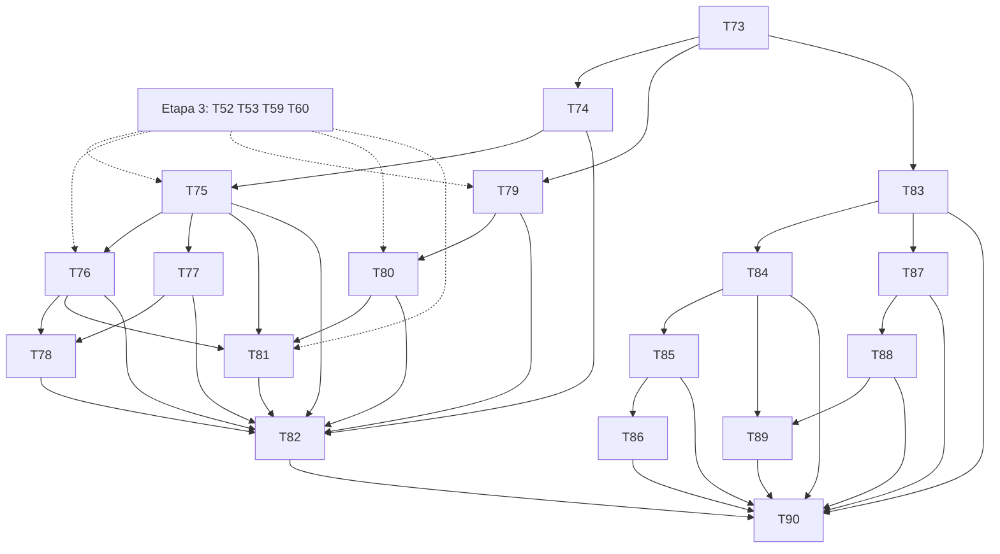

# Plano: Etapa 4 — pessoas, dívidas, divisão de despesa e recorrências

## 1. Objetivo

Permitir registrar "me devem" e "eu devo" (com e sem movimentação), quitar, perdoar e estornar com guardas, dividir uma despesa com alguém, cadastrar recorrências (contas e cartão), confirmar ou pular cada ocorrência e ver dívidas e recorrências nos compromissos do Início, tudo sem dupla contagem e sem nada acontecer sozinho.

## 2. Escopo

### 2.1 Entra

| #   | Entregável                                                                                                                                  | Quem         | Tasks    |
| --- | ------------------------------------------------------------------------------------------------------------------------------------------- | ------------ | -------- |
| C   | Contrato (pessoas, dívidas, recorrências, tipos `LOAN_GIVEN`, `MONEY_RECEIVED`, `DEBT_PAYMENT`, `shares`)                                   | dev-backend  | T73      |
| P   | Pessoas, dívidas (persistência e leitura; `FinancialRecordsGateway` passa a carregar dívidas)                                               | dev-backend  | T74, T75 |
| M   | Movimentações de dívida (emprestar, receber, pagar), dívida sem movimentação, perdão, estorno guardado                                      | dev-backend  | T76, T77 |
| S   | Divisão de despesa e dívida de consumo (S-40, extensão do domínio)                                                                          | dev-backend  | T78      |
| R   | Recorrências: persistência, CRUD, ocorrências, custo fixo; realizar/pular em conta e no cartão (liga `realizeOnCard` da T60)                | dev-backend  | T79, T80 |
| D   | Compromissos de dívidas e recorrências no dashboard, com prova cruzada de não dupla contagem                                                | dev-backend  | T81      |
| F   | Telas de pessoas, dívidas, quick actions "Dinheiro emprestado"/"recebido", divisão de despesa, recorrências e ocorrências pendentes, Início | dev-frontend | T83–T89  |
| Q   | Validação e E2E                                                                                                                             | tester       | T82, T90 |

### 2.2 Não entra

- **Lembrete automático** de cobrança (PR 00 §11) e notificações: Etapa 7 (os dados `expectedDate`/`overdue` já ficam prontos aqui).
- Juros de dívida, parcelamento de dívida, dívida em outra moeda (S-2).
- Importar dívidas de extrato (Etapa 7).
- Realização **automática** de recorrência: nunca (S-20). Só confirmação do usuário.
- Desfazer perdão (S-41; D1 §2.6): fora do MVP.
- Dream Board, metas (Etapa 5).

### 2.3 Regra de trabalho

- O domínio de `Person`, `Debt`, `DebtTransactions` e `RecurringTransaction` (Etapa 1) está concluído; só **métodos novos** são aceitos (T78, T79). Nenhuma task muda regra existente.
- Esta etapa **depende da Etapa 3 no backend**: T75 e T76 usam o mapper estendido (T52) e os handlers por tipo (T53); T80 liga o `realizeOnCard` (T60).
- Migrações `V4.*`.
- O front só usa os componentes da UI própria (nenhum controle nativo).

## 3. Perguntas em aberto e suposições

Numeração do backend continua após a Etapa 3 (**S-137** em diante).

### 3.1 A validar com o usuário (ordenadas por impacto)

| #     | Impacto | Suposição                                                                                                                                                                                                                                                                                                                                                                                                                                                              | Motivo                                                                                                                             | Dono    | Tasks         |
| ----- | ------- | ---------------------------------------------------------------------------------------------------------------------------------------------------------------------------------------------------------------------------------------------------------------------------------------------------------------------------------------------------------------------------------------------------------------------------------------------------------------------- | ---------------------------------------------------------------------------------------------------------------------------------- | ------- | ------------- |
| S-137 | alto    | **Divisão de despesa e dívida que nasce de consumo (S-40) entram nesta etapa**, estendendo o domínio com testes dos dois exemplos de D1 §2.6.1: `EXPENSE` com `shares: [{ newDebt: { personId }, amount }]` (Σ shares < amount; caixa −total, consumo só a parte do usuário, `RECEIVABLE` +parte) e dívida `PAYABLE` `WITHOUT_MOVEMENT` com `categoryId` opcional (consumo +valor, caixa 0). A despesa dividida é a **origem** da dívida e segue as guardas de estorno | casos comuns que o PR 01 não cobre; mexe no razão, por isso é uma task própria com revisão e fica por último no backend de dívidas | Produto | T78           |
| S-141 | alto    | **Estorno** (S-36): quitação (`DEBT_PAYMENT`/`MONEY_RECEIVED`) é estornável e devolve o status derivado; origem de dívida só se não houver quitação ativa (`DEBT_HAS_SETTLEMENTS`); dívida perdoada não aceita novo estorno de quitação (`DEBT_CLOSED`); perdão não pode ser desfeito; estornar o registro de dívida sem movimentação só sem quitações                                                                                                                 | segue D1 §2.6 e S-54; o front só habilita a ação                                                                                   | Produto | T76, T77      |
| S-138 | médio   | **Pessoa:** nome sem unicidade (homônimos são possíveis; a UI avisa "já existe uma pessoa com esse nome"); pessoa arquivada não recebe dívida nova (`PERSON_ARCHIVED`); criar a pessoa **dentro** do formulário da dívida (campo "nova pessoa") chama `POST /v1/people` antes, sem criar pessoa implícita no backend                                                                                                                                                   | evita pessoa duplicada por acidente e mantém uma rota por intenção                                                                 | Produto | T74, T85      |
| S-139 | médio   | **Recorrência é editável só nos dados do modelo para ocorrências futuras** (valor, descrição, categoria, conta/método, fim): novos métodos de domínio `updateDetails`/`endOn`; as ocorrências já realizadas continuam como estão (são movimentações). Frequência e início **não** mudam: para mudar, encerra e cria outra. Encerrar = `endDate`, sem apagar nada; desativar = `deactivate`                                                                             | a agenda é calculada da âncora (D1 §2.7); mexer nela reescreveria o histórico das previsões                                        | Produto | T79           |
| S-140 | médio   | **Realizar ocorrência:** sempre por confirmação; data da movimentação = data da ocorrência (domínio), valor padrão = o do modelo e editável (conta de luz). Ocorrência vencida e não realizada continua pendente (S-20) até ser realizada ou pulada; pular não cria movimentação                                                                                                                                                                                       | segue D1 §2.7                                                                                                                      | Produto | T80, T88      |
| S-142 | médio   | **Saldo por pessoa:** `net = Σ recebíveis em aberto − Σ passivos em aberto`, calculado no backend; a tela da pessoa mostra "João deve R$ 150,00" ou "você deve R$ 80,00" e o histórico (dívidas e quitações). Dívidas `CANCELED`/`VOIDED` ficam no histórico e fora do saldo                                                                                                                                                                                           | PR 00 §11 e §22 ("João → quanto deve, histórico e próxima cobrança")                                                               | Produto | T75           |
| S-143 | médio   | **Quitar a maior** é recusado (`DEBT_SETTLEMENT_EXCEEDS_OUTSTANDING`, regra da Etapa 1); a UI sugere o saldo restante vindo do backend. Devolver mais do que emprestou é outro registro (receita real), não quitação                                                                                                                                                                                                                                                   | não inventa regra de negócio                                                                                                       | Produto | T76, T85      |
| S-144 | médio   | **Recorrência no cartão:** só `CARD_PURCHASE` à vista (1 parcela); assinatura parcelada não existe como recorrência                                                                                                                                                                                                                                                                                                                                                    | D1 §2.7                                                                                                                            | Produto | T79, T80      |
| S-145 | baixo   | `Debt.overdue` (derivado: `expectedDate < hoje` e `outstanding > 0`) e dívida sem `expectedDate` ("sem data") aparecem na lista e no Início, mas **não** entram nos horizontes (D1 §2.8)                                                                                                                                                                                                                                                                               | evita inventar vencimento                                                                                                          | Produto | T75, T81, T89 |
| S-146 | baixo   | Custo fixo mensal e receita recorrente mensal = `MonthlyEstimate` (estimativa, semanal × 52/12), sempre rotulados como estimativa                                                                                                                                                                                                                                                                                                                                      | D1 §2.7                                                                                                                            | Produto | T79, T87      |

## 4. Contrato de API (delta sobre D2 §4.6)

Fonte da verdade: `contracts/openapi.yaml` (T73). Só adições.

| Método     | Caminho                                             | Corpo / observação                                                                                         | Resposta                                                                     |
| ---------- | --------------------------------------------------- | ---------------------------------------------------------------------------------------------------------- | ---------------------------------------------------------------------------- |
| GET / POST | `/v1/people`                                        | POST `{ name, notes? }`; `?status=ACTIVE                                                                   | ARCHIVED&q`                                                                  | `Slice<Person>` / `201 Person` (com `net` e `openDebts`)                                            |
| GET / PUT  | `/v1/people/{id}`                                   | PUT `{ name, notes?, version }`                                                                            | `Person` (inclui `net`, `nextDueDate`, `debts[]` resumidas)                  |
| POST       | `/v1/people/{id}/archive` · `/unarchive`            | —                                                                                                          | `200 Person`; `PERSON_ARCHIVED` ao usar                                      |
| GET        | `/v1/debts?direction&status&personId&overdue`       | `Slice`                                                                                                    | `Slice<Debt>`                                                                |
| POST       | `/v1/debts`                                         | só `WITHOUT_MOVEMENT`: `{ personId, direction, principal, date, expectedDate?, description, categoryId? }` | `201 Debt`                                                                   |
| GET / PUT  | `/v1/debts/{id}`                                    | PUT `{ expectedDate?, description, version }`                                                              | `Debt`                                                                       |
| POST       | `/v1/debts/{id}/cancel` · `/void`                   | `{ reason }`                                                                                               | `200 Debt`; `422 DEBT_HAS_SETTLEMENTS`                                       |
| POST       | `/v1/transactions`                                  | `LOAN_GIVEN { accountId, amount, date, newDebt:{ personId, expectedDate?, description? }                   | debtId }`; `MONEY_RECEIVED { accountId, amount, date, debtId                 | newDebt (captação) }`; `DEBT_PAYMENT { accountId, amount, date, debtId }`; `EXPENSE`ganha`shares[]` | `201 Transaction` (com `debt`) |
| GET / POST | `/v1/recurrences`                                   | POST `{ type, amount, description, categoryId, accountId+method                                            | cardId, frequency, interval?, unit?, startDate, endDate?, maxOccurrences? }` | `Slice<Recurrence>` / `201 Recurrence`                                                              |
| GET / PUT  | `/v1/recurrences/{id}`                              | PUT só os campos de S-139 + `version`                                                                      | `Recurrence` (com `monthlyEstimate`)                                         |
| POST       | `/v1/recurrences/{id}/end` · `/deactivate`          | `{ endDate? }`                                                                                             | `200 Recurrence`                                                             |
| GET        | `/v1/recurrences/occurrences?from&to&status=PENDING | REALIZED                                                                                                   | SKIPPED`                                                                     | ocorrências previstas e passadas                                                                    | `Slice<OccurrenceView>`        |
| POST       | `/v1/recurrences/{id}/occurrences/{date}/realize`   | header `Idempotency-Key`; `{ amount? }`                                                                    | `201 Transaction`                                                            |
| POST       | `/v1/recurrences/{id}/occurrences/{date}/skip`      | —                                                                                                          | `200 OccurrenceView`                                                         |
| GET        | `/v1/recurrences/summary`                           | —                                                                                                          | `{ fixedCosts, recurringIncome, estimate:true }`                             |

`Debt` segue D2 §4.6 (com `overdue`, `person`, `settlements[]`, `categoryId?`). `Person` ganha `net: Money` com sinal (positivo = me devem) e `direction` derivada para o texto.
Erros: códigos reais de `DebtExceptions`, `RecurrenceExceptions` e `PERSON_*` (T73 lê o domínio e fecha a lista); novos: `SHARES_EXCEED_AMOUNT`, `SHARE_PERSON_ARCHIVED`.

### 4.1 Garantias testadas (T82 e T90)

1. Caso 6 e 7 do PR 01 (emprestar 300, receber 300): caixa −300/+300, consumo 0, nenhuma receita; patrimônio: recebível +300/−300.
2. Caso 8 (eu devo 200 sem movimentação): caixa 0, consumo 0, patrimônio −200, compromisso previsto.
3. Divisão: Pix de 200 com 100 do João: caixa −200, consumo 100, recebível +100; quando o João paga 100: caixa +100, **não** é receita.
4. Recorrência: ocorrência prevista é compromisso (não consumo); ao realizar, sai das previsões e vira movimentação (uma vez); estornar reabre.
5. `Σ upcoming` de todas as fontes (faturas, dívidas, recorrências) não tem item duplicado (matriz de T81).

## 5. Tasks

> Convenções e **cenário padrão** das Etapas 2 e 3 (relógio 10/10/2026; Nubank 20.000,00; Roxinho). Pessoa: **João** e **Maria**. Categorias Alimentação, Assinaturas, Contas.

---

### T73 · dev-backend · Contrato da Etapa 4

**Objetivo:** escrever em `contracts/openapi.yaml` as rotas e os schemas de §4 e fechar a lista de `code`.

**Arquivos/camadas:** `contracts/openapi.yaml`, D2 §4.6, `ContractCoverageIT` (lista temporária de pendentes).

**Critérios de aceite**

1. **Dado** o contrato, **quando** rodo o lint do OpenAPI, **então** passa e só há adições (diff estrutural contra o contrato da Etapa 3).
2. **Dado** `TransactionInput` com os tipos novos, **então** `LOAN_GIVEN` aceita `newDebt` **xor** `debtId`; `EXPENSE.shares` exige `amount` de cada parte > 0 (`oneOf`); `DEBT_PAYMENT` exige `debtId`.
3. **Dado** os `code` de §4, **então** existem no código (conferência por teste) ou ficam marcados "a criar em T78".
4. **Dado** `npm run api:types`, **então** gera sem erro (T83).

**Depende de:** — (documento; rebase sobre T49 se rodar junto: ambos só acrescentam caminhos).

### T74 · dev-backend · Pessoas: persistência e API

**Objetivo:** persistir `Person` e expor `/v1/people` (criar, listar, editar, arquivar/desarquivar). `net` e `openDebts` chegam completos em T75.

**Arquivos/camadas:** `core/debt/app/{gateways/PersonGateway, usecase/{CreatePerson, UpdatePerson, GetPerson, ListPeople, ArchivePerson, UnarchivePerson}}`, `infra/person/...`, `infra/config/PersonConfig`, testes.

**Critérios de aceite**

1. **Dado** `POST /v1/people { name: "João" }`, **então** `201` + `Location`, `archived: false`, `version: 0`; nome vazio → `422 PERSON_NAME_REQUIRED`; > 100 → erro de tamanho.
2. **Dado** dois "João", **então** ambos são aceitos (S-138); `GET ?q=jo` filtra sem acento/caixa.
3. **Dado** `archive`, **então** `200`; segunda vez → `422 PERSON_ALREADY_ARCHIVED`; `unarchive` de ativa → `422 PERSON_NOT_ARCHIVED`.
4. **Dado** `PUT` com `version` velha, **então** `409 VERSION_CONFLICT`.
5. **Dado** outro usuário, **então** `404 PERSON_NOT_FOUND`.
6. Mapper `toDomain(toEntity(p))` igual; testes de caso de uso com Mockito.

**Depende de:** T73. Etapa 3: padrão de T51.

### T75 · dev-backend · Dívidas: persistência, leitura e carregamento único

**Objetivo:** reidratar `Debt` (`Debt.restore(DebtState, settlements, entries)`) a partir de `debts`, das quitações (movimentações ativas ligadas a `debt_id`) e dos postings; `FinancialRecordsGatewayImpl` passa a carregar `debts`; `GET /v1/debts`, `GET /v1/debts/{id}`, `Person.net`.

**Arquivos/camadas:** `infra/debt/{persistence, gateways/{DebtRepositoryMapper, DebtRepositoryGatewayImpl}}`, `infra/finance/gateways/FinancialRecordsGatewayImpl`, `core/debt/app/{DebtView, usecase/{GetDebt, ListDebts}}`, migração `V4.00` (índices `ix_debts_user_person`, `ix_transactions_debt`), testes.

**Critérios de aceite**

1. **Dado** uma dívida `WITH_MOVEMENT` de 300,00 (origem `LOAN_GIVEN`) e uma quitação ativa de 100,00, **então** a leitura traz `settled` 100,00, `outstanding` 200,00, `status: PARTIALLY_SETTLED` (derivado, S-41), `settlements[0]`, e `overdue` conforme `expectedDate` e o relógio.
2. **Dado** `FinancialRecords.load`, **então** traz `debts`; o razão em memória e o SQL dos livros `RECEIVABLE`/`PAYABLE`/`EQUITY` coincidem e fecham em zero.
3. **Dado** estado gravado corrompido (dívida `WITH_MOVEMENT` sem movimentação de origem), **então** `DEBT_STATE_INCONSISTENT` sem retorno parcial (S-94).
4. **Dado** `GET /v1/debts?direction=RECEIVABLE&status=OPEN&overdue=true`, **então** filtra corretamente; dívida de outro usuário → `404 DEBT_NOT_FOUND`.
5. **Dado** João com recebível aberto de 150,00 e passivo de 40,00, **então** `Person.net` = 110,00 (S-142); dívida `CANCELED` não entra.
6. **Dado** os ITs das Etapas 2 e 3, **então** continuam verdes (o carregamento extra não muda saldos).

**Depende de:** T74. Etapa 3: T52 (mapper e `FinancialRecordsGateway`). Etapa 2: T45 (`Debt.restore`).

### T76 · dev-backend · Movimentações de dívida (emprestar, receber, pagar)

**Objetivo:** `LOAN_GIVEN`, `MONEY_RECEIVED` (devolução e captação) e `DEBT_PAYMENT` por `POST /v1/transactions` (handlers por tipo), com a dívida criada/alterada na mesma transação; estorno com guardas (S-141).

**Arquivos/camadas:** `core/finance/app/transactions/handlers/{LoanGivenHandler, MoneyReceivedHandler, DebtPaymentHandler}` (mesmo ponto de extensão da T53: `AccountTransactionFactory`/`CreateTransactionCommand`; `core.transaction.app` não pode importar `finance`, e `ArchitectureTest` barra ciclos), `core/debt/app/gateways/DebtGateway` (porta usada pelo handler; `transaction` já depende de `debt`), `infra/transaction/controller` (corpo discriminado), `TransactionImpactCalculator` (campo `debt`), testes.

**Critérios de aceite** (cenário padrão)

1. **Dado** `LOAN_GIVEN` 300,00 da Nubank ao João (previsão 05/11), **então** `201` com `debt` criada (`RECEIVABLE`, `WITH_MOVEMENT`, principal 300,00); `impact.cash` −300,00, `consumption` vazio, `netWorth` 0,00 (recebível +300,00 compensa o caixa); aparece como compromisso `DEBT_RECEIVABLE` em 05/11 (caso 6 do PR 01).
2. **Dado** `MONEY_RECEIVED` 300,00 com `debtId` do CA1, **então** caixa +300,00, **sem** receita, dívida `SETTLED`; 100,00 depois de 200,00 já quitados → `422 DEBT_SETTLEMENT_EXCEEDS_OUTSTANDING` (S-143); `MONEY_RECEIVED` sem `debtId` e sem `newDebt` → `400`.
3. **Dado** `MONEY_RECEIVED` com `newDebt` (captação de 500,00 da Maria), **então** nasce uma dívida `PAYABLE` e o caixa sobe 500,00 sem receita (S-6).
4. **Dado** `DEBT_PAYMENT` de 200,00 numa `PAYABLE` de 500,00, **então** caixa −200,00, consumo 0, `outstanding` 300,00 (`PARTIALLY_SETTLED`); direção errada → `422 DEBT_DIRECTION_MISMATCH`.
5. **Dado** segunda origem para a mesma dívida, **então** `422 DEBT_ALREADY_HAS_ORIGIN`; pessoa arquivada → `422 PERSON_ARCHIVED`; conta não `CASH` → `422 TRANSACTION_ACCOUNT_NOT_CASH`.
6. **Dado** o estorno da quitação do CA2, **então** a dívida volta a `OPEN`/`PARTIALLY_SETTLED` e o caixa volta; estorno da origem do CA1 com quitação ativa → `422 DEBT_HAS_SETTLEMENTS` com `voidable: false`; sem quitações, o estorno da origem marca a dívida `VOIDED` e desativa os postings; dívida perdoada → `422 DEBT_CLOSED`.
7. **Dado** `Idempotency-Key` repetida, **então** uma única movimentação e uma única dívida.
8. Testes de caso de uso (Mockito) por tipo; a Etapa 2/3 inalteradas.

**Depende de:** T75. Etapa 3: T53 (handlers por tipo). Etapa 1: T7.

### T77 · dev-backend · Dívida sem movimentação, edição, perdão e estorno do registro

**Objetivo:** `POST /v1/debts` (`WITHOUT_MOVEMENT`, com `categoryId` só em T78), `PUT /v1/debts/{id}`, `cancel` (perdão) e `void` (estorno do registro).

**Arquivos/camadas:** `core/finance/app/debts/usecase/{CreateDebt, UpdateDebt, CancelDebt, VoidDebtRecord}` (gravam no razão por `LedgerWriteGateway`, que é de `finance`; `core.debt` só depende de `sk`; leituras e CRUD de pessoa ficam em `core/debt/app`), `infra/debt/controller`, domínio: métodos novos `Debt.updateDetails` se faltar, testes.

**Critérios de aceite**

1. **Dado** `POST /v1/debts` PAYABLE 200,00 "Almoço pago por Maria", **então** `201`; caixa 0, consumo 0, patrimônio −200,00 (`PAYABLE −200 / EQUITY +200`), compromisso `DEBT_PAYABLE` na `expectedDate` (caso 8 do PR 01); sem `expectedDate`, aparece em `undated` e fora dos horizontes (S-145).
2. **Dado** `cancel` com motivo numa dívida `OPEN`/`PARTIALLY_SETTLED`, **então** `CANCELED`, saldo zerado contra `EQUITY` sem despesa/receita (S-19); sem motivo → `422 DEBT_REASON_REQUIRED`; dívida `SETTLED` → recusa; novo `cancel` → `DEBT_CLOSED`.
3. **Dado** `void` de dívida sem movimentação e sem quitações, **então** `VOIDED`; com quitações → `422 DEBT_HAS_SETTLEMENTS`; dívida `WITH_MOVEMENT` → `422 DEBT_HAS_ORIGIN_TRANSACTION` (o caminho é estornar a movimentação).
4. **Dado** `PUT` de `expectedDate` e `description`, **então** `200` e o compromisso muda de data; `principal` não muda; `version` velha → `409`.
5. **Dado** valor 0, negativo ou acima do teto (S-78), **então** `422 DEBT_INVALID_PRINCIPAL`/`AMOUNT_ABOVE_LIMIT`.

**Depende de:** T75, T74.

### T78 · dev-backend · Divisão de despesa e dívida de consumo (S-40)

**Objetivo:** estender o domínio (D1 §2.6.1) e a API: `EXPENSE` com `shares` e dívida `PAYABLE` `WITHOUT_MOVEMENT` com `categoryId`. É a única task desta etapa que muda o razão; vai à revisão do `revisor` com atenção ao PR 01.

**Arquivos/camadas:** `core/transaction/domain` (novos tipos `ExpenseShare`; `AccountTransactions.expenseWithShares`), `core/debt/domain` (`Debt.withoutMovement(..., categoryId)`), handler `ExpenseHandler` estendido, `infra` (colunas `debt_shares`/`category_id` em `V4.01`), D1 §2.6.1 atualizado, testes.

**Critérios de aceite**

1. **Dado** `EXPENSE` 200,00 por Pix, Alimentação, com `shares: [{ newDebt:{ personId: João }, amount: 100,00 }]`, **então** postings `EXPENSE +100` / `RECEIVABLE +100` / `ACCOUNT −200`; caixa −200,00 (igual à linha do extrato), consumo 100,00, patrimônio −100,00; nasce a dívida do João (100,00) com **origem = essa despesa**.
2. **Dado** `Σ shares ≥ amount` ou parte ≤ 0, **então** `422 SHARES_EXCEED_AMOUNT`; pessoa arquivada → `422 SHARE_PERSON_ARCHIVED`; mais de uma parte à mesma pessoa é aceita como duas dívidas.
3. **Dado** o João pagando 100,00 depois (`MONEY_RECEIVED` com `debtId`), **então** caixa +100,00, consumo inalterado e **sem** receita.
4. **Dado** estorno da despesa dividida **sem** quitação, **então** estorna despesa e dívida juntas; **com** quitação ativa → `422 DEBT_HAS_SETTLEMENTS` (S-36/S-141).
5. **Dado** dívida `PAYABLE` sem movimentação com `categoryId` (Alimentação, 80,00, "jantar pago pelo amigo"), **então** `EXPENSE(cat, competência) +80 / PAYABLE −80`: consumo +80,00, caixa 0, patrimônio −80,00; sem categoria continua o caso 8 (consumo 0).
6. **Dado** o razão após qualquer combinação, **então** soma zero e o consumo da categoria é a parte do usuário (propriedade, 200 cenários).
7. **Dado** a edição de `EXPENSE` dividida, **então** `422 TRANSACTION_NOT_EDITABLE` para valor/divisão (editar descrição/categoria/observação segue a Etapa 2); documentado.

**Depende de:** T76, T77. Etapa 1: T4, T7. Revisão do domínio obrigatória antes de T82.

### T79 · dev-backend · Recorrências: persistência, CRUD, ocorrências e custo fixo

**Objetivo:** persistir `RecurringTransaction` (e as ocorrências puladas), expor `/v1/recurrences`, listar ocorrências (previstas/realizadas/puladas), `summary` (S-146) e implementar o `CommitmentSourcesGateway` real (recorrências do usuário).

**Arquivos/camadas:** `core/recurrence/app/{gateways/RecurrenceGateway (implementação JPA), usecase/{Create, Update, End, Deactivate, Get, List, ListOccurrences, GetSummary}}`, domínio: `updateDetails`/`endOn` (S-139), `infra/recurrence/{persistence, gateways}`, `infra/dashboard/gateways/RecurrenceCommitmentSources` (substitui `EmptyCommitmentSources`), migrações `V4.02` (`recurring_transactions`, `recurrence_skips`) e índices, testes.

**Critérios de aceite**

1. **Dado** `POST /v1/recurrences` MONTHLY de 119,00 "Internet" (Contas) na Nubank (PIX), início 10/09, **então** `201` com `monthlyEstimate`; `occurrences` entre 01/10 e 31/12 traz 10/10, 10/11, 10/12 `PENDING`.
2. **Dado** dia 31 e meses curtos, **então** 31/01, 28/02, 31/03, 30/04 (âncora, D1 §2.7); `maxOccurrences` e `endDate` limitam; `CUSTOM` com intervalo 2 semanas funciona.
3. **Dado** `CARD_PURCHASE` à vista (assinatura de 49,90 no Roxinho), **então** aceito; parcelado não existe (S-144); modelo com conta **e** cartão → `422 RECURRENCE_INVALID`.
4. **Dado** `PUT` de valor e categoria, **então** só as ocorrências **não realizadas** mudam de valor; as realizadas (movimentações) ficam; frequência/início no corpo → `400`; `version` velha → `409`.
5. **Dado** `summary`, **então** `fixedCosts` e `recurringIncome` com `estimate: true` (semanal × 52/12).
6. **Dado** o `CommitmentSourcesGateway` real, **então** `GET /v1/dashboard/upcoming` traz as ocorrências `PENDING` como `RECURRENCE` (de hoje a 12 meses; vencidas pendentes entram, S-20), e a recorrência desativada/encerrada não.
7. **Dado** outro usuário, `404`; a Etapa 2/3 inalteradas.

**Depende de:** T73. Etapa 3: T60 (porta `RecurrenceGateway`). Etapa 2: T45 (`RecurringTransaction.restore`).

### T80 · dev-backend · Realizar e pular ocorrências (conta e cartão)

**Objetivo:** `POST .../realize` (conta: `RecurringTransaction.realize`; cartão: `RealizeCardRecurrenceUseCase` da T60 agora com Postgres) e `POST .../skip`, com idempotência e a regra S-49.

**Arquivos/camadas:** `core/finance/app/recurrences/usecase/{RealizeOccurrence, SkipOccurrence}` (criam movimentação: `recurrence` não pode depender de `finance`, que já depende de `recurrence`), `infra/recurrence/controller`, testes.

**Critérios de aceite**

1. **Dado** a ocorrência de 10/10 da Internet (119,00), **quando** `realize` sem `amount`, **então** `201` com `EXPENSE` de 119,00 em 10/10, `source: RECURRENCE`, `recurrenceId` e `occurrenceDate`; a ocorrência passa a `REALIZED` e sai dos compromissos; **com** `amount: 124,90` a movimentação tem 124,90.
2. **Dado** a mesma ocorrência de novo, **então** `422 RECURRENCE_OCCURRENCE_ALREADY_REALIZED`; `Idempotency-Key` repetida → o mesmo `201`; duas requisições concorrentes → uma vence, a outra recebe o erro (índice único `uq_transactions_recurrence_occurrence`).
3. **Dado** a assinatura de 49,90 no Roxinho, **quando** realizo a de 15/10 com a fatura `OPEN`, **então** `CARD_PURCHASE` em 1 parcela na fatura que fecha 25/10; com a fatura do ciclo `CLOSED` não paga → `lateEntry`; com a fatura `PAID` → fatura corrente (nunca `PAID`); **então** o valor sai das previsões e passa a vir só da fatura (sem dupla contagem; T60 CA1 agora com Postgres).
4. **Dado** `skip` de 10/11, **então** a ocorrência some dos compromissos e não vira movimentação; `realize` depois → `422 RECURRENCE_OCCURRENCE_SKIPPED`.
5. **Dado** o estorno da movimentação realizada, **então** a ocorrência volta a `PENDING` e pode ser realizada de novo (S-49).
6. **Dado** data que não é ocorrência → `422 RECURRENCE_NOT_AN_OCCURRENCE`; recorrência de outro usuário → `404`; conta/cartão arquivados → `422 ACCOUNT_ARCHIVED`/`CARD_ARCHIVED`.

**Depende de:** T79. Etapa 3: T60, T53.

### T81 · dev-backend · Compromissos de dívidas e recorrências no dashboard (prova cruzada)

**Objetivo:** com dívidas (T75) e recorrências (T79) carregadas, provar que `summary` e `upcoming` somam cada compromisso uma vez entre **todas as fontes** e que lista, dashboard e telas concordam.

**Arquivos/camadas:** testes de integração em `backend/src/test/java/.../finance`, ajuste de descrições do contrato (remove "fontes ainda não persistidas").

**Critérios de aceite** (relógio 10/10; cenário completo: fatura do Roxinho 1.283,00 vence 05/11; Internet 119,00 todo dia 10 com **início 10/10** (com início 10/09 a ocorrência de 10/09 estaria vencida e pendente e entraria em todos os horizontes, S-20); João deve 150,00 com `expectedDate` 05/11; eu devo 200,00 à Maria sem data)

1. **Dado** o cenário, **então** `/upcoming` de 10/10 a 10/11 traz: Internet 10/10 (hoje), fatura 05/11 (1.283,00 com parcelas aninhadas), cobrança do João 05/11 (IN 150,00), Internet 10/11; a dívida da Maria aparece em `undated` e fora dos horizontes (S-145).
2. **Dado** `committed.d30` (horizonte = hoje + 30 dias = até **09/11**, inclusive: `Horizon.endFrom`), **então** = Internet 10/10 + fatura de 05/11 = 119 + 1.283 = **1.402,00**; a Internet de 10/11 é o dia 31 e só entra em `d60` (1.521,00 = 1.402 + 119; revisão 2026-10-05: o texto anterior somava 1.521,00 em d30) — as entradas (João) **não** abatem o comprometido (D1 §2.8), e `projected.d30` as inclui como entrada prevista.
3. **Dado** realizar a Internet de 10/10 (119,00), **então** `committed.d30` cai 119,00, `inAccounts` cai 119,00 e o disponível **não muda**; `month.consumption` sobe 119,00 uma vez.
4. **Dado** o João pagar 150,00, **então** a cobrança some, `inAccounts` +150,00, `month.income` **não** muda (não é renda) e `month.received` sobe 150,00.
5. **Dado** recorrência no cartão realizada, **então** a ocorrência deixa de ser `RECURRENCE` e o valor passa a compor a fatura; `Σ upcoming OUT` = `Σ outstanding` das faturas + ocorrências pendentes + dívidas `PAYABLE` datadas (matriz com 12 combinações, sem item duplicado).
6. **Dado** o mesmo mês na lista (registros e por competência) e no dashboard, **então** `totals.cashFlow` = `month.cashFlow` e `totals`/`byCategory` = `month.consumption` (S-79), com divisão de despesa e quitação no meio.

**Depende de:** T75, T76, T79, T80. Etapa 3: T59.

### T82 · tester · Validação do backend da Etapa 4

**Objetivo:** integridade das dívidas, divisão e recorrências; contrato; concorrência.

**Arquivos/camadas:** `backend/src/test/java/com/moneylog/qa/`, relatório `docs/qa/AAAA-MM-DD-qa-backend-etapa-4.md`.

**Critérios de aceite**

1. **Dado** os casos 6, 7, 8 e 9 do PR 01 e os de divisão, **então** cada coluna (caixa, consumo, patrimônio, compromisso) bate com a tabela do PR 01.
2. **Propriedade (≥ 600 operações):** empréstimos, quitações, perdões, estornos, divisões, realizações e puladas; **então** razão zera, `outstanding ≥ 0`, nenhuma quitação acima do principal, nenhuma ocorrência realizada duas vezes e lista × dashboard × pessoa concordam.
3. **Concorrência:** quitações simultâneas da mesma dívida, `realize` simultâneo, estorno × quitação; **então** sem 500 e sem estado inconsistente.
4. **Segurança:** isolamento entre usuários em pessoas, dívidas, recorrências, ocorrências.
5. **Contrato:** operações × handlers e `code` da tabela; migrações sobre base com dados.
6. Bugs de integridade bloqueiam T90.

**Depende de:** T74–T81.

### T83 · dev-frontend · Módulos `people`, `debts` e `recurrences` (negócio)

**Objetivo:** tipos gerados e três módulos (`src/modules/{people,debts,recurrences}`): tipos, portas, facades, requests, mapper, mocks; estende `transactions` com os tipos de dívida e `shares`.

**Arquivos/camadas:** `src/modules/{people,debts,recurrences}/{core,infra,mock-data}`, `src/modules/transactions` (tipos novos), `provide*()` no `app.config.ts`, testes.

**Critérios de aceite**

1. **Dado** o contrato, **então** `api:check` verde; módulos não se importam entre si (regra do `lint:deps`): o formulário de despesa dividida recebe `people` por `input`/facade da página, não por import de módulo.
2. **Dado** `Idempotency-Key`, **então** por tentativa em emprestar/receber/pagar/realizar.
3. **Dado** `422/409`, **então** falhas tipadas (`DEBT_HAS_SETTLEMENTS`, `DEBT_CLOSED`, `RECURRENCE_OCCURRENCE_ALREADY_REALIZED`...).
4. **Dado** `API_MOCKS = true`, **então** vazios sem HTTP.
5. **Dado** dinheiro, **então** string sem soma no front (lint).

**Depende de:** T73. Integração real: T74–T80 (T90).

### T84 · dev-frontend · Pessoas: lista, detalhe e histórico

**Objetivo:** `/people` (lista com "João deve R$ 150,00" / "você deve R$ 80,00"), criar/editar/arquivar, detalhe com dívidas, quitações e próxima cobrança.

**Arquivos/camadas:** `src/app/features/people/{people.routes.ts, pages/{people.page, person-form.page, person.page}, components/{person-row, debt-row}}`, i18n, testes. Usa `Disclosure`, `Tabs`, `Tooltip`.

**Critérios de aceite**

1. **Dado** nenhuma pessoa, **então** estado vazio com "Adicionar pessoa" habilitado.
2. **Dado** `Person.net` positivo/negativo/zero, **então** a frase vem de `net` (sinal do backend) e a cor só reforça o texto.
3. **Dado** o detalhe, **então** lista dívidas abertas e encerradas (status em texto), quitações e `nextDueDate`; cada dívida leva ao detalhe.
4. **Dado** busca por nome, **então** debounce e cancela anterior; homônimo mostra aviso (S-138).
5. **Dado** 375 px e 1280 px, **então** lista/tabela responsivas; teclado completo.

**Depende de:** T83; UI própria: T158, T159, T166. Integração real: T74, T75.

### T85 · dev-frontend · Emprestar, receber, dívida sem movimentação, quitar e perdoar

**Objetivo:** quick actions "Dinheiro emprestado" e "Dinheiro recebido" em `/quick-add` (modos `loan`, `received`), "Nova dívida" (sem movimentação), quitar (`DEBT_PAYMENT`/`MONEY_RECEIVED`), perdoar e estornar registro.

**Arquivos/camadas:** `src/app/features/quick-add/components/{loan-form, received-form}`, `src/app/features/people/components/{debt-form, settle-sheet, forgive-dialog}`, i18n, testes. Usa `Select`/`Combobox` (pessoa), `DatePicker`.

**Critérios de aceite**

1. **Dado** o modo "Dinheiro emprestado", **então** pede pessoa (existente ou "nova pessoa" com criação prévia, S-138), conta, valor, data, previsão e descrição; salvar usa a dívida devolvida e mostra toast com "Ver dívida".
2. **Dado** quitar uma dívida de 300,00 com 100,00 pagos, **então** a sugestão de valor é o `outstanding` **do backend**; valor maior recebe o erro do backend traduzido (S-143), sem calcular.
3. **Dado** perdoar, **então** `ConfirmDialog` com motivo obrigatório e texto "não pode ser desfeito"; depois, a dívida aparece `CANCELED` e as ações somem.
4. **Dado** `voidBlockedBy`/`DEBT_HAS_SETTLEMENTS`, **então** a ação de estornar a origem fica desabilitada com a explicação e o caminho "estorne antes as quitações".
5. **Dado** dívida sem movimentação, **então** o formulário explica "não mexe no saldo das contas" e `categoryId` só aparece para `PAYABLE` ("gasto que alguém pagou por você", S-137).
6. **Dado** clique duplo e teclado, **então** uma requisição; fluxo só com teclado.

**Depende de:** T83, T84; UI própria: T156, T160, T164, T165. Integração real: T76, T77.

### T86 · dev-frontend · Divisão de despesa no formulário

**Objetivo:** no formulário de despesa (Pix/débito/…), "Dividir com alguém": partes por pessoa, valores digitados; o backend valida.

**Arquivos/camadas:** `src/app/features/quick-add/components/cash-entry-form` + `components/shares-field`, i18n, testes.

**Critérios de aceite**

1. **Dado** despesa de 200,00 dividida com João (100,00), **então** o corpo leva `shares` e a tela **não mostra nenhum valor calculado** (nem "seu gasto"): o `impact` (consumo 100,00, caixa −200,00) aparece no detalhe depois de salvar, vindo do backend (FE-S: o front não subtrai; se o produto quiser a prévia, entra uma rota de prévia na Etapa 4b).
2. **Dado** `SHARES_EXCEED_AMOUNT`, **então** o erro aparece no campo das partes.
3. **Dado** pessoa nova na parte, **então** é criada antes (S-138).
4. **Dado** teclado/leitor de tela, **então** adicionar/remover parte tem rótulos ("Remover parte de João") e foco previsível.

**Depende de:** T83, T85; UI própria: T165. Integração real: T78.

### T87 · dev-frontend · Recorrências: lista, criar/editar e custo fixo

**Objetivo:** `/planning/recurrences` (ou aba em Planejamento): lista com frequência, próxima ocorrência e valor; criar/editar/encerrar; cartões "Custo fixo mensal" e "Receita recorrente mensal" (estimativa).

**Arquivos/camadas:** `src/app/features/planning/{pages/recurrences.page, pages/recurrence-form.page, components/{recurrence-row, fixed-costs-summary}}`, i18n, testes. Usa `Select`, `DatePicker`, `NumberStepper`, `Switch`.

**Critérios de aceite**

1. **Dado** o formulário, **então** frequência `DAILY|WEEKLY|MONTHLY|YEARLY|CUSTOM` (intervalo/unidade só em `CUSTOM`), início, fim ou nº máximo; tipo conta (conta + método) ou cartão (S-144: sem parcelas).
2. **Dado** editar, **então** frequência e início ficam desabilitados com a explicação "para mudar, encerre e crie outra" (S-139); encerrar pede data.
3. **Dado** `summary`, **então** mostra custo fixo e receita recorrente **rotulados "estimativa"**, valores do backend.
4. **Dado** vazio/erro/carregando, **então** estados testados; 375 px e 1280 px.

**Depende de:** T83; UI própria: T156, T160, T163, T157. Integração real: T79.

### T88 · dev-frontend · Ocorrências pendentes: realizar e pular

**Objetivo:** lista "Pendentes" (vencidas e próximas) com "Realizar" (valor real editável) e "Pular"; também a partir do Início.

**Arquivos/camadas:** `src/app/features/planning/{pages/occurrences.page, components/{occurrence-row, realize-sheet}}`, i18n, testes.

**Critérios de aceite**

1. **Dado** ocorrências, **então** mostra data, descrição, valor previsto e se é conta ou cartão; vencidas aparecem em "Atrasadas" com texto.
2. **Dado** "Realizar", **então** o `Sheet` pré-preenche o valor do modelo (editável) e mostra para cartões a fatura alvo vinda do backend (resposta/prévia); salvar usa o `201 Transaction` e a ocorrência some.
3. **Dado** `RECURRENCE_OCCURRENCE_ALREADY_REALIZED`, **então** mensagem clara e a lista recarrega.
4. **Dado** "Pular", **então** confirma e some; não cria movimentação.
5. **Dado** teclado, **então** realizar/pular com foco previsível.

**Depende de:** T87; UI própria: T164. Integração real: T80.

### T89 · dev-frontend · Início: dívidas e recorrências nos compromissos

**Objetivo:** a timeline do Início mostra "João deve R$ 150 — cobrar dia 5", "Internet — R$ 119 — vence dia 10" e a lista "sem data"; atalho "Realizar" para ocorrência.

**Arquivos/camadas:** `src/app/features/home/*`, i18n, testes.

**Critérios de aceite**

1. **Dado** `/upcoming` do cenário de T81, **então** a timeline agrupa hoje → amanhã → 7 dias → próximo mês com os itens e os totais do backend; entradas (cobranças) aparecem com rótulo "a receber" e não somam ao comprometido mostrado.
2. **Dado** dívida sem data, **então** aparece em "Sem data" com link; atrasada em "Atrasados" (texto + cor).
3. **Dado** item de recorrência, **então** tem ação "Realizar" que abre o `Sheet` de T88.
4. **Dado** estados carregando/erro/vazio, **então** testados; nenhuma conta no componente.

**Depende de:** T88, T84. Integração real: T81.

### T90 · tester · E2E da Etapa 4 com backend real

**Objetivo:** jornada de dívidas e recorrências com a stack real.

**Arquivos/camadas:** `frontend/e2e/integration/{debts,recurrences}.e2e.ts`, `docs/qa/AAAA-MM-DD-qa-e2e-etapa-4.md`.

**Critérios de aceite**

1. **Jornada 1:** cadastrar João → emprestar 300,00 → ver compromisso no Início → receber 100,00 → perdoar o resto; **então** saldos, `net`, compromissos e Início batem com a API em cada passo; receber não vira renda.
2. **Jornada 2:** despesa de 200,00 dividida com João → ver consumo 100,00 e caixa −200,00 → João paga 100,00.
3. **Jornada 3:** criar recorrência Internet → ver no Início → realizar com valor 124,90 → ver a ocorrência sumir e a despesa na lista; recorrência de cartão → ver na fatura.
4. **Teclado e 375 px/WebKit** nos fluxos; contrato validado contra respostas reais.
5. Bugs com severidade; bloqueiam a Etapa 5 (front) os de jornada principal/integridade.

**Depende de:** T82, T83–T89.

---

## 6. Ordem de execução e paralelismo

### 6.1 Dependências

| Task | Agente       | Depende de                           |
| ---- | ------------ | ------------------------------------ |
| T73  | dev-backend  | —                                    |
| T74  | dev-backend  | T73                                  |
| T75  | dev-backend  | T74, Etapa 3: T52                    |
| T76  | dev-backend  | T75, Etapa 3: T53                    |
| T77  | dev-backend  | T75, T74                             |
| T78  | dev-backend  | T76, T77 (+ revisão do domínio)      |
| T79  | dev-backend  | T73, Etapa 3: T60                    |
| T80  | dev-backend  | T79, Etapa 3: T53, T60               |
| T81  | dev-backend  | T75, T76, T79, T80, Etapa 3: T59     |
| T82  | tester       | T74–T81                              |
| T83  | dev-frontend | T73                                  |
| T84  | dev-frontend | T83, UI: T158, T159, T166            |
| T85  | dev-frontend | T83, T84, UI: T156, T160, T164, T165 |
| T86  | dev-frontend | T83, T85, UI: T165                   |
| T87  | dev-frontend | T83, UI: T156, T157, T160, T163      |
| T88  | dev-frontend | T87, UI: T164                        |
| T89  | dev-frontend | T88, T84                             |
| T90  | tester       | T82, T83–T89                         |

### 6.2 Grafo

### 6.3 Ondas

| Onda | Backend                                      | Frontend              |
| ---- | -------------------------------------------- | --------------------- |
| 1    | T73 (pode correr junto com T49)              | —                     |
| 2    | T74 ∥ T79 (T79 espera T60)                   | T83                   |
| 3    | T75 (espera T52)                             | T84 ∥ T87 (espera UI) |
| 4    | T76 (espera T53) ∥ T77 ∥ T80                 | T85 ∥ T88             |
| 5    | T78 (revisão obrigatória) ∥ T81 (espera T59) | T86 ∥ T89             |
| 6    | T82 (tester)                                 | —                     |
| 7    | —                                            | T90 (tester)          |

- **Paralelo com a Etapa 3:** T73–T75 e T79 podem rodar enquanto T53–T58 estão em andamento, desde que T52/T53/T60 já estejam mesclados. T76 e T78 só depois de T53 (handlers por tipo). Migrações `V4.*` numeradas por task: `V4.00` (T75), `V4.01` (T78), `V4.02` (T79).
- **Conflito de arquivos:** T76 e T78 editam o mesmo corpo discriminado de `TransactionInput` e o `ExpenseHandler`; por isso T78 é depois de T76. T79 e T75 mexem em `infra/dashboard/gateways` e `FinancialRecordsGatewayImpl` em momentos diferentes (T75 cartões/dívidas; T79 recorrências): sequenciais por rebase.
- Cada task passa pela revisão de código antes da seguinte que depende dela.

## 7. Riscos

| Risco                                                       | Impacto                    | Mitigação                                                                                           |
| ----------------------------------------------------------- | -------------------------- | --------------------------------------------------------------------------------------------------- |
| Divisão de despesa (T78) alterar o razão e a conta de caixa | número errado no dashboard | task isolada, caso do PR 01 como teste, revisão de domínio obrigatória, propriedade de 200 cenários |
| Dupla contagem entre recorrência realizada e fatura/dívida  | comprometido inflado       | matriz de T81 CA5; ocorrência realizada sai das previsões                                           |
| Recorrência editada reescrevendo histórico                  | previsões passadas mudam   | S-139: só ocorrências futuras; frequência e início imutáveis                                        |
| Usuário confundir quitação com renda                        | consumo/receita errados    | `MONEY_RECEIVED` nunca é renda (teste T76 CA2, T81 CA4); rótulos "devolução"                        |
| Pessoa duplicada por homônimo                               | saldo dividido             | aviso de homônimo; criação explícita (S-138)                                                        |
| Atraso da Etapa 3 bloqueando T75/T76/T80                    | cronograma                 | T73/T74/T79 não dependem de T53; roadmap com ondas                                                  |
| Recorrência no cartão quebrar a regra de lançamento tardio  | fatura paga recebe item    | T80 CA3 e T60 CA3                                                                                   |

## 8. ADRs e documentos

| Documento      | Tema                                                       | Task     |
| -------------- | ---------------------------------------------------------- | -------- |
| D1 §2.6.1 e §8 | Divisão de despesa implementada e suposições S-137 a S-146 | T78, T82 |
| D1 §2.7        | Edição de recorrência (S-139)                              | T79      |
| D2 §4.6        | Contrato de pessoas, dívidas e recorrências                | T73      |

## Anexo: suposições do frontend da Etapa 4 (T83–T89)

Registradas por quem implementou o front (numeração FE-S continua em FE-S-143, depois das da Etapa 3).

| #        | Suposição                                                                                                                                                                                                                                                                                                                                                                                                                                                                                 | Tasks         |
| -------- | ----------------------------------------------------------------------------------------------------------------------------------------------------------------------------------------------------------------------------------------------------------------------------------------------------------------------------------------------------------------------------------------------------------------------------------------------------------------------------------------- | ------------- |
| FE-S-143 | `POST /v1/debts` (e `POST /v1/people`) não têm `Idempotency-Key` no contrato 2.2.0: a "Nova dívida" e a "Nova pessoa" usam `exhaustMap` (clique duplo = uma requisição) e o "tentar de novo" só aparece em falha de rede/5xx, reenviando o mesmo corpo; numa resposta perdida a duplicata é possível. **Pendência de backend:** aceitar `Idempotency-Key` nessas duas rotas. As chaves existem onde o contrato as pede: emprestar, receber, pagar, despesa dividida e realizar ocorrência | T83, T85      |
| FE-S-144 | "Nova pessoa" dentro de um formulário chama `POST /v1/people` **antes** da movimentação e a pessoa criada fica no seletor e escolhida; se a movimentação falha, o "tentar de novo" reaproveita o mesmo `personId` e a mesma `Idempotency-Key` (nenhuma pessoa duplicada)                                                                                                                                                                                                                  | T85, T86      |
| FE-S-145 | Estornar uma quitação usa `POST /v1/transactions/{id}/void` (a quitação é a movimentação), pela `TransactionDetailFacade`; o contrato não tem rota de estorno de quitação em `/v1/debts`                                                                                                                                                                                                                                                                                                  | T85           |
| FE-S-146 | "Dinheiro recebido" tem dois modos: devolução de uma dívida "me devem" em aberto (`debtId`; valor sugerido = `outstanding` do backend) e empréstimo recebido (`newDebt`, cria uma `PAYABLE`). Pagar uma dívida "eu devo" é pela folha de quitação da própria dívida (`DEBT_PAYMENT`), não por um modo do `/quick-add`                                                                                                                                                                     | T85           |
| FE-S-147 | Divisão de despesa: cada parte leva só pessoa e valor digitado (`newDebt.expectedDate` e `description` ficam `null`); só na criação (a edição não mostra a divisão); não há prévia (o contrato não tem rota) e o front não mostra "seu gasto" nem o que sobra: o aviso leva ao detalhe, que mostra o `impact` e as partes devolvidos                                                                                                                                                      | T86           |
| FE-S-148 | Rotas novas: `/debts/:id` (detalhe da dívida), `/planning` redireciona para `/planning/recurrences` e "Pendentes" é `/planning/occurrences` (links como as abas de Cartões, não `Tabs`, porque cada aba é uma rota)                                                                                                                                                                                                                                                                       | T84, T87, T88 |
| FE-S-149 | "Encerrar recorrência" sugere a data de hoje (como as demais datas de formulário); a faixa válida é do backend (`RECURRENCE_INVALID`). Desativar pede confirmação e Encerrar pede a data                                                                                                                                                                                                                                                                                                  | T87           |
| FE-S-150 | "Realizar": o valor igual ao do modelo vai sem `amount` (corpo vazio, o backend usa o do modelo); a folha fica montada depois de fechar para guardar a `Idempotency-Key` pendente. No Início o `/upcoming` não diz se a ocorrência é de cartão, então a nota "o servidor escolhe a fatura" só aparece nas Pendentes; em qualquer caso a fatura alvo vem na resposta e o aviso oferece "Ver fatura"                                                                                        | T88, T89      |
| FE-S-151 | "Você deve R$ 80,00 a João": a frase vem do `direction` do backend e o valor é o `net` sem o sinal (`withoutSign`: troca texto, não calcula)                                                                                                                                                                                                                                                                                                                                              | T84           |
| FE-S-152 | Início: nenhuma soma no front. Cobranças (entradas) aparecem como "A receber" e os totais a pagar e a receber são os do backend, separados, com a nota de que o a receber não entra no a pagar; `debtConsumption` só aparece quando positivo (já está em `consumption`); a visão por competência mostra `debtItems` (completas, fora da paginação, já nos totais) e cada linha leva à dívida                                                                                              | T89           |
| FE-S-153 | `resetDatabase()` do E2E de integração passou a limpar `recurring_transactions` e `recurrence_skips` (as tabelas novas da Etapa 4)                                                                                                                                                                                                                                                                                                                                                        | T90           |
