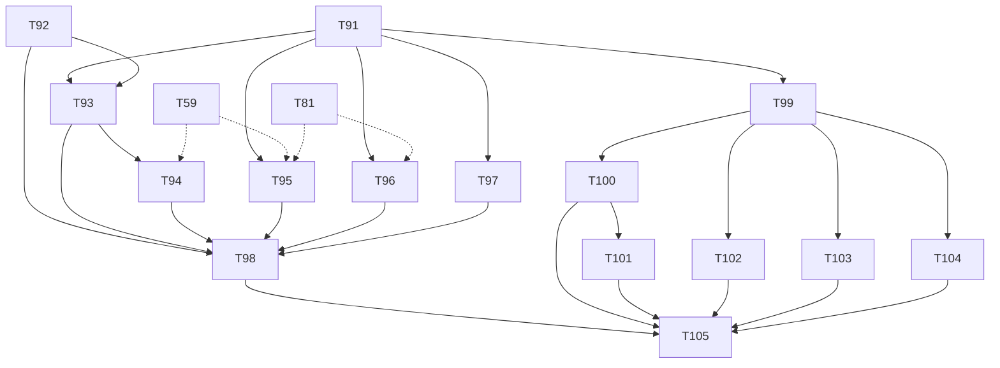

# Plano: Etapa 5 — metas, resumo mensal e projeções

## 1. Objetivo

Permitir criar metas e reservar dinheiro nelas sem mexer no caixa (reserva lógica), ver o resumo de cada mês com comparação ao anterior, enxergar projeções claramente rotuladas como projeção e exportar os dados (CSV e backup), com `reservado` real abatendo o disponível.

## 2. Escopo

### 2.1 Entra

| #   | Entregável                                                                                                                                            | Quem         | Tasks     |
| --- | ----------------------------------------------------------------------------------------------------------------------------------------------------- | ------------ | --------- |
| C   | Contrato (metas, reservas, resumos, projeções, exportação)                                                                                            | dev-backend  | T91       |
| G   | Domínio e API de metas e reservas; `reserved` real no dashboard (S-22)                                                                                | dev-backend  | T92–T94   |
| S   | Resumo mensal calculado (receitas, despesas, investimentos, saldo, maior categoria, maior gasto, cartão, parcelas futuras, % de economia, comparação) | dev-backend  | T95       |
| P   | Projeções básicas (30 dias, 90 dias, 6 e 12 meses)                                                                                                    | dev-backend  | T96       |
| X   | Exportação CSV de movimentações e backup completo (JSON)                                                                                              | dev-backend  | T97       |
| F   | Telas de metas, resumo mensal, projeções, "Meta" na ação rápida, reservado no Início, exportar                                                        | dev-frontend | T99–T104  |
| Q   | Validação e E2E                                                                                                                                       | tester       | T98, T105 |

### 2.2 Não entra

- **Dream Board**, imagem da meta, score de saúde financeira, previsões avançadas, automações: pós-MVP (PR 02). A meta **não tem imagem** no MVP (S-149).
- Gráficos elaborados (PR 00 §20): só uma série simples da projeção (tabela + sparkline em SVG próprio, sem biblioteca de gráficos).
- PDF e relatório formatado: pós-MVP (S-153). O botão "Analisar com IA" do resumo mensal aparece **desabilitado** com a explicação "IA desligada" até a Etapa 8.
- Restauração de backup pela UI: runbook na Etapa 9 (`pg_dump`); o backup JSON desta etapa é exportação.
- Metas compartilhadas, metas com contribuição automática, juros/rendimento da meta.

### 2.3 Regra de trabalho

- A meta é **reserva lógica** (S-39, D1 §2.9): nenhum posting, nenhum livro. Mover dinheiro de verdade continua sendo `TRANSFER`/`INVESTMENT`.
- Resumo e projeção são **calculadoras do `core.finance`** sobre o mesmo `FinancialRecords` (S-79). Nada é calculado no SQL nem no front.
- Migrações `V5.*`. O front só usa componentes da UI própria.
- Depende das Etapas 3 e 4 no backend (resumo e projeção usam cartões, dívidas e recorrências); metas (T92–T94) só dependem da Etapa 2.

## 3. Perguntas em aberto e suposições

Numeração do backend continua após a Etapa 4 (**S-147**).

### 3.1 A validar com o usuário (ordenadas por impacto)

| #     | Impacto | Suposição                                                                                                                                                                                                                                                                                                                                                                                                                                                                                                                                                                                                                                                       | Motivo                                                                                                                                                      | Dono                                  | Tasks                                                                              |
| ----- | ------- | --------------------------------------------------------------------------------------------------------------------------------------------------------------------------------------------------------------------------------------------------------------------------------------------------------------------------------------------------------------------------------------------------------------------------------------------------------------------------------------------------------------------------------------------------------------------------------------------------------------------------------------------------------------- | ----------------------------------------------------------------------------------------------------------------------------------------------------------- | ------------------------------------- | ---------------------------------------------------------------------------------- |
| S-147 | alto    | **Meta = reserva lógica sobre uma conta `CASH` ou `INVESTMENT`**, sem posting. Valor atual = Σ reservas ativas (+ reserva, − liberação). "Reservado" do dashboard = Σ reservas em contas **`CASH`** (as de investimento já estão fora do disponível, S-21). Disponível = em contas − `committed.d30` − reservado                                                                                                                                                                                                                                                                                                                                                | evita dupla contagem (S-39) e mantém o dashboard coerente                                                                                                   | Produto                               | T92–T94                                                                            |
| S-148 | alto    | **Reserva acima do saldo da conta** é aceita e sinalizada ("reserva descoberta": `Goal.uncovered = true` e `Account.reservedAmount` > saldo), nunca bloqueada (regra transversal 5)                                                                                                                                                                                                                                                                                                                                                                                                                                                                             | registrar a realidade; o app avisa                                                                                                                          | Produto                               | T92, T94                                                                           |
| S-149 | médio   | **Sem imagem** nas metas do MVP; prioridade `HIGH                                                                                                                                                                                                                                                                                                                                                                                                                                                                                                                                                                                                               | MEDIUM                                                                                                                                                      | LOW`; prazo opcional; descrição curta | imagem exige armazenamento de arquivos (S3) e é Dream Board; PR 00 §17 cita imagem | Produto | T92 |
| S-150 | médio   | `ACHIEVED` é **derivado** (`current ≥ target`); só `ARCHIVED` é gravado. Meta atingida continua reservando até o usuário liberar; "usar o dinheiro" = `EXPENSE` normal + liberação da reserva (duas ações, a despesa conta uma vez)                                                                                                                                                                                                                                                                                                                                                                                                                             | consistente com status derivados (S-37)                                                                                                                     | Produto                               | T92                                                                                |
| S-151 | alto    | **Resumo mensal** (definições): `income` = receitas da competência; `expenses` = consumo; `investments` = aplicações − resgates líquidos; `net` = receitas − consumo (S-23); `largestCategory` = categoria de maior consumo; `largestExpense` = maior lançamento de consumo (posting `EXPENSE`) da competência; `card` = consumo no crédito + `outstanding` das faturas que vencem no mês; `futureInstallments` = parcelas com competência depois do mês; `savingsRate` = `net / income` (`null` se receitas = 0); comparação com o mês anterior = diferença absoluta e % (`null` se a base for 0). O mês corrente traz `partial: true`                         | PR 00 §32; precisa de regra explícita para não ficar ambíguo                                                                                                | Produto                               | T95                                                                                |
| S-152 | alto    | **Projeção básica determinística**: série mensal de `em contas + entradas previstas − saídas previstas` até 12 meses, vinda dos compromissos (faturas, parcelas, dívidas datadas, recorrências), mais **metas** como informação (reservas não mudam o saldo) e sempre `isProjection: true` e `assumptions[]`. **A tendência histórica é opcional e desligada por padrão** (`includeTrend=false`): quando ligada, é uma série separada rotulada estimativa, igual à média de 3 meses completos do **consumo novo** (despesas de conta não recorrentes + 1ª parcela/à vista no cartão), nunca contando parcelas de compras antigas nem ocorrências de recorrência | sem tendência não há risco de dupla contagem com parcelas e recorrências; o PR 00 §19 pede histórico, mas "sempre deixar claro que é projeção, não certeza" | Produto                               | T96                                                                                |
| S-153 | médio   | **Exportação:** CSV de movimentações (UTF-8 com BOM, separador `;`, decimal com vírgula, datas ISO, colunas: data, tipo, descrição, categoria, conta/cartão, método, valor, status) com o filtro da lista; **backup completo** em JSON versionado (`schemaVersion`), sem hash de senha, sem tokens, com notas quando existirem (Etapa 6). PDF fica para depois                                                                                                                                                                                                                                                                                                  | PR 00 §33; dados pertencem ao usuário                                                                                                                       | Produto                               | T97                                                                                |
| S-154 | baixo   | O "Resumo de Outubro" do PR 00 §32 vive em **Planejamento** (`/planning/summary/2026-10`), navegável por mês; é também o alvo de vínculo `MONTHLY_SUMMARY` do vault (chave `AAAA-MM`)                                                                                                                                                                                                                                                                                                                                                                                                                                                                           | PR 00 §29 (navegação) e D1 §5                                                                                                                               | Produto/UX                            | T95, T102                                                                          |
| S-155 | baixo   | Horizontes da projeção: 30 e 90 dias, 6 e 12 meses (PR 00 §19); a série é mensal                                                                                                                                                                                                                                                                                                                                                                                                                                                                                                                                                                                | PR 00                                                                                                                                                       | Produto                               | T96                                                                                |
| S-156 | baixo   | Meta com prazo: o backend devolve `monthlyNeeded` (valor por mês para atingir no prazo) como **estimativa rotulada**, calculado com a regra `(target − current) / meses restantes`, onde meses restantes = meses-calendário do mês corrente ao mês do prazo, inclusive, com arredondamento para cima ao centavo; sem prazo ou prazo vencido, `null`                                                                                                                                                                                                                                                                                                             | PR 00 §17/§19                                                                                                                                               | Produto                               | T92                                                                                |

## 4. Contrato de API (delta sobre D2 §4.7)

Fonte da verdade: `contracts/openapi.yaml` (T91). Só adições.

| Método     | Caminho                                 | Corpo / observação                                                                    | Resposta                                                                                 |
| ---------- | --------------------------------------- | ------------------------------------------------------------------------------------- | ---------------------------------------------------------------------------------------- |
| GET / POST | `/v1/goals?status=ACTIVE                | ACHIEVED                                                                              | ARCHIVED`                                                                                | POST `{ name, target, deadline?, priority, description? }` | `Slice<Goal>` / `201 Goal` |
| GET / PUT  | `/v1/goals/{id}`                        | PUT mesmos campos + `version`                                                         | `Goal` (`current`, `target`, `progress`, `monthlyNeeded`, `uncovered`, `reservations[]`) |
| POST       | `/v1/goals/{id}/reservations`           | header `Idempotency-Key`; `{ accountId, amount (negativo = liberação), date, note? }` | `200 Goal`                                                                               |
| POST       | `/v1/goals/{id}/archive` · `/unarchive` | —                                                                                     | `200 Goal`                                                                               |
| GET        | `/v1/summaries/{yyyy-MM}`               | —                                                                                     | `MonthlySummary` (S-151)                                                                 |
| GET        | `/v1/projections?horizon=D30            | D90                                                                                   | M6                                                                                       | M12&includeTrend=false`                                    | —                          | `Projection { isProjection:true, series[], assumptions[], trend? }` |
| GET        | `/v1/exports/transactions.csv`          | mesmos filtros de `GET /v1/transactions`                                              | `text/csv`                                                                               |
| GET        | `/v1/exports/backup`                    | —                                                                                     | `application/json` (download)                                                            |

`Goal.progress` e `current` são `Money`/razão decimal calculados no backend; reservas não criam `Transaction`. `DashboardSummary.balances.reserved` passa a ser real (campo já existe).
Erros novos: `GOAL_NOT_FOUND`, `GOAL_ARCHIVED`, `GOAL_RESERVATION_ACCOUNT_NOT_ELIGIBLE`, `GOAL_RELEASE_EXCEEDS_RESERVED`, `SUMMARY_MONTH_INVALID`.

### 4.1 Garantias testadas

1. Criar meta e reservar 1.000,00 na Nubank: saldo da Nubank, consumo, receita, patrimônio e caixa **não mudam**; `reserved` sobe 1.000,00 e `available` cai 1.000,00.
2. Resumo, lista (por competência) e dashboard do mesmo mês batem em receitas, consumo e `net`.
3. A projeção não conta duas vezes: parcela, fatura, recorrência e dívida aparecem uma vez; ligar/desligar a meta não muda a série.

## 5. Tasks

> Convenções e cenário padrão das Etapas 2 a 4. Relógio 10/10/2026. Meta **Reserva de emergência**: alvo 20.000,00, prazo 31/12/2027, prioridade `HIGH`.

---

### T91 · dev-backend · Contrato da Etapa 5

**Objetivo:** escrever §4 em `contracts/openapi.yaml`; D2 §4.7.

**Critérios de aceite**

1. **Dado** o contrato, **quando** rodo o lint, **então** passa e só há adições; `MonthlySummary`, `Projection` e `Goal` têm exemplos que validam.
2. **Dado** `amount` da reserva, **então** é string decimal com sinal permitido (`-?\d{1,13}(\.\d{1,2})?`); outras chaves de `Money` seguem as convenções.
3. **Dado** `horizon` fora do enum, **então** o validador recusa.
4. **Dado** `api:types`, **então** gera sem erro.

**Depende de:** —.

### T92 · dev-backend · Domínio de metas e reservas

**Objetivo:** `Goal` e `GoalReservation` no `core` (puros, sem Spring), com a regra de reserva lógica.

**Arquivos/camadas:** `core/goal/{domain/{Goal, GoalReservation, GoalPriority, GoalProgress, ReserveAllocation}, exception/GoalExceptions}`, testes de unidade (cobertura ≥ 90%).

**Critérios de aceite**

1. **Dado** meta de 20.000,00 e reservas de +8.500,00 (Nubank), **então** `current` 8.500,00 e `progress` 0,425 (42,5%, exemplo do PR 00 §17).
2. **Dado** liberação de 2.000,00, **então** `current` 6.500,00; liberar mais do que o reservado naquela conta → `GOAL_RELEASE_EXCEEDS_RESERVED`.
3. **Dado** `current ≥ target`, **então** `isAchieved` (derivado, S-150); meta arquivada não aceita reserva (`GOAL_ARCHIVED`).
4. **Dado** `monthlyNeeded` com prazo 31/12/2027 e relógio 10/10/2026 (meses-calendário de out/26 a dez/27, inclusive = 15), **então** `(20.000,00 − 8.500,00) / 15` = 766,67 (arredondado **para cima** ao centavo, rotulado estimativa); sem prazo ou com prazo vencido → `null`; meta atingida → 0,00.
5. **Dado** conta que não é `CASH` nem `INVESTMENT` (não existe outro tipo hoje: teste do guarda) ou de moeda diferente, **então** `GOAL_RESERVATION_ACCOUNT_NOT_ELIGIBLE`.
6. **Dado** valor 0 ou acima do teto (S-78), **então** erro; nome vazio ou > 100 → erro de campo.
7. **Dado** `uncovered` (reserva na conta maior que o saldo informado), **então** `true` sem exceção (S-148).

**Depende de:** — (domínio puro).

### T93 · dev-backend · Metas: persistência e API

**Objetivo:** tabelas `goals` e `goal_reservations` (`V5.00`), casos de uso e `/v1/goals`.

**Arquivos/camadas:** `core/goal/app/{gateways/GoalGateway, usecase/{CreateGoal, UpdateGoal, GetGoal, ListGoals, ReserveOnGoal, ArchiveGoal, UnarchiveGoal}}`, `infra/goal/...`, `V5.00`, testes.

**Critérios de aceite**

1. **Dado** `POST /v1/goals` Reserva de emergência, **então** `201` com `current` 0,00 e `progress` 0; `POST .../reservations` +8.500,00 Nubank → `200 Goal` com a reserva em `reservations[]`, `current` 8.500,00, `monthlyNeeded` do backend.
2. **Dado** a reserva, **então** **nenhuma** linha em `transactions` nem `ledger_postings` é criada (IT conta antes e depois); saldo da Nubank igual.
3. **Dado** `Idempotency-Key` repetida, **então** uma reserva; concorrência de duas reservas na mesma meta → ambas aplicadas em série, `current` correto, `version` otimista sem 500.
4. **Dado** conta arquivada → `422 ACCOUNT_ARCHIVED`; de outro usuário → `404`; meta de outro usuário → `404 GOAL_NOT_FOUND`.
5. **Dado** `GET ?status=ACHIEVED`, **então** filtra pelo derivado (a consulta usa a mesma função do domínio, não SQL duplicado).
6. **Dado** `version` velha no `PUT`, **então** `409`.
7. Mapper round-trip; testes de caso de uso com `ArgumentCaptor`.

**Depende de:** T91, T92. Etapa 2: T25 (contas), T26b (idempotência).

### T94 · dev-backend · `reserved` real e disponível

**Objetivo:** o dashboard usa as reservas: `DashboardSummary.of` ganha sobrecarga com `reserved`; `GetDashboardSummaryUseCaseImpl` lê as reservas pelo `GoalGateway`; `Account` ganha `reservedAmount` e `uncovered`.

**Arquivos/camadas:** `core/finance/domain/DashboardSummary` (sobrecarga, sem mudar a assinatura atual), `core/finance/app/dashboard/usecase/GetDashboardSummaryUseCaseImpl`, `core/finance/app/accounts/AccountViews`, contrato (descrição), testes.

**Critérios de aceite**

1. **Dado** Nubank 20.000,00, fatura de 1.283,00 vencendo em 05/11 e reserva de 8.500,00 na Nubank, **então** `reserved` 8.500,00 e `available` = 20.000,00 − 1.283,00 − 8.500,00 = 10.217,00; sem meta, `available` volta a 18.717,00 (caso da Etapa 3).
2. **Dado** reserva em conta `INVESTMENT`, **então** `reserved` **não** muda (S-147) e a meta conta no `current`.
3. **Dado** reserva de 25.000,00 na Nubank com saldo 20.000,00, **então** `reserved` 25.000,00, `available` negativo, `Account.uncovered: true` e `Goal.uncovered: true`; nada é bloqueado.
4. **Dado** `asOf` no futuro, **então** `reserved` usa as reservas com data até `asOf`.
5. **Dado** a Etapa 2/3/4, **então** nenhum teste existente muda (a sobrecarga mantém o comportamento sem metas).
6. **Dado** o `summary` e o `GET /v1/accounts/{id}`, **então** concordam no reservado da conta (mesmo carregamento).

**Depende de:** T93. Etapa 3: T59 (dashboard com cartões).

### T95 · dev-backend · Resumo mensal (cálculo e API)

**Objetivo:** `GET /v1/summaries/{yyyy-MM}` com as definições de S-151, no `core.finance`.

**Arquivos/camadas:** `core/finance/domain/MonthlySummary` (+ calculadora), `core/finance/app/summary/{GetMonthlySummaryUseCase(+Impl)}`, `infra/summary/controller`, testes.

**Critérios de aceite** (mês 2026-10 com: receita Salário 3.000,00; Pix 100,00 Alimentação; compra 6x de 1.200,00 no cartão; aplicação 10.000,00; reembolso 50,00 de Alimentação em 12/10; mês 2026-09 com consumo 150,00 e receita 3.000,00)

1. **Dado** o cenário, **então** `income` 3.000,00; `expenses` (consumo) = 100,00 + 200,00 − 50,00 = 250,00; `investments` 10.000,00 (linha própria, **fora** do consumo); `net` 2.750,00; `savingsRate` 0,9167; `largestCategory` Tecnologia (200,00) quando for a de maior consumo (ou Alimentação 50,00 se a compra for de Alimentação: caso parametrizado).
2. **Dado** `largestExpense`, **então** é o maior posting `EXPENSE` da competência (a parcela de 200,00, "Notebook 1/6"), com `transactionId`.
3. **Dado** `card`, **então** consumo no crédito do mês (200,00) e `outstanding` das faturas que vencem no mês; `futureInstallments` 1.000,00.
4. **Dado** `previousMonth`, **então** `expensesDelta` (250,00 − 150,00 = 100,00) e `%`; com base 0 → `null`; receitas iguais → delta 0,00.
5. **Dado** o mês corrente, **então** `partial: true`; mês passado, `false`; formato inválido (`2026-13`) → `400 SUMMARY_MONTH_INVALID`; mês futuro → `partial: true`, `isProjection: true` e valores só do que já existe.
6. **Dado** receitas = 0, **então** `savingsRate: null` (nunca divisão por zero).
7. **Dado** o mesmo mês na lista por competência e no dashboard, **então** receitas, consumo e `net` batem (S-79; teste que compara os três).

**Depende de:** T91. Etapa 3: T59. Etapa 4: T81 (dívidas/recorrências no consumo e nos compromissos).

### T96 · dev-backend · Projeções básicas

**Objetivo:** `GET /v1/projections` (S-152, S-155) pelo `CommitmentSchedule` e `CashPosition`, série mensal e `assumptions[]`; tendência opcional separada.

**Arquivos/camadas:** `core/finance/domain/{Projection, ProjectionCalculator, SpendingTrend}`, `core/finance/app/projection/{GetProjectionUseCase(+Impl)}`, `infra/projection/controller`, testes.

**Critérios de aceite** (relógio 10/10; Nubank 20.000,00; fatura 1.283,00 vence 05/11; parcelas de 200,00 em 05/12…05/04; Internet 119,00 todo dia 10; salário recorrente de 3.000,00 todo dia 5; reserva de 8.500,00)

1. **Dado** `horizon=M6`, **então** `series[]` tem um ponto por mês (nov/26…abr/27) com `saídas previstas`, `entradas previstas` e `balance` = em contas + entradas acumuladas − saídas acumuladas; a primeira saída de novembro inclui a fatura de 1.283,00 e a Internet de 10/11; **dezembro** inclui a fatura com a parcela 2/6 (200,00) **uma vez**.
2. **Dado** o mesmo cenário, **então** `isProjection: true` e `assumptions[]` lista: "recorrências ativas", "faturas e parcelas já registradas", "dívidas com data prevista" e "sem tendência de gastos novos" (chaves traduzíveis, sem texto fixo).
3. **Dado** a meta com reserva de 8.500,00, **então** a série **não muda** (reserva não é saída) e o campo `goals` informa o que está reservado.
4. **Dado** `includeTrend=true`, **então** vem `trend` com `monthlyAverage` do consumo novo dos 3 meses completos anteriores (cálculo: despesas de conta não recorrentes + parcela 1/à vista; **exclui** parcelas 2..N e ocorrências de recorrência), rotulado `estimate: true`, e a série base fica **idêntica** à de `includeTrend=false`.
5. **Dado** ocorrência de recorrência realizada, **então** sai da previsão e passa a ser histórico; ocorrência pulada não entra.
6. **Dado** `horizon=D30`, **então** coincide com `projected.d30` do dashboard (mesma função).
7. **Dado** menos de 3 meses completos de histórico com `includeTrend=true`, **então** `trend.available: false` com `reason: INSUFFICIENT_HISTORY` (não inventa média).
8. Propriedade: para 100 cenários aleatórios, nenhum item de compromisso aparece duas vezes na série.

**Depende de:** T91. Etapa 4: T81.

### T97 · dev-backend · Exportação CSV e backup completo

**Objetivo:** `GET /v1/exports/transactions.csv` e `GET /v1/exports/backup` (S-153), em streaming, sem carregar tudo em memória além do necessário.

**Arquivos/camadas:** `core/export/app/{ExportTransactionsCsvUseCase, ExportBackupUseCase}`, `infra/export/controller`, testes.

**Critérios de aceite**

1. **Dado** filtro de outubro, **então** o CSV traz UTF-8 com BOM, `;`, valores `1234,50`, datas ISO, cabeçalho traduzível por `Accept-Language` e **uma linha por `Transaction`** (uma compra 6x aparece uma vez com 1.200,00); estornadas só com `status=VOIDED` ou `includeVoided`.
2. **Dado** campo de texto começando com `=`, `+`, `-` ou `@`, **então** é prefixado com `'` (proteção contra injeção de fórmula) e a descrição com `;`, aspas e quebra de linha é escapada.
3. **Dado** o backup, **então** o JSON tem `schemaVersion`, `generatedAt`, contas, categorias, cartões, movimentações (com parcelas), dívidas, pessoas, recorrências, metas e reservas; **não** contém hash de senha, refresh tokens nem `JWT_SECRET`; (teste que varre o JSON por chaves proibidas).
4. **Dado** outro usuário, **então** nenhum dado dele aparece; sem token → `401`.
5. **Dado** 10.000 movimentações, **então** responde sem estourar memória (stream) e em tempo razoável (medido; limite documentado).
6. **Dado** o backup, **então** a soma por conta recalculada a partir dele fecha com os saldos da API (teste de coerência).

**Depende de:** T91. Etapas 3 e 4 (dados do backup).

### T98 · tester · Validação do backend da Etapa 5

**Objetivo:** integridade de metas, resumo, projeção e exportação.

**Critérios de aceite**

1. **Dado** metas, **então** nenhuma reserva cria movimentação/posting e o razão continua fechando em zero após 300 operações aleatórias que misturam reservas, despesas e transferências.
2. **Dado** resumo × lista × dashboard em 100 cenários, **então** concordam.
3. **Dado** a projeção, **então** não há dupla contagem (propriedade) e `D30` = `projected.d30`.
4. **Dado** concorrência de reservas, **então** sem 500 e `current` correto.
5. **Dado** exportação, **então** injeção de fórmula bloqueada e backup sem segredos.
6. Contrato, isolamento entre usuários e migração; relatório `docs/qa/AAAA-MM-DD-qa-backend-etapa-5.md`.

**Depende de:** T92–T97.

### T99 · dev-frontend · Módulos `goals`, `summaries`, `projections` e `exports`

**Objetivo:** tipos gerados e módulos de negócio (tipos, portas, facades, requests, mocks).

**Critérios de aceite**

1. **Dado** o contrato, **então** `api:check` verde; dinheiro como string; nenhuma conta no front (lint).
2. **Dado** reserva, **então** `Idempotency-Key` por tentativa; `exhaustMap`.
3. **Dado** a facade de projeção, **então** `horizon`/`includeTrend` ↔ URL; mudar cancela a requisição anterior.
4. **Dado** `exports`, **então** o download usa `Blob` com o `Authorization` do interceptor (não link direto) e nome de arquivo vindo do `Content-Disposition`.
5. **Dado** `API_MOCKS`, **então** vazios sem HTTP.

**Depende de:** T91. Integração real: T93–T97.

### T100 · dev-frontend · Metas: lista, nova meta, detalhe e reservas

**Objetivo:** `/goals` (cartões com `ProgressBar`, valor atual/alvo, prazo, `monthlyNeeded` como estimativa), `/goals/new`, `/goals/:id` (reservas, liberar/reservar, arquivar), alerta "reserva descoberta".

**Arquivos/camadas:** `src/app/features/goals/{goals.routes.ts, pages/{goals.page, goal-form.page, goal.page}, components/{goal-card, reservation-row, reserve-sheet}}`, i18n, testes. Usa `Select`, `DatePicker`, `ProgressBar`, `Sheet`.

**Critérios de aceite**

1. **Dado** nenhuma meta, **então** estado vazio "Criar meta" habilitado.
2. **Dado** `Reserva de emergência` 8.500,00 de 20.000,00, **então** mostra "42,5%" **vindo de `progress`** (formatado, sem dividir no front), "faltam" com o valor do backend e `monthlyNeeded` com o rótulo "estimativa".
3. **Dado** "Reservar", **então** o `Sheet` pede conta (só `CASH`/`INVESTMENT` ativas), valor, data e nota; liberar usa valor negativo no corpo por uma chave "Liberar" (não o usuário digitando "−"); o saldo da conta **não** muda e a UI diz "a reserva não move dinheiro" (texto explicativo).
4. **Dado** `uncovered`, **então** aviso de risco com texto ("a conta tem menos saldo que o reservado"), sem bloquear.
5. **Dado** meta atingida (`ACHIEVED`), **então** o selo em texto e a sugestão "usar o dinheiro" explica as duas ações (despesa + liberar) sem automatizar.
6. **Dado** teclado e 375 px, **então** funcional; estados carregando/erro.

**Depende de:** T99; UI própria: T156, T160, T164, T166. Integração real: T93.

### T101 · dev-frontend · Ação rápida "Meta" e reservado no Início

**Objetivo:** a quick action "Meta" (abre a reserva rápida ou nova meta) e o bloco "Reservado" no Início com o texto "Disponível = em contas − comprometido 30 dias − reservado" vindo do backend.

**Critérios de aceite**

1. **Dado** `balances.reserved` > 0, **então** o Início mostra "Reservado R$ 8.500,00" e o disponível do backend; o `Tooltip` explica a fórmula sem prometer cálculo local.
2. **Dado** "Meta", **então** sem metas leva a `/goals/new`; com metas abre o `Sheet` de reserva da meta de maior prioridade com seletor.
3. **Dado** `Account.uncovered`, **então** o card da conta mostra o aviso.
4. **Dado** estados carregando/erro e teclado, **então** testados.

**Depende de:** T100; UI própria: T159. Integração real: T94.

### T102 · dev-frontend · Resumo mensal

**Objetivo:** `/planning/summary/:month` com navegação mês a mês (`MonthPicker`), todos os campos de S-151 e comparação; botão "Analisar com IA" desabilitado até a Etapa 8.

**Arquivos/camadas:** `src/app/features/planning/{pages/summary.page, components/{summary-block, comparison-row}}`, i18n, testes.

**Critérios de aceite**

1. **Dado** o resumo de outubro do cenário de T95, **então** mostra receitas, despesas (consumo), investimentos (linha própria, **fora** do consumo), saldo, maior categoria, maior gasto (link para a movimentação), cartão, parcelas futuras, % de economia e comparação, tudo do backend.
2. **Dado** `partial: true`, **então** o rótulo "mês em andamento" e a comparação indicam que o mês não terminou.
3. **Dado** `savingsRate: null`, **então** "—" com explicação ("sem receitas no mês").
4. **Dado** mudança de mês pelo `MonthPicker`, **então** a URL muda e o estado volta pelo F5; teclado completo.
5. **Dado** "Analisar com IA", **então** desabilitado com `Tooltip`/texto "IA desligada" (a Etapa 8 o habilita).
6. **Dado** 375 px, **então** blocos empilhados sem rolagem horizontal.

**Depende de:** T99; UI própria: T161 (`MonthPicker`), T159. Integração real: T95.

### T103 · dev-frontend · Projeções

**Objetivo:** `/planning/projections` com horizonte (`SegmentedControl`), série mensal em tabela e sparkline SVG própria, premissas e a chave "incluir tendência" (`Switch`).

**Critérios de aceite**

1. **Dado** qualquer horizonte, **então** o topo diz "Projeção, não certeza" (texto de produto) e lista as `assumptions[]` traduzidas.
2. **Dado** `includeTrend`, **então** a série da tendência aparece separada e rotulada "estimativa"; a base não muda; `trend.available: false` mostra o motivo.
3. **Dado** a sparkline, **então** usa os valores do backend (escala visual apenas), com tabela equivalente acessível (`<table>`), cores com contraste e sem depender só de cor.
4. **Dado** datas/horizontes na URL e teclado, **então** o F5 restaura; foco visível.
5. **Dado** estados vazio (sem dados)/erro, **então** testados.

**Depende de:** T99; UI própria: T157 (`Switch`). Integração real: T96.

### T104 · dev-frontend · Exportar (Configurações)

**Objetivo:** em Configurações → Dados: "Exportar movimentações (CSV)" com período (`DateRangePicker`) e "Baixar backup".

**Critérios de aceite**

1. **Dado** o período, **então** baixa o CSV do backend com o nome do arquivo; erro de rede → "tentar de novo".
2. **Dado** o backup, **então** baixa o JSON e mostra "Guarde este arquivo com segurança: contém todos os seus dados" (privacidade).
3. **Dado** o download em curso, **então** indicador de progresso e botão desabilitado (sem clique duplo).
4. **Dado** iPhone Safari, **então** o download funciona (teste manual documentado: o PWA instalado abre o arquivo no visualizador) e há alternativa "compartilhar" quando o navegador suportar `navigator.share`.

**Depende de:** T99; UI própria: T162 (`DateRangePicker`). Integração real: T97.

### T105 · tester · E2E da Etapa 5 com backend real

**Critérios de aceite**

1. **Jornada:** criar meta → reservar 8.500,00 → ver `reserved` e `available` no Início → liberar → abrir o resumo do mês → abrir projeções → exportar CSV; **então** cada número é o da API e o saldo da conta nunca mudou com a reserva.
2. **Dado** resumo × lista × Início, **então** concordam no mês.
3. **Dado** o CSV, **então** abre com as colunas e a compra parcelada aparece uma vez.
4. **Teclado, 375 px e WebKit** nos fluxos; contrato validado.
5. Bugs com severidade; bloqueiam a Etapa 6 (front) os de integridade.

**Depende de:** T98, T99–T104.

---

## 6. Ordem de execução e paralelismo

### 6.1 Dependências

| Task | Agente       | Depende de                        |
| ---- | ------------ | --------------------------------- |
| T91  | dev-backend  | —                                 |
| T92  | dev-backend  | — (domínio puro; pode começar já) |
| T93  | dev-backend  | T91, T92                          |
| T94  | dev-backend  | T93, Etapa 3: T59                 |
| T95  | dev-backend  | T91, Etapa 3: T59, Etapa 4: T81   |
| T96  | dev-backend  | T91, Etapa 4: T81                 |
| T97  | dev-backend  | T91, Etapas 3 e 4 (dados)         |
| T98  | tester       | T92–T97                           |
| T99  | dev-frontend | T91                               |
| T100 | dev-frontend | T99, UI: T156, T160, T164, T166   |
| T101 | dev-frontend | T100, UI: T159                    |
| T102 | dev-frontend | T99, UI: T159, T161               |
| T103 | dev-frontend | T99, UI: T157                     |
| T104 | dev-frontend | T99, UI: T162                     |
| T105 | tester       | T98, T99–T104                     |

### 6.2 Grafo

### 6.3 Ondas

| Onda | Backend                                                 | Frontend                  |
| ---- | ------------------------------------------------------- | ------------------------- |
| 1    | T91 ∥ T92                                               | —                         |
| 2    | T93                                                     | T99                       |
| 3    | T94 ∥ T95 ∥ T96 ∥ T97 (as que esperam T59/T81 aguardam) | T100 ∥ T102 ∥ T103 ∥ T104 |
| 4    | T98 (tester)                                            | T101                      |
| 5    | —                                                       | T105 (tester)             |

- **Paralelo com as Etapas 3 e 4:** T91, T92, T93 podem rodar durante a Etapa 3 (só dependem da Etapa 2); T94 e T95 esperam a Etapa 3 (T59); T96 e T95 esperam a Etapa 4 (T81).
- Migração `V5.00` (T93); sem outras.
- Conflitos: T94 mexe em `DashboardSummary`/`GetDashboardSummaryUseCaseImpl` (usados pelas Etapas 3 e 4): rebase depois que a Etapa 4 (T81) estiver mesclada ou coordenar com ela. T95 e T96 só **leem** `core.finance`.

## 7. Riscos

| Risco                                           | Impacto                           | Mitigação                                                                 |
| ----------------------------------------------- | --------------------------------- | ------------------------------------------------------------------------- |
| Reserva tratada como saída                      | disponível errado, dupla contagem | sem posting (T93 CA2), teste de que o saldo não muda, S-147               |
| Projeção contar parcelas e tendência duas vezes | número otimista/pessimista errado | tendência desligada por padrão e separada (S-152); propriedade de T96 CA8 |
| Resumo divergir da lista/dashboard              | falta de consistência (PR 02)     | S-79 e T95 CA7, T98 CA2                                                   |
| Usuário ler projeção como certeza               | decisão ruim                      | rótulos obrigatórios, `assumptions[]`, teste de UI (T103 CA1)             |
| CSV com injeção de fórmula                      | risco ao abrir no Excel           | T97 CA2                                                                   |
| Backup vazar segredo                            | exposição                         | T97 CA3 varre chaves proibidas                                            |
| Meta sem imagem frustrar o PR 00 §17            | expectativa                       | S-149 documentada; Dream Board pós-MVP                                    |

## 8. ADRs e documentos

| Documento    | Tema                                                                                | Task          |
| ------------ | ----------------------------------------------------------------------------------- | ------------- |
| D1 §2.9 e §8 | Metas implementadas (S-147 a S-150, S-156); resumo e projeção (S-151, S-152, S-155) | T92, T95, T96 |
| D2 §4.7      | Contrato de metas, resumos, projeções e exportação                                  | T91           |

## Anexo: suposições do frontend da Etapa 5 (T99–T104)

Registradas por quem implementou o front (numeração FE-S continua em FE-S-154, depois das da Etapa 4).

| #        | Suposição                                                                                                                                                                                                                                                                                                                                                                                                                                                                                                                                                                                                                                                                                                                                                                                                          | Tasks        |
| -------- | ------------------------------------------------------------------------------------------------------------------------------------------------------------------------------------------------------------------------------------------------------------------------------------------------------------------------------------------------------------------------------------------------------------------------------------------------------------------------------------------------------------------------------------------------------------------------------------------------------------------------------------------------------------------------------------------------------------------------------------------------------------------------------------------------------------------ | ------------ |
| FE-S-154 | Rotas de metas: `/goals` (abas Ativas, Atingidas e Arquivadas por `?status=`, o F5 volta ao filtro), `/goals/new`, `/goals/:id` e `/goals/:id/edit`. A folha de reserva tem a chave **Reservar \| Liberar**: o usuário digita o valor positivo e o mapper manda o valor negativo no corpo (S-147); a liberação oferece as contas que a meta já tem reservadas (inclusive arquivadas, o backend aceita) e a reserva, as contas ativas (todas as que existem hoje são `CASH` ou `INVESTMENT`)                                                                                                                                                                                                                                                                                                                        | T100         |
| FE-S-155 | `/planning/summary` sem mês abre o mês de hoje por `todayIso()` (fuso do usuário, o mesmo padrão dos campos de data, S-69): é só o ponto de partida da navegação; `partial`, `isProjection` e todos os valores vêm da API. O Início liga o resumo pela competência que o backend devolve (`summary.month.competence`)                                                                                                                                                                                                                                                                                                                                                                                                                                                                                              | T102         |
| FE-S-156 | A ação rápida **"Meta" está no Início** (botão ao lado de "Novo registro"), não no `/quick-add` (aquele é o seletor de tipos de movimentação, e a meta não é movimentação): sem metas leva a `/goals/new`; com metas abre a reserva rápida com a primeira meta ativa (a ordem é a do backend: prioridade, prazo, nome) e um seletor; com a lista ainda carregando ou com erro leva a `/goals`. **O resumo mensal automático ao fim do mês não existe**: a API não oferece nenhum campo ou aviso para isso, então fica só o atalho "Resumo do mês" (nenhuma regra de "o mês fechou" foi inventada no front)                                                                                                                                                                                                         | T101, T102   |
| FE-S-157 | **Removida (revisão A1, 2026-10-08):** a saúde financeira (módulo `health`, rota `/planning/health`, quinta aba, i18n, stubs e E2E) foi implementada contra `GET /v1/health/score`, que não existe no contrato nem no backend, com formato inventado pelo front. Decisão do coordenador: **o score fica fora do MVP** (PR 02) até o backend definir o contrato; todo o código foi apagado do front (nada fica roteado, listado ou no bundle). Quando o contrato existir, a tela volta como task própria, com os tipos gerados                                                                                                                                                                                                                                                                                      | T103 (saúde) |
| FE-S-158 | A exportação de movimentações usa **dois `DatePicker`** (de/até, opcionais): o plano cita um `DateRangePicker` que não existe nos componentes base. De > até é recusado na tela com mensagem (só ordem de calendário em texto ISO) antes de chamar a API                                                                                                                                                                                                                                                                                                                                                                                                                                                                                                                                                           | T104         |
| FE-S-159 | O download é um `Blob` de uma requisição com `Authorization` (interceptor) entregue por um link `blob:` por `FileDownloadService` (**revisado por FE-S-168**: o `<a download>` só é clicado num gesto do usuário) (sem `<a download>` com token e sem URL com token); o nome vem do `Content-Disposition` (com nome padrão se o header faltar). O teste manual em iPhone fica pendente (FE-S-168)                                                                                                                                                                                                                                                                                                                                                                                                                  | T104         |
| FE-S-160 | A sparkline da projeção é um SVG próprio (`app-sparkline`), decorativo para leitor de tela (`aria-hidden`); a tabela `<table>` com legenda e cabeçalhos é a leitura equivalente. `Number()` converte os valores só para a **escala visual** (posição dos pontos); a tendência é tracejada e os pontos têm forma, então a leitura não depende só de cor. Cada linha da tabela mostra "Até {periodEnd}" (a data que o backend devolve), o que rotula o último ponto parcial sem nenhuma conta                                                                                                                                                                                                                                                                                                                        | T103         |
| FE-S-161 | `progress`, `savingsRate` e `percent` chegam como string `Ratio` (`0.4250`) e são formatados por `formatRatio` (o `Intl.NumberFormat` recebe a string; sem multiplicar). A barra de progresso recebe `ratioForBar` (parse do texto) só para a largura. A comparação do resumo diz "Subiu", "Caiu" ou "Igual" por palavra (o sentido sai do sinal do texto de `amount`), mostra o valor sem o sinal e o percentual sem o sinal; com `percent` nulo (base zero) mostra só o valor                                                                                                                                                                                                                                                                                                                                    | T100, T102   |
| FE-S-162 | No ambiente mock, criar uma meta devolve a meta recém-criada (valores zerados) sem persistir: abrir `/goals/:id` depois dá "Meta não encontrada" com o caminho de volta (mesmo padrão de pessoas na Etapa 4)                                                                                                                                                                                                                                                                                                                                                                                                                                                                                                                                                                                                       | T100         |
| FE-S-163 | O Planejamento passa a ter **quatro abas** (Recorrências, Pendentes, Resumo do mês e Projeções; a quinta, Saúde financeira, foi removida com FE-S-157); em 375 px elas **podem quebrar de linha** (`flex-wrap` mantido por segurança) em vez de alargar a página (o E2E de layout pegou 517 px de largura)                                                                                                                                                                                                                                                                                                                                                                                                                                                                                                         | T102, T103   |
| FE-S-164 | `Account.reservedAmount` e `Account.uncovered` entram no tipo do core; o aviso "reserva descoberta" aparece no card/linha da conta em `/accounts` (o Início não tem cards de conta) e no detalhe da meta, sempre em texto e sem bloquear                                                                                                                                                                                                                                                                                                                                                                                                                                                                                                                                                                           | T101         |
| FE-S-165 | A fórmula "Disponível = em contas − comprometido em 30 dias − reservado" aparece no `Tooltip` do rótulo "Reservado" (um botão focável) e como o texto da fórmula já existente no card, com o aviso de que o servidor faz a conta; o link "Ver as metas reservadas" só aparece com `reserved` positivo (lê o sinal do texto, sem soma)                                                                                                                                                                                                                                                                                                                                                                                                                                                                              | T101         |
| FE-S-166 | `resetDatabase()` do E2E de integração passou a limpar `goal_reservations` e `goals` (as tabelas da Etapa 5, `V5.00`)                                                                                                                                                                                                                                                                                                                                                                                                                                                                                                                                                                                                                                                                                              | T105         |
| FE-S-167 | **CSV em espanhol (M1):** o backend só tem cabeçalho de CSV em `pt` e `en` (`CsvHeaders`); `es` cairia em português sem aviso. O front envia `pt` no `Accept-Language` quando o idioma do app não é `en` e **informa na tela** (nota em "Movimentações em CSV") que o cabeçalho sai em português. O comentário de `export.ts` foi corrigido. **Pendência (Produto/Backend):** `ES` no CSV (S-153); quando existir, basta incluir `es` em `CSV_HEADER_LANGUAGES`                                                                                                                                                                                                                                                                                                                                                    | T104         |
| FE-S-168 | **Download em iPhone/PWA (A2):** baixar o conteúdo não salva nada sozinho. Depois da requisição a tela mostra **"Arquivo pronto"** com **Salvar** (clica o `<a download>` dentro do clique do usuário, sem `target`, nunca navega para o `blob:`), **Compartilhar** (só se `navigator.canShare({ files })` for verdadeiro) e **Fechar**. O toast só aparece quando a ação final acontece ("Download de X iniciado" ao salvar; "Arquivo X compartilhado" só se o compartilhamento concluir; cancelar não avisa). O `ObjectURL` é criado ao ficar pronto e revogado ao fechar, ao chegar outro arquivo e ao sair da tela (`DestroyRef`); o `Blob` é solto junto (B1). **Pendência (QA):** o teste manual em iPhone (Safari e PWA instalado) não foi executado: `docs/qa/2026-10-08-checklist-manual-download-ios.md` | T104         |
| FE-S-169 | **Nome do arquivo (M2):** `safeFilenameFromContentDisposition(header, fallback)` aceita só `[letras números . _ -]` (o resto vira `_`), remove controles e caracteres bidi/invisíveis, pega só o último trecho do caminho, tira pontos nas pontas, limita a 100 caracteres e exige a extensão do tipo exportado (`.csv`/`.json`, em minúscula); fora disso, usa o nome padrão (`moneylog-transactions.csv`/`moneylog-backup.json`)                                                                                                                                                                                                                                                                                                                                                                                 | T104         |
| FE-S-170 | **Conflito de versão da meta (M3):** em `409 VERSION_CONFLICT` o formulário mostra o conflito e **mantém o digitado**; oferece "Manter o que digitei" (relê a meta e atualiza só a `version`, sem repor o formulário; o usuário salva de novo com os seus valores) e "Recarregar a versão atual" (troca o digitado, como em pessoa e recorrência). Sobrescrever a edição alheia é escolha explícita do usuário                                                                                                                                                                                                                                                                                                                                                                                                     | T100         |
| FE-S-171 | **Início (M4):** a folha de reserva fica montada fora de qualquer `@if` (a chave de idempotência pendente não se perde); `GoalsListFacade.reload()` é a recarga **silenciosa** (não passa por `loading` e, se falhar com dados já carregados, mantém o último `ready`); `load()` continua trocando para `loading`. Depois de reservar, o Início usa `reload`                                                                                                                                                                                                                                                                                                                                                                                                                                                       | T101         |
| FE-S-172 | **Arquivar/desarquivar (B1):** `GOAL_ALREADY_ARCHIVED` (ao arquivar) e `GOAL_NOT_ARCHIVED` (ao desarquivar) significam que um clique anterior já deu certo: o front relê a meta e trata como **sucesso silencioso** (sem erro, sem aviso). Sem `Idempotency-Key` (o contrato não define a chave para essas rotas). `GOAL_STATE_INCONSISTENT` ganhou tradução (pt/en/es)                                                                                                                                                                                                                                                                                                                                                                                                                                            | T100         |
| FE-S-173 | **"Analisar com IA" (M5):** o botão foi removido do resumo mensal (era um controle sem efeito); fica só o texto "Disponível quando a IA estiver configurada." até a Etapa 8                                                                                                                                                                                                                                                                                                                                                                                                                                                                                                                                                                                                                                        | T102         |
| FE-S-174 | **Sparkline (B1):** as séries podem trazer `keys` (a competência) e se alinham pelo mês, mesmo com tamanhos diferentes (a tendência mais curta não "estica" no eixo); a linha do zero usa teste explícito de nulo                                                                                                                                                                                                                                                                                                                                                                                                                                                                                                                                                                                                  | T103         |

## Metas de medida e plano (ADR-016, contrato 2.17.0, 2026-10-08)
- `Goal.kind = METRIC`: o dono escolhe uma **medida do sistema** (`TOTAL_DEBT`, `CARD_DEBT`, `PEOPLE_DEBT`, `OTHER_DEBT`, `ACCOUNTS_BALANCE`, `AVAILABLE_BALANCE`, `FIXED_COSTS_MONTHLY`) e o alvo; o sistema captura a `baseline` (valor atual) na criação, deriva `direction` e acompanha sozinho (`current`, `remaining`, `progress` 0..1, `reached`, `metricAsOf`). Fontes: as mesmas de `GET /v1/debts/overview`, `balances` do dashboard e `recurrences/summary`. `SAVINGS` e `DEBT_PAYOFF` inalterados. Erros: `GOAL_METRIC_TARGET_EQUALS_BASELINE` (422), `GOAL_METRIC_DUPLICATE` (409). Re-ancorar: `POST /v1/goals/{id}/baseline`. `PUT` não exige `name`/`target` em `METRIC`/`DEBT_PAYOFF`.
- Estágio derivado em toda meta: `stage` (`FANTASY`/`OBJECTIVE`/`STRATEGY`/`CONSISTENT`/`ACHIEVED`), plano automático (`requiredPace`, `monthsLeft`, `nextMilestone`, `onTrack`, `gap`), plano declarado (`planNote`, até 10 `actions` com check-in por período) e consistência (`consistency`, `streak`, `consistencyRate`) sobre `goal_metric_snapshots` (V8.14; job diário 23:55, criação e primeira leitura do mês).
- Desempenho: N metas = 1 leitura do razão e cada fonte calculada uma vez (`GoalReadModel`, ADR-008). Testes: `GoalMetricTest`, `GoalPlanningTest`, `GoalMetricUseCasesTest`, `GoalMetricSourcesPropertyTest`, `GoalMetricIT`.
- Suposições: S-310 `requiredPace` usa a distância que **falta** (não a distância total da baseline), para o ritmo se ajustar ao que já foi feito; S-311 `onTrack`/`gap` comparam com o esperado no **fim do mês anterior** (não pune o início do mês); S-312 `streak`/`consistencyRate` só contam meses **fechados**, `consistencyRate` = cumpridos ÷ fechados com dado; S-313 em `SAVINGS` o histórico vem das reservas (sem instantâneo); S-314 notificações, projeções e resumo diário ignoram metas `METRIC`.

## Competência de renda (ADR-017, contrato 2.18.0, 2026-10-08)

O resumo mensal, o dashboard (`month.*`), `GET /v1/entries?lens=INCOME` e o ponto `MONTH` de `income-expenses` (M12) leem a **competência do posting**, que na receita pode ser outro mês que o da data (`incomeCompetence`). Efeitos no resumo: a renda do mês, o resultado (`net`), a taxa de poupança e a comparação com o mês anterior usam a competência; o caixa, os compromissos e as projeções seguem por data. Caso do dono: adiantamento de 16/09 com `incomeCompetence = 2026-10` + folha de 02/10 = renda de outubro 4.000 e setembro 0; o saldo da conta já soma o adiantamento em setembro. Recorrência de receita aceita `incomeCompetenceOffsetMonths` (0 ou 1). Provas: `RendaDeOutroMesTest` (propriedade, 40 sementes), `IncomeCompetenceDomainTest`, `RecorrenciaDeRendaCompetenciaTest`, `IncomeCompetenceUseCasesTest`, `IncomeCompetenceIT`. Frontend (a fazer): formulário de receita com "Pertence ao mês" (opcional), detalhe/lista com o rótulo "Renda de <mês> (recebida em <data>)", recorrência de receita com "no mês seguinte".

