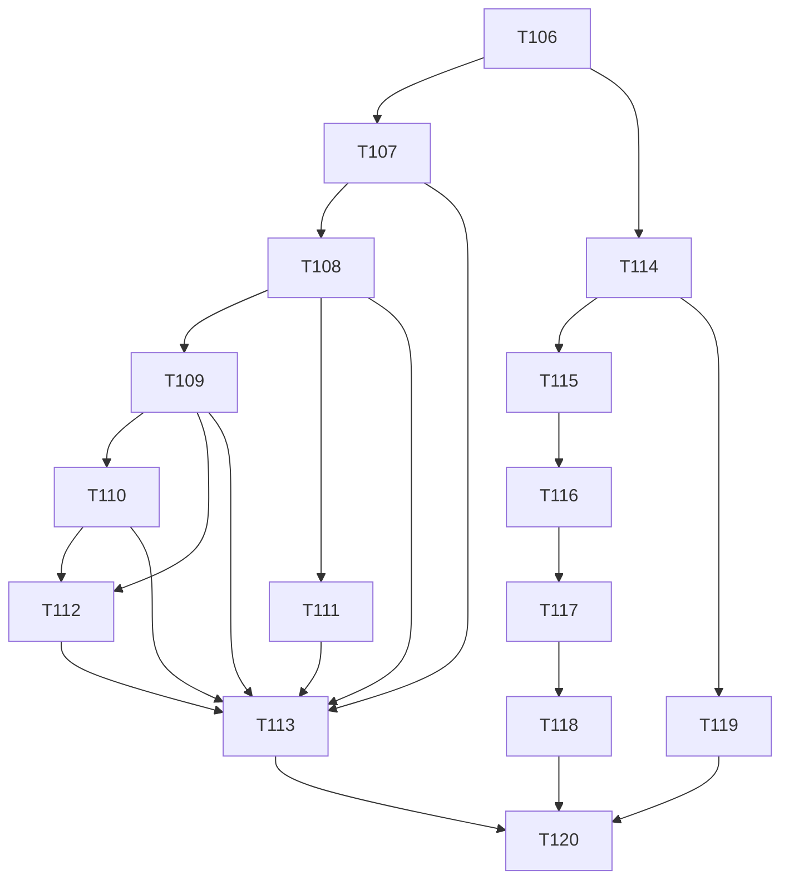

# Plano: Etapa 6 — vault de notas Markdown

## 1. Objetivo

Dar ao usuário um espaço privado de notas em Markdown, vinculadas a transações, metas, pessoas, dívidas, cartões, faturas e resumos mensais, com `[[wikilinks]]`, backlinks, tags, busca, lixeira e **exportação/importação de uma pasta compatível com o Obsidian**, sem que o vault toque em nenhuma lente financeira.

## 2. Escopo

### 2.1 Entra

| #   | Entregável                                                                                                           | Quem         | Tasks      |
| --- | -------------------------------------------------------------------------------------------------------------------- | ------------ | ---------- |
| C   | Contrato e ADR-009 (armazenamento, wikilinks, sanitização)                                                           | dev-backend  | T106       |
| D   | Domínio puro: caminho, wikilinks, frontmatter, tags                                                                  | dev-backend  | T107       |
| P   | Persistência e API: notas, lixeira, vínculos, backlinks, renomear/mover, busca, tags                                 | dev-backend  | T108–T111  |
| X   | Exportar/importar zip Obsidian                                                                                       | dev-backend  | T112       |
| F   | Telas: lista/árvore, editor com preview, vínculos e backlinks, notas dentro das telas financeiras, exportar/importar | dev-frontend | T114–T119  |
| Q   | Validação e E2E                                                                                                      | tester       | T113, T120 |

### 2.2 Não entra

- **Anexos e imagens** (D1 §5, S-48): a importação ignora e lista o que não é `.md`; `![[foto.png]]` fica como texto e link pendente.
- **"Conectar um vault do Obsidian" (pasta local)**: um PWA (principalmente no Safari) não acessa pastas do disco. Substituído por exportar/importar zip (S-157). O onboarding do DS 01 mostra "Criar vault" e "Importar pasta Markdown (zip)".
- Edição colaborativa, versões de nota (histórico de edições), criptografia de notas (anotado para depois), plugins do Obsidian, gráfico de grafo.
- Resumos de IA dentro do vault (Etapa 8).

### 2.3 Regra de trabalho

- **O vault não afeta nenhuma lente financeira** (invariante, D1 §5). Nenhuma task mexe em `core.finance`, razão ou saldo; teste de regressão confere (T113).
- Migrações `V6.*`. Front só usa componentes da UI própria.
- Conteúdo da nota é **dado do usuário**, nunca instrução; renderizado sem HTML bruto (FE 06).

## 3. Perguntas em aberto e suposições

Numeração do backend continua após a Etapa 5 (**S-157**).

### 3.1 A validar com o usuário (ordenadas por impacto)

| #     | Impacto | Suposição                                                                                                                                                                                                                                                                                                                                                                                                                                                                                                                                                                                                                                                                                                                                                                                                              | Motivo                                                                                                                                                                                                                                                                                          | Dono                 | Tasks      |
| ----- | ------- | ---------------------------------------------------------------------------------------------------------------------------------------------------------------------------------------------------------------------------------------------------------------------------------------------------------------------------------------------------------------------------------------------------------------------------------------------------------------------------------------------------------------------------------------------------------------------------------------------------------------------------------------------------------------------------------------------------------------------------------------------------------------------------------------------------------------------- | ----------------------------------------------------------------------------------------------------------------------------------------------------------------------------------------------------------------------------------------------------------------------------------------------- | -------------------- | ---------- |
| S-157 | alto    | **O vault mora no Postgres** (não em arquivos no servidor nem no dispositivo). Compatibilidade com o Obsidian por **exportação/importação de zip** com `.md` e frontmatter. Não há sincronização contínua com uma pasta                                                                                                                                                                                                                                                                                                                                                                                                                                                                                                                                                                                                | PWA sem acesso a disco; "local-first" do DS 01 vira "seus dados, exportáveis a qualquer hora"                                                                                                                                                                                                   | Produto/Arquitetura  | T106, T112 |
| S-158 | médio   | **Wikilinks como no Obsidian** (D1 §5, S-48): `[[nome]]`, `[[pasta/nome]]`, `[[nome                                                                                                                                                                                                                                                                                                                                                                                                                                                                                                                                                                                                                                                                                                                                    | alias]]`, `[[nome#seção]]`(a seção é guardada e ignorada na resolução), resolvidos pelo **nome do arquivo** (caminho sem`.md`), sem diferenciar maiúsculas/acentos; empate → caminho mais curto; sem alvo = **pendente**. Renomear/mover reescreve os links das outras notas na mesma transação | compatibilidade real | Produto    | T107, T110 |
| S-159 | alto    | **Markdown seguro no front:** `marked` só como **lexer** com **HTML bruto desabilitado**; a saída é uma **árvore de dados** desenhada por templates do Angular, **sem DOMPurify** (não existe string HTML a sanitizar; a sanitização é estrutural, ver ADR-009 §5 e FE-S-179); links externos com `rel="noopener noreferrer"` e `target="_blank"`; **imagens remotas bloqueadas** (anti-rastreio; mostram o texto alternativo). **Revisão F1:** o lexer tem custo quadrático em entrada pequena, então roda num **Web Worker com tempo limite de 1,5 s** (ao estourar, `terminate()` e a nota aparece como texto simples com aviso; nunca bloqueia a thread principal), com teto de entrada de 200 KB, profundidade inline limitada e orçamento de nós por item/linha/célula. A decisão e as versões entram na ADR-009 | XSS, privacidade e negação de serviço no navegador; FE 06                                                                                                                                                                                                                                       | Arquitetura          | T106, T116 |
| S-160 | médio   | **Vínculos para entidades:** `NoteLink` com `targetType` (`TRANSACTION`, `ACCOUNT`, `CARD`, `INVOICE`, `PERSON`, `DEBT`, `GOAL`, `MONTHLY_SUMMARY`, `NOTE`) e `targetId` (UUID) ou `targetKey` (`AAAA-MM`). Criar pela UI **valida** que o alvo existe e é do usuário (`422 NOTE_LINK_TARGET_NOT_FOUND`); no frontmatter importado, alvo inexistente vira **pendente** sem falhar                                                                                                                                                                                                                                                                                                                                                                                                                                      | integridade sem quebrar a importação                                                                                                                                                                                                                                                            | Produto              | T109, T112 |
| S-161 | médio   | **Lixeira** (`deleted_at`, S-24): excluir manda para a lixeira; restaurar devolve; **esvaziar a lixeira é ação explícita** e é a única exclusão definitiva ("nada é apagado em silêncio"). Nota na lixeira não aparece em busca nem em backlinks; o nome pode ser reutilizado (índice único parcial)                                                                                                                                                                                                                                                                                                                                                                                                                                                                                                                   | D1 §5 e regra 7 do PR 01                                                                                                                                                                                                                                                                        | Produto              | T108       |
| S-162 | médio   | **Limites:** nota ≤ 200 KB; ≤ 5.000 notas; caminho ≤ 255 caracteres, sem `..`, sem barra inicial, sem `\`, sem caracteres de controle, único **sem diferenciar maiúsculas** entre notas ativas; zip importado ≤ 20 MB, ≤ 2.000 entradas, descompressão ≤ 100 MB (zip bomb); extensão `.md` obrigatória                                                                                                                                                                                                                                                                                                                                                                                                                                                                                                                 | segurança e previsibilidade                                                                                                                                                                                                                                                                     | Arquitetura          | T107, T112 |
| S-163 | médio   | **Busca:** `unaccent` + `ILIKE` em título, caminho e corpo (sem full-text no MVP); filtros por tag e por vínculo; ordenação por relevância simples (título > caminho > corpo) e data. Extensão `unaccent` criada em migração (disponível no RDS)                                                                                                                                                                                                                                                                                                                                                                                                                                                                                                                                                                       | simples e suficiente para centenas de notas                                                                                                                                                                                                                                                     | Arquitetura          | T111       |
| S-164 | baixo   | **Nota vinculada a transação estornada** continua existindo; o vínculo mostra "estornada" (`target.status`), nunca some                                                                                                                                                                                                                                                                                                                                                                                                                                                                                                                                                                                                                                                                                                | D1 §5                                                                                                                                                                                                                                                                                           | Produto              | T109       |
| S-165 | baixo   | **Tags:** de `tags:` no frontmatter e de `#tag` no corpo (fora de blocos de código), normalizadas em minúsculas sem acento; a tela mostra a contagem por tag                                                                                                                                                                                                                                                                                                                                                                                                                                                                                                                                                                                                                                                           | compatível com o Obsidian                                                                                                                                                                                                                                                                       | Produto              | T107, T111 |
| S-166 | médio   | **Frontmatter YAML** lido com carregamento **seguro** (sem tipos arbitrários, sem âncoras recursivas, tamanho máximo); `moneylog: { links: [...] }` é o formato dos vínculos (D1 §5); frontmatter desconhecido é **preservado** na exportação                                                                                                                                                                                                                                                                                                                                                                                                                                                                                                                                                                          | segurança e fidelidade                                                                                                                                                                                                                                                                          | Arquitetura          | T107, T112 |

## 4. Contrato de API

Fonte da verdade: `contracts/openapi.yaml` (T106). Só adições.

| Método    | Caminho                                                   | Corpo / observação                                                                       | Resposta                                                                      |
| --------- | --------------------------------------------------------- | ---------------------------------------------------------------------------------------- | ----------------------------------------------------------------------------- |
| GET       | `/v1/notes?q&tag&folder&linkedType&linkedId&status=ACTIVE | TRASHED&sort`                                                                            | `Slice`                                                                       | `Slice<NoteSummary>` (sem o corpo)                                |
| POST      | `/v1/notes`                                               | `{ path, body, linksExplicit?[] }` (título = nome do arquivo, ou `title` do frontmatter) | `201 Note`                                                                    |
| GET / PUT | `/v1/notes/{id}`                                          | PUT `{ body, version }`                                                                  | `Note` (corpo, `tags`, `links[]` com estado, `backlinks` em endpoint próprio) |
| POST      | `/v1/notes/{id}/move`                                     | `{ newPath, version }` (reescreve wikilinks nas outras notas)                            | `200 Note` + `rewrittenNotes`                                                 |
| POST      | `/v1/notes/{id}/trash` · `/restore`                       | —                                                                                        | `200 Note`                                                                    |
| DELETE    | `/v1/notes/trash`                                         | esvazia a lixeira (ação explícita)                                                       | `204`                                                                         |
| GET       | `/v1/notes/{id}/backlinks`                                | —                                                                                        | `Slice<Backlink>`                                                             |
| PUT       | `/v1/notes/{id}/links`                                    | `{ links:[{ type, id? , key? }], version }` (vínculos explícitos)                        | `200 Note`                                                                    |
| GET       | `/v1/links?targetType&targetId                            | targetKey`                                                                               | notas ligadas a uma entidade                                                  | `Slice<NoteSummary>`                                              |
| GET       | `/v1/notes/tags`                                          | —                                                                                        | `[{ tag, count }]`                                                            |
| GET       | `/v1/vault/export`                                        | —                                                                                        | `application/zip`                                                             |
| POST      | `/v1/vault/import`                                        | multipart (`file`), `mode=SKIP                                                           | RENAME` para conflito de caminho                                              | `ImportReport { created, skipped, pendingLinks, ignoredFiles[] }` |

Erros: `NOTE_NOT_FOUND`, `NOTE_PATH_INVALID`, `NOTE_PATH_TAKEN`, `NOTE_TOO_LARGE`, `NOTE_LIMIT_REACHED`, `NOTE_LINK_TARGET_NOT_FOUND`, `VAULT_IMPORT_INVALID`, `VAULT_IMPORT_TOO_LARGE`, `VERSION_CONFLICT`.

### 4.1 Garantias testadas

1. Nenhuma operação do vault altera saldo, razão, consumo ou dashboard (teste de regressão com o razão antes/depois).
2. Renomear a nota "Revisão de outubro" atualiza `[[Revisão de outubro]]` e `[[Revisão de outubro|alias]]` nas outras notas, em uma transação.
3. Exportar e importar o zip devolve as mesmas notas, tags e vínculos; link para entidade inexistente vira pendente.
4. Nenhuma nota executa HTML/JS ao ser renderizada (suíte de payloads XSS).

## 5. Tasks

> Convenções e cenário das etapas anteriores. Notas do cenário: `reviews/2026-10.md` ("Revisão de outubro") com `[[MacBook]]` e vínculo à compra do notebook; `projetos/MG Tech.md`; `decisoes/reserva.md`.

---

### T106 · dev-backend · Contrato da Etapa 6 e ADR-009

**Objetivo:** escrever §4 em `contracts/openapi.yaml` e a **ADR-009** (armazenamento no Postgres, resolução de wikilinks, sanitização, limites, dependência `marked` no front (sem `DOMPurify`: a saída é uma árvore de dados), zip seguro).

**Critérios de aceite**

1. **Dado** o contrato, **então** passa no lint, só há adições e `api:types` gera (T114).
2. **Dado** a ADR, **então** descreve: S-157 (por que não pasta local), regra de resolução (S-158) com exemplos de empate, modelo de frontmatter (S-166), limites (S-162), anti-zip-bomb e anti-path-traversal, e as alternativas recusadas (FS no servidor; File System Access API).
3. **Dado** o contrato, **então** `Note.body` só aparece no `GET /v1/notes/{id}`; a lista nunca devolve corpo.

**Depende de:** —.

### T107 · dev-backend · Domínio: caminho, wikilinks, frontmatter e tags (puro)

**Objetivo:** `core/note/domain/{NotePath, Wikilink, WikilinkParser, WikilinkResolver, Frontmatter, TagExtractor, Note, NoteLink}`, sem Spring.

**Critérios de aceite**

1. **Dado** `NotePath.of("reviews/2026-10.md")`, **então** válido; `../x.md`, `/x.md`, `a\b.md`, sem `.md`, vazio, > 255 ou com controle → `NOTE_PATH_INVALID`; `Reviews/2026-10.md` e `reviews/2026-10.md` colidem (S-162).
2. **Dado** o corpo "veja [[MacBook]], [[projetos/MG Tech|cliente]] e [[2026-10#Resumo]] mas não `[[em código]]` nem \`\`\`[[bloco]]\`\`\`", **então** o parser acha 3 links (nome, caminho+alias, nome+seção) e ignora código inline e blocos de código.
3. **Dado** nomes repetidos em pastas diferentes, **então** o resolvedor escolhe o caminho mais curto (S-158); sem diferenciar maiúsculas/acentos; sem alvo → pendente.
4. **Dado** frontmatter com `moneylog.links` e `tags`, **então** o parser extrai vínculos tipados; YAML malicioso (tag `!!`, âncoras recursivas, > 64 KB) → recusado; chaves desconhecidas preservadas na reserialização.
5. **Dado** `#tag` no corpo, **então** extrai fora de código; `# título` não é tag; normaliza (S-165).
6. **Dado** nota > 200 KB → `NOTE_TOO_LARGE`.
7. Teste de propriedade: `serialize(parse(texto))` preserva o corpo byte a byte (sem reescrever o que não é link).

**Depende de:** T106.

### T108 · dev-backend · Notas: persistência, CRUD e lixeira

**Objetivo:** tabelas `notes`/`note_tags` (`V6.00`), casos de uso e API de criar, ler, editar (lock otimista), lixeira, restaurar e esvaziar.

**Critérios de aceite**

1. **Dado** `POST /v1/notes` com `reviews/2026-10.md`, **então** `201`, `version 0`, `tags` extraídas e links de corpo resolvidos/pendentes gravados em `note_links` (`origin = WIKILINK`).
2. **Dado** caminho já usado por nota ativa (inclusive em outra caixa), **então** `422 NOTE_PATH_TAKEN`; depois de mandar a nota para a lixeira, o mesmo caminho pode ser reutilizado (índice único parcial `WHERE deleted_at IS NULL`).
3. **Dado** `PUT` com `version` velha → `409`; limite de 5.000 notas → `NOTE_LIMIT_REACHED`.
4. **Dado** `trash`, **então** `deleted_at` preenchido; sai da lista padrão, da busca e dos backlinks; `restore` com caminho ocupado → `NOTE_PATH_TAKEN` (o usuário escolhe outro).
5. **Dado** `DELETE /v1/notes/trash`, **então** remove só as notas já na lixeira do usuário (e seus vínculos), sem tocar nenhuma entidade financeira.
6. **Dado** outro usuário → `404`; contrato validado; mapper round-trip.

**Depende de:** T107.

### T109 · dev-backend · Vínculos com entidades e backlinks

**Objetivo:** vínculos explícitos (`PUT /v1/notes/{id}/links`), `GET /v1/links`, `GET /v1/notes/{id}/backlinks`, validação do alvo e estado do alvo.

**Critérios de aceite**

1. **Dado** vínculo `TRANSACTION` ao id da compra do notebook, **então** `200`; `GET /v1/links?targetType=TRANSACTION&targetId=...` traz a nota; alvo de outro usuário ou inexistente → `422 NOTE_LINK_TARGET_NOT_FOUND`.
2. **Dado** `MONTHLY_SUMMARY` com `key: "2026-10"` válido; `"2026-13"` → `422`.
3. **Dado** a transação estornada, **então** o vínculo continua e `target.status = VOIDED` (S-164); a nota não some.
4. **Dado** `[[MacBook]]` em duas notas, **então** os backlinks da nota "MacBook" listam as duas com o trecho de contexto (até 160 caracteres); nota na lixeira não aparece.
5. **Dado** os vínculos do corpo (`WIKILINK`) e os explícitos (`EXPLICIT`), **então** editar o corpo recalcula só os `WIKILINK`; os explícitos permanecem.
6. **Dado** o tipo `NOTE` como alvo, **então** é o mesmo que o wikilink (sem duplicar).
7. Nenhuma operação altera o razão (regressão de §4.1).

**Depende de:** T108. Etapas 3, 4 e 5 (os alvos `CARD`, `INVOICE`, `PERSON`, `DEBT`, `GOAL` existem).

### T110 · dev-backend · Renomear e mover com reescrita de wikilinks

**Objetivo:** `POST /v1/notes/{id}/move` reescreve os wikilinks das outras notas e recalcula os vínculos, atomicamente.

**Critérios de aceite**

1. **Dado** `reviews/2026-10.md` renomeada para `reviews/outubro.md`, **então** `[[2026-10]]`, `[[reviews/2026-10]]` e `[[2026-10|alias]]` viram `[[outubro]]`, `[[reviews/outubro]]` e `[[outubro|alias]]` (preserva alias e seção); `rewrittenNotes` lista as notas mudadas.
2. **Dado** o novo caminho invalidando uma resolução anterior por empate, **então** só reescreve links que apontavam para **aquela** nota (nunca a de mesmo nome em outra pasta).
3. **Dado** falha no meio, **então** rollback total (IT que injeta falha na 3ª nota).
4. **Dado** `version` velha → `409`; caminho ocupado → `NOTE_PATH_TAKEN`.
5. **Dado** link dentro de código, **então** não é reescrito.
6. **Dado** 500 notas com links, **então** a operação termina dentro de um limite documentado (medido).

**Depende de:** T108, T109.

### T111 · dev-backend · Busca e tags

**Objetivo:** `GET /v1/notes?q=` com `unaccent`/`ILIKE`, filtros por tag/pasta/vínculo e `GET /v1/notes/tags` (`V6.01`).

**Critérios de aceite**

1. **Dado** `q=revisão` e notas com "Revisao"/"revisão", **então** acha as duas (sem acento/caixa); título e caminho antes do corpo; devolve trecho com o termo (até 160 caracteres) no `NoteSummary`.
2. **Dado** `q` com `%` ou `_`, **então** são escapados (sem curinga acidental); `q` > 200 caracteres → `400`.
3. **Dado** `tag=revisao-mensal`, **então** filtra; `GET /tags` traz contagem por tag só de notas ativas.
4. **Dado** `linkedType=GOAL&linkedId=...`, **então** filtra por vínculo.
5. **Dado** a lixeira, **então** só aparece com `status=TRASHED`.
6. **Dado** 2.000 notas, **então** a busca responde em tempo medido e registrado (sem full-text no MVP).

**Depende de:** T108.

### T112 · dev-backend · Exportar e importar o vault (zip Obsidian)

**Objetivo:** `GET /v1/vault/export` e `POST /v1/vault/import` (S-157, S-162, S-166).

**Critérios de aceite**

1. **Dado** o vault do cenário, **então** o zip tem `reviews/2026-10.md`, etc., com frontmatter YAML (`moneylog.links`, `tags`) e corpo intacto; abre no Obsidian (teste com amostras reais de vault); notas na lixeira **não** vão.
2. **Dado** importar o zip exportado, **então** recria as mesmas notas, tags e vínculos; link para entidade inexistente vira **pendente** e entra em `pendingLinks`.
3. **Dado** arquivos que não são `.md` (`foto.png`), **então** são ignorados e listados em `ignoredFiles`; `![[foto.png]]` permanece no texto.
4. **Dado** `../../etc/passwd.md`, caminho absoluto, nome com `\` ou zip com > 2.000 entradas, > 20 MB ou descompressão > 100 MB, **então** `422 VAULT_IMPORT_INVALID`/`VAULT_IMPORT_TOO_LARGE` e **nada** é gravado.
5. **Dado** conflito de caminho, **então** `mode=SKIP` pula e `RENAME` cria `nome (2).md`; o relatório diz o que fez.
6. **Dado** importar duas vezes o mesmo zip com `SKIP`, **então** não duplica.
7. **Dado** frontmatter malicioso, **então** a nota é importada sem o frontmatter inválido e o relatório avisa.

**Depende de:** T108, T109, T110.

### T113 · tester · Validação do backend da Etapa 6

**Critérios de aceite**

1. **Dado** o vault, **então** nenhuma operação muda o razão/saldos/dashboard (regressão com dados das etapas 2 a 5).
2. **Dado** payloads XSS e de zip hostil (path traversal, bomb, nomes reservados), **então** nada executa e nada é gravado fora do limite.
3. **Dado** concorrência (editar × mover × lixeira), **então** sem 500 e sem links órfãos.
4. **Dado** 100 vaults aleatórios, **então** exportar → importar reproduz notas e vínculos (propriedade).
5. **Dado** isolamento entre usuários, contrato e migração; relatório `docs/qa/AAAA-MM-DD-qa-backend-etapa-6.md`.

**Depende de:** T107–T112.

### T114 · dev-frontend · Módulo `notes` (negócio) e utilitário de Markdown seguro

**Objetivo:** tipos gerados; `src/modules/notes` (tipos, porta, facades de lista, nota, vínculos, vault); `src/util/markdown` (render seguro: `marked` como lexer, árvore de dados, sem `DOMPurify`, em Web Worker com tempo limite, S-159).

**Critérios de aceite**

1. **Dado** o contrato, **então** `api:check` verde.
2. **Dado** o render, **então** a suíte de XSS (≥ 30 payloads: `<script>`, `onerror`, `javascript:`, `data:`, SVG, HTML bruto, atributos) não produz nós executáveis; imagens remotas viram texto alternativo; links externos têm `rel="noopener noreferrer"`.
3. **Dado** wikilinks no texto, **então** o render os transforma em links de navegação interna (resolvidos pela API) ou "pendente" (sem inventar alvo).
4. **Dado** a facade do editor, **então** `PUT` com `version`; `409` abre o fluxo "esta nota mudou em outro lugar" (recarregar/ver diferença).
5. **Dado** `API_MOCKS`, **então** vazios sem HTTP.
6. **Dado** o bundle, **então** o impacto de tamanho de `marked` (e do worker) fica registrado e dentro do orçamento do build.

**Depende de:** T106. Integração real: T108–T112.

### T115 · dev-frontend · Notas: lista, pastas, tags, busca e estado vazio

**Objetivo:** `/notes` com árvore de pastas (derivada dos caminhos), lista, busca com debounce, filtro por tag, lixeira, e o estado vazio do DS 01.

**Arquivos/camadas:** `src/app/features/notes/{notes.routes.ts, pages/notes.page, components/{folder-tree, note-row, tag-chips, trash-list}}`, i18n, testes. Usa `Disclosure`, `Chip`, `Menu`.

**Critérios de aceite**

1. **Dado** nenhuma nota, **então** o estado vazio ("Seu vault está vazio." / texto do DS 01 adaptado, em pt/en/es) com "Nova nota" e "Importar pasta Markdown".
2. **Dado** notas, **então** a árvore agrupa por pasta (recolhe/expande com `Disclosure` e teclado), a lista mostra título, caminho, tags e data, com indicação "Armazenado no seu servidor privado; exporte quando quiser" (DS 01).
3. **Dado** a busca, **então** debounce 300 ms e cancela a anterior; o termo é destacado no trecho; `q` vai para a URL.
4. **Dado** a lixeira, **então** "Restaurar" e "Esvaziar lixeira" (confirmação explícita).
5. **Dado** 375 px, **então** a árvore vira lista com seletor de pasta; 1280 px, painel lateral.
6. **Dado** teclado, **então** setas na árvore (`role="tree"`), Enter abre.

**Depende de:** T114; UI própria: T158, T164, T166. Integração real: T108, T111.

### T116 · dev-frontend · Editor Markdown e preview seguro

**Objetivo:** `/notes/:id` com editor (textarea própria com atalhos) e preview lado a lado (desktop) ou abas (mobile); salvar com `version`; "alterações não salvas".

**Arquivos/camadas:** `src/app/features/notes/{pages/note.page, components/{markdown-editor, markdown-preview}}`, i18n, testes.

**Critérios de aceite**

1. **Dado** digitar, **então** o preview renderiza (debounce) usando o utilitário seguro; nenhum HTML bruto é executado.
2. **Dado** `Ctrl/Cmd+S`, **então** salva; sem salvar e ao sair → confirmação (`ConfirmDialog`); `409` → fluxo de T114.
3. **Dado** `Ctrl/Cmd+B/I/K` e `Tab` no editor, **então** formatam sem prender o foco (Esc então Tab sai do campo; documentado) — requisito de acessibilidade.
4. **Dado** nota de 200 KB, **então** o editor segue utilizável; acima do limite, erro de campo `NOTE_TOO_LARGE`.
5. **Dado** iPhone/375 px, **então** o editor ocupa a tela, abas "Escrever/Ler", fonte ≥ 16 px e o teclado não cobre o cursor (`visualViewport`).
6. **Dado** o rótulo de armazenamento, **então** indica "Notas armazenadas no servidor" (sem prometer local-first).

**Depende de:** T115; UI própria: T164. Integração real: T108.

### T117 · dev-frontend · Vínculos: seletor de entidade, `[[` e painel de backlinks

**Objetivo:** vincular nota a entidades (seletor com busca por tipo), autocomplete de `[[` com notas existentes, painel com vínculos e backlinks.

**Critérios de aceite**

1. **Dado** "Vincular", **então** o `Combobox` busca por tipo (transação, meta, pessoa, dívida, cartão, fatura, resumo mensal) usando as APIs de cada módulo através da **página** (sem import entre módulos); salvar chama `PUT /links`.
2. **Dado** digitar `[[`, **então** abre o autocomplete com notas (teclado: setas/Enter/Esc), insere `[[caminho]]`.
3. **Dado** o painel, **então** lista vínculos (com estado "estornada") e backlinks com o trecho; link pendente aparece como "pendente" com ação "Criar nota".
4. **Dado** `NOTE_LINK_TARGET_NOT_FOUND`, **então** mensagem no campo.
5. **Dado** leitor de tela, **então** o autocomplete usa `role="combobox"`/`listbox` com `aria-activedescendant` e anuncia a quantidade de resultados.

**Depende de:** T116; UI própria: T165. Integração real: T109.

### T118 · dev-frontend · Notas dentro das telas financeiras

**Objetivo:** bloco "Notas vinculadas" no detalhe de transação, meta, pessoa, dívida, cartão/fatura e no resumo mensal, com "Nova nota" já vinculada.

**Critérios de aceite**

1. **Dado** o detalhe da compra do notebook, **então** lista as notas ligadas (`GET /v1/links`) e "Nova nota vinculada" cria a nota com `moneylog.links` preenchido e abre o editor.
2. **Dado** o resumo mensal de outubro, **então** o bloco mostra "Linked to monthly review" (texto da voz do DS) com as notas de `MONTHLY_SUMMARY 2026-10`.
3. **Dado** transação estornada, **então** o bloco continua e mostra o estado.
4. **Dado** nenhuma nota, **então** estado vazio compacto; erro → "tentar de novo".
5. **Dado** módulos, **então** nenhum módulo importa `notes`: a página injeta o bloco (componente em `app/common` ou `features/notes/components` exportado por rota/`input`).

**Depende de:** T117, Etapas 3 a 5 (telas). Integração real: T109.

### T119 · dev-frontend · Exportar e importar o vault (UI)

**Objetivo:** em Notas e Configurações → Dados: "Exportar vault (zip)" e "Importar pasta Markdown" com `FilePicker`, escolha de conflito e relatório.

**Critérios de aceite**

1. **Dado** exportar, **então** baixa o zip com o nome do backend; indicador de progresso; erro → "tentar de novo".
2. **Dado** importar, **então** o `FilePicker` aceita `.zip`, mostra nome/tamanho, pede `SKIP`/`RENAME` e exibe o `ImportReport` (criadas, ignoradas, pendentes, arquivos ignorados) com linguagem calma ("Review before applying.").
3. **Dado** `VAULT_IMPORT_INVALID`/`TOO_LARGE`, **então** mensagem clara e nada some da lista.
4. **Dado** teclado/iPhone, **então** o seletor de arquivo abre pelo botão e funciona por teclado.

**Depende de:** T114; UI própria: T167 (`FilePicker`). Integração real: T112.

### T120 · tester · E2E da Etapa 6 com backend real

**Critérios de aceite**

1. **Jornada:** criar nota → vincular à compra do notebook e ao resumo de outubro → `[[` para outra nota → renomear → ver links reescritos e backlinks → mandar para a lixeira → restaurar → exportar → importar em outro usuário.
2. **Dado** nota com payload XSS, **então** nada executa no browser (teste com `page.on('dialog')`/`pageerror`).
3. **Dado** o vault, **então** saldos e dashboard idênticos antes e depois.
4. **Teclado, 375 px e WebKit** nos fluxos; contrato validado.
5. Bugs com severidade.

**Depende de:** T113, T114–T119.

---

## 6. Ordem de execução e paralelismo

### 6.1 Dependências

| Task | Agente       | Depende de                 |
| ---- | ------------ | -------------------------- |
| T106 | dev-backend  | —                          |
| T107 | dev-backend  | T106                       |
| T108 | dev-backend  | T107                       |
| T109 | dev-backend  | T108, Etapas 3–5 (alvos)   |
| T110 | dev-backend  | T108, T109                 |
| T111 | dev-backend  | T108                       |
| T112 | dev-backend  | T108, T109, T110           |
| T113 | tester       | T107–T112                  |
| T114 | dev-frontend | T106                       |
| T115 | dev-frontend | T114, UI: T158, T164, T166 |
| T116 | dev-frontend | T115, UI: T164             |
| T117 | dev-frontend | T116, UI: T165             |
| T118 | dev-frontend | T117, Etapas 3–5 (telas)   |
| T119 | dev-frontend | T114, UI: T167             |
| T120 | tester       | T113, T114–T119            |

### 6.2 Grafo

### 6.3 Ondas

| Onda | Backend       | Frontend                                  |
| ---- | ------------- | ----------------------------------------- |
| 1    | T106          | —                                         |
| 2    | T107          | T114                                      |
| 3    | T108          | T115                                      |
| 4    | T109 ∥ T111   | T116 ∥ T119                               |
| 5    | T110          | T117                                      |
| 6    | T112          | T118 (precisa das telas das Etapas 3 a 5) |
| 7    | T113 (tester) | —                                         |
| 8    | —             | T120 (tester)                             |

- **Execução antecipada possível:** T106, T107 (domínio puro) e T114 não dependem de nenhuma etapa financeira; podem rodar **em paralelo com as Etapas 3 a 5** para encurtar o caminho crítico. T109 espera os alvos (`CARD`, `INVOICE`, `PERSON`, `DEBT`, `GOAL`) existirem; antes disso valida só os tipos existentes e deixa os demais atrás de um `TargetResolver` com registro por tipo (a Etapa 6 registra os que já existirem; cada etapa financeira registra o seu).
- Migrações `V6.00` (T108), `V6.01` (T111, `unaccent`).
- Conflitos: T109, T110 e T112 tocam o mesmo agregado `Note`; por isso são sequenciais. T118 toca telas das Etapas 3 a 5 (rebase).

## 7. Riscos

| Risco                                       | Impacto                                | Mitigação                                                                                                                              |
| ------------------------------------------- | -------------------------------------- | -------------------------------------------------------------------------------------------------------------------------------------- |
| XSS pelo Markdown                           | execução de script, vazamento de token | HTML bruto desligado + árvore de dados sem HTML (sem DOMPurify) + Web Worker com tempo limite + suíte de payloads (T114 CA2, T120 CA2) |
| Zip hostil na importação                    | disco/memória/path traversal           | limites e validação (S-162), T112 CA4, T113 CA2                                                                                        |
| Reescrita de links corromper notas          | perda de conteúdo                      | transação única, nunca reescreve código, propriedade de T113 CA4                                                                       |
| Expectativa de "conectar vault do Obsidian" | frustração                             | S-157 explícita; exportar/importar                                                                                                     |
| Notas expondo dado financeiro sensível      | privacidade                            | só no servidor do usuário; nunca enviadas à IA sem permissão (Etapa 8 define)                                                          |
| Busca lenta em volume                       | UX                                     | limite 5.000 notas e medição (T111 CA6); FTS depois                                                                                    |
| Editor sem acessibilidade (Tab preso)       | barreira de teclado                    | T116 CA3                                                                                                                               |

## 8. ADRs e documentos

| Documento  | Tema                                               | Task |
| ---------- | -------------------------------------------------- | ---- |
| ADR-009    | Vault no Postgres, wikilinks, sanitização, limites | T106 |
| D1 §5 e §8 | Suposições S-157 a S-166                           | T113 |
