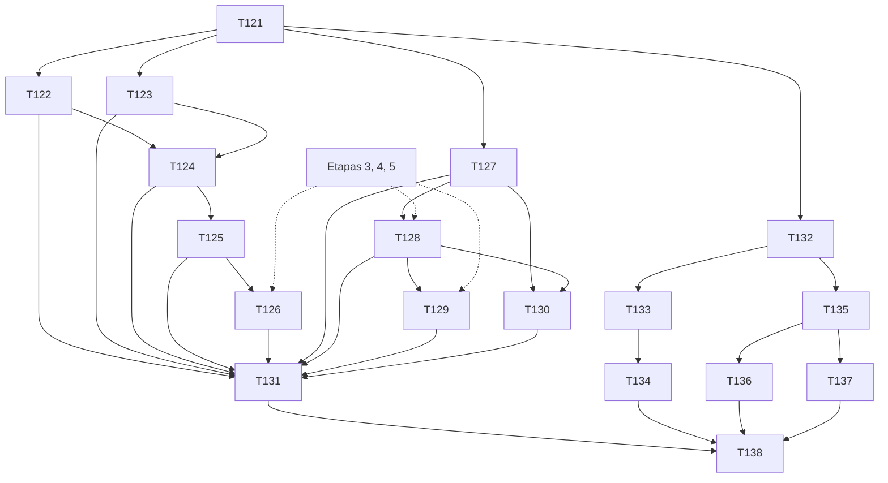

# Plano: Etapa 7 — importação CSV/OFX e notificações

## 1. Objetivo

Importar extratos CSV e OFX sem duplicar nem dupla-contar (revisão manual, desfazer o lote, categoria e método sugeridos pelo histórico), e avisar o usuário do que importa (fatura a vencer, cobrança, recorrência pendente, resumo diário) numa **central de notificações dentro do app**, com push preparado atrás de uma abstração, sem spam.

## 2. Escopo

### 2.1 Entra

| #   | Entregável                                                                                                                                                       | Quem         | Tasks      |
| --- | ---------------------------------------------------------------------------------------------------------------------------------------------------------------- | ------------ | ---------- |
| C   | Contrato (importação e notificações)                                                                                                                             | dev-backend  | T121       |
| I   | Parsers CSV e OFX (puros); lote, upload, normalização, deduplicação e sugestão por histórico; revisão das linhas; aplicar e desfazer                             | dev-backend  | T122–T126  |
| N   | Notificações: central, lembretes, configurações, geração idempotente por job, resumo das 08:00 e mensagem diária estática, push atrás de abstração               | dev-backend  | T127–T130  |
| F   | Telas de importação, revisão do lote, central e lembretes, configurações de notificação, service worker de push (preparado) e atalhos/deep links do `/quick-add` | dev-frontend | T132–T137  |
| Q   | Validação e E2E                                                                                                                                                  | tester       | T131, T138 |

### 2.2 Não entra

- **XLSX e PDF** (PR 00 §7 "quando for viável"): fora do MVP (S-169). O parser de CSV cobre a exportação de planilhas.
- **Open Finance / integração bancária / credenciais do banco** (PR 00 §26): nunca. Só arquivos que o usuário envia.
- **Categorização por IA**: Etapa 8 (esta etapa entrega a sugestão por histórico, que funciona sem IA).
- **Push real em iPhone/Android**: a abstração, a assinatura e o service worker ficam prontos e testados com fakes; **não são executados em dispositivo** (depende de domínio HTTPS, chaves VAPID e instalação do PWA). A central dentro do app é o canal garantido (S-173).
- E-mail e SMS.

### 2.3 Regra de trabalho

- `core.importing` (Etapa 1: `DedupKey`, `DescriptionNormalizer`, `DuplicateClassifier`, `ExistingEntry`, `ImportLine`, `ImportLineReview`) já existe e **não é reescrito**; esta etapa constrói parsers, persistência e casos de uso ao redor.
- Depende do backend das Etapas 3 e 4 (cartão, recorrência, dívidas) e da Etapa 5 (resumo para a mensagem). Migrações `V7.*`. Front só com os componentes da UI própria.
- A importação usa os **mesmos handlers de criação** de movimentação (T53/T76): nunca grava `Transaction` por outro caminho (PR 01 regra 10).

## 3. Perguntas em aberto e suposições

Numeração do backend continua após a Etapa 6 (**S-167**).

### 3.1 A validar com o usuário (ordenadas por impacto)

| #     | Impacto | Suposição                                                                                                                                                                                                                                                                                                                                                                                                                                                                                                                                                                                             | Motivo                                                                                               | Dono                                                                                                                                                                                                                             | Tasks            |
| ----- | ------- | ----------------------------------------------------------------------------------------------------------------------------------------------------------------------------------------------------------------------------------------------------------------------------------------------------------------------------------------------------------------------------------------------------------------------------------------------------------------------------------------------------------------------------------------------------------------------------------------------------- | ---------------------------------------------------------------------------------------------------- | -------------------------------------------------------------------------------------------------------------------------------------------------------------------------------------------------------------------------------- | ---------------- |
| S-167 | alto    | **A importação cria só `EXPENSE` e `INCOME`** na conta do lote, **nunca `TRANSFER` automático**. A linha que parece transferência entre contas do próprio usuário (mesmo valor, data ±1 dia, direção oposta, noutra conta dele, ou descrição "TED/PIX para <meu nome>") recebe a marca `POSSIBLE_TRANSFER` e **exige decisão**; aceitar como transferência cria **uma** `TRANSFER` e a linha espelhada do outro extrato é reconhecida como duplicata dela                                                                                                                                             | transferência não é despesa (PR 01); importar os dois extratos como despesa+receita contaria dobrado | Produto                                                                                                                                                                                                                          | T125, T126       |
| S-168 | alto    | **Extrato de cartão** (lote com `cardId`): linhas de **pagamento de fatura** ("PAGAMENTO RECEBIDO", "PAGTO FATURA") são **`REJECTED` por padrão** com o motivo "já registrado como pagamento de fatura na conta" (o pagamento vem do extrato da conta ou do app); linhas com padrão de parcela (`02/06`, `PARC 2/6`) ficam com a marca `LOOKS_LIKE_INSTALLMENT` e **exigem decisão** (ignorar porque a compra já está registrada, importar como compra à vista, ou ligar a uma compra existente); as demais viram `CARD_PURCHASE` à vista pela alocação normal da fatura (lançamento tardio incluído) | evita dupla contagem de pagamento e de parcela (S-133)                                               | Produto                                                                                                                                                                                                                          | T125, T126       |
| S-169 | médio   | **Formatos:** CSV (delimitador `;`, `,` ou tab detectado; UTF-8 ou ISO-8859-1; números `1.234,56` ou `1,234.56`; datas `dd/MM/yyyy`, `yyyy-MM-dd`, `dd/MM/yy`) com **mapeamento de colunas** salvo por conta/cartão; OFX 1.x (SGML) e 2.x (XML) com `STMTTRN` (`DTPOSTED`, `TRNAMT`, `FITID`, `MEMO`/`NAME`) e cartões (`CREDITCARDMSGSRSV1`). **XLSX e PDF fora do MVP**                                                                                                                                                                                                                             | cobre os formatos que os bancos brasileiros exportam; o resto depende de amostras reais              | Produto                                                                                                                                                                                                                          | T122, T123       |
| S-170 | médio   | **Sinal e direção:** em CSV com uma coluna de valor, negativo = saída e positivo = entrada, com a opção "inverter" salva no mapeamento (extratos de cartão trazem compra como positivo); em OFX, `TRNAMT` com sinal. Valor zero é ignorado e listado                                                                                                                                                                                                                                                                                                                                                  | formatos diferentes                                                                                  | Produto                                                                                                                                                                                                                          | T122, T123       |
| S-171 | médio   | **Limites:** arquivo ≤ 5 MB e ≤ 5.000 linhas; acima → `422 IMPORT_TOO_LARGE`. Mesmo `fileSha256` na mesma conta/cartão gera **aviso** antes de processar (D1 §6), com opção de continuar                                                                                                                                                                                                                                                                                                                                                                                                              | previsibilidade                                                                                      | Arquitetura                                                                                                                                                                                                                      | T124             |
| S-172 | médio   | **Sugestão de categoria e método por histórico, sem IA:** a descrição normalizada de uma linha é comparada com as movimentações ativas do usuário; regra aprendida = ≥ 2 movimentações com a mesma descrição normalizada e a mesma categoria (a mais frequente vence) ou uma `categorization_rule` que o usuário confirmou na revisão ("aprender isto"); a sugestão traz `confidence` (`HIGH` ≥ 3 ocorrências e ≥ 80% iguais; `MEDIUM` 2; sem sugestão = categoria vazia, o usuário escolhe). O método sugerido segue o mesmo critério; sem histórico, `OTHER` para conta e nenhum para cartão        | "o app aprende com o histórico" (PR 00 §10) sem depender de chave                                    | Produto                                                                                                                                                                                                                          | T124, T125       |
| S-173 | alto    | **Push é preparado, não executado:** `PushSender` (porta) com `NoopPushSender` padrão e `WebPushSender` (VAPID via `MONEYLOG_PUSH_VAPID_PUBLIC/PRIVATE/SUBJECT`) atrás da flag `moneylog.push.enabled=false`; assinaturas gravadas; o service worker tem os handlers de `push` e `notificationclick`. **O canal garantido é a central dentro do app**; push no iPhone exige PWA instalada (iOS 16.4+), permissão pedida por gesto e HTTPS real                                                                                                                                                        | depende de terceiros (Apple/domínio/chaves)                                                          | Arquitetura/Produto                                                                                                                                                                                                              | T130, T136, T137 |
| S-174 | alto    | **Notificações são geradas por um job idempotente** (`@Scheduled`, fuso `America/Sao_Paulo`, uma instância): cada notificação tem chave única `(user, kind, refId, dia)`, então reexecutar o job ou reiniciar o app **não duplica**. Tipos: `INVOICE_DUE` (3 dias, 1 dia, no dia e atrasada), `DEBT_COLLECT` (no dia e atrasada), `DEBT_PAYABLE_DUE`, `RECURRENCE_PENDING` (ocorrência chegou e não foi realizada), `COMMITTED_NEXT_MONTH` (resumo do que vence no próximo mês, 1×/mês), `DAILY_SUMMARY` (08:00), `REMINDER` (manual), `GOAL_DEADLINE` (30 dias antes do prazo)                       | PR 00 §12 e §13; sem spam                                                                            | Produto                                                                                                                                                                                                                          | T128, T129       |
| S-175 | alto    | **Sem spam (configurável):** padrão = tudo ligado na central, push desligado; o usuário configura horário do resumo (padrão 08:00), tipos, frequência (`DAILY                                                                                                                                                                                                                                                                                                                                                                                                                                         | ONLY_DUE                                                                                             | OFF` para o resumo), janela de silêncio (padrão 22:00–07:00 para push) e pode desativar tudo; **no máximo 1 notificação por (tipo, referência, dia)** e **no máximo 5 por dia** agrupadas em "N lembretes" quando passarem disso | PR 00 §13        | Produto | T127, T128 |
| S-176 | médio   | **Mensagem diária estática e factual**, sem frase aleatória: "Bom dia, {nome}. Hoje você tem R$ {disponível} disponíveis e R$ {comprometido 7d} em compromissos nos próximos 7 dias." + uma linha de meta se houver ("Reserva de emergência está 64% concluída"), toda vinda do dashboard/metas. O `{nome}` vem de uma configuração `displayName` (padrão vazio: "Bom dia."). A versão com IA e o fallback são da Etapa 8                                                                                                                                                                             | PR 00 §14 e DS 00 (voz)                                                                              | Produto                                                                                                                                                                                                                          | T129             |
| S-177 | médio   | **Lembrete manual** ("Lembrete" da ação rápida): título, data e hora opcional, nota, vínculo opcional a uma entidade; gera `REMINDER` na data; concluir/adiar ações simples                                                                                                                                                                                                                                                                                                                                                                                                                           | PR 00 §2 quick actions                                                                               | Produto                                                                                                                                                                                                                          | T127             |
| S-178 | médio   | **Atalhos e deep links do `/quick-add`:** `manifest` com `shortcuts` (Novo registro, Pix, Crédito) e `share_target` (texto compartilhado preenche descrição/valor); URL `https://<app>/quick-add?mode=pix&amount=35&description=almoço&account=<id>` **só preenche o formulário**, **nunca salva** sem confirmação do usuário; parâmetros validados e escapados                                                                                                                                                                                                                                       | iOS Shortcuts/Android; segurança contra URL maliciosa                                                | Produto/Segurança                                                                                                                                                                                                                | T137             |
| S-179 | baixo   | **Retenção:** notificações lidas há mais de 90 dias saem da central (marcadas `archived`), nunca apagadas silenciosamente; o histórico fica exportável no backup (Etapa 5, estendido)                                                                                                                                                                                                                                                                                                                                                                                                                 | regra 7 do PR 01                                                                                     | Produto                                                                                                                                                                                                                          | T127             |
| S-180 | baixo   | **Desfazer lote:** estorna (`VOIDED`, motivo "importação desfeita") todas as movimentações do lote **respeitando as guardas**; as que não puderem (compra em fatura fechada, S-36) ficam listadas para correção manual e o lote vira `PARTIALLY_UNDONE`; nada é apagado                                                                                                                                                                                                                                                                                                                               | D1 §6                                                                                                | Produto                                                                                                                                                                                                                          | T126             |

## 4. Contrato de API

Fonte da verdade: `contracts/openapi.yaml` (T121). Só adições.

### 4.1 Importação

| Método    | Caminho                                     | Corpo / observação                                               | Resposta                                                                                                                                                       |
| --------- | ------------------------------------------- | ---------------------------------------------------------------- | -------------------------------------------------------------------------------------------------------------------------------------------------------------- |
| POST      | `/v1/imports`                               | multipart: `file`, `accountId` **xor** `cardId`, `format?` (`CSV | OFX`, detectado), `mapping?`(JSON do CSV), header`Idempotency-Key`                                                                                             | `201 ImportBatch` (`PENDING_REVIEW`, linhas classificadas, `warnings[]` como `SAME_FILE_ALREADY_IMPORTED`) |
| GET       | `/v1/imports?status` · `/v1/imports/{id}`   | —                                                                | `Slice<ImportBatchSummary>` / `ImportBatch`                                                                                                                    |
| GET       | `/v1/imports/{id}/lines?status&flag&page`   | `Slice`                                                          | `Slice<ImportLine>` (data, valor, direção, descrição original e normalizada, `status`, `flags[]`, `suggestion{ categoryId, method, confidence }`, `matches[]`) |
| PATCH     | `/v1/imports/{id}/lines/{lineId}`           | `{ action: ACCEPT                                                | REJECT                                                                                                                                                         | FORCE, categoryId?, method?, description?, asTransfer?:{ counterpartAccountId }, learn?:boolean }`         | `200 ImportLine` |
| POST      | `/v1/imports/{id}/lines:bulk`               | `{ lineIds[], action }` (só linhas sem `requiresDecision`)       | `200 { updated, skipped[] }`                                                                                                                                   |
| POST      | `/v1/imports/{id}/apply`                    | header `Idempotency-Key`                                         | `200 ImportBatch` (`APPLIED`, contadores, `created[]`)                                                                                                         |
| POST      | `/v1/imports/{id}/undo`                     | `{ reason? }`                                                    | `200 ImportBatch` (`UNDONE` ou `PARTIALLY_UNDONE` + `blocked[]`)                                                                                               |
| GET / PUT | `/v1/import-mappings/{accountOrCardId}`     | mapeamento de colunas salvo                                      | `ImportMapping`                                                                                                                                                |
| GET       | `/v1/categorization-rules` · `DELETE /{id}` | regras aprendidas (o usuário pode removê-las)                    | `Slice<Rule>`                                                                                                                                                  |

Erros: `IMPORT_TOO_LARGE`, `IMPORT_FORMAT_UNSUPPORTED`, `IMPORT_PARSE_FAILED`, `IMPORT_MAPPING_INVALID`, `IMPORT_BATCH_NOT_FOUND`, `IMPORT_BATCH_NOT_PENDING`, `IMPORT_LINES_REQUIRE_DECISION`, `IMPORT_LINE_INVALID`, `IMPORT_LINE_INVALID_TRANSITION` (do domínio), mais os de criação de movimentação.

### 4.2 Notificações

| Método     | Caminho                                     | Corpo / observação                                                                                                              | Resposta                                  |
| ---------- | ------------------------------------------- | ------------------------------------------------------------------------------------------------------------------------------- | ----------------------------------------- |
| GET        | `/v1/notifications?status=UNREAD            | ALL&kind`                                                                                                                       | `Slice`                                   | `Slice<Notification>` (`kind`, `title`/`body` por chave i18n + parâmetros, `ref{type,id}`, `dueOn`, `readAt`) |
| GET        | `/v1/notifications/unread-count`            | —                                                                                                                               | `{ count }`                               |
| POST       | `/v1/notifications/{id}/read` · `/read-all` | —                                                                                                                               | `204`                                     |
| GET / POST | `/v1/reminders`                             | POST `{ title, remindOn, remindAt?, note?, link? }`                                                                             | `Slice<Reminder>` / `201 Reminder`        |
| PUT / POST | `/v1/reminders/{id}` · `/done` · `/snooze`  | —                                                                                                                               | `200 Reminder`                            |
| GET / PUT  | `/v1/settings/notifications`                | `{ dailySummary:{ enabled, time, frequency }, kinds:{…}, quietHours:{ from, to }, push:{ enabled }, displayName? }` + `version` | `NotificationSettings`                    |
| POST       | `/v1/push/subscriptions` · `DELETE /{id}`   | `{ endpoint, keys{p256dh,auth}, userAgent? }`                                                                                   | `201` / `204`                             |
| GET        | `/v1/daily-message`                         | —                                                                                                                               | `{ text, source: "STATIC", generatedAt }` |

Os textos das notificações são **chaves de i18n + parâmetros** (o front traduz pt/en/es); o backend não grava frase pronta (S-34).

### 4.3 Garantias testadas

1. Reimportar o mesmo arquivo não duplica nenhuma movimentação (todas as linhas viram `DUPLICATE`).
2. Importar o extrato da conta e o do cartão com a mesma compra e o pagamento da fatura não dobra nada (S-167, S-168).
3. Desfazer o lote devolve saldos, consumo e dashboard ao estado anterior, exceto o que a guarda impedir (listado).
4. Rodar o job de notificações duas vezes no mesmo dia não cria notificações novas.

## 5. Tasks

> Convenções e cenário das etapas anteriores. Arquivos de exemplo em `backend/src/test/resources/imports/`: `nubank-conta.csv`, `nubank-cartao.csv`, `itau.ofx` (SGML), `inter.ofx` (XML), `latin1-ponto-e-virgula.csv`. Se o usuário fornecer extratos reais (anonimizados), eles entram como amostras adicionais (ver §7).

---

### T121 · dev-backend · Contrato da Etapa 7

**Objetivo:** escrever §4.1 e §4.2 em `contracts/openapi.yaml` e fechar a lista de `code` (lendo `ImportLineExceptions` do domínio).

**Critérios de aceite**

1. **Dado** o contrato, **então** passa no lint, só há adições; `multipart/form-data` de `POST /v1/imports` validado pelo validador (ou documentado como exceção se o validador não cobrir).
2. **Dado** `PATCH` de linha, **então** `action=FORCE` só aceita linhas `DUPLICATE` e `asTransfer` só em conta (oneOf).
3. **Dado** as notificações, **então** os campos de texto são chaves de i18n + `params`.
4. **Dado** `api:types`, **então** gera sem erro (T132).

**Depende de:** —.

### T122 · dev-backend · Parser de CSV (puro)

**Objetivo:** `core/importing/parser/{CsvStatementParser, CsvFormatDetector, ColumnMapping, AmountParser, DateParser, ParsedStatement}` — sem Spring, sem I/O de rede.

**Critérios de aceite**

1. **Dado** `nubank-conta.csv` (UTF-8, `,`, `dd/MM/yyyy`) e `latin1-ponto-e-virgula.csv` (ISO-8859-1, `;`, `1.234,56`), **então** o detector acha encoding, delimitador, linha de cabeçalho e sugere o mapeamento (data, descrição, valor); linhas parseadas têm `ImportLine` com data, valor em `Money`, direção e descrição.
2. **Dado** `AmountParser`, **então** `1.234,56`, `1,234.56`, `-82,90`, `(82,90)`, `R$ 82,90`, `82.90` e `1234` dão o valor exato em centavos (propriedade, sem `double`); `abc` → `IMPORT_PARSE_FAILED` com a linha.
3. **Dado** coluna única de valor com `invert=true` (cartão), **então** o sinal é invertido (S-170); duas colunas (débito/crédito) também mapeiam.
4. **Dado** linhas em branco, totais e rodapé ("Saldo final"), **então** são ignoradas e listadas em `skipped[]` com o motivo; valor zero é ignorado.
5. **Dado** datas `15/10/2026`, `2026-10-15`, `15/10/26`, **então** corretas; `31/02/2026` → linha inválida (listada, não derruba o arquivo).
6. **Dado** arquivo > 5 MB ou > 5.000 linhas → `IMPORT_TOO_LARGE`; BOM UTF-8 tratado; aspas e quebra de linha em campo tratadas; injeção de fórmula na descrição não é "executada" (descrição é texto).
7. Cobertura ≥ 90% e teste de propriedade: `parse(render(linhas)) = linhas`.

**Depende de:** T121.

### T123 · dev-backend · Parser de OFX (puro)

**Objetivo:** `core/importing/parser/{OfxStatementParser}` tolerante a SGML 1.x (tags sem fechamento) e XML 2.x, sem resolver entidades externas (XXE).

**Critérios de aceite**

1. **Dado** `itau.ofx` (SGML) e `inter.ofx` (XML), **então** extrai `STMTTRN` com `DTPOSTED` (com e sem fuso `[−3:BRT]`), `TRNAMT` com sinal, `FITID`, `MEMO`/`NAME`; a descrição usa `MEMO` quando `NAME` é genérico.
2. **Dado** `FITID`, **então** é guardado em `sourceId` e entra na chave de deduplicação no lugar da descrição (D1 §6); sem `FITID`, usa a descrição.
3. **Dado** extrato de cartão (`CREDITCARDMSGSRSV1`), **então** é reconhecido e marcado como `CARD`; o `ACCTID` (parcial) **não é guardado**.
4. **Dado** XML com `<!DOCTYPE ... ENTITY ...>`, **então** é recusado sem resolver (teste XXE); arquivo truncado → `IMPORT_PARSE_FAILED` informativo.
5. **Dado** moeda diferente de BRL → `IMPORT_FORMAT_UNSUPPORTED` com a moeda (S-2).
6. **Dado** valor 0 ou data inválida, **então** linha ignorada e listada.
7. Cobertura ≥ 90%.

**Depende de:** T121.

### T124 · dev-backend · Lote: upload, normalização, deduplicação e sugestões

**Objetivo:** persistir `ImportBatch`/`import_lines` (`V7.00`), receber o upload (`POST /v1/imports`), classificar cada linha com `DuplicateClassifier`/`DedupKey` e calcular as sugestões por histórico (S-172).

**Arquivos/camadas:** `core/importing/app/{gateways/{ImportBatchGateway, ExistingEntriesGateway, HistoryGateway}, usecase/{CreateImportBatch, GetImportBatch, ListImportLines}}`, `core/importing/domain/{ImportBatch, CategorySuggester}`, `infra/importing/{controller, persistence, gateways}`, `V7.00` (`import_batches`, `import_lines`, `import_mappings`, `categorization_rules`; FK de `transactions.import_batch_id`), testes.

**Critérios de aceite**

1. **Dado** `nubank-conta.csv` com 40 linhas e a conta Nubank, **quando** `POST /v1/imports`, **então** `201`, lote `PENDING_REVIEW`, 40 linhas com `status` `PENDING`, `normalizedDescription` (trim, maiúsculas, sem acento, pontuação em espaço, espaços colapsados; dígitos mantidos) e **nenhuma** `Transaction` criada (IT conta antes e depois).
2. **Dado** dois cafés idênticos no mesmo dia no arquivo, **então** ordinais 1 e 2, chaves distintas; reimportar o mesmo arquivo → todas `DUPLICATE` (chaves iguais), e o `warnings` traz `SAME_FILE_ALREADY_IMPORTED` pelo `fileSha256`.
3. **Dado** uma movimentação manual de mesmo valor, data ±1 dia e mesma conta, **então** a linha vira `POSSIBLE_DUPLICATE` com `matches[]` (S-25); depois de **estornar** a original, a reimportação **não** marca `DUPLICATE` (o `DuplicateClassifier` ignora movimentações estornadas: o estorno libera a chave; só a movimentação **ativa** com `dedup_key` ou `original_dedup_key` igual bloqueia, S-75), e a linha volta a `PENDING` (consistente com T126 CA7; revisão 2026-10-05: o texto anterior dizia o contrário).
4. **Dado** histórico com "POSTO SHELL" → Combustível (3 vezes) e uma linha "POSTO SHELL", **então** sugere Combustível com `confidence: HIGH`; com só 2 ocorrências → `MEDIUM`; com 1 → sem sugestão. A comparação é por **igualdade da descrição normalizada** ("POSTO SHELL 1234" não casa com "POSTO SHELL": sem sugestão; teste de caracterização que documenta o limite).
5. **Dado** arquivo grande demais ou formato desconhecido, **então** `422 IMPORT_TOO_LARGE`/`IMPORT_FORMAT_UNSUPPORTED`; lote com `accountId` **e** `cardId` → `400`; conta de outro usuário → `404`; `Idempotency-Key` repetida → o mesmo lote, sem duplicar linhas.
6. **Dado** o mapeamento CSV do usuário, **então** é salvo em `import_mappings` (por conta/cartão) e reaproveitado no próximo upload.
7. **Dado** a lista `GET /lines?status=DUPLICATE&flag=...`, **então** filtra e pagina; o conteúdo do arquivo bruto **não** é guardado (só as linhas parseadas e o hash).

**Depende de:** T122, T123. Etapa 2: T26b (idempotência). Etapa 1: `core.importing`.

### T125 · dev-backend · Revisão das linhas e marcas de decisão

**Objetivo:** `PATCH /v1/imports/{id}/lines/{lineId}` e `lines:bulk` (aceitar, rejeitar, forçar duplicata, editar categoria/método/descrição, "aprender isto"), mais as marcas `LOOKS_LIKE_INVOICE_PAYMENT`, `LOOKS_LIKE_INSTALLMENT`, `POSSIBLE_TRANSFER` (S-167, S-168) via `ImportLineReview`.

**Arquivos/camadas:** `core/importing/app/usecase/{ReviewImportLine, BulkReviewImportLines}`, `core/importing/domain/{LineFlagger, TransferPairMatcher}`, `infra/importing/controller`, testes.

**Critérios de aceite**

1. **Dado** linha `PENDING`, **quando** `ACCEPT` com `categoryId` e `method`, **então** `ACCEPTED`; `REJECT` → `REJECTED`; estados finais não voltam (`IMPORT_LINE_INVALID_TRANSITION`).
2. **Dado** linha `DUPLICATE`, **então** só `FORCE` (que a leva a `ACCEPTED` com a chave derivada) ou `REJECT`; `ACCEPT` direto → `IMPORT_LINE_INVALID_TRANSITION`.
3. **Dado** linha `POSSIBLE_DUPLICATE`, **então** `ACCEPT` significa "é outro lançamento" e `REJECT` significa "é o mesmo lançamento manual".
4. **Dado** extrato de cartão com "PAGAMENTO RECEBIDO R$ 1.283,00", **então** a linha nasce `REJECTED` com `flags: [LOOKS_LIKE_INVOICE_PAYMENT]` e o motivo (S-168); "PARC 2/6 NOTEBOOK" → `flags: [LOOKS_LIKE_INSTALLMENT]`, `requiresDecision: true`.
5. **Dado** a linha de 1.000,00 de saída na Nubank em 10/10 e a de 1.000,00 de entrada na XP em 10/10 (outro lote ou movimentação existente), **então** `flags: [POSSIBLE_TRANSFER]` e `requiresDecision: true`; `asTransfer: { counterpartAccountId: XP }` marca a linha para virar `TRANSFER`; sem decisão o lote **não aplica** (`IMPORT_LINES_REQUIRE_DECISION`).
6. **Dado** `lines:bulk` (`ACCEPT`) com linhas que exigem decisão, **então** só as sem marca são atualizadas e as demais voltam em `skipped[]`.
7. **Dado** `learn: true`, **então** grava uma `categorization_rule` (descrição normalizada → categoria) usada nas próximas sugestões (S-172); `DELETE /v1/categorization-rules/{id}` a remove.
8. **Dado** lote já aplicado/desfeito, **então** `422 IMPORT_BATCH_NOT_PENDING`.

**Depende de:** T124.

### T126 · dev-backend · Aplicar e desfazer o lote

**Objetivo:** `POST /v1/imports/{id}/apply` cria as movimentações das linhas `ACCEPTED` pelos **mesmos handlers** de T53/T76 (`source: IMPORT`, `import_batch_id`, `dedup_key` e `original_dedup_key` conforme S-75), em uma transação; `POST /v1/imports/{id}/undo` (S-180).

**Arquivos/camadas:** `core/finance/app/imports/usecase/{ApplyImportBatch, UndoImportBatch}` (criam e estornam movimentações pelos handlers de `finance`; `core.transaction` já depende de `importing`, então `core.importing.app` não pode importar `transaction`/`finance`: ciclo barrado pelo `ArchitectureTest`), `infra/importing/controller`, testes.

**Critérios de aceite**

1. **Dado** o lote do CA1 de T124 com 38 linhas aceitas e 2 rejeitadas, **quando** `apply`, **então** `200`, `APPLIED`, 38 movimentações `EXPENSE`/`INCOME` na Nubank com `source: IMPORT`, categoria e método escolhidos; saldos e dashboard refletem; `Idempotency-Key` repetida → o mesmo resultado, 38 movimentações (não 76).
2. **Dado** o lote de cartão (`cardId`), **então** as linhas aceitas viram `CARD_PURCHASE` à vista pela alocação da fatura (inclui `lateEntry` quando a fatura do ciclo está fechada e não paga); a linha de pagamento de fatura nunca vira movimentação (S-168).
3. **Dado** `asTransfer`, **então** cria uma `TRANSFER` (e a linha espelhada no outro extrato, quando importada depois, é `DUPLICATE` dela).
4. **Dado** falha numa linha (ex.: categoria arquivada), **então** rollback total e o lote volta a `PENDING_REVIEW` com o erro apontando a linha; nada parcial.
5. **Dado** linhas pendentes de decisão (`requiresDecision` sem ação) → `422 IMPORT_LINES_REQUIRE_DECISION`; lote sem linhas aceitas → `422`.
6. **Dado** `undo`, **então** estorna as movimentações do lote com motivo "importação desfeita" e o lote vira `UNDONE`; saldos e dashboard voltam; compra em fatura fechada (S-36) **não** é estornada: o lote vira `PARTIALLY_UNDONE` e `blocked[]` lista as movimentações com a razão (S-180).
7. **Dado** reimportar o mesmo arquivo depois de aplicar, **então** todas `DUPLICATE`; depois de `undo`, a reimportação **volta a ser possível** (originais estornadas não bloqueiam; `original_dedup_key` só classifica).
8. **Dado** concorrência (dois `apply` simultâneos), **então** um aplica e o outro recebe `IMPORT_BATCH_NOT_PENDING`; sem movimentação duplicada (índice único de `dedup_key`).

**Depende de:** T125. Etapa 3: T53. Etapa 4: T76 (handlers). Etapa 2: T27 (estorno).

### T127 · dev-backend · Notificações: central, lembretes e configurações

**Objetivo:** domínio e persistência de `Notification`, `Reminder`, `NotificationSettings` (`V7.01`), API de central e configurações (S-175, S-177, S-179), `unread-count`.

**Arquivos/camadas:** `core/notification/{domain/{Notification, NotificationKind, Reminder, NotificationSettings, QuietHours}, app/{gateways, usecase/*}}`, `infra/notification/...`, `V7.01`, ADR-008 (notificações e push) em `docs/adrs/`, testes.

**Critérios de aceite**

1. **Dado** `GET /v1/notifications`, **então** lista com `kind`, chaves i18n e `params`, `ref`, `readAt`; `read` e `read-all` marcam; `unread-count` bate; de outro usuário nunca aparece.
2. **Dado** `PUT /v1/settings/notifications` com `dailySummary.time` `07:30`, `frequency: ONLY_DUE`, `kinds.INVOICE_DUE=false`, `quietHours` 22:00–07:00, **então** persiste com `version` (`409` se velha); horário inválido (`25:00`) → `400`.
3. **Dado** `POST /v1/reminders` "Cobrar João" em 05/11 às 09:00 com vínculo a uma dívida, **então** `201`; `done` e `snooze` (para amanhã ou +N dias) funcionam; lembrete concluído não gera notificação.
4. **Dado** a regra de retenção, **então** notificação lida há > 90 dias passa a `archived` (e sai da central) sem apagar (S-179), por job testado com relógio falso.
5. **Dado** a ADR-008, **então** registra: central como canal garantido, push atrás de `PushSender`, chaves de idempotência, limites por dia (S-175) e as alternativas (e-mail/SMS fora).
6. Testes de domínio (≥ 90%) e de caso de uso.

**Depende de:** T121. Etapa 1: nada. (Pode correr junto com T122–T126.)

### T128 · dev-backend · Geradores de notificação e job idempotente

**Objetivo:** `NotificationGenerator` por tipo (S-174) lendo os mesmos `FinancialRecords`/`CommitmentSchedule`; job `@Scheduled` que roda a cada 15 min em `America/Sao_Paulo`, respeita as configurações (S-175) e grava com chave única.

**Arquivos/camadas:** `core/notification/app/generator/{InvoiceDueGenerator, DebtCollectGenerator, DebtPayableGenerator, RecurrencePendingGenerator, CommittedNextMonthGenerator, GoalDeadlineGenerator, ReminderGenerator}`, `core/notification/app/usecase/GenerateNotificationsUseCase`, `infra/notification/jobs/NotificationJob`, `V7.02` (índice único `(user_id, kind, ref_id, on_date)`; `ref_id` **nunca nulo**: nos tipos sem entidade, `DAILY_SUMMARY` e `COMMITTED_NEXT_MONTH`, usa o próprio `user_id` ou a chave do mês, porque no Postgres `NULL`s não colidem em índice único e o job duplicaria a notificação), testes com relógio falso.

**Critérios de aceite** (cenário: fatura Roxinho 1.283,00 vence 05/11; João deve 150,00 em 05/11; Internet 119,00 todo dia 10)

1. **Dado** o relógio em 02/11 08:00, **então** o job gera `INVOICE_DUE` ("vence em 3 dias") com `params` (cartão, valor, data); em 04/11 "vence amanhã"; em 05/11 "vence hoje"; em 06/11 "atrasada" (só se não paga).
2. **Dado** o job executado **duas vezes** no mesmo dia (ou reinício), **então** nenhuma notificação duplicada (índice único); pagar a fatura antes do dia cancela a geração futura.
3. **Dado** `DEBT_COLLECT` em 05/11 ("Hoje você precisa cobrar João — R$ 150,00") e atrasada depois; dívida quitada → nada.
4. **Dado** a ocorrência de 10/10 da Internet não realizada, **então** `RECURRENCE_PENDING` aparece no dia e **não** repete todo dia: reaparece como "atrasada" no máximo 1×/semana (limite documentado).
5. **Dado** mais de 5 geradas no mesmo dia, **então** as excedentes viram uma notificação agrupada "N lembretes" (S-175); tipo desligado → nada; fora do horário/dentro da janela de silêncio → marcadas para a central, sem push.
6. **Dado** `COMMITTED_NEXT_MONTH`, **então** no dia 25 gera uma por mês com o total comprometido do mês seguinte vindo do `CommitmentSchedule` (mesmo número do dashboard).
7. **Dado** `GOAL_DEADLINE`, **então** 30 dias antes do prazo de meta não atingida.
8. **Dado** falha em um gerador/usuário, **então** os outros continuam e o erro é registrado sem vazar dados.

**Depende de:** T127. Etapa 3: T59. Etapa 4: T81. Etapa 5: T93 (metas).

### T129 · dev-backend · Resumo das 08:00 e mensagem diária (estática)

**Objetivo:** `DAILY_SUMMARY` e `GET /v1/daily-message` (S-176): texto por chave i18n + parâmetros, sem IA.

**Arquivos/camadas:** `core/notification/app/{DailyMessageComposer, usecase/GetDailyMessage}`, `core/notification/app/generator/DailySummaryGenerator`, testes.

**Critérios de aceite**

1. **Dado** disponível 10.217,00 e 620,00 de compromissos em 7 dias, **então** a mensagem é `{ key: "daily.summary", params: { name, available, committed7d } }` com os valores do `DashboardSummary` (mesma fonte); o front compõe "Bom dia, Viana. Hoje você tem R$ 10.217,00 disponíveis e R$ 620,00 em compromissos nos próximos 7 dias." — o backend não monta frase.
2. **Dado** meta com 64% e prazo, **então** acrescenta `goalLine` (nome e `progress` do backend); sem metas, sem a linha.
3. **Dado** `displayName` vazio, **então** `name: null` ("Bom dia.").
4. **Dado** `frequency: ONLY_DUE` e nada vencendo em 7 dias, **então** não gera o resumo do dia; `OFF` → nunca.
5. **Dado** a mensagem, **então** `source: "STATIC"` (a Etapa 8 acrescenta `AI`); mesma entrada → mesma saída (sem aleatoriedade).
6. **Dado** o horário configurado, **então** gera na primeira execução do job a partir do horário, 1×/dia.

**Depende de:** T127, T128. Etapa 5: T94 (reservado no disponível).

### T130 · dev-backend · Push: `PushSender`, assinaturas e VAPID (preparado, não executado)

**Objetivo:** porta `PushSender`, `NoopPushSender` (padrão), `WebPushSender` (biblioteca Web Push, chaves por variável de ambiente), assinaturas (`POST/DELETE /v1/push/subscriptions`) e despacho a partir das notificações elegíveis (fora da janela de silêncio, `push.enabled`).

**Arquivos/camadas:** `core/notification/app/gateways/PushSender`, `infra/notification/push/{NoopPushSender, WebPushSender, PushConfig}`, `V7.03` (`push_subscriptions`), `.env.example` (`MONEYLOG_PUSH_*`), testes.

**Critérios de aceite**

1. **Dado** `moneylog.push.enabled=false` (padrão), **então** o bean é o `NoopPushSender`, nada sai e a central funciona igual.
2. **Dado** `enabled=true` sem chaves, **então** o app **não sobe** com erro claro (como `JWT_SECRET`); com chaves, o `WebPushSender` é criado.
3. **Dado** o `WebPushSender` contra um **servidor HTTP falso** local (teste), **então** envia o payload cifrado no formato esperado, com `TTL` e `urgency`, e trata `404/410` removendo a assinatura; `429` faz recuo.
4. **Dado** assinatura de outro usuário, **então** isolada; `endpoint` duplicado → mesma assinatura (idempotente); máx. 10 por usuário.
5. **Dado** o payload, **então** contém só `kind`, `title key`, `params` mínimos e o `id` da notificação (nenhum valor financeiro sensível além do necessário; configurável `push.includeAmounts=false` padrão).
6. **Dado** o relatório da task, **então** documenta o que **não** foi executado (envio real a um iPhone/Android, domínio HTTPS, instalação do PWA) e como validar quando o usuário tiver os pré-requisitos.

**Depende de:** T127, T128.

### T131 · tester · Validação do backend da Etapa 7

**Critérios de aceite**

1. **Dado** amostras reais (se fornecidas) e sintéticas (CSV/OFX, encodings, formatos de número/data), **então** nenhum parse perde ou inventa centavo (propriedade de round-trip; fuzz de 1.000 arquivos mutados sem 500).
2. **Dado** dedup, **então** reimportar nunca duplica; duas compras iguais legítimas continuam distintas; forçar duplicata e reimportar continua `DUPLICATE`.
3. **Dado** extrato de conta + extrato de cartão com compra e pagamento de fatura, **então** a soma não dobra (S-167, S-168).
4. **Dado** desfazer o lote, **então** saldos/consumo/dashboard voltam; bloqueios listados.
5. **Dado** segurança: XXE, arquivo gigante, `multipart` malformado, nome de arquivo com path traversal (o nome é só metadado), isolamento entre usuários.
6. **Dado** o job de notificações, **então** idempotência (execuções repetidas e concorrentes), configurações respeitadas, sem spam (limite diário) e fuso correto na virada do dia.
7. **Dado** push, **então** com fake server; sem chaves o app não ativa push.
8. Contrato, migrações; relatório `docs/qa/AAAA-MM-DD-qa-backend-etapa-7.md`.

**Depende de:** T122–T130.

### T132 · dev-frontend · Módulos `imports` e `notifications` (negócio)

**Objetivo:** tipos gerados e módulos de negócio (tipos, portas, facades, requests, mocks); polling leve do contador de não lidas.

**Critérios de aceite**

1. **Dado** o contrato, **então** `api:check` verde; módulos não se importam entre si.
2. **Dado** o upload, **então** a facade usa `FormData`, `Idempotency-Key` por tentativa, progresso e cancelamento (`AbortController`).
3. **Dado** `unread-count`, **então** consulta ao abrir o app e a cada 60 s **só com a aba visível** (`visibilitychange`), parando offline.
4. **Dado** as chaves de i18n das notificações, **então** o mapper as traduz com os `params` (formatando dinheiro/data com os utilitários); chave desconhecida mostra texto neutro (nunca a chave crua).
5. **Dado** `API_MOCKS`, **então** vazios sem HTTP.

**Depende de:** T121. Integração real: T124–T130.

### T133 · dev-frontend · Importar extrato: upload e mapeamento

**Objetivo:** `/import`: escolher conta ou cartão, arquivo (CSV/OFX), mapeamento de colunas (CSV) com prévia das primeiras linhas, avisos (`SAME_FILE_ALREADY_IMPORTED`).

**Arquivos/camadas:** `src/app/features/import/{import.routes.ts, pages/{import.page, import-upload.page}, components/{mapping-editor, file-summary}}`, i18n, testes. Usa `FilePicker`, `Select`, `Switch`.

**Critérios de aceite**

1. **Dado** nenhuma importação, **então** estado vazio ("Importar extrato" habilitado) com os formatos aceitos (CSV e OFX) e a nota "XLSX/PDF não são suportados ainda".
2. **Dado** CSV, **então** mostra a prévia (do backend) e permite ajustar coluna de data, descrição, valor, "inverter sinal" e formato; o mapeamento fica salvo para a conta.
3. **Dado** `warnings: SAME_FILE_ALREADY_IMPORTED`, **então** pergunta antes de continuar, com o lote anterior linkado.
4. **Dado** erro (`IMPORT_PARSE_FAILED`, `IMPORT_TOO_LARGE`), **então** mensagem clara com a linha problemática; nada é criado.
5. **Dado** progresso e cancelamento do upload, **então** o botão cancela a requisição; teclado e 375 px.
6. **Dado** o texto de privacidade, **então** diz "O arquivo não é guardado; só as linhas lidas" (verdadeiro por T124 CA7).

**Depende de:** T132; UI própria: T156, T157, T167. Integração real: T124.

### T134 · dev-frontend · Revisão do lote (tabela), aplicar e desfazer

**Objetivo:** `/import/:id` com a tabela de linhas estilo planilha (DS 01), filtros por status/marca, edição de categoria/método, aceitar/rejeitar/forçar, decisão de transferência e parcela, aplicar e desfazer.

**Arquivos/camadas:** `src/app/features/import/{pages/import-review.page, components/{lines-table, line-row, decision-sheet, batch-summary}}`, i18n, testes. Usa `Select`/`Combobox`, `Chip`, `Sheet`, `Tooltip`.

**Critérios de aceite**

1. **Dado** o lote, **então** a tabela mostra data, descrição original, valor (tabular), categoria sugerida com `confidence` (texto "alta/média", não só cor), método, status e marcas; "Review before applying." no topo (voz do DS).
2. **Dado** `DUPLICATE`, **então** vem rejeitada por padrão com "Forçar importação" explícito; `POSSIBLE_DUPLICATE` mostra a(s) movimentação(ões) parecida(s) lado a lado.
3. **Dado** `POSSIBLE_TRANSFER`, **então** abre a decisão ("é transferência para XP / é gasto/receita") e bloqueia "Aplicar" até decidir (`IMPORT_LINES_REQUIRE_DECISION` explicado); `LOOKS_LIKE_INSTALLMENT` com as 3 opções de S-168.
4. **Dado** "Aceitar todas as sem decisão", **então** usa `lines:bulk` e mostra `skipped`; o resumo ("38 aceitas, 2 rejeitadas, 3 precisam de decisão") vem dos contadores do backend.
5. **Dado** "Aplicar", **então** confirma com resumo, usa `Idempotency-Key`, mostra `created` e leva às movimentações; **dado** "Desfazer lote", `ConfirmDialog` com motivo, e `PARTIALLY_UNDONE` lista `blocked[]` com a razão e o caminho de correção.
6. **Dado** teclado, **então** navegar linhas (setas), aceitar (`A`), rejeitar (`R`), editar categoria (`C`) com ajuda visível (atalhos listados) sem conflito com leitores de tela; em 375 px a tabela vira lista de cartões com as mesmas ações.
7. **Dado** 1.000 linhas, **então** a tabela virtualiza ou pagina (carregar mais) sem travar.

**Depende de:** T133; UI própria: T156, T165, T164, T166. Integração real: T125, T126.

### T135 · dev-frontend · Central de notificações, sino e lembretes

**Objetivo:** sino com contador no shell, `/notifications` (central), "Lembrete" na ação rápida (criar/editar/concluir/adiar), e a mensagem diária no Início.

**Arquivos/camadas:** `src/app/common/components/app-shell` (sino), `src/app/features/notifications/{pages/notifications.page, components/{notification-row, reminder-form}}`, `src/app/features/home` (mensagem), i18n, testes.

**Critérios de aceite**

1. **Dado** `unread-count` > 0, **então** o sino mostra o número com `aria-label` ("3 notificações não lidas") e atualiza sem recarregar.
2. **Dado** a central, **então** lista por dia, "marcar como lida", "marcar todas", filtro por tipo, e cada item leva à entidade (fatura, dívida, ocorrência, meta); texto traduzido (S-34).
3. **Dado** "Lembrete", **então** o formulário pede título, data (`DatePicker`), hora opcional (`TimePicker`), nota, vínculo; concluir e adiar funcionam.
4. **Dado** a mensagem diária, **então** o Início compõe o texto com `{name, available, committed7d}` e **fallback "Bom dia."** se faltar parâmetro; nunca mostra `undefined`.
5. **Dado** estado vazio ("Nada por aqui."), carregando, erro e offline (mostra o último carregado com aviso), **então** testados.
6. **Dado** teclado/leitor de tela, **então** a central é uma lista com foco previsível e live region discreta para novas notificações (sem anunciar a cada polling).

**Depende de:** T132; UI própria: T160, T163, T164. Integração real: T127–T129.

### T136 · dev-frontend · Configurações de notificação e opt-in de push

**Objetivo:** Configurações → Notificações: horário do resumo, tipos, frequência, janela de silêncio, `displayName`; "Ativar notificações no dispositivo" com **detecção de capacidade** e instruções por plataforma.

**Critérios de aceite**

1. **Dado** o formulário, **então** `TimePicker` para horário e janela, `Switch` por tipo, `Select` de frequência; salvar usa `version` (`409` → recarrega).
2. **Dado** o navegador sem `PushManager`/`Notification` ou **iPhone fora da PWA instalada**, **então** o botão fica desabilitado com a explicação específica ("No iPhone, adicione o moneylog à tela inicial para receber notificações") — texto, não só `Tooltip`.
3. **Dado** `Notification.permission = denied`, **então** explica como reativar nas configurações do sistema.
4. **Dado** `push.enabled=false` no backend (resposta de configuração ou 404/501 da assinatura), **então** o fluxo mostra "Notificações no dispositivo ainda não estão ativadas neste servidor" e a central continua; **nenhum** erro sem tratamento.
5. **Dado** a permissão concedida (só por gesto do usuário), **então** assina com a chave VAPID pública recebida do backend e envia `POST /v1/push/subscriptions`; "Desativar" chama `DELETE`.
6. **Dado** os testes, **então** usam fakes de `PushManager`/`Notification`; a execução real em iPhone fica registrada como **pendente do usuário** em §7.

**Depende de:** T135; UI própria: T157, T163. Integração real: T127, T130.

### T137 · dev-frontend · Service worker de push e atalhos/deep links do `/quick-add`

**Objetivo:** handlers `push` e `notificationclick` no service worker (preparado), `manifest` com `shortcuts` e `share_target`, e leitura segura de parâmetros do `/quick-add` (S-178).

**Arquivos/camadas:** `ngsw-config.json` + `src/sw-push.js` (worker complementar), `manifest.webmanifest`, `src/app/features/quick-add` (leitura de query params), i18n, testes.

**Critérios de aceite**

1. **Dado** um evento `push` simulado, **então** o worker exibe a notificação com título/corpo traduzidos pela chave (idioma guardado) e `data.url`; `notificationclick` abre/foca o app na rota certa; payload malformado é ignorado sem erro.
2. **Dado** `/quick-add?mode=pix&amount=35&description=almoço`, **então** o formulário abre **preenchido** (modo, valor, descrição) e **nada é salvo**; parâmetros inválidos (`amount=abc`, `mode=xyz`, texto com HTML) são descartados/escapados sem quebrar a tela.
3. **Dado** o `manifest`, **então** `shortcuts` (Novo registro, Pix, Crédito) apontam para `/quick-add?mode=...` e `share_target` (GET) leva texto compartilhado para a descrição; o teste valida o JSON do manifest (campos, ícones) e o `Lighthouse`/instalabilidade continua verde.
4. **Dado** `/quick-add` sem sessão, **então** vai ao login e **volta** ao `/quick-add` com os parâmetros depois de entrar (sem perdê-los, sem registrar nada).
5. **Dado** o documento da task, **então** lista o que não foi exercitado em dispositivo (iOS Shortcuts, atalhos Android, push real) e o roteiro para o usuário validar.

**Depende de:** T135. Etapa 2: T38 (`/quick-add`).

### T138 · tester · E2E da Etapa 7 com backend real

**Critérios de aceite**

1. **Jornada de importação:** enviar `nubank-conta.csv` → revisar (aceitar, rejeitar, forçar uma duplicata, decidir uma transferência) → aplicar → ver saldos e Início → reimportar (tudo duplicado) → desfazer → ver o estado anterior.
2. **Jornada de cartão:** enviar `nubank-cartao.csv` com compras, parcela e pagamento de fatura → pagamento rejeitado por padrão, parcela exige decisão → aplicar → fatura correta.
3. **Notificações:** com relógio controlado, a fatura gera "vence em 3 dias" → aparece no sino e na central → marcar como lida → o job de novo não duplica; criar lembrete e vê-lo na data.
4. **Configurações:** desligar um tipo e ver que não gera; janela de silêncio.
5. **Deep link:** `/quick-add?...` preenche e não salva.
6. **Teclado, 375 px e WebKit** nos fluxos; contrato validado contra respostas reais; push só com fake (sem dispositivo real).
7. Bugs com severidade.

**Depende de:** T131, T132–T137.

---

## 6. Ordem de execução e paralelismo

### 6.1 Dependências

| Task | Agente       | Depende de                                     |
| ---- | ------------ | ---------------------------------------------- |
| T121 | dev-backend  | —                                              |
| T122 | dev-backend  | T121                                           |
| T123 | dev-backend  | T121                                           |
| T124 | dev-backend  | T122, T123                                     |
| T125 | dev-backend  | T124                                           |
| T126 | dev-backend  | T125, Etapa 3: T53, Etapa 4: T76               |
| T127 | dev-backend  | T121                                           |
| T128 | dev-backend  | T127, Etapa 3: T59, Etapa 4: T81, Etapa 5: T93 |
| T129 | dev-backend  | T127, T128, Etapa 5: T94                       |
| T130 | dev-backend  | T127, T128                                     |
| T131 | tester       | T122–T130                                      |
| T132 | dev-frontend | T121                                           |
| T133 | dev-frontend | T132, UI: T156, T157, T167                     |
| T134 | dev-frontend | T133, UI: T156, T164, T165, T166               |
| T135 | dev-frontend | T132, UI: T160, T163, T164                     |
| T136 | dev-frontend | T135, UI: T157, T163                           |
| T137 | dev-frontend | T135                                           |
| T138 | tester       | T131, T132–T137                                |

### 6.2 Grafo

### 6.3 Ondas

| Onda | Backend                                                                                                   | Frontend                                           |
| ---- | --------------------------------------------------------------------------------------------------------- | -------------------------------------------------- |
| 1    | T121                                                                                                      | —                                                  |
| 2    | T122 ∥ T123 ∥ T127 (parsers e notificações são independentes; **correm em paralelo com as Etapas 3 a 5**) | T132                                               |
| 3    | T124 ∥ T128 (T128 espera Etapas 3, 4 e 5)                                                                 | T133 ∥ T135                                        |
| 4    | T125 ∥ T129 ∥ T130                                                                                        | T134 (começa com T124/T125 estáveis) ∥ T136 ∥ T137 |
| 5    | T126 (espera T53 e T76)                                                                                   | —                                                  |
| 6    | T131 (tester)                                                                                             | —                                                  |
| 7    | —                                                                                                         | T138 (tester)                                      |

- **Caminho independente das etapas financeiras:** T121–T125 (parsers, lote, revisão) e T127 (central/configurações) não dependem das Etapas 3 a 5 e podem ser feitos antes, encurtando o caminho crítico. T126 precisa dos handlers de cartão e de dívida; T128/T129 precisam dos compromissos reais e das metas.
- Migrações `V7.00` (T124), `V7.01` (T127), `V7.02` (T128), `V7.03` (T130).
- Conflitos: T126 usa os handlers por tipo; só **consome** (não altera) os de T53 e T76. T128 só **lê** `core.finance`.

## 7. Dependências de terceiros e pendências do usuário

| Item                                                   | Estado                                      | O que o usuário precisa fazer depois                                                                   |
| ------------------------------------------------------ | ------------------------------------------- | ------------------------------------------------------------------------------------------------------ |
| Extratos reais (CSV/OFX dos bancos dele, anonimizados) | amostras sintéticas cobrem o plano          | enviar 1 ou 2 por banco; viram testes de aceitação do parser (T131)                                    |
| Push real no iPhone/Android                            | preparado, testado com fakes, **desligado** | domínio HTTPS, chaves VAPID, PWA instalada (iOS 16.4+), ligar `moneylog.push.enabled`; roteiro em T137 |
| iOS Shortcuts / atalhos Android                        | deep link e manifest prontos                | validar em dispositivo                                                                                 |
| Nome para a mensagem diária                            | `displayName` vazio                         | preencher em Configurações                                                                             |

## 8. Riscos

| Risco                                             | Impacto                  | Mitigação                                                                          |
| ------------------------------------------------- | ------------------------ | ---------------------------------------------------------------------------------- |
| Importar transferência como despesa e receita     | dupla contagem           | S-167: marca e decisão obrigatória; teste de T131 CA3                              |
| Importar pagamento de fatura do extrato do cartão | dupla contagem           | S-168: rejeitado por padrão                                                        |
| Duplicar movimentações ao reimportar              | saldo errado             | chave de deduplicação + índice único + teste de reimportação; `original_dedup_key` |
| Parser perder/alterar centavos                    | valores errados          | `Money` exato, propriedade round-trip, sem `double`                                |
| Arquivo malicioso (XXE, bomb)                     | segurança                | parsers puros sem resolução externa, limites, testes de T131 CA5                   |
| Notificação em excesso ou duplicada               | spam, perda de confiança | chave única, limite diário, configurações (S-174, S-175)                           |
| Job rodando em duas instâncias                    | duplicidade              | uma instância (ADR-001) + índice único como proteção                               |
| Push depende de terceiros                         | promessa não cumprida    | central garantida; push preparado, documentado e desligado                         |
| Deep link salvar sem querer                       | registro indevido        | S-178: nunca salva                                                                 |

## 9. ADRs e documentos

| Documento                           | Tema                                                                                 | Task       |
| ----------------------------------- | ------------------------------------------------------------------------------------ | ---------- |
| ADR-008                             | Notificações: central garantida, geração idempotente, push atrás de `PushSender`     | T127       |
| D1 §6 e §8                          | Importação (marcas, S-167/S-168, sugestões por histórico) e suposições S-167 a S-180 | T125, T131 |
| `backend/README.md`, `.env.example` | `MONEYLOG_PUSH_*`, amostras de importação                                            | T130       |

---

## 10. Registro de execução: backend T121 a T130 (dev-backend, modo rápido, 2026-10-07)

- **Feito:** contrato 2.7.0 (só acréscimos; `api:types` regenerado), parsers CSV e OFX puros, lote com deduplicação, marcas e sugestão por histórico, revisão (um e em lote), aplicar/desfazer, notificações (central, lembretes, configurações), geradores e job idempotente, resumo diário e `GET /v1/daily-message`, push preparado e desligado (`WebPushSender` só com JDK, validado no vetor da RFC 8291), migrações `V7.00` a `V7.03`, ADR-012. `./mvnw test`: 1.572 unitários verdes (ArchUnit incluído). Bugs da fase 0: BUG-QA-05 (filtro `QueryStringGuardFilter`), 01 e 04 (termo normalizado em NFC, desacentuado e só então escapado), 02 (`GoalVolumeQaIT` limpa por `user_id`); `@Disabled` removidos (BUG-QA-06 segue aberto).
- **Não rodou (sem Docker):** nenhum IT, nenhuma migração contra Postgres, os ITs reativados da fase 0, o `clean verify`. Não há IT novo da Etapa 7 (T131 e T138 seguem do tester).
- **Pareamento das duas pernas de transferência (pergunta aberta, NÃO decidida):** implementei o conservador. A linha com perna oposta em outra conta (mesmo valor, direção oposta, ±1 dia) recebe `POSSIBLE_TRANSFER` e **exige decisão**; sem decisão o lote não aplica. Se o usuário decide `asTransfer`, cria **uma** `TRANSFER`; a perna espelhada do outro extrato vira `POSSIBLE_DUPLICATE` dela (as transferências contam como "manual" na classificação) e também pede decisão. Nada é pareado ou rejeitado sozinho; nunca entra como despesa mais receita sem o usuário escolher. **Pergunta ao dono:** a perna espelhada deve ser reconhecida automaticamente como duplicata e rejeitada (sem perguntar), ou continuar pedindo decisão? E vale casar também por descrição ("TED/PIX para <meu nome>"; hoje só por valor e data)?
- **Desvios do plano:** (1) persistência da importação e das notificações em JDBC (como a busca), não JPA com mapper; (2) `ImportIdempotencyGateway` espelha a idempotência porque `core.importing` não pode importar `core.transaction` (ciclo); (3) extrato de cartão: crédito que não é pagamento (estorno) nasce `REJECTED` com a marca `CARD_CREDIT_NOT_IMPORTED` (nunca vira compra); a opção "ligar a uma compra existente" da parcela não existe, só ignorar (rejeitar) ou importar à vista; (4) o desfazer não tem transação própria de propósito (cada estorno é uma transação, uma guarda recusada não desfaz as outras); (5) `GET /v1/push/config` e `PUT/GET /v1/import-mappings` são adições ao contrato; (6) ADR-012 no lugar do "ADR-008" citado no plano (008 já existe); (7) rate limit do upload não foi adicionado.
- **Pendências:** ITs e QA do backend (T131), frontend (T132 a T138), amostras reais de extrato, push real em iPhone/Android, `unaccent` e `normalize(..., NFC)` exigem Postgres 13+ com UTF8 (conferir no RDS), BUG-QA-06, gerar `displayName`/nome na UI.

---

## 11. Registro de execução: frontend T132 a T137 (dev-frontend, modo rápido, 2026-10-07)

- **Feito:** módulos `imports` e `notifications` (portas, facades de negócio, facades de requisições, mocks vazios, `Idempotency-Key`, upload com progresso e cancelamento, polling do contador a cada 60 s só com a aba visível e online); `/import` (envio CSV/OFX, editor de colunas, recentes), `/import/:id` (linhas em tabela/cartões, decisões, aceitar em lote, aplicar, desfazer, atalhos A/R/C); `/notifications` (central, lembretes), sino no cabeçalho, mensagem do dia no Início, `/settings/notifications` (push honesto e desligado); `sw-push.js` (push e clique, idioma por mensagem), `manifest` com atalhos e `share_target`, `/quick-add` aceitando `text`/`title` sanitizados; dados do modo demo (`demo-etapa7.ts`); chaves i18n pt/en/es. `lint`, `lint:deps`, `typecheck`, `test` (2.711 verdes) e `build` verdes. Build com aviso: bundle inicial 524 kB (limite de aviso 500 kB; não medi o valor de antes), sem erro.
- **Desvios:** (1) sem prévia das linhas do CSV no envio: o contrato não tem endpoint de prévia; o mapeamento vai com o arquivo e as linhas aparecem na revisão; (2) `SAME_FILE_ALREADY_IMPORTED` vira aviso na revisão com link para as importações (o lote já nasceu e não há "descartar lote"; o backend também não devolve o id do lote anterior); (3) parcela: só "importar à vista" ou "ignorar" (como o backend); (4) "Lembrete" não entrou na ação rápida do cabeçalho: o botão "Novo lembrete" fica na central; (5) vínculo do lembrete com entidade não tem seletor (o backend aceita, a UI não oferece); (6) `matches` são só ids: a revisão linka a movimentação parecida em vez de mostrar lado a lado; (7) o worker (`sw-push.js`) traduz pelo `kind` (sem params) e o idioma chega por `postMessage`; o `manifest` não traduz (texto fixo em pt-BR); (8) os params de notificação não trazem moeda: assumi BRL, como o backend; (9) o app registra `sw-push.js` (que importa o `ngsw-worker.js`) no lugar do `ngsw-worker.js`.
- **Perguntas ao dono (não decidi):** (a) a perna espelhada de uma transferência deve ser duplicata automática? (herdada do backend); (b) pode desfazer "aceitar"/"rejeitar" de uma linha? A UI oferece "Rejeitar" numa aceita e "Aceitar" numa rejeitada; se o backend recusar (`IMPORT_LINE_INVALID_TRANSITION`) a mensagem aparece; (c) `settings.push.enabled` é a preferência do usuário ou o estado do servidor? Hoje a tela repassa o valor sem alterar; (d) "Aceitar todas" deve incluir linhas de baixa confiança (`MEDIUM`)? Hoje inclui, como o backend.
- **Depende do backend / não exercitado:** prévia do CSV, id do lote anterior, descartar lote, linha problemática no erro `IMPORT_PARSE_FAILED`, ligar parcela a compra existente; nenhuma integração real rodou (sem Docker); push real em iPhone/Android, atalhos do iOS/Android e Lighthouse ficam para o usuário; E2E (T138) não foi feito.

---

## 12. Registro de execução: correções da revisão final A1, A2, A3, M1, M2 (dev-backend, modo rápido, 2026-10-07)

- **A1 (conservador):** `asTransfer` é recusado (`422 IMPORT_TRANSFER_LEG_ALREADY_RECORDED`) se a outra ponta já é receita/despesa ATIVA em outra conta (`ExistingEntriesGateway.hasActiveOppositeLeg`). A mesma guarda roda no aplicar, sob o lock do lote (`IMPORT_APPLY_FAILED`). A linha segue pedindo decisão (aceitar como está ou rejeitar). Não estorna nada sozinho e não decide a regra de pareamento (pergunta aberta mantida).
- **A2:** o aplicar reclassifica sob o lock (chave já ativa vira `IMPORT_APPLY_FAILED` com a posição, causa `IMPORT_LINE_ALREADY_RECORDED`) e `DataIntegrityViolationException` da criação é traduzida pelo decorador de `ImportConfig`, nunca 500. Novas ações do PATCH: `REJECT` vale em linha `ACCEPTED` e `REOPEN` volta ao estado de origem (`PENDING`/`POSSIBLE_DUPLICATE`/`DUPLICATE`), só com o lote em revisão. Descartar lote: `DELETE /v1/imports/{id}` e `POST /v1/imports/{id}/discard` (204; apaga lote e linhas; só `PENDING_REVIEW`). Contrato 2.9.0 (aditivo).
- **A3:** `PushEndpointPolicy` (https, porta 443, sem userinfo/IP literal, hosts `fcm.googleapis.com`, `*.push.services.mozilla.com`, `*.notify.windows.com`, `*.push.apple.com`) no cadastro e antes de enviar; `HttpClient` com `Redirect.NEVER`. Decisão a registrar: lista fechada no código.
- **M1:** `normalized_description` truncada em 500; `FITID` > 100 ignora a linha com motivo em `skipped`. **M2:** `categoryId` do PATCH validado (404 `CATEGORY_NOT_FOUND`, 422 tipo errado/arquivada) antes de gravar ou aprender regra.
- **Fora do escopo:** M3, M4, B1 a B5. Sem Docker: ITs não rodados; SQL novo (`hasActiveOppositeLeg`, `DELETE`) lido, não executado.

## Registro (frontend, contrato 2.9.0): descartar lote, reabrir linha, erros 422 e M4
- Importação: "Descartar lote" (confirmação, `DELETE /v1/imports/{id}`, volta a `/import`) em lote `PENDING_REVIEW`; "Desfazer decisão" em linha aceita via PATCH `REOPEN` (fora de `lines:bulk`).
- 422 tratados: `IMPORT_TRANSFER_LEG_ALREADY_RECORDED` (banner com "Aceitar como está"/"Rejeitar linha"), `IMPORT_APPLY_FAILED` (posição e causa lidas do `detail`; "Rejeitar a linha N" ou "Descartar o lote"), `CATEGORY_NOT_FOUND` e `IMPORT_BATCH_NOT_PENDING` (já traduzidos). Textos pt/en/es.
- Desvio: o contrato não tem campo estruturado para linha/causa do `IMPORT_APPLY_FAILED`; o front lê o `detail` (`Problem.detail`, só para isso) por regex. Pendência backend: expor `position`/`cause` estruturados.
- M4: o logout roda ganchos de fim de sessão (`SESSION_END_HOOKS`, 3 s, melhor esforço) que fazem `DELETE` da assinatura de push e limpam `moneylog.pushSubscriptionId`; o gancho vive em `app/session-end-hooks.ts` (módulos são isolados).
- Demo: sem mudanças necessárias (mocks de importação seguem vazios).

## Registro (backend, contrato 2.10.0): BUG-QA-10, BUG-QA-09 e `position`/`cause`
- **BUG-QA-10:** `V8.01__composite_fk_transactions_import_batch.sql` (aditiva) troca `fk_transactions_import_batch` por `fk_transactions_import_batch_id_user (import_batch_id, user_id) -> import_batches (id, user_id)`. A exceção documentada saiu de `CompositeUserForeignKeysIT` (agora nenhuma FK simples para tabela de negócio; 16 compostas) e há teste de recusa entre usuários. `MigrationUpgradeQaIT` ganhou caso que migra até V8.00 com lote e movimentação importada e aplica a V8.01 com os dados.
- **BUG-QA-09:** o contrato lista `ACCOUNT_CURRENCY_NOT_SUPPORTED` entre os 422 (e o 400 do `Money` só vale pelo schema), então o código ficou e o teste foi ajustado: espera `422 ACCOUNT_CURRENCY_NOT_SUPPORTED`. `@Disabled` removido. Na importação, moeda diferente de BRL no arquivo já é `422 IMPORT_FORMAT_UNSUPPORTED` (contrato).
- **`IMPORT_APPLY_FAILED`:** `GlobalExceptionHandler` devolve `position` (inteiro) e `cause` (code da recusa) além do `detail`, que não mudou. `Problem` ganhou os dois campos opcionais; versão 2.10.0; `npm run api:types` regenerado e `api:check` verde. Teste: `ImportApplyFailedMappingTest`.
- **Frontend deve trocar:** em `modules/imports/core/types/import-apply-failure.ts`, ler `problem.position` e `problem.cause` em vez de regex no `detail` (manter `OTHER` para `cause` desconhecida e `null` se ausente). O `detail` fica só como fallback.
- Testes: `./mvnw test` 1689 verdes; ITs `CompositeUserForeignKeysIT`, `MigrationUpgradeQaIT`, `FlywayMigrationIT`, `SchemaDomainAlignmentIT`, `ErrorCodeConformanceQaIT` verdes.
