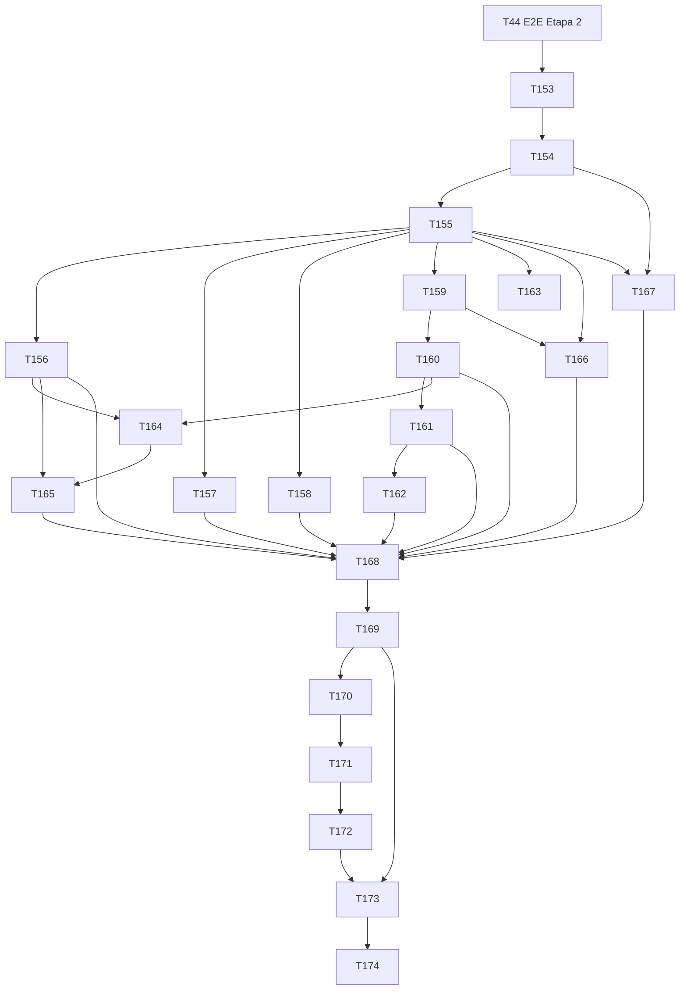

# Plano: etapa transversal "UI própria"

## 1. Objetivo

Garantir que **nenhum controle nativo do navegador apareça** em lugar nenhum do moneylog (seletores, calendários, checkboxes, `details`, tooltips, validação, diálogos do sistema), substituindo-os por componentes **próprios, acessíveis por teclado e leitor de tela, coerentes com o design** (calmo, premium, números tabulares, cantos de 12 a 18 px), com uma **guarda automática que falha se um controle nativo reaparecer**, uma **revisão de UX da jornada principal** (microinterações, foco, estados, mobile 375 px, iPhone Safari) e **testes de acessibilidade por teclado**.

Prioridade **alta**: roda **logo depois do T44** e **antes do frontend da Etapa 3**, em paralelo com o **backend** da Etapa 3 (sem conflito de arquivos: este plano só toca `frontend/`).

## 2. Escopo

### 2.1 Mapa do que existe hoje (levantamento no código, 2026-10-05)

| Ocorrência nativa                                             | Onde                                                                                                                                    | Substituto                                               | Task             |
| ------------------------------------------------------------- | --------------------------------------------------------------------------------------------------------------------------------------- | -------------------------------------------------------- | ---------------- |
| `<select>` ×2 (idioma, tema)                                  | `features/settings/pages/settings.page.html` linhas 9 e 20                                                                              | `Select`                                                 | T156, T169       |
| `<select>` ×6 (tipo, conta, categoria, método, status, lente) | `features/transactions/components/filters-bar/filters-bar.component.html`                                                               | `Select`                                                 | T156, T168       |
| `<input type="date">` ×3 (de, até, e o `DateField`)           | `filters-bar.component.html` linhas 30 e 41; `common/components/forms/date-field/date-field.component.ts` linha 33                      | `DatePicker` / `DateRangePicker`                         | T160, T162, T168 |
| `<input type="month">`                                        | `filters-bar.component.html` linha 73                                                                                                   | `MonthPicker`                                            | T161, T168       |
| `<input type="checkbox">`                                     | `filters-bar.component.html` linha 154 ("mostrar estornadas")                                                                           | `Checkbox`                                               | T157, T168       |
| `
`/`
` ×2                                    | `filters-bar.component.html` linha 2; `features/settings/pages/categories.page.html` linha 112                                          | `Disclosure`                                             | T158, T168, T169 |
| `<input type="search">` ×2                                    | `filters-bar` (busca) e `quick-add/components/refund-form`                                                                              | `SearchField`                                            | T167, T168, T169 |
| `title` como tooltip                                          | `segmented-control.component.html` (`[attr.title]`)                                                                                     | `Tooltip`                                                | T159, T169       |
| `<input type="password">` (revelar do Edge/Safari)            | `features/login/pages/login.page.html`                                                                                                  | `PasswordField` (ou `TextField` com alternância própria) | T167, T169       |
| Já próprios e que serão reaproveitados                        | `OptionSelect` (combobox de lista), `SegmentedControl`, `MoneyInput`, `TextField`, `ConfirmDialog`, `Toast`, `EmptyState`, `ErrorState` | evoluem/refatoram                                        | T156, T164       |

### 2.2 Entra

| #   | Entregável                                                                                                                                                                                                                                                                                  | Tasks      |
| --- | ------------------------------------------------------------------------------------------------------------------------------------------------------------------------------------------------------------------------------------------------------------------------------------------- | ---------- |
| A   | ADR-007, spike do primitivo de sobreposição e contrato de acessibilidade                                                                                                                                                                                                                    | T153       |
| B   | **Guarda automática** (script com baseline que só diminui + ESLint + guarda de runtime)                                                                                                                                                                                                     | T154       |
| C   | **Primitivos**: camada de sobreposição (`Popover`), foco, bloqueio de rolagem, tokens de z-index, UI Kit de desenvolvimento                                                                                                                                                                 | T155       |
| D   | **Componentes**: `Select`, `Checkbox`/`Switch`/`RadioGroup`, `Disclosure`, `Tooltip`, `DatePicker`, `MonthPicker`, `DateRangePicker`, `TimePicker`/`NumberStepper`, `Menu`/`Dialog`/`Sheet`, `Combobox`, `Tabs`/`Chip`/`ProgressBar`/`Skeleton`, `FilePicker`/`SearchField`/`PasswordField` | T156–T167  |
| E   | **Migração** das telas existentes e baseline zerado                                                                                                                                                                                                                                         | T168, T169 |
| F   | **Revisão de UX** da jornada principal e correções                                                                                                                                                                                                                                          | T170–T172  |
| G   | **Testes de acessibilidade por teclado** e validação final                                                                                                                                                                                                                                  | T173, T174 |

### 2.3 Não entra

- Biblioteca de componentes de terceiros e `@angular/cdk` (FE-S-113, FE-S-122); gradientes (DS 00; `check-styles` já os proíbe).
- Reescrever `MoneyInput`, `TextField`, `SegmentedControl` (só ajustes de acessibilidade se a auditoria pedir).
- Paleta de comandos (DS 01 E) e busca global: candidatos pós-MVP; os primitivos desta etapa (`Dialog`, `Combobox`) a viabilizam.
- Teste em **iPhone real** (depende do usuário, §7).

### 2.4 Regra de trabalho

- Só `frontend/` (e `docs/`). Nenhuma mudança em `backend/` nem em `contracts/`.
- **Todo componente novo:** `ControlValueAccessor` quando for campo (reaproveita `FieldControl`), `OnPush`, signals, i18n pt/en/es em `common.ui.*`, `data-cy` em tudo que é interativo, só tokens de `tokens.css` (sem cor literal, sem gradiente: `check-styles` verde), `prefers-reduced-motion` respeitado, `forced-colors` (alto contraste) legível, alvo de toque ≥ 44 px em ponteiro grosso, fonte ≥ 16 px em campos de entrada no mobile (sem zoom do Safari), números com `.num`, **página de demonstração no UI Kit** (`/dev/ui-kit`) com todos os estados, testes unitários (Testing Library + `user-event`) **inclusive por teclado**.
- Cada componente segue o **padrão WAI-ARIA APG** indicado na ADR-007 (T153).
- Cada task de componente passa pela revisão de código antes de a migração que o usa começar.

## 3. Perguntas em aberto e suposições

Numeração do frontend: **FE-S a partir de FE-S-112**.

| #        | Impacto | Suposição                                                                                                                                                                                                                                                                                                                                                                                                                                                                                                                                                                                                                                                                                                                                                                                                                             | Motivo                                                                                                         | Dono        | Tasks                  |
| -------- | ------- | ------------------------------------------------------------------------------------------------------------------------------------------------------------------------------------------------------------------------------------------------------------------------------------------------------------------------------------------------------------------------------------------------------------------------------------------------------------------------------------------------------------------------------------------------------------------------------------------------------------------------------------------------------------------------------------------------------------------------------------------------------------------------------------------------------------------------------------- | -------------------------------------------------------------------------------------------------------------- | ----------- | ---------------------- |
| FE-S-112 | alto    | **"Nenhum controle nativo" significa proibir**: `<select>`, `<datalist>`, `
/
`, `<progress>`, `<meter>`, `<dialog>`, `<input>` com `type` `date`, `month`, `week`, `time`, `datetime-local`, `checkbox`, `radio`, `range`, `color`, `number`, `search`, `file` (visível), `image`, `submit`, `reset`; atributo `title` (tooltip nativo), `popover`, `controls` (mídia), `list`; `<form>` sem `novalidate` (bolhas de validação do navegador); `window.alert/confirm/prompt`; seletores CSS `::-webkit-calendar-picker-indicator`, `::-webkit-datetime-edit*` e `accent-color`. **Permitidos:** `<input>` de texto (`text`, `email`, `password`, `tel`, `url`), `<textarea>`, `<button>`, `<a>`. Um `<input type="password">` não mostra o botão de revelar do navegador (suprimido por CSS; revelar é do componente) | é a leitura mais estrita do pedido; campo de texto é superfície de edição, não um controle com UI do navegador | Produto/UX  | T154, T167             |
| FE-S-113 | alto    | **Primitivo de sobreposição próprio** (`Popover` + `Dialog`/`Sheet`), sem `@angular/cdk`. Se o spike de T153 mostrar que o custo/risco de acessibilidade ou de iOS é maior que o de adotar o CDK, a ADR-007 registra a troca e **só T155 muda** (a API dos componentes não muda)                                                                                                                                                                                                                                                                                                                                                                                                                                                                                                                                                      | UI "própria" e dependências mínimas; o risco é isolado num primitivo                                           | Arquitetura | T153, T155             |
| FE-S-114 | alto    | **Guarda em duas camadas:** (1) script estático `scripts/check-native-controls.mjs` no `npm run lint`, baseado no AST do compilador de templates do Angular (não regex), com **baseline que só diminui** (cada ocorrência nativa existente entra num arquivo de baseline; achado novo falha; ocorrência corrigida e ainda listada também falha, para a lista só encolher) e **baseline vazio ao fim de T169**; mais regras ESLint (`no-restricted-globals` para `alert/confirm/prompt`); (2) teste Playwright de **runtime** que percorre as rotas (375 e 1280 px, claro e escuro) e falha se o DOM tiver algum elemento da lista de FE-S-112                                                                                                                                                                                         | uma só camada deixa passar templates dinâmicos; a de runtime pega o que o AST não vê                           | Arquitetura | T154, T174             |
| FE-S-115 | médio   | **Datas são strings** (`YYYY-MM-DD`, `YYYY-MM`, `HH:mm`) do começo ao fim; os pickers não usam `Date` com fuso para guardar valor (cálculo de calendário por aritmética de dias civis, `Date.UTC` só para dia da semana). Testes rodam com `TZ=America/Sao_Paulo`, `Pacific/Auckland` e `America/Los_Angeles`. "Hoje" vem de `~/util/date` (fuso do usuário, S-1)                                                                                                                                                                                                                                                                                                                                                                                                                                                                     | evitar o bug clássico de fuso e a divergência com o backend                                                    | Arquitetura | T160–T163              |
| FE-S-116 | médio   | **Mobile:** até 640 px (ou ponteiro grosso) listas e calendários abrem como **folha inferior** (`Sheet`) com botão de fechar, em vez de popover; campos de entrada com fonte ≥ 16 px; alvos ≥ 44 px; `visualViewport` para o teclado; `env(safe-area-inset-*)`; `100dvh`                                                                                                                                                                                                                                                                                                                                                                                                                                                                                                                                                              | iPhone Safari em primeiro lugar (PR 00)                                                                        | UX          | T155–T166              |
| FE-S-117 | médio   | **Campo de data digitável com máscara** `dd/mm/aaaa` (pt-BR), `mm/dd/yyyy` (en) e `dd/mm/aaaa` (es), `inputmode="numeric"`; o calendário é um atalho. Semana começa no **domingo** (pt, en) e **segunda** (es). Datas inválidas (31/02) mostram erro de campo, sem bolha nativa                                                                                                                                                                                                                                                                                                                                                                                                                                                                                                                                                       | velocidade de registro e teclado                                                                               | UX          | T160–T162              |
| FE-S-118 | baixo   | **Tooltip só complementa:** nada essencial vive só nele; no toque aparece por toque no ícone de ajuda ou pressão longa; sempre há texto visível ou `aria-label` equivalente                                                                                                                                                                                                                                                                                                                                                                                                                                                                                                                                                                                                                                                           | acessibilidade e mobile sem hover                                                                              | UX          | T159                   |
| FE-S-119 | médio   | **Única exceção nativa:** o `<input type="file">` **escondido** dentro do `FilePicker` (o seletor de arquivos é do sistema operacional; não existe como substituir). Fica na lista de permissões do script, restrita a `common/components/forms/file-picker/**`                                                                                                                                                                                                                                                                                                                                                                                                                                                                                                                                                                       | necessidade técnica                                                                                            | Arquitetura | T154, T167             |
| FE-S-120 | baixo   | **UI Kit** (`/dev/ui-kit`) existe só em builds de desenvolvimento e `mock` e **não entra** no build de produção (teste que procura o chunk e as rotas no `dist`)                                                                                                                                                                                                                                                                                                                                                                                                                                                                                                                                                                                                                                                                      | demonstração e testes sem risco                                                                                | Arquitetura | T155                   |
| FE-S-121 | médio   | **Sem gradientes** (nem em fade de rolagem ou skeleton): abas com overflow usam sombra/borda; `Skeleton` pulsa por opacidade; barras de progresso são sólidas                                                                                                                                                                                                                                                                                                                                                                                                                                                                                                                                                                                                                                                                         | DS 00 e `check-styles`                                                                                         | UX          | T166                   |
| FE-S-122 | baixo   | Sem `@angular/cdk`, sem biblioteca de ícones nova: reaproveita `app-icon` e acrescenta os ícones SVG necessários (calendário, relógio, check, setas, fechar, busca, olho) no mesmo conjunto                                                                                                                                                                                                                                                                                                                                                                                                                                                                                                                                                                                                                                           | consistência visual e tamanho do bundle                                                                        | UX          | T155                   |
| FE-S-123 | médio   | **i18n:** textos dos componentes (rótulos de teclado, nomes de meses/dias, "Hoje", "Limpar", "Fechar", anúncios de leitor de tela) em `common.ui.*` nos 3 idiomas, formatados com `Intl` no idioma ativo                                                                                                                                                                                                                                                                                                                                                                                                                                                                                                                                                                                                                              | S-34, FE 04                                                                                                    | Produto/UX  | T156–T167              |
| FE-S-124 | baixo   | O projeto Playwright **`webkit`** (dispositivo iPhone) é o melhor proxy automático do Safari, mas **não substitui** o iPhone real: a checagem em aparelho fica como pendência do usuário (§7)                                                                                                                                                                                                                                                                                                                                                                                                                                                                                                                                                                                                                                         | limite de automação                                                                                            | Produto     | T170, T174             |
| FE-S-125 | alto    | **`Dialog`, `Sheet` e `Menu` compõem o `OverlayPanel`** (não há segundo primitivo): `mode="modal"` + `layout` (`bottom`, `center`, `side`, `responsive-center`, `responsive-side`) dão diálogo, folha e painel lateral; `Menu` usa `mode="auto"` (popover em tela larga, folha até 640 px). `ConfirmDialog` passou a ser um `Dialog` com a mesma API e os mesmos `data-cy`. Camadas: modais (`mode="modal"`) em `--z-dialog` (50), folha/popover dos campos em `--z-popover` (60), então um `Select` aberto dentro de um diálogo fica por cima                                                                                                                                                                                                                                                                                        | T164 CA1/CA4 e revisão E3 §5 (um só primitivo)                                                                 | Arquitetura | T164                   |
| FE-S-126 | médio   | **`NumberStepper` é de inteiros de contagem** (parcelas 1 a 36, dia 1 a 31): campo de texto `inputmode="numeric"` com `role="spinbutton"`; só aceita dígitos (até 9, e `-` só com `min < 0`); `parseInt` sobre texto de dígitos (nunca `Number()`/ponto flutuante, nunca dinheiro). Valor fora de `min`/`max` não vira valor e o campo volta ao último valor válido ao sair. Os botões "−"/"+" são `tabindex="-1"` (o spinbutton já dá o teclado), têm 44 px e repetem ao segurar (400 ms, depois 160 ms acelerando até 40 ms). `valueText` é uma função do chamador (o plural fica no i18n da tela)                                                                                                                                                                                                                                  | T163 CA1 a CA3                                                                                                 | UX          | T163                   |
| FE-S-127 | médio   | **`Menu`:** `Tab` fecha e devolve o foco ao botão (não segue para o próximo elemento da página); `selected` só emite depois de fechar e devolver o foco (a ação escolhida, como abrir um diálogo, já encontra o foco no lugar certo e o Safari/iOS não perde o retorno); item com `checked` é `menuitemcheckbox` e mantém o menu aberto; item desabilitado é `aria-disabled` e pulado                                                                                                                                                                                                                                                                                                                                                                                                                                                 | T164 CA3                                                                                                       | UX          | T164                   |
| FE-S-128 | médio   | **`Tabs`:** ativação automática; painéis em `<ng-template appTabPanel="id">` montados na 1ª abertura e depois só ocultos (`hidden`), preservando o estado; sem painel o componente é só seletor (a rota troca o conteúdo); a sombra de rolagem é um pseudo-elemento de largura zero com `box-shadow` (blur), sem gradiente (FE-S-121)                                                                                                                                                                                                                                                                                                                                                                                                                                                                                                 | T166 CA1                                                                                                       | UX          | T166                   |
| FE-S-129 | médio   | **`ProgressBar`:** `value` é a razão 0..1 **do backend**; `aria-valuenow` é só a mesma razão em 0..100 arredondada para o leitor de tela (apresentação, não cálculo). `warning` e `risk` mostram o texto "Atenção"/"Risco" (`form.progress`, genérico) antes do texto formatado pelo chamador, e o `aria-valuetext` repete o estado; indeterminado (`value=null`) fica estático com `prefers-reduced-motion`                                                                                                                                                                                                                                                                                                                                                                                                                          | T166 CA3                                                                                                       | UX          | T166                   |
| FE-S-130 | baixo   | **`RadioGroup`** (T157) é `button role="radio"` com roving tabindex (APG), mostra a `hint` de cada opção (visível, diferente do `SegmentedControl`, que a põe em tooltip) e tem três layouts (`vertical`, `horizontal`, `cards`)                                                                                                                                                                                                                                                                                                                                                                                                                                                                                                                                                                                                      | T157 CA3                                                                                                       | UX          | T157                   |
| FE-S-131 | baixo   | **Numeração:** o prompt desta etapa pediu FE-S a partir de 121, mas 121 a 124 já existiam neste plano; as novas começam em **125** para não duplicar números                                                                                                                                                                                                                                                                                                                                                                                                                                                                                                                                                                                                                                                                          | rastreabilidade                                                                                                | Arquitetura | T157, T163, T164, T166 |
| FE-S-132 | baixo   | **Tooltip "hoverable"** (WCAG 1.4.13): o balão aceita o ponteiro (sem `pointer-events: none`) e fica 150 ms depois de o ponteiro sair do gatilho, para dar tempo de alcançá-lo. **`Disclosure`:** o botão fica dentro de um `role="heading"` (nível 2 por padrão, `headingLevel`)                                                                                                                                                                                                                                                                                                                                                                                                                                                                                                                                                     | revisão da UI B3/B4                                                                                            | UX          | T159, T158             |

## 4. Contratos de acessibilidade por componente (resumo; a ADR-007 detalha)

| Componente          | Padrão APG                    | Teclado essencial                                       |
| ------------------- | ----------------------------- | ------------------------------------------------------- |
| `Select`            | select-only combobox          | Setas, Home/End, Enter/Espaço, Esc, digitar para buscar |
| `Combobox`          | editable combobox com listbox | digitar filtra, Setas, Enter escolhe, Esc fecha/limpa   |
| `Checkbox`/`Switch` | checkbox / switch             | Espaço alterna                                          |
| `RadioGroup`        | radiogroup (roving tabindex)  | Setas movem e escolhem, Tab entra/sai                   |
| `Disclosure`        | disclosure                    | Enter/Espaço                                            |
| `Tooltip`           | tooltip                       | aparece no foco, Esc fecha                              |
| `DatePicker`        | date picker dialog (grid)     | setas, PageUp/Down, Home/End, Enter, Esc, digitar       |
| `MonthPicker`       | grid de meses                 | setas, PageUp/Down (ano), Enter, Esc                    |
| `DateRangePicker`   | grid + dois campos            | como o `DatePicker` e dois toques/Enter                 |
| `TimePicker`        | spinbutton + listbox          | Setas, digitar, Enter                                   |
| `NumberStepper`     | spinbutton                    | Setas, PageUp/Down, Home/End                            |
| `Menu`              | menu button                   | Enter/Setas abre, Setas navegam, Esc, digitar           |
| `Dialog`/`Sheet`    | modal dialog                  | Tab preso, Esc, foco volta ao gatilho                   |
| `Tabs`              | tabs (ativação automática)    | Setas, Home/End                                         |
| `Chip`              | toggle button                 | Espaço/Enter                                            |
| `ProgressBar`       | progressbar/meter             | (informativo)                                           |
| `FilePicker`        | botão + status                | Enter/Espaço abre o seletor                             |

## 5. Tasks

> Convenções do frontend da Etapa 2 (`docs/planos/2026-10-04-etapa-2-contas-movimentacoes.md` §5): `npm run lint`, `lint:deps`, `typecheck`, `test`, `build` verdes; OnPush; sem texto fixo; `data-cy`; Testing Library; e2e Playwright.
> **Cada task de componente** entrega: componente + testes unitários (incluindo teclado) + entrada no UI Kit + i18n + documentação de uso em `frontend/src/app/common/components/README.md`. **Cenário comum:** viewport 1280 px e 375 px; claro e escuro; pt-BR.
> A definição de pronto do PR 02 vale para todas.

---

### T153 · dev-frontend · ADR-007, spike do primitivo de sobreposição e contrato de acessibilidade (documentação + spike descartável)

**Objetivo:** decidir (FE-S-113) entre primitivo próprio e `@angular/cdk`, medir o custo e fixar o contrato de acessibilidade de cada componente (§4).

**Arquivos/camadas:** `docs/adrs/ADR-007-ui-propria-sem-controles-nativos.md`, `docs/qa/evidencias/ui-propria/spike/` (capturas e medições). O código do spike não é mesclado.

**Critérios de aceite**

1. **Dado** o spike, **então** compara (em Chromium e WebKit) um popover ancorado, um foco preso e um bloqueio de rolagem **próprios** contra o equivalente do CDK em: tamanho do bundle (KB gzip), comportamento no iOS (teclado, `visualViewport`, rubber-band, rolagem de fundo), acessibilidade (leitor de tela simulado por `ariaSnapshot`) e esforço; **a decisão e os números** ficam na ADR.
2. **Dado** a ADR, **então** registra: FE-S-112 (lista exata de proibidos e permitidos), FE-S-113, FE-S-114, a tabela de padrões APG (§4), o plano de z-index (`--z-popover`, `--z-dialog`, `--z-toast`) e a estratégia de i18n dos componentes.
3. **Dado** a ADR, **então** define como cada componente trata: toque × ponteiro fino, `forced-colors`, `prefers-reduced-motion` e idiomas pt/en/es.
4. **Dado** as alternativas (CDK, Radix-like headless, bibliotecas de UI), **então** ficam registradas com o motivo da recusa.

**Depende de:** T44 (E2E da Etapa 2 concluído; o front fica estável).

### T154 · dev-frontend · Guarda automática de controles nativos (com baseline que só diminui)

**Objetivo:** `scripts/check-native-controls.mjs` no `npm run lint` (FE-S-112, FE-S-114), regras ESLint e o teste de runtime (esqueleto; roda cheio em T174).

**Arquivos/camadas:** `frontend/scripts/check-native-controls.mjs`, `frontend/scripts/native-controls.baseline.json`, `frontend/scripts/native-controls.allowlist.json`, `frontend/scripts/__fixtures__/native-controls/`, `frontend/scripts/check-native-controls.spec.mjs` (Vitest), `frontend/eslint.config.js`, `frontend/package.json` (`lint`), `frontend/e2e/native-controls.e2e.ts`, `frontend/README.md` (como funciona e como justificar uma exceção).

**Critérios de aceite**

1. **Dado** o script, **então** usa o analisador de templates do Angular (`@angular/compiler`, já dependência) para ler os `.html` e os templates inline dos `.ts` (não regex), e detecta, com `arquivo:linha`: elementos `select`, `datalist`, `details`, `summary`, `progress`, `meter`, `dialog`; `input` com `type` proibido (estático) **ou** `[type]`/`[attr.type]` dinâmico (não verificável: falha, a menos que permitido); atributos `title`, `[title]`, `[attr.title]`, `popover`, `controls`, `list`; `<form>` sem `novalidate`; em `.ts`/`.css`: `window.alert/confirm/prompt`, `showPicker(`, `document.createElement('select'|'details'|...)`, `::-webkit-calendar-picker-indicator`, `::-webkit-datetime-edit`, `accent-color`.
2. **Dado** o baseline inicial, **então** lista as ocorrências existentes (as 18 do mapa de §2.1 (8 `select`, 3 `type=date`, 1 `type=month`, 1 `checkbox`, 2 `details`, 2 `type=search`, 1 `title`), por arquivo + regra + contagem) e o script **passa** hoje; **dado** uma ocorrência **nova** (fixture/`select` em um componente novo), **então** o script **falha** com a mensagem do local e a alternativa (`use app-select`).
3. **Dado** uma ocorrência do baseline que foi corrigida mas continua listada, **então** o script **falha** pedindo remover a linha do baseline (a lista só encolhe).
4. **Dado** a lista de permissões, **então** só aceita `{ arquivo, regra, motivo, responsável }` com motivo preenchido; a única entrada inicial é o `<input type="file">` do `FilePicker` (FE-S-119), restrita ao caminho `common/components/forms/file-picker/**` (T167).
5. **Dado** as fixtures (`bad/` com cada regra e `good/` com os componentes próprios), **então** o teste do script prova que **cada regra dispara** e que `good/` não dispara (a guarda tem teste de si mesma).
6. **Dado** o ESLint, **então** `no-restricted-globals`/`no-restricted-properties` proíbem `alert`, `confirm`, `prompt` (inclusive `window.`) com a mensagem "use ConfirmDialog/Dialog"; `npm run lint` roda os dois e continua verde.
7. **Dado** o teste de runtime (`e2e/native-controls.e2e.ts`, projeto `mock`), **então** percorre as rotas do roteador, abre os controles próprios existentes e falha se o DOM contiver `select, datalist, details, progress, meter, dialog, input[type=date|month|week|time|datetime-local|checkbox|radio|range|color|number|search|image|submit|reset]`, `[title]` (exceto `<title>` de SVG), `[popover]` ou algum evento `dialog` do navegador (`alert/confirm/prompt`); fora do `FilePicker` o `input[type=file]` também falha. Nesta task o teste usa o **mesmo baseline** (rotas com ocorrências conhecidas ficam marcadas e diminuem junto); em T174 ele roda sem baseline.
8. **Dado** o `lint-staged`/pre-commit, **então** o script roda nos arquivos alterados (`.html`, `.ts`, `.css`).

**Depende de:** T153 (lista de FE-S-112 aprovada).

### T155 · dev-frontend · Primitivos: sobreposição (`Popover`), foco, rolagem, tokens e UI Kit

**Objetivo:** a base dos componentes: serviço/diretiva de sobreposição ancorada, utilitários de foco e de bloqueio de rolagem, tokens de camada e a rota `/dev/ui-kit`.

**Arquivos/camadas:** `src/app/common/components/overlay/{overlay-root.component, popover.directive, popover-positioner.ts, focus-trap.ts, scroll-lock.ts, live-announcer.service.ts}`, `src/app/app.html`/`app.ts` (`
`), `src/styles/tokens.css` (`--z-popover`, `--z-dialog`, `--z-toast`, `--shadow-popover`), ícones novos, `src/app/features/dev-ui-kit/*`, `src/app/app.routes.ts` (rota só em dev/mock), `README.md`, testes.

**Critérios de aceite**

1. **Dado** um gatilho, **quando** abre um popover, **então** o conteúdo vai para `#overlay-root` (portal), posiciona-se com a opção pedida (`bottom-start`, `bottom-end`, `top-start`...), **vira** para o lado com espaço (flip) e se **desloca** para caber (shift) dentro de `visualViewport`, com `max-height` pela área disponível.
2. **Dado** rolagem de página, redimensionamento, teclado virtual aberto e rotação, **então** o popover reposiciona (`ResizeObserver`, `visualViewport`) sem tremer; no iOS o teclado não cobre o popover aberto a partir de um campo.
3. **Dado** clique/toque fora ou `Esc`, **então** fecha e devolve o foco ao gatilho; um popover aninhado fecha só o do topo (pilha).
4. **Dado** `focus-trap` e `scroll-lock` (para `Dialog`/`Sheet`), **então** Tab não escapa do trap, o fundo recebe `inert`, a rolagem do fundo é travada inclusive no iOS (sem pular para o topo ao fechar) e restaura o scroll.
5. **Dado** `LiveAnnouncer`, **então** uma região `aria-live="polite"` anuncia mensagens (mês trocado, "3 resultados") sem repetir.
6. **Dado** `prefers-reduced-motion`, **então** nenhuma transição de entrada/saída; `forced-colors`, **então** bordas e foco visíveis.
7. **Dado** o UI Kit (`/dev/ui-kit`), **então** lista cada componente com todos os estados (normal, foco, hover, desabilitado, erro, carregando, vazio, longo), tema claro/escuro, 375 e 1280 px; o **build de produção não contém** a rota nem o chunk (teste no `dist`, FE-S-120).
8. **Dado** `npm run lint`, `lint:deps`, `typecheck` e `build`, **então** verdes; sem cor literal nem gradiente.

**Depende de:** T153, T154.

### T156 · dev-frontend · `Select` (evolução do `OptionSelect`) e migração de Configurações

**Objetivo:** promover o `OptionSelect` a `Select` público, usando o `Popover` (portal, flip) e a folha inferior no mobile, e migrar os 2 `<select>` de Configurações.

**Arquivos/camadas:** `src/app/common/components/forms/select/*` (renomeia/evolui `option-select`; **mantém o seletor antigo como alias** até T169 para não quebrar telas), `features/settings/pages/settings.page.html/ts`, i18n, UI Kit, testes.

**Critérios de aceite**

1. **Dado** o `Select`, **então** é `ControlValueAccessor` com `options`, `placeholder`, `mandatory`, `clearable`, `size` (`default`/`compact`, para a barra de filtros), `disabled`, **opção desabilitada** com `hint`, **grupos** (`ChoiceGroup` com rótulo) e `invalid`; valor `string | null`.
2. **Dado** teclado, **então** segue o padrão select-only combobox: Enter/Espaço/ArrowDown abre; Setas/Home/End movem (pulando desabilitadas); digitar (type-ahead de 500 ms, sem acento) vai à opção; Enter escolhe; Esc fecha e volta o foco; Tab só fecha (não escolhe a opção ativa; conservador); `aria-activedescendant`, `aria-expanded`, `aria-selected`.
3. **Dado** 375 px/ponteiro grosso, **então** abre como `Sheet` com a lista rolável, título (rótulo do campo) e botão "Fechar"; a opção selecionada fica visível ao abrir; alvo de cada opção ≥ 44 px.
4. **Dado** lista longa (200 opções), **então** abre sem travar (virtualização ou `content-visibility`) e mantém o foco na ativa.
5. **Dado** a posição, **então** o painel nunca fica cortado por `overflow: hidden` de um pai (portal) nem sai da tela (flip/shift).
6. **Dado** Configurações, **então** idioma e tema usam `Select`; trocar aplica na hora (comportamento atual) e o foco permanece no campo; nenhum `<select>` resta em `settings.page.html`; o baseline perde 2 entradas (script verde).
7. **Dado** leitor de tela (snapshot de acessibilidade), **então** nome acessível = rótulo, papel combobox, valor atual anunciado, lista como `listbox` com contagem.
8. **Dado** erro de campo e `touched`, **então** mostra o erro (padrão de T32) e `aria-invalid`.

**Depende de:** T155.

### T157 · dev-frontend · `Checkbox`, `Switch` e `RadioGroup`

**Objetivo:** controles de escolha próprios, acessíveis e coerentes com o design.

**Arquivos/camadas:** `src/app/common/components/forms/{checkbox, switch, radio-group}/*`, i18n, UI Kit, testes.

**Critérios de aceite**

1. **Dado** `Checkbox` (CVA `boolean`, com `indeterminate`), **então** é um `button role="checkbox"` com `aria-checked` (`true|false|mixed`), rótulo clicável (a área inteira do rótulo alterna), Espaço alterna, foco visível, desenho SVG próprio (cantos de 6 px, borda e preenchimento por tokens, o "check" sem animação com `reduced-motion`).
2. **Dado** `Switch` (CVA `boolean`), **então** `role="switch"`, `aria-checked`, estado em texto opcional ("Ligado/Desligado") e **nunca** só por cor (posição do botão + ícone/rótulo), alvo ≥ 44 px no toque.
3. **Dado** `RadioGroup` (CVA do valor), **então** `role="radiogroup"` com `aria-labelledby`, **roving tabindex**: Tab entra no selecionado (ou no primeiro), Setas movem **e** selecionam (padrão APG), Home/End, itens desabilitados pulados; variante vertical (lista) e em cartões.
4. **Dado** desabilitado e erro (`invalid` com `aria-describedby`), **então** estilo e semântica corretos; `forced-colors` mostra o estado.
5. **Dado** formulário reativo, **então** `disabled`, `touched` (no blur) e `valueChanges` funcionam; erro só depois de `touched`.
6. **Dado** uso em listas longas (50 checkboxes), **então** sem custo perceptível (OnPush).
7. **Dado** testes de teclado, **então** cada padrão do §4 é exercitado por `user-event` (Tab, Espaço, Setas).

**Depende de:** T155.

**Status (2026-10-06):** `RadioGroup` entregue (`forms/radio-group`, FE-S-130); `Checkbox` e `Switch` já existiam. Pendente: `indeterminate` do `Checkbox` (CA1).

### T158 · dev-frontend · `Disclosure` (e acordeão)

**Objetivo:** substituir `
/
`.

**Arquivos/camadas:** `src/app/common/components/disclosure/*`, i18n, UI Kit, testes.

**Critérios de aceite**

1. **Dado** `app-disclosure`, **então** o cabeçalho é um `<button>` com `aria-expanded` e `aria-controls`, a região tem `role="region"` (ou `group`) com `aria-labelledby`, conteúdo oculto não é focável (`inert`/`hidden` após a transição).
2. **Dado** `open` (two-way por `model()`), **então** controla de fora (a barra de filtros abre por URL/estado) e emite `openChange`.
3. **Dado** a animação, **então** altura por `grid-template-rows: 0fr → 1fr` (sem medir em JS), 180 ms, **desligada** com `prefers-reduced-motion`.
4. **Dado** o ícone (chevron) e o texto, **então** o estado aberto/fechado nunca depende só do ícone (`aria-expanded` + texto acessível opcional).
5. **Dado** `app-accordion` (grupo), **então** modo `single` (abre um, fecha os outros) e `multiple`; Setas/Home/End entre cabeçalhos (opcional, APG).
6. **Dado** conteúdo com foco interno e o painel fechando, **então** o foco volta ao cabeçalho.
7. **Dado** impressão/SSR-less, **então** o conteúdo é montado só quando aberto (opção `lazy`) ou sempre (padrão), documentado.

**Depende de:** T155.

### T159 · dev-frontend · `Tooltip`

**Objetivo:** dica de ajuda própria no lugar de `title`.

**Arquivos/camadas:** `src/app/common/components/tooltip/{tooltip.directive, tooltip.component}`, `segmented-control` (remove `[attr.title]`), i18n, UI Kit, testes.

**Critérios de aceite**

1. **Dado** `appTooltip="texto"` num elemento focável, **então** aparece no **hover** (atraso de 400 ms; sem atraso ao passar de um tooltip a outro) e no **foco por teclado** (`:focus-visible`), some no `Esc`, no blur, no scroll e ao sair do hover (com tolerância de 100 ms para entrar no balão); `role="tooltip"` e `aria-describedby` no elemento.
2. **Dado** toque (sem hover), **então** não aparece ao toque simples (não rouba o clique); aparece com **pressão longa (500 ms)** ou com a variante `trigger="tap"` num ícone de ajuda (botão com `aria-label`); some ao tocar fora.
3. **Dado** o conteúdo, **então** é texto curto (≤ 120 caracteres; mais que isso é erro de desenvolvimento no modo dev), não interativo, sem HTML.
4. **Dado** a posição, **então** usa o `Popover` com flip/shift, seta discreta opcional, cantos de 10 px, contraste AA nos dois temas (`check-contrast` com o par novo).
5. **Dado** `SegmentedControl`, **então** a dica das opções (`hint`) usa `Tooltip` **e** a informação essencial continua em texto visível/`aria-describedby` (FE-S-118); nenhum `title` resta (script verde, baseline −1).
6. **Dado** leitor de tela, **então** o texto é anunciado como descrição do elemento sem duplicar o nome.
7. **Dado** `prefers-reduced-motion`, **então** aparece sem animação.

**Depende de:** T155.

### T160 · dev-frontend · `DatePicker` (campo de data com calendário) e substituição do `DateField`

**Objetivo:** campo de data digitável com máscara e calendário próprio, substituindo o `<input type="date">` do `DateField` (mantendo a API de `DateField` para não quebrar as telas).

**Arquivos/camadas:** `src/app/common/components/forms/date-picker/{date-picker.component, calendar-grid.component, calendar-math.ts}`, `date-field` (passa a delegar ao `DatePicker`), `src/util/date.ts` (utilitários puros novos), i18n, UI Kit, testes.

**Critérios de aceite**

1. **Dado** o valor `YYYY-MM-DD` (CVA `string | null`), **então** o campo mostra a máscara do idioma (FE-S-117: `dd/mm/aaaa` em pt-BR), aceita digitação com formatação automática (`inputmode="numeric"`), e **valida** (31/02, 00/00/0000, fora de `min`/`max`) como erro de campo com texto próprio (sem bolha nativa).
2. **Dado** o botão de calendário (nome acessível "Abrir calendário"), **então** abre um popover (desktop) ou `Sheet` (mobile) com a grade do mês, **mês e ano** no cabeçalho (botões para ir ao mês anterior/seguinte e ao seletor de mês/ano), "Hoje" e "Ontem" como atalhos, dias de fora do intervalo **desabilitados** (`aria-disabled`), hoje destacado e o selecionado com `aria-selected`.
3. **Dado** teclado na grade (`role="grid"`, roving tabindex): ← → ↑ ↓ movem 1 dia/1 semana, Home/End início/fim da semana, PageUp/PageDown mês, Shift+PageUp/PageDown ano, Enter/Espaço seleciona, Esc fecha **sem** alterar e devolve o foco ao campo; ao trocar de mês o `LiveAnnouncer` anuncia "outubro de 2026".
4. **Dado** a aritmética de calendário (FE-S-115), **então** é por dias civis, **sem** `Date` local para guardar valor; testes parametrizados com 5 anos (inclusive 29/02), virada de ano, semana começando domingo/segunda, e executados com `TZ=America/Sao_Paulo`, `Pacific/Auckland` e `America/Los_Angeles` (resultado idêntico).
5. **Dado** `todayIso()` (fuso do usuário), **então** "Hoje" e o destaque usam essa data, não a do dispositivo quando diferirem (teste com fuso forçado).
6. **Dado** o `DateField` existente, **então** continua com a **mesma API** (`min`, `max`, `mandatory`, `hint`, `label`) e os formulários da Etapa 2 passam **sem alteração de teste** além dos seletores; nenhum `type="date"` resta em `date-field.component.ts` (baseline −1).
7. **Dado** 375 px, **então** o `Sheet` mostra a grade com células ≥ 44 px, sem rolagem horizontal; o campo tem fonte ≥ 16 px; abrir o calendário não abre o teclado virtual.
8. **Dado** leitor de tela, **então** o diálogo tem nome ("Escolher data"), cada dia tem rótulo completo ("sábado, 10 de outubro de 2026") e `aria-current="date"` no hoje.

**Depende de:** T155, T159. (Até T164 existir, o mobile usa o `Popover` em tela cheia; **T164 troca para `Sheet`**.)

### T161 · dev-frontend · `MonthPicker`

**Objetivo:** seletor de competência `YYYY-MM` (substitui `type="month"`).

**Arquivos/camadas:** `src/app/common/components/forms/month-picker/*`, `calendar-math.ts` (reuso), i18n, UI Kit, testes.

**Critérios de aceite**

1. **Dado** o valor `YYYY-MM` (CVA), **então** o campo mostra "outubro de 2026" (por `Intl`, no idioma) ou a máscara `mm/aaaa`; digitável com validação; botão para abrir.
2. **Dado** o popover/`Sheet`, **então** mostra o ano com setas "anterior/seguinte" e uma grade de 12 meses (`role="grid"`), mês atual destacado, "Este mês" como atalho, meses fora de `min`/`max` desabilitados.
3. **Dado** teclado, **então** ← → ±1 mês, ↑ ↓ ±3 meses, PageUp/PageDown ±1 ano, Home/End jan/dez, Enter seleciona, Esc fecha; anuncia o ano ao trocar.
4. **Dado** os testes de fuso (FE-S-115), **então** idênticos em 3 fusos; virada de ano correta.
5. **Dado** a barra de filtros (T168) e o resumo mensal (Etapa 5), **então** usam o componente com `min`/`max` opcionais.
6. **Dado** 375 px e leitor de tela, **então** alvos ≥ 44 px, rótulo "Escolher mês" e cada mês com nome completo.

**Depende de:** T160 (math e padrões), T155.

### T162 · dev-frontend · `DateRangePicker`

**Objetivo:** intervalo de datas com atalhos (substitui os dois `type="date"` de "de/até").

**Arquivos/camadas:** `src/app/common/components/forms/date-range-picker/*`, reuso de `calendar-grid`, i18n, UI Kit, testes.

**Critérios de aceite**

1. **Dado** o valor `{ from, to }` (strings `YYYY-MM-DD`, ambos opcionais), **então** dois campos digitáveis (início e fim) com a mesma máscara e validação; `from > to` é corrigido por troca **e** avisado ("as datas foram invertidas") ou marcado como erro conforme o formulário (parâmetro), nunca silencioso.
2. **Dado** o calendário, **então** seleção em **dois passos** (primeiro o início, depois o fim), pré-visualização do intervalo ao mover o ponteiro/setas, intervalo destacado por fundo (não só cor: bordas de início/fim), e o `LiveAnnouncer` diz "início selecionado 10 de outubro; escolha o fim".
3. **Dado** os atalhos ("Este mês", "Mês passado", "Últimos 30 dias", "Este ano", "Limpar"), **então** preenchem o intervalo pelos cálculos de `calendar-math` (datas civis, no fuso do usuário) e fecham.
4. **Dado** teclado, **então** setas movem o dia focado, Enter define o início e depois o fim, Esc cancela a seleção em andamento (primeiro Esc) e fecha (segundo), Tab percorre campos → atalhos → grade.
5. **Dado** `maxRange` opcional (ex.: 366 dias), **então** dias além são desabilitados com explicação acessível.
6. **Dado** 375 px, **então** `Sheet` com um mês por vez e os atalhos em linha rolável (sem fade em gradiente); botão "Aplicar".
7. **Dado** os testes de fuso e de virada de ano, **então** idênticos em 3 fusos.

**Depende de:** T160, T161.

### T163 · dev-frontend · `TimePicker` e `NumberStepper`

**Objetivo:** hora `HH:mm` (horário do resumo e lembretes, Etapa 7) e contador numérico (parcelas, dias do cartão, intervalos), substituindo `type="time"` e `type="number"`.

**Arquivos/camadas:** `src/app/common/components/forms/{time-picker, number-stepper}/*`, i18n, UI Kit, testes.

**Critérios de aceite**

1. **Dado** `NumberStepper` (CVA `number | null`), **então** campo de texto `inputmode="numeric"` com botões "−" e "+" (nomes acessíveis "Diminuir"/"Aumentar"), `min`, `max`, `step`, valor inválido volta ao último válido ao sair do campo; `role="spinbutton"` com `aria-valuenow/min/max`.
2. **Dado** teclado, **então** ↑/↓ ±step, PageUp/PageDown ±10 steps, Home/End min/max; **segurar** o botão repete com aceleração (e cancela ao soltar/blur); no toque, alvos ≥ 44 px.
3. **Dado** o uso para parcelas (1 a 36) e dias (1 a 31), **então** funciona com `min/max` e mostra o limite no `aria-valuetext` ("6 parcelas").
4. **Dado** `TimePicker` (CVA `HH:mm | null`), **então** campo com máscara `hh:mm` (24 h), validação, e popover/`Sheet` com duas listas (horas e minutos, passo configurável: 5/15/30) navegáveis por setas, Enter confirma, Esc fecha; sem AM/PM no MVP (pt/es), `en` também 24 h (documentado).
5. **Dado** valores de borda (23:59, 00:00), **então** corretos; digitar `7` **não** completa sozinho (espera o resto), `730` vira `07:30` e `2460` é inválido; testes parametrizados.
6. **Dado** nenhum `type="number"`/`type="time"` no código (script verde).

**Depende de:** T155.

**Status (2026-10-06):** `NumberStepper` entregue (`forms/number-stepper`, FE-S-126), pronto para parcelas (1 a 36) e dias (1 a 31). **Pendente:** `TimePicker` (CA4 e CA5), que a Etapa 7 exige; não bloqueia o G-UI-E3.

### T164 · dev-frontend · `Menu`, `Dialog` e `Sheet` (e refatoração do `ConfirmDialog`)

**Objetivo:** menu de ações, diálogo modal e folha inferior/painel, sobre o foco preso e a rolagem travada.

**Arquivos/camadas:** `src/app/common/components/{menu, dialog, sheet}/*`, `confirm-dialog` (passa a usar `Dialog`, mesma API pública e `data-cy`), `DatePicker`/`Select` (trocam o fallback mobile para `Sheet`), i18n, UI Kit, testes.

**Critérios de aceite**

1. **Dado** `Dialog`, **então** é modal (`role="dialog"`/`alertdialog` configurável, `aria-modal`, `aria-labelledby/describedby`), foco inicial configurável (primeiro campo ou o botão seguro), foco **preso**, fundo `inert`, rolagem travada, `Esc` fecha (a menos que `dismissable=false`), clique no fundo fecha só se permitido, **foco volta** ao gatilho ao fechar, pilha de diálogos aninhados.
2. **Dado** `Sheet`, **então** é um `Dialog` ancorado embaixo (≤ 640 px) com cantos de 18 px no topo, `max-height` de 90 `dvh`, rolagem interna, respeito a `safe-area-inset-bottom` e ao teclado (`visualViewport`), botão "Fechar"; no desktop vira painel central/lateral (parâmetro).
3. **Dado** `Menu` (botão + `role="menu"`), **então** Enter/Espaço/↓ abrem e focam o primeiro item, ↑ ↓ navegam (circular), Home/End, digitar pula ao item, Esc fecha e devolve o foco, Tab fecha; itens `role="menuitem"` (e `menuitemcheckbox` quando houver), desabilitado pulado, item **destrutivo** com estilo de risco e texto (não só cor); no mobile abre como `Sheet`.
4. **Dado** o `ConfirmDialog` refatorado, **então** o comportamento e **todos os testes da Etapa 2** continuam verdes sem mudar os `data-cy`; exige motivo (`requireReason`) como antes.
5. **Dado** leitor de tela, **então** o título é anunciado ao abrir e o conteúdo atrás não é lido.
6. **Dado** iOS Safari (WebKit), **então** abrir/fechar não pula a rolagem, não deixa o fundo rolar e o input do diálogo não é coberto pelo teclado.
7. **Dado** `Select` e `DatePicker`, **então** passam a abrir `Sheet` no mobile (substitui o fallback provisório de T156/T160), com os testes atualizados.

**Depende de:** T155, T156, T160.

**Status (2026-10-06):** `Dialog`, `Sheet` e `Menu` entregues, compostos do `OverlayPanel` (FE-S-125, FE-S-127); `ConfirmDialog` refatorado sobre o `Dialog` com a mesma API e os mesmos `data-cy`; `focus-trap.ts` extraído. **Pendente:** `Select`/`DatePicker` já abrem a folha do `OverlayPanel` (CA7 cumprido na prática); teste manual do teclado virtual no iPhone real.

### T165 · dev-frontend · `Combobox` (busca e escolha em listas longas ou remotas)

**Objetivo:** campo com digitação e lista filtrada, para categorias longas, pessoas, notas (`[[`) e vínculos.

**Arquivos/camadas:** `src/app/common/components/forms/combobox/*`, reuso do `Popover`/`Sheet`, i18n, UI Kit, testes.

**Critérios de aceite**

1. **Dado** `Combobox` (CVA do valor escolhido), **então** segue o padrão editable combobox: `role="combobox"`, `aria-autocomplete="list"`, `aria-controls`, `aria-activedescendant`; digitar filtra (sem acento/caixa) opções locais **ou** emite `search` (debounce 250 ms, cancelável) para fonte remota; `loading`, vazio ("nada encontrado") e erro com "tentar de novo".
2. **Dado** teclado, **então** ↑ ↓ movem, Enter escolhe, Esc fecha (segundo Esc limpa o texto), Tab fecha sem forçar escolha; o texto digitado **não** vira valor sem escolha (`allowFreeText=false`; com `true`, vira valor explícito).
3. **Dado** `clearable`, **então** botão "Limpar" com nome acessível e foco previsível.
4. **Dado** destaque do termo na lista (`<mark>` com contraste) e o anúncio de contagem de resultados (`LiveAnnouncer`: "3 resultados").
5. **Dado** 375 px, **então** `Sheet` com o campo de busca no topo (o teclado não cobre a lista).
6. **Dado** 5.000 opções locais, **então** responde em < 100 ms por tecla (virtualização/limite de render).
7. **Dado** itens agrupados e itens com `hint` (ex.: tipo da entidade), **então** renderizados e navegáveis.

**Depende de:** T156, T164.

### T166 · dev-frontend · `Tabs`, `Chip`, `ProgressBar` e `Skeleton`

**Objetivo:** abas, chips de filtro (DS 01), barra de progresso (limite, metas, importação) e esqueleto de carregamento.

**Arquivos/camadas:** `src/app/common/components/{tabs, chip, progress-bar, skeleton}/*`, i18n, UI Kit, testes.

**Critérios de aceite**

1. **Dado** `Tabs`, **então** `role="tablist"` com ativação automática, roving tabindex, ← → Home/End, `aria-selected`/`aria-controls`, painéis `role="tabpanel"` com `aria-labelledby`; aba ativa pode ir à URL (`?tab=`) por `input`/`output`; overflow rola na horizontal com **sombra/borda** nas bordas (sem gradiente, FE-S-121) e a aba ativa entra na vista ao focar.
2. **Dado** `Chip`, **então** variantes: **alternável** (`button aria-pressed`) e **removível** (`aria-label` "Remover filtro: Alimentação", Backspace/Delete remove com o foco indo ao próximo); `ChipGroup` com `role="group"` e rótulo; cantos `--radius-pill`; contagem opcional tabular.
3. **Dado** `ProgressBar`, **então** `role="progressbar"` (ou `meter` para limites) com `aria-valuenow/min/max` e `aria-valuetext` (texto formatado pelo chamador), `value` 0..1 **vindo do backend** (o componente nunca calcula dinheiro), variantes `default`/`warning`/`risk` **sempre com texto** (não só cor), indeterminado (importação) sem animação com `reduced-motion`, `forced-colors` legível; sem gradiente.
4. **Dado** `Skeleton`, **então** pulsa por **opacidade**, respeita `reduced-motion` (estático), tem `aria-hidden` e o contêiner `aria-busy`; formatos linha, bloco e linha de tabela.
5. **Dado** contraste, **então** `check-contrast` cobre os pares novos (chip ativo, barra, aviso) nos dois temas.
6. **Dado** teclado e 375 px, **então** tabs rolam sem cortar rótulos; chips quebram linha sem rolagem da página.

**Depende de:** T155, T159.

**Status (2026-10-06):** `Tabs` e `ProgressBar` entregues (FE-S-128, FE-S-129). **Pendente:** `Chip` e `Skeleton` (CA2 e CA4), que o G-UI-E3 não exige.

### T167 · dev-frontend · `FilePicker`, `SearchField` e `PasswordField`

**Objetivo:** entradas que hoje dependem de comportamento nativo: seletor de arquivo (única exceção, FE-S-119), campo de busca e campo de senha com revelar próprio.

**Arquivos/camadas:** `src/app/common/components/forms/{file-picker, search-field, password-field}/*`, `scripts/native-controls.allowlist.json` (entrada do `FilePicker`), i18n, UI Kit, testes.

**Critérios de aceite**

1. **Dado** `FilePicker` (CVA `File | null`), **então** botão "Escolher arquivo" + área de arrastar e soltar; o `<input type="file">` fica **escondido** (`hidden`, fora da ordem de tabulação) e acionado por `click()` do botão; `accept`, tamanho máximo e tipo validados como **erro de campo** (sem `alert`); mostra nome e tamanho do arquivo escolhido e "Remover".
2. **Dado** teclado, **então** Enter/Espaço no botão abre o seletor do sistema; arrastar mostra o estado de foco/alvo e anuncia "arquivo recebido"; só 1 arquivo (`multiple` opcional).
3. **Dado** o script de guarda, **então** o `input type="file"` só é aceito neste caminho (`common/components/forms/file-picker/**`) com o motivo registrado; em qualquer outro lugar falha.
4. **Dado** `SearchField`, **então** é `<input type="text" role="searchbox" enterkeyhint="search">` com ícone, botão "Limpar" próprio (aparece com texto), Esc limpa, `maxlength` configurável, debounce opcional; **não** usa `type="search"`.
5. **Dado** `PasswordField`, **então** `<input type="password">` com botão "Mostrar/Ocultar senha" próprio (`aria-pressed`, `aria-label` traduzido), o revelar nativo do Edge/Safari suprimido por CSS (`::-ms-reveal` e equivalentes **no CSS global, fora da lista de seletores proibidos**), `autocomplete` correto (`current-password`), sem registrar o valor em logs.
6. **Dado** os três, **então** CVA, erro só depois de `touched`, fonte ≥ 16 px no mobile e `data-cy`.

**Depende de:** T154, T155.

### T168 · dev-frontend · Migração da barra de filtros das movimentações

**Objetivo:** reescrever `filters-bar.component.html` sem nenhum controle nativo (6 `<select>`, 3 datas, 1 mês, 1 checkbox, `
`, busca), mantendo o comportamento (filtros ↔ URL, duas visões, `totals` do backend).

**Arquivos/camadas:** `src/app/features/transactions/components/filters-bar/*`, i18n, testes (unitários e e2e `transactions`), `scripts/native-controls.baseline.json` (remove as entradas).

**Critérios de aceite**

1. **Dado** a barra, **então** usa `Disclosure` (aberto/fechado por estado e `?filters=1` opcional), `SearchField`, `DateRangePicker` (visão Registros), `MonthPicker` (visão Por competência), `Select` ×(tipo, conta, categoria, método, status, lente) no tamanho `compact` e `Checkbox` ("mostrar estornadas"); `Combobox` para conta e categoria quando houver mais de 8 opções.
2. **Dado** os testes da Etapa 2 (T39), **então** passam com ajuste **apenas de seletores** (`data-cy` preservados quando possível); nenhuma regra de filtro mudou.
3. **Dado** filtros ativos, **então** aparecem como **chips removíveis** abaixo da barra (`Chip`, DS 01: "chips de filtro") com "Limpar tudo"; remover um chip atualiza URL e lista; contagem de filtros no cabeçalho do `Disclosure`.
4. **Dado** teclado, **então** o fluxo "abrir filtros → buscar → escolher tipo → escolher período → ver a lista" é feito só com teclado, com foco previsível e anúncios.
5. **Dado** 375 px, **então** a barra vira folha/painel com os mesmos campos (cada `Select`/picker abre `Sheet`), botão "Aplicar" visível sem rolar; 1280 px, grade compacta.
6. **Dado** o script de guarda, **então** o baseline perde todas as entradas de `filters-bar` e o script passa.
7. **Dado** a URL do F5, **então** restaura todos os filtros e os componentes mostram o valor correto (inclusive `?from&to`, `?competence`).

**Depende de:** T156, T157, T158, T160, T161, T162, T165, T166, T167.

### T169 · dev-frontend · Migração do restante e baseline zerado

**Objetivo:** remover as últimas ocorrências nativas e zerar o baseline.

**Arquivos/camadas:** `categories.page.html` (`
` → `Disclosure`), `refund-form` (`type="search"` → `SearchField`), `login.page.html` (`PasswordField`), `option-select` (remove o alias antigo e usa `Select`), `segmented-control` (sem `title`), todos os usos de `DateField`, `scripts/native-controls.baseline.json` (**vazio**), README.

**Critérios de aceite**

1. **Dado** o repositório, **então** `npm run lint` passa com o baseline **vazio** (somente a permissão do `FilePicker`); um `select` ou `type="date"` colocado de volta em qualquer template **falha o lint** (teste manual documentado + a suíte do script).
2. **Dado** Categorias, **então** "Arquivadas" usa `Disclosure` com contagem no cabeçalho e foco correto; os testes da Etapa 2 passam.
3. **Dado** o login, **então** o campo de senha usa `PasswordField` e a tela continua com `novalidate`; autofill do gerenciador de senhas funciona (atributos `autocomplete`).
4. **Dado** `OptionSelect`, **então** nenhuma referência ao nome antigo resta (`grep`) e a API pública está documentada no README de componentes.
5. **Dado** todos os `<form>`, **então** têm `novalidate` (regra do script) e erros por campo (T32).
6. **Dado** a suíte unitária e e2e (`mock`, `prod`), **então** verde, sem snapshots quebrados sem justificativa.
7. **Dado** o teste de runtime (T154 CA7), **então** passa **sem baseline** em todas as rotas existentes.

**Depende de:** T156, T157, T158, T159, T160, T164, T166, T167, T168.

### T170 · tester · Auditoria de UX: evidências da jornada principal

**Objetivo:** capturar a jornada principal e coletar métricas para a revisão (T171).

**Arquivos/camadas:** `frontend/e2e/ux-journey.e2e.ts` (evidências com `E2E_EVIDENCE=1`), projeto Playwright **`webkit`** (dispositivo iPhone) acrescentado a `playwright.config.ts`, `docs/qa/evidencias/ui-propria/`, `docs/qa/AAAA-MM-DD-qa-ux-ui-propria.md`.

**Critérios de aceite**

1. **Dado** a jornada **abrir o app → login → Início → Novo registro (Pix, R$ 35, almoço) → Movimentações com filtros e as duas visões → detalhe → estorno com motivo → Contas → Configurações (idioma e tema)**, **então** captura cada passo em 375 e 1280 px, claro e escuro, Chromium e **WebKit (iPhone)**, mais um vídeo curto da jornada no mobile.
2. **Dado** cada passo, **então** registra: ordem de foco (sequência de `document.activeElement`), tempo até o primeiro feedback visual depois de uma ação (ms), presença de rolagem horizontal, tamanho dos alvos de toque (< 44 px listados), tamanho de fonte dos campos (< 16 px listados) e erros de console.
3. **Dado** estados, **então** captura carregando, vazio, erro com "tentar de novo", sucesso (toast), desabilitado com explicação e campo com erro, para as telas da jornada.
4. **Dado** teclado, **então** registra a jornada **sem mouse** (Tab/Shift+Tab/Enter/Esc) e onde o foco se perde ou fica preso.
5. **Dado** o relatório, **então** lista os achados objetivos com evidência (captura + dado), **sem** julgar: o parecer é do `revisor` (T171).

**Depende de:** T169. Etapa 2: T44.

### T171 · revisor · Revisão de UX da jornada principal

**Objetivo:** parecer com severidade sobre microinterações, foco, estados, mobile 375 px e iPhone Safari, contra o DS 00/DS 01 e o PR 02 (definição de pronto).

**Arquivos/camadas:** `docs/revisoes/AAAA-MM-DD-revisao-ux-ui-propria.md`.

**Critérios de aceite**

1. **Dado** as evidências, **então** o parecer avalia, com severidade (crítico/alto/médio/baixo) e referência ao DS: **microinterações** (transições 120–200 ms com `ease-out`, estados hover/pressed/focus coerentes, feedback imediato de toque, `touch-action: manipulation`, sem atraso de 300 ms, sem hover como única pista), **foco** (anel visível e consistente, ordem lógica, foco inicial e retorno em diálogos/popovers, nunca perdido), **estados** (carregando com esqueleto no lugar certo, vazio com ação, erro com "tentar de novo", sucesso discreto, desabilitado **com a razão**), **mobile 375** (sem rolagem horizontal, alvos ≥ 44, safe areas, barra inferior, teclado não cobre o botão de salvar, `100dvh`), **iPhone Safari** (fonte ≥ 16 px, sem zoom, rubber-band, modo standalone, barra de status, `viewport-fit`), **tema** (claro/escuro/alto contraste), **números** tabulares e **voz** (calma, sem exclamações), **densidade e hierarquia** (informação → contexto → ação).
2. **Dado** os achados, **então** cada um tem: onde, o que, por que importa (critério), severidade e sugestão objetiva; **críticos e altos** viram tasks obrigatórias de T172.
3. **Dado** o parecer, **então** termina com 🟢/🟡/🔴 e a lista do que **não** foi avaliado (iPhone real).

**Depende de:** T170.

### T172 · dev-frontend · Correções da revisão de UX

**Objetivo:** corrigir os achados 🔴/🟠 (críticos/altos) e os 🟡 de baixo custo da T171.

**Arquivos/camadas:** conforme os achados (componentes e telas do frontend).

**Critérios de aceite**

1. **Dado** cada achado crítico/alto, **então** há correção com teste (unitário ou e2e) que falharia antes; o relatório lista achado → commit/arquivo → teste.
2. **Dado** os médios/baixos não corrigidos, **então** ficam registrados com justificativa e viram itens da fase de fechamento (T179).
3. **Dado** `lint`, `lint:deps`, `typecheck`, `test`, `build` e os e2e `mock`/`prod`, **então** verdes; a guarda segue com baseline vazio.
4. **Dado** o contraste, **então** `check-contrast` verde com os pares novos.

**Depende de:** T171.

### T173 · tester · Testes de acessibilidade por teclado (componentes e jornada)

**Objetivo:** suíte automática de teclado e acessibilidade, para os componentes e para a jornada principal.

**Arquivos/camadas:** `frontend/e2e/a11y/{components-keyboard, journey-keyboard, axe}.e2e.ts` (usa o UI Kit e as telas reais), dependência de teste `@axe-core/playwright`, `docs/qa/AAAA-MM-DD-qa-a11y-ui-propria.md`.

**Critérios de aceite**

1. **Dado** cada componente do UI Kit (§4), **então** um teste de **só teclado** executa o roteiro do APG (abrir, navegar, escolher, fechar, devolver o foco) e valida o **estado ARIA** por snapshot de acessibilidade (`toMatchAriaSnapshot`), incluindo `Select`, `Combobox`, `DatePicker`, `MonthPicker`, `DateRangePicker`, `TimePicker`, `NumberStepper`, `Menu`, `Dialog`, `Sheet`, `Tabs`, `Disclosure`, `Checkbox`, `Switch`, `RadioGroup`, `Tooltip`, `FilePicker`.
2. **Dado** a jornada principal, **então** é concluída **só com teclado** (login, registrar Pix, filtrar, abrir detalhe, estornar, trocar idioma/tema) sem armadilha de foco, e a ordem de Tab confere com a ordem visual (teste de sequência).
3. **Dado** `axe-core` em cada rota e em cada estado aberto de componente (popover, dialog, sheet), claro e escuro, 375 e 1280 px, **então** **zero** violações `serious`/`critical` (as `moderate` listadas e justificadas).
4. **Dado** `prefers-reduced-motion: reduce` e `forced-colors: active` emulados, **então** as telas e os componentes continuam utilizáveis (foco visível, estados legíveis, sem animação).
5. **Dado** zoom de 200% e fonte de 200% (emulação), **então** sem perda de conteúdo ou função; reflow em 320 px sem rolagem horizontal.
6. **Dado** o relatório, **então** lista cobertura (componente × padrão × passou) e as limitações (leitor de tela real não testado: pendência do usuário, §7).

**Depende de:** T169, T172.

### T174 · tester · Validação final da etapa (guarda, runtime e iPhone Safari automatizado)

**Objetivo:** fechar a etapa provando que a guarda funciona, que nada nativo aparece e que o app segue estável.

**Arquivos/camadas:** `frontend/e2e/native-controls.e2e.ts` (sem baseline), `docs/qa/AAAA-MM-DD-qa-ui-propria-final.md`.

**Critérios de aceite**

1. **Dado** a guarda, **quando** reintroduzo de propósito, em branches descartáveis, um `<select>`, um `type="date"`, um `
`, um `title`, um `window.confirm` e um `<form>` sem `novalidate`, **então** `npm run lint` **falha** em cada caso com o local e a alternativa (evidência no relatório).
2. **Dado** o teste de runtime **sem baseline**, **então** percorre todas as rotas (autenticadas e não) em 375 e 1280 px, claro e escuro, e **não encontra** nenhum elemento da lista de FE-S-112; abrir **cada** componente próprio também não dispara `dialog` do navegador.
3. **Dado** o **projeto WebKit (iPhone)**, **então** a jornada principal e os componentes (abrir/fechar `Sheet`, calendário, seleção, teclado virtual simulado) passam; diferenças com o Chromium listadas.
4. **Dado** a regressão, **então** as suítes unitárias, `mock`, `prod` e `integration` (Etapa 2) passam sem mudança de comportamento.
5. **Dado** o build de produção, **então** o tamanho inicial do bundle respeita o orçamento (registrado) e o UI Kit não está no `dist` (FE-S-120).
6. **Dado** o relatório, **então** declara o que fica para o usuário (iPhone real, leitor de tela real) e libera o frontend da Etapa 3.

**Depende de:** T172, T173.

---

## 6. Ordem de execução e paralelismo

### 6.1 Dependências

| Task | Agente                     | Depende de                                           |
| ---- | -------------------------- | ---------------------------------------------------- |
| T153 | dev-frontend (doc + spike) | T44                                                  |
| T154 | dev-frontend               | T153                                                 |
| T155 | dev-frontend               | T153, T154                                           |
| T156 | dev-frontend               | T155                                                 |
| T157 | dev-frontend               | T155                                                 |
| T158 | dev-frontend               | T155                                                 |
| T159 | dev-frontend               | T155                                                 |
| T160 | dev-frontend               | T155, T159                                           |
| T161 | dev-frontend               | T160                                                 |
| T162 | dev-frontend               | T160, T161                                           |
| T163 | dev-frontend               | T155                                                 |
| T164 | dev-frontend               | T155, T156, T160                                     |
| T165 | dev-frontend               | T156, T164                                           |
| T166 | dev-frontend               | T155, T159                                           |
| T167 | dev-frontend               | T154, T155                                           |
| T168 | dev-frontend               | T156, T157, T158, T160, T161, T162, T165, T166, T167 |
| T169 | dev-frontend               | T156–T168                                            |
| T170 | tester                     | T169                                                 |
| T171 | revisor                    | T170                                                 |
| T172 | dev-frontend               | T171                                                 |
| T173 | tester                     | T169, T172                                           |
| T174 | tester                     | T172, T173                                           |

### 6.2 Grafo

### 6.3 Ondas e paralelismo

| Onda | Tasks                                       | Observação                                                                                          |
| ---- | ------------------------------------------- | --------------------------------------------------------------------------------------------------- |
| 0    | T44 (outro agente)                          | pré-requisito                                                                                       |
| 1    | T153                                        | decide o primitivo                                                                                  |
| 2    | T154                                        | guarda com baseline (a partir daqui o lint barra novos nativos)                                     |
| 3    | T155                                        | primitivos + UI Kit                                                                                 |
| 4    | **T156 ∥ T157 ∥ T158 ∥ T159 ∥ T163 ∥ T167** | componentes independentes (pastas diferentes); só `README` de componentes e `i18n` em comum: rebase |
| 5    | **T160 ∥ T166**                             | T160 espera T159; T166 espera T159                                                                  |
| 6    | **T161 ∥ T164**                             | T161 espera T160; T164 espera T156 e T160                                                           |
| 7    | **T162 ∥ T165**                             | T162 espera T161; T165 espera T164                                                                  |
| 8    | T168                                        | migração dos filtros                                                                                |
| 9    | T169                                        | baseline zero                                                                                       |
| 10   | T170 → T171 → T172                          | auditoria, parecer, correções (sequencial)                                                          |
| 11   | T173 → T174                                 | acessibilidade e fechamento                                                                         |

- **Gate para o frontend da Etapa 3 (G-UI-E3):** T155, T156, T158, T159, T160, T163, T164 e T166 mesclados (os componentes que as telas de cartão usam: `Select`, `Disclosure`, `Tooltip`, `DatePicker`, `NumberStepper`, `Menu`/`Dialog`/`Sheet`, `Tabs`/`ProgressBar`). Não é preciso esperar T168 a T174: as telas novas já nascem sem nativos e a guarda (T154) vale desde a Onda 2. `Combobox` (T165) e `FilePicker` (T167) são exigidos pelas Etapas 4, 6 e 7.
- **Paralelo com o backend da Etapa 3:** esta etapa só toca `frontend/` e `docs/`; o backend da Etapa 3 (T49 a T61) corre ao mesmo tempo sem conflito de arquivos. O contrato (`contracts/openapi.yaml`) não é tocado aqui.
- Conflitos internos: T156 e T164 mexem em `select` (T164 troca o fallback mobile); por isso T164 vem depois. `src/styles/tokens.css` e `i18n` recebem acréscimos de várias tasks: cada uma só **acrescenta** (rebase simples).
- Cada task de componente passa pela revisão de código antes da migração (T168/T169).

## 7. Dependências de terceiros e pendências do usuário

| Item                                       | Estado                                                          | O que o usuário precisa fazer                                                                                                                   |
| ------------------------------------------ | --------------------------------------------------------------- | ----------------------------------------------------------------------------------------------------------------------------------------------- |
| iPhone real (Safari e PWA instalada)       | WebKit/iPhone emulado pelo Playwright                           | rodar o roteiro de validação em aparelho (T174 entrega o roteiro: Início, `/quick-add`, filtros, calendário, `Sheet`, teclado virtual, rotação) |
| Leitor de tela real (VoiceOver)            | só verificação por snapshot ARIA e axe                          | percorrer a jornada com VoiceOver (roteiro em T173)                                                                                             |
| Download do navegador WebKit do Playwright | exige baixar o binário (CDN do Playwright) na primeira execução | permitir o download na máquina que roda os testes                                                                                               |

## 8. Riscos

| Risco                                                                         | Impacto                            | Mitigação                                                                                       |
| ----------------------------------------------------------------------------- | ---------------------------------- | ----------------------------------------------------------------------------------------------- |
| Popover/diálogo próprio com bugs de iOS (rolagem, teclado)                    | UX ruim no iPhone                  | spike (T153), testes WebKit (T170, T174), `visualViewport`, roteiro para iPhone real            |
| Calendário com bug de fuso/virada de mês                                      | data errada gravada                | aritmética de dias civis, testes em 3 fusos, datas como string (FE-S-115)                       |
| Acessibilidade regressiva ao trocar controles nativos (que já são acessíveis) | piora para quem usa teclado/leitor | contrato APG por componente, suíte por teclado e axe (T173), parecer de UX (T171)               |
| Guarda gerar falso positivo e ser desligada                                   | controle nativo reaparece          | AST e não regex, fixtures da guarda, lista de permissões com motivo, baseline que só diminui    |
| Escopo grande atrasar as Etapas 3 a 8                                         | cronograma                         | gate mínimo G-UI-E3 (8 tasks), backend da Etapa 3 em paralelo, componentes em paralelo (onda 4) |
| Rotas do `Select` mudarem seletores dos testes existentes                     | quebra de e2e                      | `data-cy` preservados, alias até T169, ajuste só de seletor                                     |
| Bundle crescer                                                                | desempenho no celular              | orçamento de build, componentes standalone com `defer`, medição em T155 e T174                  |
| Tooltip esconder informação essencial no toque                                | informação perdida                 | FE-S-118: nunca essencial; revisão de UX                                                        |

## 9. ADRs e documentos

| Documento                                      | Tema                                                                                                                 | Task                   |
| ---------------------------------------------- | -------------------------------------------------------------------------------------------------------------------- | ---------------------- |
| ADR-007                                        | UI própria: lista de proibidos, primitivo de sobreposição, padrões APG, guarda em duas camadas, i18n dos componentes | T153                   |
| `frontend/src/app/common/components/README.md` | catálogo e uso dos componentes                                                                                       | T156–T167              |
| `frontend/README.md`                           | guarda de controles nativos e como justificar uma exceção                                                            | T154                   |
| `docs/qa/evidencias/ui-propria/`               | evidências (spike, jornada, acessibilidade, WebKit)                                                                  | T153, T170, T173, T174 |
